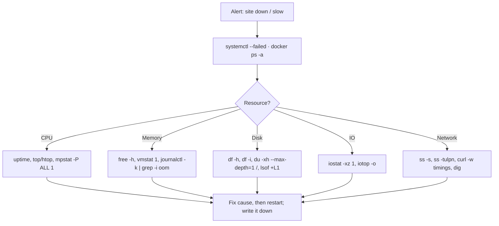

# Linux Essentials - systemd, Logs & Troubleshooting

> [!info] Deep dive of [[Linux Essentials]]

> [!abstract] TL;DR
> - **systemd** supervises everything that isn't in a container: write units with `Restart=on-failure`, resource limits and sandboxing, and use **timers** instead of cron.
> - **journald** is the log index. `journalctl -u <unit> -p warning --since …` answers most "what happened" questions.
> - **Triage** follows the USE method (Utilization, Saturation, Errors) across CPU → memory → disk/inodes → I/O → network, in that order, before restarting anything.
>
> Most VPS outages are disk-full, OOM or a crash-looping service.

## Concept
| Unit type | Purpose | Example |
|---|---|---|
| `.service` | A supervised process | `backup-agent.service`, `cloudflared.service` |
| `.timer` | Schedule that starts a service | `pg-backup.timer` (replaces cron) |
| `.target` | Group / sync point | `multi-user.target`, `network-online.target` |
| `.socket` / `.path` / `.mount` | Socket activation, file-watch triggers, mounts | `docker.socket` |

- **Service types**:
  - `simple`: considered started as soon as forked;
  - `exec`: started after `exec()` succeeds, so you get better errors;
  - `notify`: the process signals readiness with `sd_notify`;
  - `oneshot`: runs to completion, used for jobs.
- **Ordering vs dependency**: `After=` orders only; `Wants=` (soft) and `Requires=` (hard) pull units in. "Start after the network is up" needs `Wants=network-online.target` **and** `After=network-online.target`.
- **Drop-ins**: `systemctl edit <unit>` creates `/etc/systemd/system/<unit>.d/override.conf`. Override vendor units this way instead of editing files under `/lib/systemd/system` (overwritten by upgrades).
- **cgroups**: every unit is a cgroup, so `MemoryMax=`, `CPUQuota=` and `TasksMax=` apply to the whole process tree.

## How It Works


## Practical Usage
**A hardened service unit** (e.g. a Node worker or `cloudflared` outside Docker):
```ini
# /etc/systemd/system/wa-worker.service
[Unit]
Description=WhatsApp outbound worker
Wants=network-online.target
After=network-online.target
StartLimitIntervalSec=300
StartLimitBurst=5
OnFailure=notify-telegram@%n.service

[Service]
Type=exec
User=worker
Group=worker
WorkingDirectory=/opt/wa-worker
EnvironmentFile=/etc/wa-worker/env            # chmod 600, owned by root
ExecStart=/usr/bin/node dist/worker.js
Restart=on-failure
RestartSec=5s
TimeoutStopSec=60s                            # time to drain jobs on SIGTERM
MemoryMax=512M
CPUQuota=150%
NoNewPrivileges=yes
ProtectSystem=strict
ProtectHome=yes
PrivateTmp=yes
ReadWritePaths=/var/lib/wa-worker
CapabilityBoundingSet=
RestrictAddressFamilies=AF_INET AF_INET6 AF_UNIX

[Install]
WantedBy=multi-user.target
```
```bash
systemctl daemon-reload && systemctl enable --now wa-worker
systemd-analyze security wa-worker            # exposure score; aim < 5
systemctl status wa-worker --no-pager -l
```
**Timer instead of cron** (nightly backup at 02:30 MYT):
```ini
# /etc/systemd/system/pg-backup.timer
[Timer]
OnCalendar=*-*-* 02:30:00 Asia/Kuala_Lumpur
RandomizedDelaySec=10m
Persistent=true                               # run at boot if the VPS was off at 02:30
[Install]
WantedBy=timers.target
```
```bash
systemctl list-timers --all                   # next/last run per timer
systemctl start pg-backup.service             # run now, same environment as the timer
```
**Failure notification template** (`notify-telegram@.service`):
```ini
[Service]
Type=oneshot
ExecStart=/usr/local/bin/notify-telegram "%i failed on %H"
```
**journalctl cheat sheet**:
```bash
journalctl -u wa-worker -f                         # follow one unit
journalctl -u wa-worker --since "10 min ago" -p warning
journalctl -b -1 -p err                            # errors from the previous boot (after a crash/reboot)
journalctl -k --since today | grep -iE "oom|killed process|i/o error"
journalctl -u ssh --since "24h ago" -g "Failed password" | wc -l
journalctl -o json-pretty -u wa-worker -n 5        # structured fields (_PID, _SYSTEMD_UNIT, PRIORITY)
journalctl --disk-usage && journalctl --vacuum-time=30d
```
**Disk-full triage** (the #1 VPS incident):
```bash
df -h; df -i                                       # space AND inodes
du -xh --max-depth=1 / 2>/dev/null | sort -h | tail
docker system df                                   # images, build cache, volumes
find /var/lib/docker/containers -name '*-json.log' -size +500M -exec ls -lh {} \;
lsof +L1                                           # deleted files still held open (space not freed until process restarts)
```
**Wrong way**:
```bash
nohup node worker.js &          # ❌ no restart, no logs, dies with the SSH session's cgroup on some setups
crontab -e   # 30 2 * * * …     # ❌ no logging, no missed-run catch-up, no overlap protection, runs in server TZ
kill -9 $(pgrep node)           # ❌ skips graceful shutdown: in-flight jobs lost, locks not released
rm /var/log/big.log             # ❌ space not reclaimed while the writer holds the file; truncate (: > file) instead
```

## Patterns & Anti-patterns
| Pattern | When | Anti-pattern to avoid |
|---|---|---|
| `Restart=on-failure` + `StartLimit*` + `OnFailure=` alert | Every long-running service | `Restart=always` crash-looping silently forever |
| Timers with `Persistent=true` and an explicit TZ | Backups, cleanups, reports | Cron jobs nobody sees fail |
| Drop-in overrides (`systemctl edit`) | Tuning vendor units (docker, ssh) | Editing `/lib/systemd/system/*.service` |
| Sandboxing directives + `systemd-analyze security` | Anything exposed or holding secrets | Services running as root with full FS access |
| `EnvironmentFile=` with 600 perms | Secrets for non-container services | Secrets inline in `ExecStart=` (visible in `ps`) |
| Check before you restart: capture `journalctl`, `ss`, `free` first | Incidents | Rebooting first and losing the evidence |
| Persistent journal with size caps | All servers | Volatile journal: logs vanish on reboot, right when you need them |

## Performance & Trade-offs
- **journald vs files**: journald gives indexed, structured queries but uses more disk per line than plain text. Cap it with `SystemMaxUse=` (see [[Linux Essentials - VPS Hardening Runbook]]). Ship logs off-box (Loki, Better Stack, Axiom) if you need >30 days or cross-server search.
- **Docker logs** default to `json-file` and are **not** in journald. Either set rotation in `daemon.json` or use `"log-driver": "journald"` so `journalctl CONTAINER_NAME=web` works and retention is unified ([[Docker - Compose Patterns for Production]]).
- **`MemoryMax`** triggers a cgroup-local OOM kill of the offending service instead of the global OOM killer choosing Postgres. Use `MemoryHigh=` slightly below it for throttling before the kill.
- **Swap on small VPSs**: 1–2 GB of swap with `vm.swappiness=10` absorbs spikes on a 4–8 GB KVM. Without it, a short spike becomes an OOM kill. With too much, the box thrashes. Watch `si/so` in `vmstat 1`.
- **Load average** counts runnable **and** uninterruptible (I/O-blocked) tasks. A load of 8 on 4 vCPUs with idle CPU means an I/O problem, not CPU.

## Tips & Reminders
> [!tip] In ZP's stack
> - Most workloads run in Docker under [[Coolify]], so systemd mainly manages `docker`, `cloudflared`, `tailscaled`, backup timers and host agents.
> - First incident commands on a Hostinger KVM:
>   - `systemctl --failed; df -h; df -i; free -h; docker ps -a --format '{{.Names}} {{.Status}}' | grep -v Up; journalctl -k --since -1h | grep -i oom`
> - Put that in `/usr/local/bin/triage` and keep it in your runbook.

- Set the server timezone deliberately: keep the host in UTC (`timedatectl set-timezone UTC`), and put explicit time zones in `OnCalendar=` for business-time jobs.
- After package upgrades, `needrestart` lists services still running old libraries. Restart them or the fix isn't live.
- `systemd-analyze blame` / `critical-chain` explain slow boots. `systemd-cgtop` shows live per-unit CPU and memory.
- `systemd-run --scope -p MemoryMax=1G -- pg_restore …` puts limits on one-off heavy commands so they can't take down the box.
- Keep a `/root/INCIDENTS.md` (or the runbook in git) with date, symptom, cause and fix. Patterns repeat.

## Version Notes
| Version | Change relevant here |
|---|---|
| systemd 240–250 | `systemd-analyze security`, `RestrictFileSystems=`, credentials (`LoadCredential=`) for secrets |
| systemd 252 (Debian 12) | Mature `MemoryHigh`/`MemoryMax` behaviour, `ExecSearchPath=` |
| systemd 255 (Ubuntu 24.04) | Improved `systemd-analyze` verbs, soft-reboot. `OnCalendar=` time zones supported since earlier releases |
| systemd 257 (Debian 13) | Continued cgroup v2-only operation (cgroup v1 deprecated) |
| Ubuntu 26.04 LTS | Newer systemd + kernel. Check `systemctl --version` |

> [!warning] Unverified — check before relying on this
> The per-release feature attributions above are approximate. Check `man systemd.exec` / `man systemd.service` on your installed version (`systemctl --version`) before relying on a specific directive.

## Critical Issues & Gotchas
> [!danger] Disk full takes everything down
> When `/` fills up, Postgres can't write WAL, Docker can't create containers, journald stops logging, and SSH logins may fail. Alert at 80% disk **and** inode usage. The usual culprits are unrotated Docker logs, old images or build cache, and local backups that were never pruned.

> [!danger] The OOM killer picks the biggest process
> Without per-service limits, a leaking Node process makes the kernel kill Postgres (largest RSS). Set container and unit memory limits, add modest swap, and check `journalctl -k | grep -i "killed process"` after every unexplained restart.

- **Start-limit lockout**: after `StartLimitBurst` failures within the interval, systemd stops retrying and the unit stays `failed` until `systemctl reset-failed`. That's good, as long as `OnFailure=` alerts you.
- **`Type=simple` lies about readiness**: dependants start before the app is listening. Use `Type=exec` or `notify`, or a health-check `ExecStartPost=`.
- **`EnvironmentFile` syntax** isn't shell: no `export`, quotes are taken literally in some cases, and `$VAR` expansion is limited. Test with `systemctl show <unit> -p Environment`.
- **Volatile journal**: if `/var/log/journal` doesn't exist and `Storage=auto`, logs live in RAM and are lost on reboot. Create the directory or set `Storage=persistent`.
- **Time skew** breaks TLS, JWT validation and TOTP. Ensure `timedatectl` shows `System clock synchronized: yes` (systemd-timesyncd or chrony).

## Related
- [[Linux Essentials]]
- [[Linux Essentials - VPS Hardening Runbook]] — SSH, firewall, updates, journald retention
- [[Docker]] — container logs and restart policies vs systemd
- [[Coolify]] — what runs on the host vs in containers
- [[Node.js - Performance & Diagnostics]] — app-level profiling once the host is ruled out
- [[PostgreSQL]] — the usual OOM and disk-full victim

## References
- https://www.freedesktop.org/software/systemd/man/latest/systemd.service.html
- https://www.freedesktop.org/software/systemd/man/latest/systemd.exec.html
- https://www.freedesktop.org/software/systemd/man/latest/systemd.timer.html
- https://www.brendangregg.com/usemethod.html
- https://www.freedesktop.org/software/systemd/man/latest/journalctl.html
