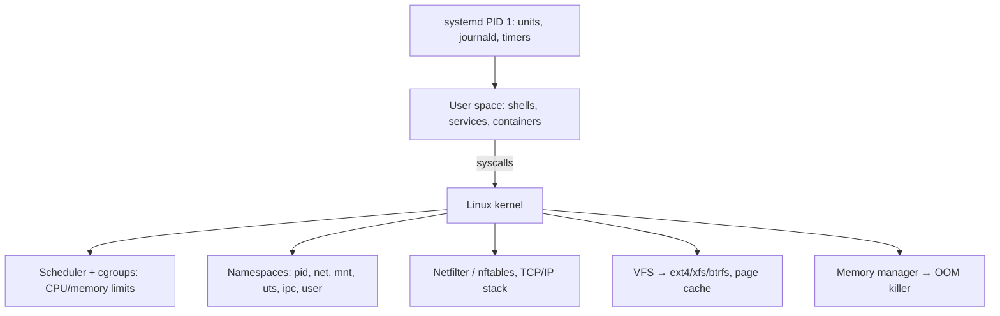

# Linux Essentials

> [!abstract] TL;DR
> Practical Linux for running production VPSs (e.g. Hostinger KVM with [[Coolify]]/[[Docker]]): users and permissions, processes and **systemd**, logs (**journalctl**), networking (`ip`, `ss`, nftables/UFW), storage (disk, inodes, swap), package updates, SSH hardening, and performance triage.
> - **Containers are just Linux**: namespaces and cgroups, so these skills explain most "Docker weirdness".
> - **Baseline**: an LTS distro (Ubuntu 24.04/26.04 or Debian 12/13), unattended security updates, key-only SSH, a firewall, monitoring disk and memory, and **tested backups**.

## Introduction
- **Origin**: Linus Torvalds' kernel (1991) + GNU userland. Distributions bundle the kernel, init system and packages: Debian/Ubuntu (apt), RHEL/Rocky/Alma/Fedora (dnf), Alpine (apk, musl, popular for containers).
- **Problem**: a free, stable, scriptable OS that runs ~all servers, containers, Android and most cloud infrastructure.
- **Where it sits**: under every container, VPS, Kubernetes node and CI runner. A solo founder's on-call skill set is mostly Linux triage: disk full, OOM kills, a stuck service, an expired cert, an open port.

## Core Concepts

### Filesystem layout
| Path | Holds |
|---|---|
| `/etc` | System config (`/etc/ssh/sshd_config`, `/etc/systemd/system/`) |
| `/var` | Variable data: `/var/log`, `/var/lib/docker`, `/var/lib/postgresql` (**fills up first**) |
| `/home`, `/root` | User homes |
| `/opt`, `/srv` | Third-party apps, served data (Coolify uses `/data/coolify`) |
| `/tmp` | Temporary (often tmpfs, cleared on reboot) |
| `/proc`, `/sys` | Kernel interfaces (process info, tunables) |
| `/dev` | Devices (`/dev/sda`, `/dev/null`) |

### Users, permissions, sudo
```bash
adduser deploy && usermod -aG sudo,docker deploy    # docker group = root-equivalent!
chmod 640 app.env && chown deploy:deploy app.env    # rwx for user/group/other: 6=rw, 4=r, 0=none
ls -l                                               # -rw-r----- 1 deploy deploy ...
sudo -l                                             # what can I run?
getfacl / setfacl                                   # fine-grained ACLs
```
- Least privilege: services run as dedicated users (`systemd` `User=`, containers `USER node`).
- Special bits: setuid/setgid (`chmod u+s`), sticky bit on `/tmp`.

### Processes, signals, systemd
```bash
ps aux --sort=-%mem | head          # top memory consumers
kill -TERM <pid>; kill -KILL <pid>  # SIGTERM (graceful) before SIGKILL
systemctl status|start|restart|enable nginx
systemctl list-units --failed
journalctl -u docker --since "1 hour ago" -f
journalctl -p err -b                # errors since boot
journalctl --vacuum-size=500M       # cap journal disk usage
```
```ini
# /etc/systemd/system/backup.service + backup.timer (preferred over cron)
[Unit]
Description=Nightly Postgres backup to R2
[Service]
Type=oneshot
User=deploy
ExecStart=/opt/scripts/backup.sh
# backup.timer: [Timer] OnCalendar=*-*-* 03:00:00 Asia/Kuala_Lumpur  Persistent=true  [Install] WantedBy=timers.target
```

### Networking
```bash
ip -br a; ip r                       # addresses, routes
ss -tulpn                            # listening sockets + owning process (who opened port 5432?)
curl -sv https://api.example.my      # TLS + HTTP debugging
dig +short example.my A; dig @1.1.1.1 example.my
nft list ruleset | less              # actual firewall (UFW and Docker both write here/iptables)
mtr api.example.my                   # path + packet loss
```

### Storage
```bash
df -h; df -i                         # space AND inodes (millions of small files exhaust inodes)
du -xh --max-depth=1 /var | sort -h  # find the culprit
docker system df; docker system prune -af --volumes   # careful: removes unused volumes
lsblk; findmnt                       # disks and mounts
fallocate -l 2G /swapfile && chmod 600 /swapfile && mkswap /swapfile && swapon /swapfile   # small-VPS safety net
```

## Architecture / How It Works

- **Containers = namespaces (isolation) + cgroups (limits) + an image filesystem (overlayfs)**. A container's "memory limit" is a cgroup limit, and exceeding it triggers the kernel OOM killer inside that cgroup.
- **Page cache**: "used" memory includes cache, which the kernel reclaims. Watch `available` in `free -h`, not `free`.
- **OOM killer**: when memory runs out, the kernel kills the process with the highest `oom_score`, often your database. Check `journalctl -k | grep -i oom` / `dmesg -T`.
- **Load average** counts runnable + uninterruptible (I/O-waiting) tasks. High load with low CPU usually means disk I/O wait.

## Project Structure
N/A — an OS skill set, not a codebase. A recommended VPS baseline layout:
```text
/opt/scripts/          # backup.sh, healthcheck.sh (in Git, deployed via CI/rsync)
/etc/systemd/system/   # custom units + timers
/data/coolify/         # Coolify state (back up!)
/var/lib/docker/       # images, volumes (monitor size)
/etc/ssh/sshd_config.d/10-hardening.conf
/etc/apt/apt.conf.d/50unattended-upgrades
```

## Use Cases
| Use case | Why it fits |
|---|---|
| Hosting containers/apps on a VPS | Docker/Coolify run on Linux |
| Debugging production incidents | journald, `ss`, `df`, `top` answer most questions |
| Automation scripts and cron jobs | bash + systemd timers |
| CI runners and build agents | Ephemeral Linux containers/VMs |
| Security hardening | Users, SSH, firewall, updates (see [[Network Security]]) |
| Desktop design/creative work for clients | Not the focus here. macOS/Windows dominate |

## Pros & Cons
| Pros | Cons |
|---|---|
| Free, stable, ubiquitous on servers | Distro differences (apt vs dnf, paths, defaults) |
| Fully scriptable, transparent (logs, /proc) | Footguns: `rm -rf`, permissions, firewall lockout |
| Huge community knowledge | Security is your job on self-managed VPSs |
| Lightweight. Runs on small VPSs | Kernel/OS upgrades need maintenance windows |
| Container-native | Troubleshooting spans many layers (kernel, systemd, Docker, network) |

## Alternatives & Peers
| Alternative | Strength vs self-managed Linux | Weakness | Pick it when… |
|---|---|---|---|
| Managed PaaS (Render, Fly, Railway, Cloud Run) | No OS maintenance | Cost at scale, lock-in | No time for ops |
| Managed Kubernetes | Node OS managed by provider | Complexity | Many services, team |
| Immutable/minimal OS (Talos, Flatcar, Bottlerocket) | Read-only, auto-updated, minimal attack surface | Less flexible, learning curve | Kubernetes nodes |
| Windows Server | AD/.NET integration | Licensing, heavier | Microsoft-centric clients |

## Tips & Reminders
> [!tip]
> - First 10 minutes on a new VPS: create a sudo user, SSH keys, disable root and password login, UFW default-deny + 22 from VPN/Tailscale, unattended-upgrades, timezone/NTP (`timedatectl set-timezone Asia/Kuala_Lumpur`), swap on ≤ 4 GB RAM hosts.
> - Monitor three things before anything fancy: disk (`/var`), memory/OOM, and certificate expiry. Uptime Kuma or Netdata on a second box. Alert via [[n8n]]/Telegram.
> - Cap logs: journald `SystemMaxUse=`, Docker `log-opts max-size=10m max-file=3`. Full disks from logs are the #1 small-VPS outage.
> - Reboot after kernel updates (check `/var/run/reboot-required`). Schedule it, don't avoid it.
> - Use `tmux` for long operations over SSH, and `rsync -avz --dry-run` before real syncs.
> - **In ZP's stack**: Hostinger KVM running Ubuntu LTS + [[Coolify]]. Take provider snapshots before upgrades, run nightly DB dumps to R2 via systemd timers, and keep the Coolify/Docker data paths in backups. Plan the 24.04 → 26.04 LTS upgrade on a clone first.

## Versions & Breaking Changes
| Release | Released | Key changes | Breaking / migration notes |
|---|---|---|---|
| CentOS 7 / CentOS Linux 8 | — | EOL 2024-06 / 2021-12 | Migrate to Rocky/Alma/RHEL |
| Ubuntu 20.04 LTS | 2020-04 | — | Standard support ended 2025-05 (ESM only) |
| Debian 12 "bookworm" | 2023-06 | — | Still supported (LTS phase later) |
| **Ubuntu 24.04 LTS** | 2024-04 | Kernel 6.8, Netplan, `deb822` sources format | Standard support to 2029 |
| Linux 6.12 LTS | 2024-11 | PREEMPT_RT merged, sched_ext | LTS kernel |
| Debian 13 "trixie" | 2025-08 | Kernel 6.12, `tmpfs` /tmp | — |
| Linux 6.18 LTS | 2025-12 | Latest LTS kernel line | — |
| **Ubuntu 26.04 LTS** | 2026-04 | New LTS | Upgrade from 24.04 after .1 point release |

> [!warning] Unverified — check before relying on this
> Ubuntu 26.04 LTS details and kernel LTS designations weren't re-checked this run. Check https://ubuntu.com/about/release-cycle and https://www.kernel.org/category/releases.html.

## Critical Issues & Gotchas
> [!danger] Kernel privilege escalation: CVE-2024-1086 (nf_tables)
> A use-after-free in netfilter's nf_tables let local users become root on kernels ~5.14–6.6. A public exploit existed, it was used by ransomware (CISA KEV), and it matters because any compromised container/app user becomes host root. Patch kernels and reboot, and restrict unprivileged user namespaces where possible.

> [!danger] Supply chain in the base OS (xz-utils, CVE-2024-3094)
> A backdoor in xz/liblzma 5.6.0–5.6.1 targeted sshd via systemd on rolling/beta distros. LTS releases were spared because they lag. Stick to stable/LTS repos on servers, avoid random PPAs/curl-pipe-bash installers, and keep SSH off the public internet ([[Network Security]]).

> [!warning] Gotchas
> - `docker` group membership = passwordless root. Treat it like sudo.
> - Disk full → databases crash or corrupt WAL, and Docker fails to start containers. Alert at 80%.
> - Deleted-but-open files keep using space (`lsof +L1`). Restart the holding process.
> - Editing firewall rules over SSH can lock you out. Keep a provider console session or a scheduled rollback (`at now + 5 min`).
> - Timezone mismatch between host, containers and DB causes cron/backup jobs at the wrong hour. Use UTC in systems, and display in `Asia/Kuala_Lumpur` in apps.
> - `rm -rf $DIR/` with an empty variable becomes `rm -rf /`. Use `set -euo pipefail` and `${DIR:?}` in scripts.

## Deep Dives
N/A — no deep dives planned yet. Candidates: VPS hardening runbook, performance triage (CPU/memory/disk/network).

## Related
- [[Docker]] — namespaces, cgroups, overlayfs in practice
- [[Network Security]] — SSH, firewall, patching baseline
- [[Coolify]] — the platform running on these servers
- [[Git]] — scripts and config under version control
- [[Nginx]] — classic Linux web server
- [[Kubernetes]] — Linux nodes at scale

## References
- Ubuntu release cycle: https://ubuntu.com/about/release-cycle
- Kernel releases: https://www.kernel.org/category/releases.html
- systemd docs: https://systemd.io/
- Brendan Gregg, Linux performance: https://www.brendangregg.com/linuxperf.html
- CIS Ubuntu benchmark: https://www.cisecurity.org/benchmark/ubuntu_linux
- CVE-2024-1086 (NVD): https://nvd.nist.gov/vuln/detail/CVE-2024-1086
