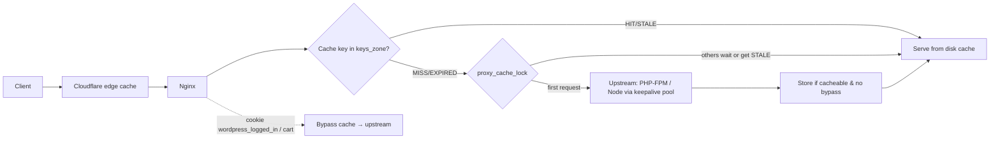

# Nginx - Caching & Performance Tuning

> [!info] Deep dive of [[Nginx]]

> [!abstract] TL;DR
> The biggest Nginx performance wins are rarely kernel sysctls. They are:
> 1. **caching** dynamic responses (`proxy_cache` / `fastcgi_cache`, even 1–5 s microcaching)
> 2. **upstream keepalive**
> 3. correct **buffering** (on for normal responses, off for streaming/SSE)
> 4. **compression + long-lived immutable static assets**
> 5. HTTP/2 + HTTP/3 at the edge
>
> **Bypass the cache** for logged-in users, carts and anything with `Set-Cookie`. Expose `X-Cache-Status` so you can see hit rates.

## Concept

### Where time goes in a proxied request
| Stage | Typical cost | Lever |
|---|---|---|
| TLS handshake | 1–2 RTT | HTTP/2+3, TLS 1.3, session resumption, Cloudflare in front |
| Connection to upstream | 1 RTT + TCP/TLS setup per request without keepalive | `upstream { keepalive N; }` |
| Upstream generation (PHP/Node) | 50 ms–2 s | **Cache** (`proxy_cache`, `fastcgi_cache`), microcaching |
| Response transfer | Size / bandwidth | gzip/brotli, `sendfile`, buffers |
| Static files | Disk/OS cache | `sendfile`, `open_file_cache`, `immutable` headers, CDN |

### Cache building blocks
| Directive | Purpose |
|---|---|
| `proxy_cache_path` / `fastcgi_cache_path` | Disk location, `keys_zone` (shared memory for keys), `max_size`, `inactive` |
| `proxy_cache_key` | What makes responses distinct (scheme, host, URI, selected cookies/headers) |
| `proxy_cache_valid` | TTL per status code when upstream doesn't set caching headers |
| `proxy_cache_bypass` / `proxy_no_cache` | Skip reading / skip storing (logged-in users, POST, cart) |
| `proxy_cache_use_stale` | Serve stale on `error timeout updating http_500 …` |
| `proxy_cache_background_update` + `proxy_cache_lock` | Stale-while-revalidate, with only one request hitting upstream per key |
| `$upstream_cache_status` | `HIT`, `MISS`, `BYPASS`, `EXPIRED`, `STALE`, `UPDATING`, `REVALIDATED` |

## How It Works

- **Event loop per worker**: one worker per CPU (`worker_processes auto`) handles thousands of connections non-blockingly. Blocking comes from disk I/O on cold caches, or from huge regex maps.
- **Keys live in shared memory, bodies on disk**: 1 MB of `keys_zone` holds ~8,000 keys. The OS page cache makes hot cache files effectively in-memory.

## Practical Usage

### Global baseline (`nginx.conf`)
```nginx
worker_processes auto;
worker_rlimit_nofile 65535;
events { worker_connections 8192; }

http {
    sendfile on; tcp_nopush on; tcp_nodelay on;
    keepalive_timeout 30s; keepalive_requests 1000;
    server_tokens off;
    client_max_body_size 32m;

    gzip on; gzip_comp_level 5; gzip_min_length 1024; gzip_vary on;
    gzip_types text/css application/javascript application/json image/svg+xml text/xml application/xml;
    # brotli via ngx_brotli module if built in; or let Cloudflare compress at the edge

    open_file_cache max=10000 inactive=60s; open_file_cache_valid 120s; open_file_cache_errors on;

    log_format perf '$remote_addr "$request" $status $body_bytes_sent rt=$request_time '
                    'urt=$upstream_response_time cache=$upstream_cache_status';
    access_log /var/log/nginx/access.log perf buffer=64k flush=5s;

    # Behind Cloudflare: real client IP (keep the list updated from cloudflare.com/ips)
    set_real_ip_from 173.245.48.0/20;  # … add all CF ranges
    real_ip_header CF-Connecting-IP;
}
```

### Reverse proxy to Node/Next.js with keepalive + microcaching
```nginx
upstream app {
    server 127.0.0.1:3000;
    keepalive 64;                                  # idle connections kept per worker
}
proxy_cache_path /var/cache/nginx/app levels=1:2 keys_zone=app:50m max_size=2g inactive=30m use_temp_path=off;

server {
    listen 443 ssl; listen 443 quic reuseport; http2 on;
    add_header Alt-Svc 'h3=":443"; ma=86400' always;
    server_name shop.example.my;

    location /_next/static/ { proxy_pass http://app; expires 1y; add_header Cache-Control "public, immutable"; }

    location / {
        proxy_pass http://app;
        proxy_http_version 1.1;                    # default since 1.30, explicit for older builds
        proxy_set_header Connection "";            # required for upstream keepalive
        proxy_set_header Host $host;
        proxy_set_header X-Forwarded-Proto $scheme;

        proxy_cache app;
        proxy_cache_key "$scheme$host$request_uri";
        proxy_cache_valid 200 301 5s;              # microcache: 5 s absorbs traffic spikes
        proxy_cache_use_stale error timeout updating http_500 http_502 http_503 http_504;
        proxy_cache_background_update on;
        proxy_cache_lock on;
        proxy_cache_bypass $cookie_session $http_authorization;
        proxy_no_cache     $cookie_session $http_authorization;
        add_header X-Cache-Status $upstream_cache_status always;
    }

    location /api/stream/ {                        # SSE / LLM token streaming
        proxy_pass http://app;
        proxy_buffering off; proxy_cache off;
        proxy_read_timeout 300s;
    }
}
```

### WordPress / WooCommerce FastCGI cache
```nginx
fastcgi_cache_path /var/cache/nginx/wp levels=1:2 keys_zone=wp:100m max_size=4g inactive=60m use_temp_path=off;
map $http_cookie $wp_skip {
    default 0;
    ~*wordpress_logged_in|wp-postpass|woocommerce_items_in_cart|woocommerce_cart_hash|comment_author 1;
}
map $request_uri $wp_skip_uri { default 0; ~*/(cart|checkout|my-account|wp-admin|wp-login\.php|wp-json)/? 1; }

server {
    # ...
    set $skip $wp_skip;
    if ($wp_skip_uri) { set $skip 1; }
    if ($request_method = POST) { set $skip 1; }

    location ~ \.php$ {
        include fastcgi_params;
        fastcgi_param SCRIPT_FILENAME $document_root$fastcgi_script_name;
        fastcgi_pass unix:/run/php/php8.3-fpm.sock;
        fastcgi_cache wp;
        fastcgi_cache_key "$scheme$request_method$host$request_uri";
        fastcgi_cache_valid 200 301 10m;
        fastcgi_cache_use_stale error timeout updating http_500;
        fastcgi_cache_background_update on;
        fastcgi_cache_lock on;
        fastcgi_cache_bypass $skip; fastcgi_no_cache $skip;
        add_header X-Cache-Status $upstream_cache_status always;
    }
}
```
- Purge on content updates with a purge plugin plus the `ngx_cache_purge` module, or simply keep TTLs short (5–10 min), letting Cloudflare cache HTML at the edge for anonymous users ([[PHP - WordPress Hardening & Maintenance SOP]]).

### Benchmark before and after
```bash
h2load -n 20000 -c 100 -m 10 https://shop.example.my/          # HTTP/2 load
wrk -t4 -c200 -d30s --latency https://shop.example.my/product/x
awk '{print $NF}' /var/log/nginx/access.log | sort | uniq -c     # cache=HIT/MISS distribution
```

## Patterns & Anti-patterns
| Pattern | When | Anti-pattern to avoid |
|---|---|---|
| Microcache (1–10 s) anonymous HTML | Traffic spikes, WhatsApp blast campaigns | No cache: every visitor hits PHP |
| Bypass on auth cookies + `Set-Cookie` aware | Logged-in/cart flows | Caching personalised pages (user A sees user B's cart) |
| `use_stale` + background update + lock | Flaky or slow upstreams | Cache stampede: 500 requests regenerate the same page |
| Upstream keepalive with `Connection ""` | Any proxy | New TCP/TLS connection to upstream per request |
| `proxy_buffering off` only for streams | SSE, LLM streaming, WebSockets | Buffering off globally (slow clients hold upstream workers) |
| `immutable` fingerprinted assets | JS/CSS/fonts with hashes | `Cache-Control: no-cache` on hashed assets |

## Performance & Trade-offs
- **Nginx cache vs Cloudflare cache**:
  - **Cloudflare** caches at the edge near users (best TTFB), but needs cache rules and costs nothing extra on most plans.
  - **Nginx cache** protects the origin from Cloudflare misses and bypassed traffic.
  - **Use both** for WordPress ([[Cloudflare]]).
- **TTL vs freshness**: microcaching hides most of the staleness problem (≤ 5 s). Longer TTLs need purge on publish.
- **Disk cache on small VPSs**: use `max_size` to bound disk, and `use_temp_path=off` to avoid cross-filesystem copies. Put the cache on fast local SSD.
- **Nginx vs Traefik**: in ZP's stack, [[Traefik]] is the router/TLS terminator, and Nginx inside a container adds caching or PHP-FPM serving. Don't stack two TLS terminators unnecessarily.

## Tips & Reminders
> [!tip]
> - **Always ship `X-Cache-Status`** and log `$upstream_cache_status` plus `$upstream_response_time`. Without them, cache tuning is guesswork.
> - **Test bypass rules** logged-in vs anonymous, with curl: `curl -sI -H "Cookie: wordpress_logged_in_x=1" https://…` must show `BYPASS`.
> - **Run `nginx -t && nginx -s reload`** for zero-downtime config changes. Pin images (`nginx:1.30-alpine`) and rebuild on security patches.
> - **Error budget**: `proxy_cache_use_stale` keeps sites up during PHP/DB outages. Mention it in client SLAs as resilience you provide.
> - **In ZP's stack**:
>   - **Client WordPress sites**: Nginx + PHP-FPM container with FastCGI cache behind Traefik and Cloudflare APO.
>   - **Next.js**: usually no Nginx (Traefik → Node), unless microcaching or static offload is needed.

## Version Notes
| Version | Performance/caching-relevant changes |
|---|---|
| 1.25.x (2023) | HTTP/3/QUIC (experimental → stable in 1.26), `http2 on;` directive |
| 1.29.x mainline (2025–26) | Early Hints (103), HTTP/2 to backends, upstream sticky sessions, Multipath TCP, `max_headers`, OpenSSL 4.0 compatibility |
| **1.30 stable** (2026-04-14) | Brings 1.29 features to stable. **HTTP/1.1 with keep-alive is the default proxy protocol** |
| 1.30.1–1.30.4 (2026) | Security fixes (HTTP/2 proxy request injection, `map` regex overflow, slice disclosure, SSI UAF). **Run ≥ 1.30.4** |
| 1.31.x mainline (2026) | HTTP forward-proxy support (1.31.0). 1.31.4 (2026-08-19) latest seen |

## Critical Issues & Gotchas
> [!danger] Caching personalised or private responses
> - **The leak**: a missing bypass for a session cookie, or caching responses that carry `Set-Cookie`, serves one user's dashboard, cart or CSRF token to others. This is a real cause of data leaks and "random logout" bugs.
> - **Fix**: bypass on every auth/session cookie and on `Authorization`, don't cache `Set-Cookie` responses (Nginx skips them by default unless `proxy_ignore_headers Set-Cookie` is set; **don't set it**), and test with two browsers.

> [!danger] Unpatched Nginx in containers
> The 2026 fixes (HTTP/2 proxy injection, memory-safety bugs in `map`/slice/SSI) only help if images are rebuilt. `nginx:latest` pulled once in 2025 and never updated is vulnerable. Pin a minor tag, rebuild on releases, and use a scanner (Trivy) in CI ([[CI-CD]]).

> [!warning] Gotchas
> - `if` inside `location` is limited and surprising ("if is evil"). Use `map` for conditions, as above.
> - `add_header` in a nested block **replaces** inherited `add_header`s, so security headers disappear. Repeat them, or use `always` consistently in one place.
> - Without `real_ip` config behind Cloudflare, rate limits and logs see Cloudflare IPs. You'd end up rate-limiting Cloudflare itself.
> - `proxy_read_timeout` defaults to 60 s, which cuts off long LLM/SSE streams. Raise it per streaming location.
> - Gzip on already-compressed types (images, video) wastes CPU. Keep `gzip_types` to text formats.

## Related
- [[Nginx]]
- [[Traefik]] — the router/TLS layer in front
- [[Cloudflare]] — edge cache and APO
- [[PHP - WordPress Hardening & Maintenance SOP]] — WordPress hosting context
- [[HTTP & HTTPS]] — caching headers, HTTP/2/3
- [[Browser & Web Fundamentals - Core Web Vitals Optimization]] — TTFB and asset caching impact

## References
- Nginx proxy module (cache directives): https://nginx.org/en/docs/http/ngx_http_proxy_module.html
- Nginx FastCGI module: https://nginx.org/en/docs/http/ngx_http_fastcgi_module.html
- Nginx caching guide: https://blog.nginx.org/blog/nginx-caching-guide
- Nginx news (releases & security): https://nginx.org/2026.html
- Cloudflare IP ranges: https://www.cloudflare.com/ips/
