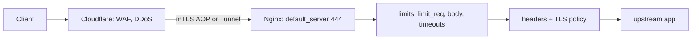

# Nginx - Security Hardening

> [!info] Deep dive of [[Nginx]]

> [!abstract] TL;DR
> Hardening comes in layers:
> - patched binary;
> - catch-all `default_server` that rejects unknown hosts;
> - modern TLS;
> - security headers set with `always` and re-declared wherever `add_header` is used;
> - timeouts, size limits and `limit_req` against abuse;
> - origin locked to [[Cloudflare]], or not exposed at all;
> - unprivileged, read-only container.
>
> Most real Nginx breaches are **config bugs** (alias traversal, `$uri` CRLF injection, missing headers), not 0-days.

## Concept
- Nginx's attack surface comes in four parts:
  - **parser/protocol bugs**: C memory-safety CVEs in HTTP/2, `map`, SSI and slice. Patch for these.
  - **misconfiguration**: path traversal, header injection, open proxy, leaked dotfiles. Lint and test for these.
  - **resource abuse**: slowloris, floods, giant bodies. Use limits.
  - **exposure**: an origin reachable directly, bypassing the CDN or WAF. Fix this with network policy.
- Hardening is mostly **subtractive**: disable what you don't need, reject what you don't recognise, and cap what you accept.

## How It Works

Request-time order inside Nginx matters. `server` selection happens by SNI/Host first, so an unknown host hits `default_server`. Then come the `limit_req`/`limit_conn` checks (preaccess phase), then `allow/deny` and `auth_request` (access phase), then content or `proxy_pass`.

## Practical Usage
**1. Catch-all server**: reject scanners hitting the IP or unknown Host headers.
```nginx
server {
    listen 80 default_server;
    listen 443 ssl default_server;
    http2 on;
    ssl_reject_handshake on;      # 1.19.4+: no cert needed, refuses unknown SNI
    server_name _;
    return 444;                   # close connection, no response
}
```

**2. TLS**: Mozilla "intermediate" profile.
```nginx
ssl_protocols TLSv1.2 TLSv1.3;
ssl_ciphers ECDHE-ECDSA-AES128-GCM-SHA256:ECDHE-RSA-AES128-GCM-SHA256:ECDHE-ECDSA-AES256-GCM-SHA384:ECDHE-RSA-AES256-GCM-SHA384:ECDHE-ECDSA-CHACHA20-POLY1305:ECDHE-RSA-CHACHA20-POLY1305;
ssl_prefer_server_ciphers off;
ssl_session_cache shared:TLS:10m;
ssl_session_timeout 1d;
ssl_session_tickets off;          # tickets without key rotation break forward secrecy
```

**3. Security headers** (`snippets/security-headers.conf`):
```nginx
server_tokens off;
add_header Strict-Transport-Security "max-age=63072000; includeSubDomains" always;
add_header X-Content-Type-Options "nosniff" always;
add_header Referrer-Policy "strict-origin-when-cross-origin" always;
add_header Permissions-Policy "camera=(), microphone=(), geolocation=()" always;
add_header Content-Security-Policy "default-src 'self'; frame-ancestors 'none'; object-src 'none'" always;
proxy_hide_header X-Powered-By;
```
```nginx
location /assets/ {
    include snippets/security-headers.conf;     # ❗ re-include: any add_header here drops inherited ones
    add_header Cache-Control "public, max-age=31536000, immutable" always;
}
```

**4. Abuse limits**:
```nginx
http {
    client_max_body_size 10m;           # default 1m; raise per location for uploads only
    client_header_timeout 10s;
    client_body_timeout 10s;            # slowloris defence
    send_timeout 10s;
    keepalive_timeout 15s;
    large_client_header_buffers 4 8k;

    limit_req_zone  $binary_remote_addr zone=perip:10m rate=10r/s;
    limit_req_zone  $binary_remote_addr zone=login:10m rate=5r/m;
    limit_conn_zone $binary_remote_addr zone=conn:10m;
    limit_req_status 429;
    limit_conn_status 429;
}
server {
    limit_conn conn 20;
    location /           { limit_req zone=perip burst=40 nodelay; proxy_pass http://app; }
    location = /api/login { limit_req zone=login burst=5; proxy_pass http://app; }
}
```

**5. Real IP and origin lock behind Cloudflare**:
```nginx
# generated from https://www.cloudflare.com/ips-v4 and ips-v6 (refresh via cron)
set_real_ip_from 173.245.48.0/20;
# …
real_ip_header CF-Connecting-IP;

# Authenticated Origin Pulls: only Cloudflare can complete the TLS handshake
ssl_client_certificate /etc/nginx/certs/cloudflare-origin-pull-ca.pem;
ssl_verify_client on;
```

**6. Deny dotfiles and protect admin paths**:
```nginx
location ~ /\.(?!well-known/) { deny all; return 404; }
location /admin/ {
    allow 10.0.0.0/8; deny all;          # or auth_request to oauth2-proxy
    proxy_pass http://app;
}
```

**Wrong way**: three classic config bugs.
```nginx
location /static { alias /srv/static/; }          # ❌ /static../etc/passwd: missing trailing slash on location
return 302 https://$host$uri;                     # ❌ $uri is decoded: %0d%0a gives CRLF header injection
proxy_set_header Host $http_host;                 # ❌ attacker-controlled; prefer $host (validated by server_name)
```
Fixes: `location /static/ { alias /srv/static/; }`, `return 301 https://$host$request_uri;`, `proxy_set_header Host $host;`.

## Patterns & Anti-patterns
| Pattern | When | Anti-pattern to avoid |
|---|---|---|
| `default_server` + `return 444` + `ssl_reject_handshake` | Every public instance | First vhost silently serving any Host (host-header attacks, cert leaks) |
| Header snippet included per block | Any `location` with its own `add_header` | Headers set only in `http {}` and lost in nested blocks |
| Strict `limit_req` on auth endpoints | Login, OTP, password reset | One global rate for everything, so either useless or breaking assets |
| Origin reachable only via Cloudflare (AOP, IP allowlist, or Tunnel) | Behind a CDN/WAF | Public origin IP found via DNS history or `crt.sh`, bypassing WAF |
| `nginx-unprivileged` image, `read_only: true`, tmpfs for cache | Containers | Root container with writable `/etc/nginx` |
| `proxy_pass` to a fixed upstream | Reverse proxy | `proxy_pass http://$arg_target` (open proxy / SSRF) |
| Config linted in CI (`nginx -t`, gixy fork) | Every change | Hand-edited prod config, tested by reloading |

## Performance & Trade-offs
- `limit_req` zones cost about 64 bytes per state on 64-bit. 10 MB holds ~160k IPs. When a zone fills, Nginx evicts old entries and then returns errors. Size zones for peak unique IPs.
- `burst` + `nodelay` serves bursts immediately and rejects beyond them, which is good for APIs. Without `nodelay`, excess requests are queued and latency rises.
- Behind NAT or carrier-grade NAT (common on Malaysian mobile networks), many users share one IP. Per-IP limits that are too strict block real users. Key on `$http_authorization` or an API-key `map` for authenticated routes.
- TLS 1.3-only cuts handshake RTT and cipher complexity, but drops very old Android (≤ 4.4) and Java 7 clients. Intermediate is the safe default.
- CSP with nonces requires app cooperation. Nginx can't generate per-request nonces without njs or the app. Static `'self'` policies work for SPA builds.
- ModSecurity + OWASP CRS adds ~1–5 ms and many false positives. Prefer a Cloudflare WAF at the edge, or Coraza (Go, CRS-compatible) if self-hosting.

## Tips & Reminders
> [!tip] In ZP's stack
> On Coolify, [[Traefik]] terminates TLS. Inner `nginx:alpine` containers then need only the headers, dotfile denial, limits and an unprivileged user. Skip TLS config there. On standalone client VPSs, use a Cloudflare Tunnel (`cloudflared`) and bind Nginx to `127.0.0.1`. No inbound 80/443 means no origin exposure at all (see [[Network Security]]).

> [!tip] Verify, don't assume
> - `nginx -T` dumps the effective merged config. Grep it for `add_header`.
> - `testssl.sh https://host` checks TLS; Mozilla Observatory or `curl -I` checks headers.
> - `curl -H 'Host: evil.test' https://<ip> -k` must fail or get 444.

- Use the nginx.org package repo or official images; distro packages lag CVE fixes by weeks to months. Rebuild images on every 1.30.x patch.
- Keep `/nginx_status` (`stub_status`) on `127.0.0.1` or behind `allow`. It leaks connection counts useful for timing attacks and capacity probing.
- `autoindex off` (the default). Never enable it on upload directories.
- Use `client_max_body_size 0` (unlimited) only on a dedicated upload location with auth in front.
- Log `$http_cf_ray` and `$request_id`, and pass `X-Request-ID` upstream for incident correlation.

## Version Notes
| Version | Change relevant here |
|---|---|
| 1.19.4 | `ssl_reject_handshake` for cert-less default TLS servers |
| 1.25.1 | `http2 on;` directive replaces `listen … http2` (deprecated) |
| 1.27–1.29 | ACME module (separate `nginx-acme`), 103 Early Hints |
| 1.30.x stable (2026) | Several memory-safety fixes. 1.30.1 fixed a batch incl. CVE-2026-42945 (rewrite module); 1.30.4 fixed `map` regex, slice and SSI CVEs (see [[Nginx]]) |
| Let's Encrypt 2025 | OCSP ended. `ssl_stapling` with LE certs is a no-op and logs warnings, so remove it |

> [!warning] Unverified — check before relying on this
> The 1.30.1 CVE list comes from a third-party vendor advisory, not nginx.org. Check https://nginx.org/en/security_advisories.html.

## Critical Issues & Gotchas
> [!danger] Alias off-by-slash path traversal
> `location /files { alias /data/files/; }` lets `/files../secrets.env` resolve to `/data/secrets.env`. This is one of the most common Nginx findings in pentests. Keep `location` and `alias` trailing slashes consistent, or use `root`.

> [!danger] `add_header` inheritance silently drops security headers
> Any `add_header` in a `location` discards **all** headers inherited from `server`/`http`. A single `Cache-Control` line can remove HSTS and CSP from that path. Use includes, or the `headers-more` module's `more_set_headers`, which always merges.

> [!danger] Origin IP bypasses the WAF
> Attackers find origins via historical DNS, `crt.sh` certificate logs or email headers. If the origin accepts traffic from anywhere, Cloudflare WAF and rate limits are optional for them. Lock the origin with AOP mTLS, a firewall allowlist of Cloudflare ranges, or Tunnel only.

- **ModSecurity status**: Trustwave handed ModSecurity to OWASP in 2024, and F5's commercial NGINX ModSecurity WAF reached end of life in 2024. Treat existing setups as legacy and plan for Coraza or an edge WAF.
- **ingress-nginx retired (March 2026)**: the community Kubernetes controller gets no more fixes after IngressNightmare (CVE-2025-1974). This is a different project from F5's NGINX Ingress Controller.
- `merge_slashes off` or a misplaced regex location can create routing ambiguity between Nginx and the app (path confusion, cache deception). Keep defaults unless the app requires otherwise.
- `proxy_pass` with a variable disables upstream resolution at startup and needs a `resolver`. Without `valid=` and `ipv6=off` tuning, a stale DNS answer can send traffic to a recycled IP.

## Related
- [[Nginx]]
- [[Nginx - Caching & Performance Tuning]] — cache deception and key design overlap with hardening
- [[Network Security]] — firewalling, zero-trust, origin exposure
- [[Cloudflare]] — WAF, AOP, Tunnels, real-IP ranges
- [[Traefik]] — edge TLS and middlewares in Coolify
- [[HTTP & HTTPS]] — TLS versions, HSTS, header semantics
- [[OWASP Top 10]] — A05 Security Misconfiguration

## References
- https://nginx.org/en/security_advisories.html
- https://ssl-config.mozilla.org/
- https://nginx.org/en/docs/http/ngx_http_limit_req_module.html
- https://developers.cloudflare.com/ssl/origin-configuration/authenticated-origin-pull/
- https://www.asustor.com/en/security/security_advisory_detail?id=59
