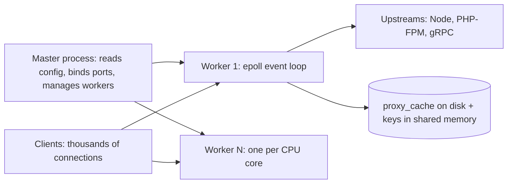

# Nginx

> [!abstract] TL;DR
> Nginx is an event-driven, high-performance **web server, reverse proxy, load balancer and cache**. It serves a large share of the busiest websites, and it's the classic front for [[PHP]]-FPM, Node/Next.js, static sites and APIs.
> - **Model**: static configuration (reloaded gracefully), with powerful `location` matching, caching and buffering.
> - **Versions**: run **stable 1.30.x** (or mainline 1.31.x) and patch it. 2026 brought several memory-safety CVEs (HTTP/2, `map` regex, slice, SSI modules).
> - **In ZP's stack**: [[Traefik]] handles dynamic container routing via [[Coolify]], so Nginx shows up inside containers (static/SPA serving, PHP-FPM front) and on legacy client servers.

## Introduction
- **Origin**: Igor Sysoev (2004) built it to solve the C10K problem (10k concurrent connections) that Apache's process-per-connection model struggled with. Nginx Inc. was acquired by **F5** (2019). The open-source nginx is BSD-2-licensed. **NGINX Plus** adds commercial features (active health checks, API, JWT auth, dynamic upstreams).
- **Forks**: **freenginx** (2024, by core developer Maxim Dounin after a dispute over F5's security policy), **OpenResty** (Nginx + LuaJIT), Angie (Russian fork).
- **Where it sits**: edge reverse proxy on VMs, a static file server inside [[Docker]] images (`nginx:alpine` serving SPA builds), a PHP-FPM front, a cache in front of slow backends, and (historically) Kubernetes ingress via the now-retired community ingress-nginx ([[Kubernetes]]).

## Core Concepts

### Configuration model
| Context | Purpose |
|---|---|
| `main` | Worker processes, user, error log |
| `events` | `worker_connections`, event method (epoll) |
| `http` | Global HTTP settings, `upstream`, `map`, caches, log formats |
| `server` | Virtual host (`listen`, `server_name`, TLS) |
| `location` | URI matching: `=` exact > `^~` prefix stop > `~`/`~*` regex (first match in order) > longest prefix |
| `upstream` | Backend pools: round robin, `least_conn`, `ip_hash`, `hash`, keepalive |

### Typical reverse proxy server block
```nginx
upstream api_backend {
    server 127.0.0.1:3000 max_fails=3 fail_timeout=10s;
    keepalive 32;                                     # reuse upstream connections
}

server {
    listen 443 ssl;
    http2 on;
    server_name api.example.my;

    ssl_certificate     /etc/letsencrypt/live/api.example.my/fullchain.pem;
    ssl_certificate_key /etc/letsencrypt/live/api.example.my/privkey.pem;
    ssl_protocols TLSv1.2 TLSv1.3;
    add_header Strict-Transport-Security "max-age=31536000; includeSubDomains" always;

    client_max_body_size 20m;
    limit_req zone=api burst=50 nodelay;              # zone defined in http{}: limit_req_zone $binary_remote_addr zone=api:10m rate=20r/s;

    location / {
        proxy_pass http://api_backend;
        proxy_http_version 1.1;
        proxy_set_header Connection "";               # needed for upstream keepalive
        proxy_set_header Host $host;
        proxy_set_header X-Real-IP $remote_addr;
        proxy_set_header X-Forwarded-For $proxy_add_x_forwarded_for;
        proxy_set_header X-Forwarded-Proto $scheme;
        proxy_read_timeout 60s;
    }

    location /ws/ {                                   # WebSocket upgrade
        proxy_pass http://api_backend;
        proxy_http_version 1.1;
        proxy_set_header Upgrade $http_upgrade;
        proxy_set_header Connection "upgrade";
        proxy_read_timeout 1h;
    }

    location ~ /\.(?!well-known) { deny all; }        # block .git, .env, dotfiles
}
```

### SPA / static site in a container
```nginx
server {
    listen 8080;
    root /usr/share/nginx/html;
    location /assets/ { expires 1y; add_header Cache-Control "public, immutable"; }
    location / { try_files $uri $uri/ /index.html; }  # client-side routing fallback
    gzip on; gzip_types text/css application/javascript application/json image/svg+xml;
}
```

## Architecture / How It Works

- **Master + worker processes**: each worker is single-threaded and non-blocking (epoll/kqueue), handling thousands of connections. `worker_processes auto` gives one per core. Thread pools are available for blocking disk I/O (`aio threads`).
- **Graceful reload** (`nginx -s reload` / `systemctl reload nginx`): new workers start with the new config, and old workers finish in-flight requests. Always run `nginx -t` first.
- **Buffering**: Nginx buffers upstream responses by default (protecting slow backends from slow clients). Disable it (`proxy_buffering off`) for SSE/streaming.
- **Caching**: `proxy_cache_path` + `proxy_cache` with keys, `proxy_cache_use_stale` (serve stale content during upstream failure) and microcaching (1–5 s) for dynamic pages.
- **Modules**: compiled in statically or as dynamic modules. Extend with njs (JavaScript), Lua (OpenResty), and since 2025 the official **ACME module** (`ngx_http_acme`) for built-in Let's Encrypt.

## Project Structure
```text
/etc/nginx/
├── nginx.conf                 # main + http defaults, include directives
├── conf.d/*.conf              # one file per site (or sites-available/ + sites-enabled/ symlinks on Debian)
├── snippets/                  # ssl-params.conf, proxy-headers.conf, security-headers.conf
└── mime.types
/var/log/nginx/{access,error}.log
/var/cache/nginx/              # proxy_cache storage
```
```bash
nginx -t && systemctl reload nginx          # validate then reload
nginx -T | less                             # dump full effective config
certbot --nginx -d api.example.my           # classic ACME; or the nginx ACME module
tail -f /var/log/nginx/error.log
```

## Use Cases
| Use case | Why it fits |
|---|---|
| Static sites / SPA builds in Docker | Tiny image, fast static serving, `try_files` routing |
| PHP-FPM front (WordPress, Laravel) | Standard `fastcgi_pass` setup, caching |
| Reverse proxy + TLS on a plain VM | Mature, fast, well-documented |
| Caching layer for slow APIs/CMS | `proxy_cache`, stale-while-error, microcaching |
| Rate limiting, request size limits, basic WAF (ModSecurity/NAXSI) | Edge protection without a CDN |
| Dynamic container discovery on a Coolify/Docker host | **Weaker fit**. [[Traefik]] or Caddy configure themselves from labels |

## Pros & Cons
| Pros | Cons |
|---|---|
| Very high performance, low memory per connection | Static config. Changes need reloads/templating (no native service discovery in OSS) |
| Battle-tested, huge knowledge base | Config pitfalls (`if` is evil, `location` precedence, trailing slashes in `proxy_pass`) |
| Excellent caching and static serving | Active health checks, API, dynamic upstreams only in NGINX Plus |
| Small, portable, runs everywhere | Written in C: recurring memory-safety CVEs |
| HTTP/2, HTTP/3 (QUIC), gRPC proxying | F5 stewardship tensions (freenginx fork), slower community engagement |

## Alternatives & Peers
| Alternative | Strength vs Nginx | Weakness vs Nginx | Pick it when… |
|---|---|---|---|
| [[Traefik]] | Auto-discovery from Docker/K8s labels, built-in ACME | No response caching, more opaque routing | Container hosts (Coolify default) |
| Caddy | Automatic HTTPS by default, simple Caddyfile, Go (memory-safe) | Smaller ecosystem, fewer tuning knobs | Simple sites wanting zero TLS config |
| HAProxy | Best-in-class L4/L7 load balancing, observability | Not a web server/cache | Pure load balancing at scale |
| Envoy | Dynamic xDS config, service mesh | Complex | Kubernetes/mesh |
| Apache httpd | `.htaccess`, mod_php legacy | Process/thread model heavier | Legacy shared hosting |
| [[Cloudflare]] (CDN) | Global caching + DDoS without servers | Vendor dependence | Public sites needing global edge |

## Tips & Reminders
> [!tip]
> - Always `nginx -t` before reload, and keep configs in [[Git]].
> - `proxy_pass http://backend/;` (with trailing slash) **replaces** the matched location prefix. Without it, the URI is passed as-is. This is the most common routing bug.
> - Behind [[Cloudflare]]: `set_real_ip_from <CF ranges>; real_ip_header CF-Connecting-IP;` so logs and rate limits see real IPs.
> - Hide version (`server_tokens off`), block dotfiles, set security headers, and limit body sizes.
> - Use `map` + `limit_req_zone` for per-route or per-API-key rate limits. Use `proxy_cache_use_stale error timeout updating` for resilience.
> - **In ZP's stack**: use `nginx:alpine` (or `nginxinc/nginx-unprivileged`) inside containers to serve Astro/SPA builds or front PHP-FPM, and let [[Traefik]] (Coolify) handle the edge and TLS. Only use Nginx at the edge on standalone legacy client VPSs, with certbot or the ACME module.

## Versions & Breaking Changes
| Version | Released | Key changes | Breaking / migration notes |
|---|---|---|---|
| 1.0 | 2011-04 | First stable | — |
| 1.9.5 | 2015 | HTTP/2 (`listen ... http2`) | — |
| 1.25.x | 2023 | HTTP/3/QUIC, `http2 on;` directive | `listen ... http2` parameter deprecated |
| 1.26 stable | 2024-04 | QUIC in stable | — |
| 1.28 stable | 2025-04 | — | — |
| 1.29 mainline | 2025 | Early Hints (103), ACME module (separate), more | — |
| **1.30 stable** | 2026-04 | Current stable (1.30.4 on 2026-07-15 fixed CVE-2026-42533, -60005, -56434) | Patch to the latest 1.30.x |
| 1.31 mainline | 2026 | 1.31.4 on 2026-08-19 | — |

> [!warning] Unverified — check before relying on this
> Release details came from mirrors of nginx.org news. Confirm the latest version and advisories at https://nginx.org/en/security_advisories.html.

## Critical Issues & Gotchas
> [!danger] 2026 security releases: patch regularly
> Stable 1.30.x patches in 2026 fixed an HTTP/2 request-injection issue in the proxy module (CVE-2026-42926, 1.30.1), a buffer overflow in `map` with regexes (CVE-2026-42533), slice-module memory disclosure (CVE-2026-60005) and an SSI use-after-free (CVE-2026-56434), plus several buffer over-reads. Distro packages lag. Use the nginx.org repo or a maintained image tag, and rebuild containers on each patch.

> [!danger] Ingress-NGINX ≠ Nginx, but its retirement matters
> The community Kubernetes `ingress-nginx` controller (IngressNightmare, CVE-2025-1974) was **retired in March 2026** with no further fixes ([[Kubernetes]]). F5's `nginxinc/kubernetes-ingress` and NGINX Gateway Fabric are separate, maintained projects. Don't confuse them when reading advisories.

> [!warning] Gotchas
> - Alias traversal: `location /static { alias /var/www/static/; }` without a trailing slash on `location` allows `/static../` path traversal. Match the slashes.
> - `if` inside `location` behaves unexpectedly ("if is evil"). Prefer `map`, `try_files` and separate locations.
> - `add_header` in a nested block **replaces** all inherited headers (security headers disappear). Repeat them or use includes.
> - Default `client_max_body_size 1m` → 413 errors on uploads.
> - Default 60 s `proxy_read_timeout` kills long requests, WebSockets and SSE. Tune per location.
> - Resolving upstream hostnames happens once at startup. Container IP changes need `resolver 127.0.0.11 valid=10s;` + variables in `proxy_pass` (Docker DNS).

## Deep Dives
- [[Nginx - Caching & Performance Tuning]]
- [[Nginx - Security Hardening]] — default_server 444, TLS, header inheritance, limits, origin lock, alias traversal

## Related
- [[Traefik]] — dynamic proxy in Coolify, main peer
- [[Cloudflare]] — CDN/WAF in front, real-IP headers
- [[PHP]] — PHP-FPM front end
- [[HTTP & HTTPS]] — HTTP/2/3, TLS, caching semantics
- [[Kubernetes]] — ingress controllers, ingress-nginx retirement
- [[Network Security]] — origin hardening

## References
- nginx docs: https://nginx.org/en/docs/
- nginx news (2026 releases): https://nginx.org/2026.html
- Security advisories: https://nginx.org/en/security_advisories.html
- Pitfalls and common mistakes: https://docs.nginx.com/nginx/admin-guide/basic-functionality/managing-configuration-files/
- Mozilla SSL config generator: https://ssl-config.mozilla.org/
- freenginx: https://freenginx.org/
