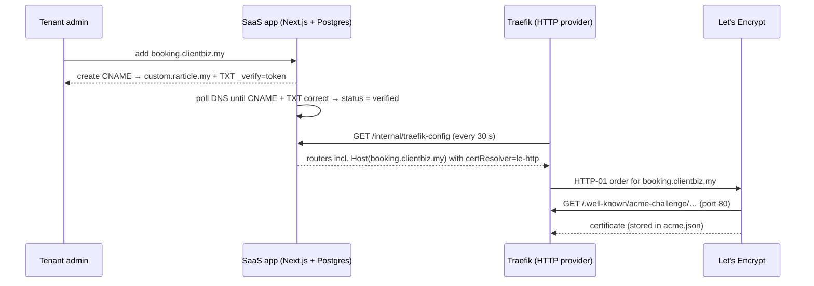

# Traefik - Custom Domains, ACME DNS-01 & Wildcard Certificates

> [!info] Deep dive of [[Traefik]]

> [!abstract] TL;DR
> Two certificate problems in multi-tenant SaaS:
> 1. **Your subdomains** (`*.app.rarticle.my`): one **wildcard cert via DNS-01** (Cloudflare API token scoped to the zone) plus `HostRegexp` routing.
> 2. **Tenant custom domains** (`booking.clientbiz.my`): the tenant points a **CNAME** at you, you **verify ownership** (TXT), then issue a **per-domain cert via HTTP-01/TLS-ALPN-01**, since you don't control their DNS. Feed routers dynamically via Traefik's **HTTP provider** (or file provider) from your database.
>
> Traefik has no Caddy-style on-demand TLS, so domains must be **declared before** Traefik requests certs. At scale (hundreds of custom domains), **Cloudflare for SaaS (custom hostnames)** offloads issuance entirely. Persist `acme.json`, test against LE staging, and respect rate limits.

## Concept
| Scenario | Challenge | Who controls DNS | Router rule |
|---|---|---|---|
| `client.app.rarticle.my` | DNS-01 wildcard `*.app.rarticle.my` | You (Cloudflare) | ``HostRegexp(`^[a-z0-9-]+\.app\.rarticle\.my$`)`` |
| `booking.clientbiz.my` → CNAME `custom.rarticle.my` | HTTP-01 or TLS-ALPN-01 per domain | Tenant | ``Host(`booking.clientbiz.my`)`` |
| Apex `clientbiz.my` | HTTP-01 (A/ALIAS record to your IP) | Tenant | ``Host(`clientbiz.my`)`` |
| Tenant domain proxied through *their* Cloudflare (orange) | HTTP-01 fails if they force HTTPS/cache. DNS-01 impossible | Tenant | Ask for grey-cloud, or use Cloudflare for SaaS |

**Challenge types**:

| Type | Needs | Wildcards | Pitfall |
|---|---|---|---|
| HTTP-01 | Port 80 reachable at the domain | ❌ | Redirect middlewares must not block `/.well-known/acme-challenge/` |
| TLS-ALPN-01 | Port 443 directly to Traefik | ❌ | Breaks behind TLS-terminating proxies (Cloudflare orange cloud) |
| DNS-01 | DNS API token | ✅ | Token scope and propagation delays |

**Let's Encrypt limits to design around** (verify current values): ~50 certificates per registered domain per week, 5 duplicate certificates per week, ~300 new orders per account per 3 hours, and failed-validation limits per hostname.

## How It Works


## Practical Usage
**Static config: two resolvers + HTTP provider** (`traefik.yml`):
```yaml
entryPoints:
  web:
    address: ":80"
    http:
      redirections: { entryPoint: { to: websecure, scheme: https } }   # Traefik still answers ACME on :80
  websecure: { address: ":443" }

certificatesResolvers:
  le-dns:
    acme:
      email: ops@rarticle.my
      storage: /letsencrypt/acme.json
      dnsChallenge:
        provider: cloudflare
        resolvers: ["1.1.1.1:53", "8.8.8.8:53"]
  le-http:
    acme:
      email: ops@rarticle.my
      storage: /letsencrypt/acme.json
      httpChallenge: { entryPoint: web }
      # caServer: https://acme-staging-v02.api.letsencrypt.org/directory   # test first

providers:
  docker: { exposedByDefault: false }
  http:
    endpoint: "http://app:3000/internal/traefik-config"
    pollInterval: "30s"
```
```bash
# environment for the DNS resolver: token with Zone:DNS:Edit on that zone only
CF_DNS_API_TOKEN=…
```
**Wildcard for your own subdomains** (Docker labels):
```yaml
- traefik.http.routers.tenants.rule=HostRegexp(`^[a-z0-9-]+\.app\.rarticle\.my$`)
- traefik.http.routers.tenants.tls.certresolver=le-dns
- traefik.http.routers.tenants.tls.domains[0].main=app.rarticle.my
- traefik.http.routers.tenants.tls.domains[0].sans=*.app.rarticle.my
```
**Dynamic config endpoint for verified custom domains** (Next.js route handler, internal network only):
```ts
export async function GET() {
  const domains = await db.query<{ host: string }>(
    "select host from custom_domains where status = 'verified' and deleted_at is null");
  const routers = Object.fromEntries(domains.rows.map((d, i) => [
    `custom-${i}`,
    { rule: `Host(\`${d.host}\`)`, service: "app", entryPoints: ["websecure"], tls: { certResolver: "le-http" } },
  ]));
  return Response.json({ http: { routers, services: { app: { loadBalancer: { servers: [{ url: "http://app:3000" }] } } } } });
}
```
**Ownership verification before issuing**:
```ts
import { resolveCname, resolveTxt } from "node:dns/promises";
const cname = await resolveCname(host).catch(() => []);
const txt = (await resolveTxt(`_rarticle-verify.${host}`).catch(() => [])).flat();
const ok = cname.includes("custom.rarticle.my") && txt.includes(expectedToken);
```
**Inspect issued certificates**:
```bash
jq -r '.["le-http"].Certificates[].domain.main' /letsencrypt/acme.json
openssl s_client -connect booking.clientbiz.my:443 -servername booking.clientbiz.my </dev/null 2>/dev/null | openssl x509 -noout -dates -issuer
```
**Wrong way**:
```text
❌ Router for an unverified tenant domain          → endless failed HTTP-01 attempts → LE failed-validation limits
❌ acme.json not on a persistent volume             → re-issue every restart → duplicate-cert rate limit
❌ Cloudflare Global API Key in Traefik env         → full account takeover if the proxy leaks env
❌ IP-allowlist or auth middleware on all of :80    → blocks LE validation requests
```

## Patterns & Anti-patterns
| Pattern | When | Anti-pattern to avoid |
|---|---|---|
| Wildcard via DNS-01 for own subdomains | Tenant subdomains | One cert per subdomain (rate limits) |
| Verify CNAME + TXT before adding routers | Custom domains | Issuing for any Host header requested |
| HTTP provider fed from DB, internal only | Dynamic domains | Hand-editing file provider per tenant |
| Separate resolvers per challenge type | Mixed setups | One resolver forced to do both |
| LE staging for new flows | Testing | Debugging against production LE |
| Cloudflare for SaaS at scale | Hundreds of domains, global edge | Self-issuing thousands of certs from one VPS |
| Status page for tenants (`pending DNS`, `issuing`, `active`) | Self-serve onboarding | Silent failures and support tickets |

## Performance & Trade-offs
- **acme.json size**: hundreds of certs are fine. Thousands slow Traefik reloads and make one file a single point of failure. Back it up.
- **Renewals**: Traefik renews ~30 days before expiry (for 90-day certs). Shorter lifetimes (LE's move toward 45-day certs) mean more renewals, so keep validation paths healthy.
- **HTTP provider polling** adds config reload churn. 30–60 s is plenty, and return stable router names to avoid flapping.
- **Cloudflare for SaaS** costs per custom hostname beyond the included allowance, but adds WAF/DDoS and removes ACME ops. Traefik then only sees Cloudflare origin traffic ([[Cloudflare - DNS, Email Authentication & Domain Ops]]).

## Tips & Reminders
> [!tip] In ZP's stack
> - **Coolify**: configure DNS-01 for wildcard domains in Coolify's proxy settings, and add custom domains per app in the UI for a handful of clients. Move to the HTTP provider pattern only for a self-serve SaaS ([[Coolify]]).
> - **White-label client portals** (`portal.clientbiz.my`) are a sellable upsell. Document DNS steps in BM/EN for client IT, and make CNAME the default.
> - **Apex domains**: many Malaysian registrars (e.g. MYNIC resellers) lack ALIAS/ANAME. Ask clients to use `www` or a subdomain, or move DNS to Cloudflare.

- Store custom domains with lowercase normalization and IDN (punycode) handling.
- Alert on certs expiring in < 14 days (Prometheus blackbox exporter or Uptime Kuma).
- Remove routers when a tenant churns, so you stop renewing their cert.
- Rotate the Cloudflare DNS token periodically. Scope it to one zone.

## Version Notes
| Date / version | Change relevant here |
|---|---|
| Traefik v2 | ACME resolvers, `tls.domains` for wildcards |
| Traefik v3.0 (2024) | Rule syntax changes (`HostRegexp` uses Go regex, no `{subdomain:...}` placeholders) |
| Traefik v3.7.x (2026) | Current. `certificatesDuration` default 2160 h (90 days) |
| Let's Encrypt 2025 | OCSP ended. Expiry emails discontinued. Short-lived (≈6-day) certs offered as opt-in |
| Let's Encrypt plan | Default lifetime reducing toward 45 days over 2026–2028 |

> [!warning] Unverified — check before relying on this
> Current Let's Encrypt rate-limit values, the 45-day transition schedule, and short-lived certificate availability weren't confirmed from LE's own pages this run (search found only secondary sources). Check https://letsencrypt.org/docs/rate-limits/ and LE announcements.

## Critical Issues & Gotchas
> [!danger] Issuing for arbitrary Host headers burns rate limits and enables abuse
> If any hostname pointed at your IP gets a router and cert request, attackers (or stale tenant DNS) trigger thousands of failed validations, hitting LE's failed-validation and account order limits, which blocks legitimate renewals for every tenant. Only route domains that passed ownership verification, and cap new domains per tenant per day.

> [!danger] Losing acme.json or the DNS token stops every renewal
> A non-persistent `acme.json` re-requests all certs on restart (duplicate-cert limit after 5 restarts/week). A revoked or expired Cloudflare token silently breaks wildcard renewal, which surfaces 30 days later as expired certs across all tenants. Persist and back up `acme.json` (chmod 600), monitor expiry, and alert on ACME errors in Traefik logs ([[Traefik - Observability & Troubleshooting]]).

- **Tenant uses Cloudflare proxy** on their CNAME: HTTP-01 may still work, but their "Always Use HTTPS" or cache rules can break validation. Ask for DNS-only or use Cloudflare for SaaS.
- **CAA records** on the tenant domain may forbid Let's Encrypt. Check CAA during verification.
- **Redirect to HTTPS** on `web` is fine, since Traefik serves ACME challenges before redirect middlewares, but custom catch-all routers on :80 can intercept them.
- **DNS propagation** for DNS-01: set `resolvers` and `delayBeforeCheck` when TXT records propagate slowly.

## Related
- [[Traefik]]
- [[Traefik - Middlewares, TLS & Routing]] — resolvers, TLS options, redirects
- [[Traefik - Rate Limiting, ForwardAuth & Multi-Tenant Routing]] — tenant routing and limits
- [[Cloudflare - DNS, Email Authentication & Domain Ops]] — DNS tokens, Cloudflare for SaaS
- [[Next.js - Middleware, Auth & Multi-Tenant Routing]] — resolving tenant from Host in the app
- [[System Design - Multi-Tenant SaaS Architecture]] — tenancy design

## References
- https://doc.traefik.io/traefik/https/acme/
- https://doc.traefik.io/traefik/providers/http/
- https://coolify.io/docs/knowledge-base/proxy/traefik/dns-challenge
- https://letsencrypt.org/docs/rate-limits/
- https://developers.cloudflare.com/cloudflare-for-platforms/cloudflare-for-saas/
