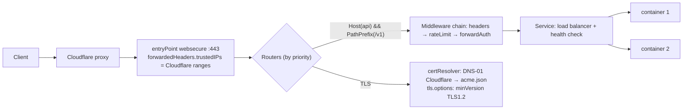

# Traefik - Middlewares, TLS & Routing

> [!info] Deep dive of [[Traefik]]

> [!abstract] TL;DR
> A Traefik request flows **entryPoint → router (rule + priority + TLS) → middleware chain → service (load balancer)**.
> - **Routing**: precise rules with explicit priorities when they overlap. Keep providers straight (`@docker`, `@file`).
> - **Middlewares**: headers, redirects, rate limits, IP allow-lists, **forwardAuth** SSO, compress, retry, circuit breakers. They're the security and resilience layer.
> - **TLS**: ACME resolvers (DNS-01 via Cloudflare for wildcards), TLS options (min TLS 1.2, mTLS), and correct real-IP handling behind Cloudflare.
> - **Patch** to ≥ 3.6.21 / 3.7.5: 2026 included a critical forwardAuth bypass.

## Concept

### Rule matchers (v3 syntax)
| Matcher | Example |
|---|---|
| ``Host(`a.example.my`)`` / ``HostRegexp(`^.+\.example\.my$`)`` | Virtual hosts (Go regex in v3) |
| ``PathPrefix(`/api`)`` / ``Path(`/healthz`)`` / ``PathRegexp(...)`` | Paths |
| ``Method(`POST`)``, ``Header(`X-Tenant`, `acme`)``, ``Query(`v`, `2`)`` | Request attributes |
| ``ClientIP(`10.0.0.0/8`)`` | Source IP (after forwarded-header processing) |
| `&&`, `\|\|`, `!`, parentheses | Combine |

**Priority** defaults to rule string length, so a longer rule wins. Set `priority` explicitly for catch-alls (low) and specific overrides (high).

### Middleware catalog (most useful)
| Middleware | Use | Key options |
|---|---|---|
| `redirectScheme` | HTTP → HTTPS | `scheme: https`, `permanent: true` (or entryPoint-level redirect) |
| `headers` | Security headers, CORS | `stsSeconds`, `frameDeny`, `contentTypeNosniff`, `customResponseHeaders`, `accessControlAllowOriginList` |
| `basicAuth` | Simple protection | `users` (htpasswd bcrypt), `usersFile`, `removeHeader: true` |
| **`forwardAuth`** | Delegate auth to Authelia/authentik/oauth2-proxy | `address`, `trustForwardHeader`, `authResponseHeaders` |
| `ipAllowList` | Restrict by IP | `sourceRange`, `ipStrategy.depth` / `excludedIPs` behind proxies |
| `rateLimit` | Throttle | `average`, `burst`, `period`, `sourceCriterion` (IP/header) |
| `inFlightReq` | Concurrency cap | `amount` |
| `retry` | Retry idempotent upstream failures | `attempts`, `initialInterval` |
| `circuitBreaker` | Stop sending to failing backends | `expression: NetworkErrorRatio() > 0.3` |
| `compress` | gzip/brotli/zstd | `minResponseBodyBytes`, excluded types |
| `stripPrefix` / `addPrefix` / `replacePathRegex` | Path rewriting | — |
| `chain` | Reusable ordered group | `middlewares: [a, b, c]` |
| `buffering` | Request/response size limits | `maxRequestBodyBytes` |

## How It Works

- **Middleware order** is the order listed on the router. Put cheap rejections first (IP allow-list, rate limit), then auth, then transforms.
- **Provider namespaces**: a middleware defined in a file is referenced as `name@file`, in Docker labels as `name@docker`. Omitting the suffix only works within the same provider.
- **Forwarded headers**: Traefik only trusts `X-Forwarded-*` from `forwardedHeaders.trustedIPs`. Otherwise it overwrites them with the direct peer IP (Cloudflare's edge), which breaks rate limits and IP rules.
- **ACME**: HTTP-01 (port 80 must reach Traefik), TLS-ALPN-01 (port 443), and **DNS-01** (API token to create TXT records). DNS-01 works behind Cloudflare's orange cloud and supports wildcards.

## Practical Usage

### Dynamic file config: shared middlewares (Coolify: `/data/coolify/proxy/dynamic/middlewares.yaml`)
```yaml
http:
  middlewares:
    secure-headers:
      headers:
        stsSeconds: 31536000
        stsIncludeSubdomains: true
        frameDeny: true
        contentTypeNosniff: true
        referrerPolicy: strict-origin-when-cross-origin
        customResponseHeaders: { X-Powered-By: "", Server: "" }
    api-ratelimit:
      rateLimit:
        average: 20          # req/s per source
        burst: 50
        sourceCriterion: { requestHeaderName: CF-Connecting-IP }   # real client IP behind Cloudflare
    sso:
      forwardAuth:
        address: http://authentik-server:9000/outpost.goauthentik.io/auth/traefik
        trustForwardHeader: true
        authResponseHeaders: [X-authentik-username, X-authentik-email, X-authentik-groups]
    admin-only:
      ipAllowList:
        sourceRange: ["100.64.0.0/10"]            # Tailscale
    hardened-admin:
      chain: { middlewares: [admin-only, secure-headers, sso] }
  routers:
    n8n-editor:
      rule: Host(`n8n-editor.example.my`)
      entryPoints: [websecure]
      middlewares: [hardened-admin]
      service: n8n@docker
      tls: { certResolver: cf }
    n8n-webhooks:                                  # separate host, no SSO (machine traffic), rate limited
      rule: Host(`hooks.example.my`) && PathPrefix(`/webhook`)
      entryPoints: [websecure]
      middlewares: [api-ratelimit, secure-headers]
      service: n8n@docker
      tls: { certResolver: cf }
tls:
  options:
    default:
      minVersion: VersionTLS12
      sniStrict: true
```

### Static config: Cloudflare DNS-01 + trusted IPs
```yaml
entryPoints:
  websecure:
    address: ":443"
    forwardedHeaders:
      trustedIPs: ["173.245.48.0/20", "103.21.244.0/22", "103.22.200.0/22", "104.16.0.0/13", "172.64.0.0/13", "131.0.72.0/22"]   # keep the full, current Cloudflare list
certificatesResolvers:
  cf:
    acme:
      email: ops@example.my
      storage: /acme.json
      dnsChallenge:
        provider: cloudflare            # env CF_DNS_API_TOKEN (Zone:DNS:Edit for that zone only)
        resolvers: ["1.1.1.1:53", "8.8.8.8:53"]
```
```yaml
# Docker labels: wildcard certificate for many client subdomains
- traefik.http.routers.app.tls.domains[0].main=example.my
- traefik.http.routers.app.tls.domains[0].sans=*.example.my
```

### Canary with weighted services
```yaml
http:
  services:
    api-canary:
      weighted:
        services:
          - { name: api-v1@docker, weight: 90 }
          - { name: api-v2@docker, weight: 10 }
```

## Patterns & Anti-patterns
| Pattern | When | Anti-pattern to avoid |
|---|---|---|
| Shared middlewares in a file provider, referenced `@file` | Many apps per server (Coolify) | Copy-pasting long label blocks per container |
| Separate hostnames for human UIs (SSO) vs machine webhooks | n8n, admin panels | One hostname where SSO breaks webhooks, or webhooks bypass SSO for the UI |
| `trustedIPs` = Cloudflare ranges + rate limit by `CF-Connecting-IP` | Behind Cloudflare | Rate limiting by peer IP (all traffic looks like Cloudflare) |
| DNS-01 with a zone-scoped API token | Wildcards, orange-cloud hosts | Global API key in Traefik env |
| Explicit `priority` on overlapping routers | Catch-all + specific routes | Relying on rule-length defaults you can't see |
| `sniStrict` + `minVersion: TLS1.2` | All TLS | Default TLS options accepting legacy clients |

## Performance & Trade-offs
- `compress` saves bandwidth but costs CPU. Don't double-compress behind Cloudflare (it compresses already), except for origin-to-edge savings on large JSON.
- `retry` can multiply load during outages and duplicate non-idempotent requests. Restrict it to idempotent routes, and combine with circuit breakers.
- `rateLimit` is per Traefik instance (in-memory). With multiple instances, limits don't aggregate. Use Cloudflare rate limiting or Redis-backed limits in the app for global limits.
- `forwardAuth` adds an HTTP round trip per request. Cache sessions in the auth provider and keep it on the same host/network.

## Tips & Reminders
> [!tip]
> - Use the dashboard/API (protected!) or `traefik` access logs with `RouterName` to debug which router matched.
> - Test configs on staging. A YAML error in a file provider disables those dynamic configs (watch the logs on reload).
> - Keep the Cloudflare IP list up to date (fetch `https://www.cloudflare.com/ips-v4` periodically).
> - **In ZP's stack**: [[Coolify]] generates per-app labels, and shared middlewares (`secure-headers`, `api-ratelimit`, `hardened-admin`) live in Coolify's proxy dynamic folder and are referenced from app labels. Use a DNS-01 Cloudflare resolver for wildcard client subdomains.

## Version Notes
| Version | Change |
|---|---|
| v2.x | Routers/middlewares model. `ipWhiteList`, `Headers`/`HostRegexp` old syntax |
| **v3.0** (2024-04) | `ipWhiteList` → **`ipAllowList`**, matcher changes (`HostRegexp` Go regex, `Header`, `Query`), `ruleSyntax: v2` per router for migration, OpenTelemetry, WASM plugins |
| v3.1–3.5 | Gateway API, ingress-nginx annotation compatibility, more compression algorithms |
| 3.6.10–3.6.21 (2026) | Security fixes: HTTPRoute rule-token injection, **forwardAuth bypass (CVE-2026-35051)** |
| 3.7.x | Current minor |

## Critical Issues & Gotchas
> [!danger] forwardAuth is a security boundary: patch and configure it correctly
> CVE-2026-35051 allowed bypassing forwardAuth in setups with `trustForwardHeader=false` behind a trusted upstream proxy (fixed in 3.6.14+). Misconfigurations are just as dangerous: routers that forget the middleware, a second router for the same host without auth, or `trustForwardHeader: true` with no `trustedIPs` (clients spoof `X-Forwarded-*`). Audit every router that should be protected, and test from outside.

> [!danger] Let's Encrypt rate limits and `acme.json` loss
> Losing `acme.json` (non-persisted volume) or misconfigured challenges cause re-issuance loops, which hit Let's Encrypt limits (50 certs per registered domain per week, 5 duplicate certs per week) and lock you out for days. Persist `acme.json` (`chmod 600`), use the staging CA when testing, and prefer wildcard DNS-01 for many subdomains.

> [!warning] Gotchas
> - Middleware referenced but not defined (typo, wrong `@provider`) → the router is disabled with an error in the logs. The site returns 404.
> - `stripPrefix` without telling the app its base path breaks redirects and asset URLs.
> - WebSocket/SSE routes need generous timeouts (`respondingTimeouts`, `serversTransport` settings), and no compression or buffering.
> - Long-lived certificates from Cloudflare Origin CA don't need ACME, but then Traefik must load them via `tls.certificates` in a file provider.
> - `HostRegexp` syntax changed in v3 (Go regex, no `{subdomain:...}` placeholders). Old labels silently stop matching.

## Related
- [[Traefik]]
- [[Traefik - Observability & Troubleshooting]] — debugging routers, access logs and certificate failures
- [[Coolify]] — generates routers, hosts the dynamic config folder
- [[Cloudflare]] — DNS-01, real-IP headers, edge rate limiting
- [[Docker]] — label-based configuration
- [[Network Security]] — admin surface isolation, TLS settings
- [[HTTP & HTTPS - TLS Handshake & Certificates]] — certificate details

## References
- Traefik middlewares: https://doc.traefik.io/traefik/middlewares/overview/
- Routers & rule syntax: https://doc.traefik.io/traefik/routing/routers/
- ACME / certificate resolvers: https://doc.traefik.io/traefik/https/acme/
- TLS options: https://doc.traefik.io/traefik/https/tls/
- Cloudflare IP ranges: https://www.cloudflare.com/ips/
- CVE-2026-35051: https://osv.dev/vulnerability/CVE-2026-35051
