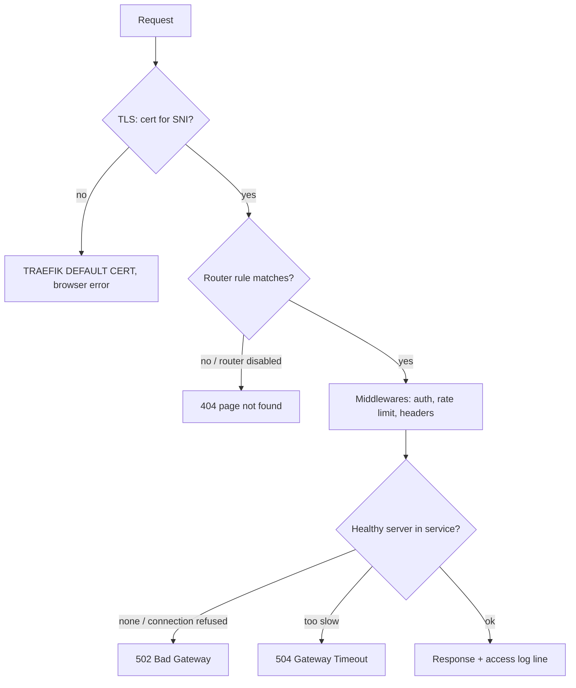

# Traefik - Observability & Troubleshooting

> [!info] Deep dive of [[Traefik]]

> [!abstract] TL;DR
> Every Traefik incident maps to one of four symptoms:
>
> | Symptom | Meaning | Usual causes |
> |---|---|---|
> | **404** | No router matched | Host typo; router disabled by a config error; container not visible |
> | **502** | Router matched, backend unreachable | Wrong port; wrong network; app bound to `127.0.0.1` |
> | **504** | Backend too slow | Timeouts |
> | **TLS errors / `TRAEFIK DEFAULT CERT`** | No certificate for that host | ACME failed or rate-limited |
>
> Turn on **JSON access logs** (filtered to errors and slow requests) and **Prometheus metrics**. The API at `/api/http/routers` shows each router's status and errors.

## Concept
| Signal | Config (static) | Answers |
|---|---|---|
| Traefik logs | `log.level` (`ERROR` default; `DEBUG` temporarily) | Provider errors, ACME failures, config parse errors |
| Access logs | `accessLog` (JSON, filters, field redaction) | Which router/service handled a request, status, duration, client IP |
| Metrics | `metrics.prometheus` / `metrics.otlp` | Request rate, error rate and latency per entrypoint/router/service, TLS cert expiry |
| Tracing | `tracing.otlp` | Where latency sits across proxy → app → DB |
| API / dashboard | `api.dashboard` behind an authenticated router | Live routers, services, middlewares, and per-object **errors and warnings** |
| Ping | `ping` | Liveness for Docker healthcheck / external monitors |

- **Coolify specifics**: the proxy runs as the `coolify-proxy` container. Its config lives under `/data/coolify/proxy/` (static config + `dynamic/` file provider). Labels on app containers are generated by Coolify ([[Coolify]]).
- **Router status** in the API is `enabled`, `warning` or `disabled`. A disabled router (e.g. one referencing a non-existent middleware) produces **404s with no other visible error**.

## How It Works


## Practical Usage
**Static config for observability** (`traefik.yml`, or Coolify → Proxy → Configuration):
```yaml
log:
  level: ERROR
  format: json
accessLog:
  format: json
  bufferingSize: 100
  filters:
    statusCodes: ["400-599"]        # keep volume sane; drop filter while debugging
    minDuration: "500ms"            # also log slow requests
  fields:
    defaultMode: keep
    headers:
      defaultMode: drop
      names:
        User-Agent: keep
        Cf-Ray: keep
        Authorization: redact
        Cookie: redact
metrics:
  prometheus:
    entryPoint: metrics
    addRoutersLabels: false         # true = per-router series; watch cardinality
entryPoints:
  metrics: { address: "127.0.0.1:8082" }   # never public
ping: {}
api: { dashboard: true }            # expose only via an authenticated router
```
**Real client IPs behind Cloudflare** (otherwise logs and rate limits see Cloudflare IPs):
```yaml
entryPoints:
  websecure:
    address: ":443"
    forwardedHeaders:
      trustedIPs: ["173.245.48.0/20", "103.21.244.0/22", "…"]   # Cloudflare ranges; refresh periodically
```
**Triage commands**:
```bash
docker logs coolify-proxy --since 15m 2>&1 | grep -iE "error|acme|unable|router"
# which routers exist and are they healthy? (via SSH tunnel to the API)
curl -s localhost:8080/api/http/routers | jq '.[] | select(.status != "enabled") | {name, status, error}'
# hit the origin directly, bypassing DNS/Cloudflare
curl -vk --resolve app.example.my:443:203.0.113.10 https://app.example.my/api/health
# what cert is served for this SNI?
openssl s_client -connect 203.0.113.10:443 -servername app.example.my </dev/null 2>/dev/null | openssl x509 -noout -subject -issuer -dates
# is the app reachable from Traefik's network namespace?
docker exec coolify-proxy wget -qO- http://<container-name>:3000/api/health
```
**Access log → quick error breakdown**:
```bash
docker logs coolify-proxy --since 1h 2>/dev/null | jq -r 'select(.DownstreamStatus>=500) | "\(.DownstreamStatus) \(.RouterName) \(.RequestPath)"' | sort | uniq -c | sort -rn | head
```
**Symptom → cause table**:

| Symptom | Check | Typical fix |
|---|---|---|
| `404 page not found` (plain text) | `/api/http/routers` status; Host rule; container running | Fix the rule or the domain in Coolify; fix the middleware reference (`name@provider`); redeploy |
| 404 only right after deploy | Container health `starting`/`unhealthy` | Traefik's Docker provider skips unhealthy containers. Fix the healthcheck or `start_period` |
| `502 Bad Gateway` | `docker exec coolify-proxy wget …` to the container | Correct `loadbalancer.server.port`; app must listen on `0.0.0.0`; same Docker network as the proxy |
| `504 Gateway Timeout` | Access log `Duration`, app latency | Fix the slow endpoint. Raise `serversTransport` `forwardingTimeouts.responseHeaderTimeout` only for known long routes |
| Browser shows `TRAEFIK DEFAULT CERT` | Logs for `acme` errors | DNS points elsewhere, CAA record, rate limit, or HTTP-01 blocked. Switch to DNS-01 |
| Redirect loop | Cloudflare SSL mode | Use **Full (strict)**, never Flexible, with Traefik HTTPS redirects |
| WebSocket drops every N seconds | LB / Cloudflare idle timeout (100 s) | App-level ping every 30 s ([[WebSocket - Scaling & Reliability]]) |

**Wrong way**:
```yaml
api: { insecure: true }             # ❌ dashboard on :8080 without auth; exposes every route and backend
log: { level: DEBUG }               # ❌ left on in prod: noisy, leaks headers, fills disk
accessLog: {}                       # ❌ unfiltered + unrotated plain text on a busy site → GBs/day, Authorization headers kept
```

## Patterns & Anti-patterns
| Pattern | When | Anti-pattern to avoid |
|---|---|---|
| JSON access logs filtered to 4xx/5xx + slow | Production | All requests at INFO with full headers |
| Redact `Authorization`, `Cookie`, `X-Api-Key` | Always | Bearer tokens in logs shipped to a SaaS |
| Metrics on a localhost-only entrypoint, scraped via the private network | Prometheus/Grafana | Public `/metrics` |
| `ping` + Docker healthcheck for the proxy | Every server | Discovering a dead proxy from customer complaints |
| External uptime checks **per origin** + via Cloudflare | Multi-server / CDN | Only checking the CDN hostname (hides origin failures) |
| Temporary `DEBUG` with a reminder to revert | Deep debugging | Permanent debug logging |

## Performance & Trade-offs
- **Access log volume**: ~300–600 bytes per JSON line. 100 req/s unfiltered is ~3–5 GB/day. Filter, buffer (`bufferingSize`) and rotate (Docker log options or a file + logrotate).
- **Metric cardinality**: `addRoutersLabels`/`addServicesLabels` multiply series by routers × status codes × methods. That's fine for <50 routers. For a busy Coolify host with hundreds of preview deployments, keep entrypoint-level metrics only.
- **Tracing** adds small overhead per request. Sample (e.g. 5–10%) unless debugging. OpenTelemetry logs and access logs export has been **experimental** since v3.3.
- **Health checks**: Traefik's own `healthCheck` on services adds probe traffic per server. Usually unnecessary on Coolify, where container health gates routing already.

## Tips & Reminders
> [!tip] In ZP's stack
> - **First command** when a client site is down on Coolify: `docker logs coolify-proxy --since 10m | grep -i error`, then `curl --resolve` to the origin IP.
> - **Isolate the layer**: compare the origin with Cloudflare. If the origin works and Cloudflare doesn't, check SSL mode, WAF and DNS. If the origin fails too, check the router, the container and the app.
> - **Metrics**: ship Traefik metrics to a small Prometheus + Grafana stack (a Coolify one-click service) and alert on `traefik_entrypoint_requests_total{code=~"5.."}` rate and cert expiry.

- Keep a per-server "known good" snapshot of the dynamic config (`/data/coolify/proxy/dynamic/`) in git. A broken file-provider YAML silently disables those routes.
- Let's Encrypt limits: 50 certificates per registered domain per week, 5 duplicate certificates per week, and 5 failed validations per account per hostname per hour. Debug against the staging CA (`caServer: https://acme-staging-v02.api.letsencrypt.org/directory`).
- Use `RouterName` in access logs to map a failing request to the exact Coolify resource.
- After a Traefik upgrade, re-check the router list for new `warning` states. Rule syntax changes between v2 and v3 surface there ([[Traefik - Middlewares, TLS & Routing]]).

## Version Notes
| Version | Change relevant here |
|---|---|
| v3.0 (2024-04) | OpenTelemetry tracing and metrics. Rule syntax v3 (`ruleSyntax: v2` per router for migration) |
| v3.3 (2025-01) | OTel **logs and access logs** (experimental). Per-router opt-in/out of tracing, metrics and access logs. Rewritten observability docs |
| v3.6–v3.7 (2026) | Maintained lines with frequent security releases. Keep current (see [[Traefik]]) |

> [!warning] Unverified — check before relying on this
> Whether OTel logs and access logs have left experimental status in v3.6/3.7 wasn't confirmed in this run. Check https://doc.traefik.io/traefik/observability/overview/.

## Critical Issues & Gotchas
> [!danger] Exposed dashboard and API
> `api.insecure: true`, or a dashboard router without auth, reveals every hostname, backend IP and middleware, which makes a perfect recon map. The 2026 ForwardAuth bypass CVE showed that auth middlewares themselves need patching. Protect the dashboard with auth + IP allow-list, and patch Traefik ([[Traefik]]).

> [!danger] Secrets in access logs
> The default access-log fields mode keeps headers in some setups, and query strings (`?token=…`) are always logged. Redact sensitive headers, avoid secrets in URLs, and treat log storage as sensitive data (PDPA, if it includes customer IPs and phone numbers in paths).

- **Silent route disable**: a reference to a missing middleware or a typo in `@file`/`@docker` disables the router. The symptom is a 404 and the only clue is in the API/dashboard or the logs.
- **Docker network mismatch**: with multiple networks on a container, Traefik may pick the wrong IP. Set `traefik.docker.network=<proxy network>` (Coolify sets this for managed resources; custom compose files need it).
- **Clock skew** on the server breaks ACME and TLS validation. Ensure NTP sync ([[Linux Essentials - systemd, Logs & Troubleshooting]]).
- **Cloudflare 52x errors ≠ Traefik errors**: 521 means the origin refused the connection, 522 a timeout reaching it, 525/526 an SSL handshake or certificate problem at the origin. Read them as "Cloudflare can't reach Traefik properly".

## Related
- [[Traefik]]
- [[Traefik - Middlewares, TLS & Routing]] — router rules, middlewares, certificate resolvers
- [[Coolify]] — `coolify-proxy`, generated labels
- [[Cloudflare]] — SSL modes, 52x errors, real-IP ranges
- [[Docker - Networking & Volumes]] — networks and container reachability
- [[HTTP & HTTPS - TLS Handshake & Certificates]] — SNI, chains, ACME

## References
- https://doc.traefik.io/traefik/observability/overview/
- https://doc.traefik.io/traefik/observability/access-logs/
- https://doc.traefik.io/traefik/observability/metrics/overview/
- https://traefik.io/blog/traefik-proxy-v3-3-nectaire-of-the-gods
- https://letsencrypt.org/docs/rate-limits/
