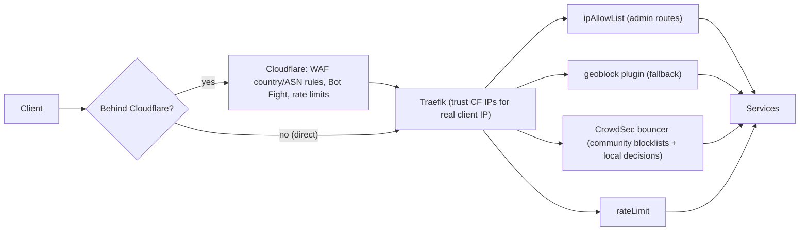

# Traefik - Plugins, Geo-Blocking & Bot Filtering

> [!info] Deep dive of [[Traefik]]

> [!abstract] TL;DR
> Traefik's built-in middlewares (`ipAllowList`, `rateLimit`, `basicAuth`, `forwardAuth`, `headers`) cover most needs. **Plugins** (Go via the Yaegi interpreter, or WASM in v3) add geo-blocking, CrowdSec/fail2ban-style banning, bot filters and more from the plugin catalog.
> - **If Cloudflare proxies your traffic, do geo-blocking and bot management at Cloudflare** (WAF custom rules by country/ASN, Bot Fight Mode, Turnstile). It stops traffic before it reaches the VPS, and Traefik sees only Cloudflare IPs unless real-IP headers are trusted.
> - **Use Traefik-level filtering for**: origins not behind Cloudflare, admin panels (`ipAllowList` + Tailscale), defense in depth, and CrowdSec community blocklists.
> - **Plugins run inside the proxy**: pin versions, prefer maintained ones, and test, since a buggy plugin can take every site down.

## Concept
| Need | Best layer | Traefik option |
|---|---|---|
| Block countries (e.g. admin panel MY-only) | Cloudflare WAF rule | `geoblock` plugin (MaxMind/IP2Location DB) |
| Bad-bot/user-agent filtering | Cloudflare Bot Fight Mode / WAF | Custom plugin or `headers`-based rules (limited) |
| Brute-force bans | Cloudflare rate limiting + Turnstile | CrowdSec bouncer / fail2ban plugin |
| Admin UI access | Cloudflare Access / Tailscale | `ipAllowList` with tailnet/office IPs |
| Request rate limits | Both (edge coarse, origin per route) | `rateLimit` middleware (Redis-backed option) |
| Auth gate | Cloudflare Access / ForwardAuth | `forwardAuth` to an auth service |

**Plugin types**:

| Type | How | Notes |
|---|---|---|
| Yaegi (Go source) | Interpreted at runtime from the catalog/GitHub | Easy to write. Interpreter overhead, limited stdlib |
| WASM (v3) | Compiled module via http-wasm | Faster, language-agnostic, newer |
| Local plugins | `experimental.localPlugins` from a mounted dir | Offline/air-gapped, private plugins |

## How It Works


## Practical Usage
**Trust Cloudflare for the real client IP** (static config):
```yaml
entryPoints:
  websecure:
    address: ":443"
    forwardedHeaders:
      trustedIPs: ["173.245.48.0/20", "103.21.244.0/22", "104.16.0.0/13", "172.64.0.0/13", "131.0.72.0/22"]  # keep full CF list updated
```
**Enable plugins** (static config, pinned versions):
```yaml
experimental:
  plugins:
    geoblock:
      moduleName: github.com/PascalMinder/geoblock
      version: v0.3.3              # pin; check catalog for current
    crowdsec:
      moduleName: github.com/maxlerebourg/crowdsec-bouncer-traefik-plugin
      version: v1.4.2              # pin; check catalog for current
```
**Geo-block an admin route to Malaysia + Singapore** (dynamic config / labels):
```yaml
http:
  middlewares:
    admin-geo:
      plugin:
        geoblock:
          allowLocalRequests: true
          allowUnknownCountries: false
          countries: ["MY", "SG"]
          api: "https://get.geojs.io/v1/ip/country/{ip}"     # or a local IP DB for privacy/latency
          cacheSize: 5000
    admin-ip:
      ipAllowList:
        sourceRange: ["100.64.0.0/10", "203.0.113.10/32"]     # Tailscale CGNAT range + office IP
  routers:
    coolify:
      rule: Host(`deploy.rarticle.my`)
      middlewares: [admin-ip]
      service: coolify
```
**CrowdSec bouncer** (CrowdSec agent parses Traefik access logs, bouncer enforces decisions):
```yaml
http:
  middlewares:
    crowdsec:
      plugin:
        crowdsec:
          enabled: true
          crowdsecLapiHost: crowdsec:8080
          crowdsecLapiKey: "${CROWDSEC_BOUNCER_KEY}"
          forwardedHeadersTrustedIPs: ["173.245.48.0/20"]   # trust Cloudflare for client IP
```
**Cloudflare WAF equivalent** (preferred when proxied):
```text
Custom rule: (http.host eq "admin.client.my" and not ip.geoip.country in {"MY" "SG"}) → Block
Custom rule: (http.request.uri.path contains "/wp-login.php" or "/.env") → Block
```
**Wrong way**:
```text
❌ Geo-blocking at Traefik while proxied by Cloudflare without trusted IPs → every visitor appears as a CF IP (US/SG)
❌ Unpinned plugin versions                         → proxy fails to start after a plugin update
❌ Blocking whole countries for a public storefront  → lost legitimate customers (travellers, VPN users)
❌ Relying on user-agent blocking for security       → trivially spoofed
```

## Patterns & Anti-patterns
| Pattern | When | Anti-pattern to avoid |
|---|---|---|
| Edge (Cloudflare) first, Traefik as defense in depth | Proxied sites | Duplicating heavy logic in both |
| `ipAllowList` + Tailscale for admin tools | Coolify, n8n editor, Grafana | Public admin panels with passwords only |
| CrowdSec with community blocklists | Direct-exposed origins | Rolling your own ban lists |
| Pin plugin versions, test in staging | All plugins | `latest` plugins in production |
| Local IP database for geo lookups | High traffic / privacy | External geo API per request |
| Monitor blocked requests | Tuning | Blind blocking (false positives unseen) |

## Performance & Trade-offs
- **Yaegi plugins** add per-request interpretation overhead. Fine for SME traffic, noticeable at high RPS. WASM plugins are faster.
- **External geo APIs** add latency and a dependency on every uncached request. Use local MaxMind/IP2Location databases with periodic updates (licence terms apply).
- **CrowdSec** adds an agent + LAPI (RAM ~100–200 MB) and log parsing. Worth it for origins exposed directly to the internet.
- **Cloudflare** filtering costs nothing in origin CPU and blocks earlier, but needs the Cloudflare proxy (orange cloud) and isn't available for non-HTTP traffic.

## Tips & Reminders
> [!tip] In ZP's stack
> - **Default for client apps**: Cloudflare proxy + WAF rules (block common exploit paths, geo-restrict admin hosts) + Turnstile on forms. Traefik handles routing, TLS and basic rate limits ([[Network Security - Cloudflare WAF & Rate Limiting Rules]]).
> - **Admin surfaces** (Coolify, n8n editor, Supabase Studio, Grafana): `ipAllowList` with Tailscale, or Cloudflare Access. Never public ([[Linux Essentials - Networking, Firewalls & Tailscale]]).
> - **Malaysian audiences**: geo-restricting admin to MY/SG is reasonable. Geo-blocking public sites rarely is (tourists, VPNs, Meta/Google crawlers).

- Keep Cloudflare IP ranges in Traefik's `trustedIPs` updated (they change occasionally).
- Exclude webhook paths (Meta, Stripe, payment gateways) from geo/bot rules, or whitelist provider IPs.
- Log blocked requests with reason and review weekly ([[Traefik - Observability & Troubleshooting]]).
- Lock the origin to Cloudflare IPs at the firewall, so edge rules can't be bypassed.

## Version Notes
| Version | Change relevant here |
|---|---|
| v2.3 (2020) | Plugins (Yaegi) and plugin catalog |
| v3.0 (2024) | WASM plugin support. `ipWhiteList` renamed `ipAllowList` |
| v3.x (2025–26) | `rateLimit` distributed (Redis) option. Plugin ecosystem growth (CrowdSec, geoblock) |
| v3.7.x (2026) | Current. v3.8 in development ([[Traefik]]) |

> [!warning] Unverified — check before relying on this
> Plugin versions and configuration keys shown (geoblock, CrowdSec bouncer) weren't verified against the current catalog this run. Check https://plugins.traefik.io and each plugin's README before deploying.

## Critical Issues & Gotchas
> [!danger] Wrong client IP breaks every IP-based control
> Behind Cloudflare (or any proxy), Traefik sees the proxy's IP unless `forwardedHeaders.trustedIPs` is set. Then allow-lists, geo-blocks, rate limits and CrowdSec bans apply to Cloudflare edge IPs: either blocking everyone or no one. Trusting `X-Forwarded-For` from **untrusted** sources is equally bad, since attackers spoof their IP. Trust only Cloudflare's published ranges.

> [!danger] Third-party plugins run inside your proxy
> A plugin is code executing in the request path of every site on the server. An abandoned or malicious plugin can leak headers (cookies, tokens), crash Traefik, or add latency. Use well-maintained plugins, pin versions, review the source for small plugins, and prefer Cloudflare-side features when available.

- **Geo databases are imperfect**: mobile carriers and VPNs mislocate users. Avoid hard geo-blocks on customer-facing flows.
- **Webhook providers** (Meta, Stripe, LHDN) originate from various countries. Geo-blocking them breaks integrations.
- **Plugin download at startup** needs internet access from Traefik. Air-gapped setups need local plugins.
- **Bot filters** can block search engines and link-preview crawlers (WhatsApp previews), so test.

## Related
- [[Traefik]]
- [[Traefik - Middlewares, TLS & Routing]] — middleware basics and forwarded headers
- [[Traefik - Rate Limiting, ForwardAuth & Multi-Tenant Routing]] — rate limits and auth gates
- [[Network Security - Cloudflare WAF & Rate Limiting Rules]] — edge-side equivalents
- [[Traefik - Observability & Troubleshooting]] — logging blocked requests
- [[Cloudflare - Turnstile & Bot Protection for Forms]] — bot protection for forms

## References
- https://doc.traefik.io/traefik/plugins/
- https://plugins.traefik.io/
- https://doc.traefik.io/traefik/middlewares/http/ipallowlist/
- https://github.com/maxlerebourg/crowdsec-bouncer-traefik-plugin
- https://www.cloudflare.com/ips/
