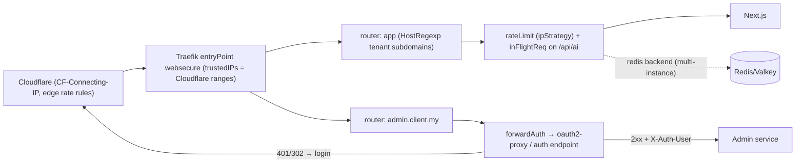

# Traefik - Rate Limiting, ForwardAuth & Multi-Tenant Routing

> [!info] Deep dive of [[Traefik]]

> [!abstract] TL;DR
> - **Rate limits** at the proxy are a coarse shield: per client IP (resolved correctly behind Cloudflare), per path class, plus `inFlightReq` for expensive endpoints. With 2+ Traefik instances, use the built-in **`redis`** backend. Fine-grained per-user/tenant limits belong in the app.
> - **ForwardAuth** delegates "is this request allowed?" to an auth service (oauth2-proxy, Authelia, or your own endpoint). Pass identity downstream via `authResponseHeaders`, strip spoofable headers, and patch to ≥ 3.6.14 (CVE-2026-35051).
> - **Multi-tenant routing**: wildcard subdomains via `HostRegexp` + DNS-01 wildcard cert. Customer **custom domains** need per-domain certs. Traefik has no Caddy-style on-demand TLS, so generate router config from your DB or use **Cloudflare for SaaS** custom hostnames.

## Concept
| Middleware / feature | Does | Watch out |
|---|---|---|
| `rateLimit` (`average`, `period`, `burst`) | Token bucket per source | In-memory per instance unless `redis` configured |
| `sourceCriterion.ipStrategy` (`depth` / `excludedIPs`) | Which IP identifies the client | Behind Cloudflare, the remote IP is Cloudflare's |
| `sourceCriterion.requestHeaderName` / `requestHost` | Key by header (API key) or host (per tenant domain) | Headers are spoofable unless set by a trusted hop |
| `inFlightReq` (`amount`) | Max concurrent requests per source | Protects slow endpoints (LLM, exports) |
| `forwardAuth` (`address`, `authResponseHeaders`, `trustForwardHeader`) | Subrequest to auth service, 2xx → pass | Every router needing auth must reference it |
| EntryPoint `forwardedHeaders.trustedIPs` | Trust `X-Forwarded-*` only from listed proxies | Missing → wrong client IPs. `insecure` → spoofing |
| `HostRegexp` + priority | Wildcard tenant routing | Overlapping routers resolved by priority (rule length by default) |

**Where to enforce what**:

| Control | Edge (Cloudflare) | Traefik | App |
|---|---|---|---|
| Volumetric / bot floods | ✅ | — | — |
| Per-IP request caps | ✅ | ✅ | — |
| Concurrency on expensive routes | — | ✅ `inFlightReq` | ✅ queue |
| Per-user / per-tenant quotas | — | ⚠️ coarse | ✅ ([[Redis - Rate Limiting & Distributed Locks]]) |
| Authentication for internal tools | ✅ Access | ✅ ForwardAuth | — |
| Authorization (tenant data) | — | — | ✅ always |

## How It Works


## Practical Usage
**Real client IPs behind Cloudflare** (static config):
```yaml
entryPoints:
  websecure:
    address: ":443"
    forwardedHeaders:
      trustedIPs: ["173.245.48.0/20", "103.21.244.0/22", "…all Cloudflare ranges…"]
    proxyProtocol: {}          # only if a TCP proxy in front sends PROXY protocol
```
**Rate limits** (dynamic file config; key by client IP after Cloudflare):
```yaml
http:
  middlewares:
    api-ratelimit:
      rateLimit:
        average: 30            # per period, per source
        period: 1s
        burst: 60
        sourceCriterion:
          ipStrategy: { depth: 1 }     # take the right-most untrusted X-Forwarded-For entry (the CF-added client IP)
        # redis:                       # enable when running 2+ Traefik instances
        #   endpoints: ["valkey:6379"]
    login-ratelimit:
      rateLimit: { average: 5, period: 1m, burst: 5, sourceCriterion: { ipStrategy: { depth: 1 } } }
    ai-concurrency:
      inFlightReq: { amount: 3, sourceCriterion: { ipStrategy: { depth: 1 } } }
```
**ForwardAuth with identity headers** (internal tools: Grafana, n8n editor, admin panels):
```yaml
http:
  middlewares:
    sso:
      forwardAuth:
        address: "http://oauth2-proxy:4180/oauth2/auth"
        trustForwardHeader: false
        authResponseHeaders: ["X-Auth-Request-User", "X-Auth-Request-Email"]
    strip-identity:
      headers:
        customRequestHeaders: { X-Auth-Request-User: "", X-Auth-Request-Email: "" }   # drop client-supplied copies first
  routers:
    n8n-editor:
      rule: "Host(`n8n.rarticle.my`)"
      middlewares: [strip-identity, sso, secure-headers@file]
      service: n8n
      tls: { certResolver: cf }
```
**Tenant subdomains + custom domains**:
```yaml
http:
  routers:
    tenants-wildcard:
      rule: "HostRegexp(`^[a-z0-9-]+\\.app\\.rarticle\\.my$`)"
      tls: { certResolver: cf-dns, domains: [{ main: "app.rarticle.my", sans: ["*.app.rarticle.my"] }] }
      service: web
    custom-kedaiahseng:                       # generated from DB: one router per verified custom domain
      rule: "Host(`order.kedaiahseng.my`)"
      tls: { certResolver: le-http }          # HTTP-01 per domain after the customer points DNS
      service: web
```
**Wrong way**:
```text
❌ rateLimit without ipStrategy behind Cloudflare  → every user shares a few CF IPs; you rate-limit everyone together
❌ trustForwardHeader: true / forwardedHeaders.insecure → clients spoof X-Forwarded-For and identity headers
❌ ForwardAuth on the main router but not on a second router for the same host (e.g. /api) → unauthenticated path
❌ Middleware "requires auth header X-User" set by clients → anyone sends X-User: admin
```

## Patterns & Anti-patterns
| Pattern | When | Anti-pattern to avoid |
|---|---|---|
| Trusted-IP config + `ipStrategy` aligned with your proxy chain | Behind Cloudflare/LB | Default remote-IP keying |
| Different limits per path class (login, API, AI, static) | Public apps | One global limit |
| `inFlightReq` on slow endpoints | LLM, exports, PDF generation | Rate limits only (don't cap concurrency) |
| Strip identity headers before ForwardAuth adds them | Header-based identity | Trusting headers from the client |
| ForwardAuth for internal tools, app-level auth for products | Admin UIs | Building product auth in the proxy |
| Generate custom-domain routers from DB (file/HTTP provider) | White-label SaaS | Hand-editing labels per customer |
| Cloudflare for SaaS for many custom domains | 10s–1000s of tenant domains | Hundreds of ACME HTTP-01 certs on one VPS |

## Performance & Trade-offs
- **ForwardAuth adds a subrequest per request** (~1–10 ms on the same host). Cache sessions in the auth service, and exclude static asset routes from auth where safe.
- **In-memory rate limits** are fast but per-instance: two replicas means double the effective limit. The `redis` backend adds a Redis round trip per request.
- **Wildcard certs (DNS-01)** need a Cloudflare API token on the proxy. Scope it to `Zone:DNS:Edit` for the specific zone.
- **Many custom domains**: each needs ACME issuance and renewal, and Let's Encrypt rate limits apply (e.g. per registered domain/week). Cloudflare for SaaS offloads certs to the edge at a per-hostname cost beyond the free allowance.

## Tips & Reminders
> [!tip] In ZP's stack
> - **Coolify proxy**: shared middlewares (`api-ratelimit`, `login-ratelimit`, `sso`) in the Traefik dynamic config folder, referenced from app labels ([[Traefik - Middlewares, TLS & Routing]]).
> - **Internal tools** (n8n editor, Grafana, Coolify itself): prefer **Cloudflare Access** (no inbound exposure). Use Traefik ForwardAuth + oauth2-proxy when you can't use Access ([[Cloudflare - Zero Trust Tunnel & Access]]).
> - **Tenant routing**: Traefik routes hosts to the same Next.js service, and the app resolves the tenant from `Host` and enforces it in RLS ([[Next.js - Middleware, Auth & Multi-Tenant Routing]]).

- Add Cloudflare IP ranges to `trustedIPs` via a generated file, refreshed on a schedule ([[Linux Essentials - Networking, Firewalls & Tailscale]]).
- Return `429` with `Retry-After` where possible, and log limited requests in access logs to tune thresholds ([[Traefik - Observability & Troubleshooting]]).
- Test protections from outside: unauthenticated `curl` to every protected host/path, and rapid requests to login endpoints.
- Keep a list of every router + middleware chain per client server in `OPERATIONS.md`.

## Version Notes
| Version | Change relevant here |
|---|---|
| v2 | `rateLimit`, `inFlightReq`, `forwardAuth`, `ipStrategy` |
| v3.0 (2024-04) | `HostRegexp` uses Go regex (no `{sub:...}` placeholders). `ipWhiteList` → `ipAllowList` |
| v3.x | `rateLimit.redis` backend for distributed limits (present in 3.5+ docs, version introduced not confirmed). `distributedRateLimit` is Traefik Hub only |
| 3.6.10 / 3.6.14 (2026) | CVE-2026-29777 (HTTPRoute rule-token injection) and CVE-2026-35051 (ForwardAuth bypass) fixed ([[Traefik]]) |
| 3.7.5 / 3.6.21 | CVE-2026-54761 fixed. Run ≥ these |

> [!warning] Unverified — check before relying on this
> The exact release that added `rateLimit.redis`, the `ipStrategy.depth` semantics with Cloudflare + Coolify's proxy chain, and Let's Encrypt's current rate limits weren't verified. Check https://doc.traefik.io/traefik/reference/routing-configuration/http/middlewares/ratelimit/.

## Critical Issues & Gotchas
> [!danger] ForwardAuth gaps expose admin tools
> Auth only protects routers that reference it. Coolify can generate extra routers (www redirect, preview URLs, a second port), path-specific routers bypass the chain, and CVE-2026-35051 allowed bypassing ForwardAuth entirely in some proxy setups. Patch, list all routers per host (`/api/http/routers` on the dashboard API, internally only), and test every hostname/path unauthenticated.

> [!danger] Spoofable client identity
> Rate limits and allowlists keyed on `X-Forwarded-For` or custom headers are worthless if Traefik trusts them from anyone. Set `trustedIPs` to Cloudflare/LB ranges only, never `insecure: true`, and strip identity headers on entry. Otherwise attackers rotate fake IPs to bypass limits, or impersonate users.

- **Priority collisions**: a broad `HostRegexp` router can swallow specific routers. Set explicit `priority` on catch-alls (low) and specific hosts (high).
- **Custom-domain takeover**: when a tenant leaves, remove their router and certificate config, or a stale DNS record pointing at you serves their old domain. Verify domain ownership (TXT) before issuing certs.
- **Rate limit memory**: unbounded sources (random IPs, header values) grow memory. Traefik evicts old entries, but keep criteria on bounded identifiers.
- **WebSockets/SSE** count as one long request for `inFlightReq`. Don't put AI streaming routes under tiny concurrency limits meant for downloads.

## Related
- [[Traefik]]
- [[Traefik - Middlewares, TLS & Routing]] — middleware basics, TLS resolvers
- [[Traefik - Observability & Troubleshooting]] — access logs and metrics for tuning
- [[Redis - Rate Limiting & Distributed Locks]] — app-level per-user/tenant limits
- [[Next.js - Middleware, Auth & Multi-Tenant Routing]] — tenant resolution behind the proxy
- [[Cloudflare - Zero Trust Tunnel & Access]] — edge alternative to ForwardAuth

## References
- https://doc.traefik.io/traefik/v3.7/reference/routing-configuration/http/middlewares/ratelimit/
- https://doc.traefik.io/traefik/middlewares/http/forwardauth/
- https://doc.traefik.io/traefik/middlewares/http/inflightreq/
- https://developers.cloudflare.com/cloudflare-for-platforms/cloudflare-for-saas/
- https://osv.dev/vulnerability/CVE-2026-35051
