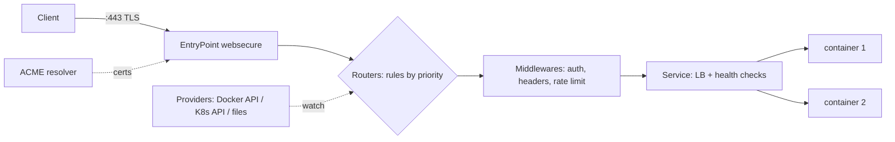

# Traefik

> [!abstract] TL;DR
> Traefik is a Go-based, cloud-native **reverse proxy and load balancer** that **auto-discovers routes** from [[Docker]] labels, [[Kubernetes]] (CRDs, Ingress, Gateway API), files or KV stores, and gets TLS certificates via ACME (Let's Encrypt) automatically. It's the default proxy in [[Coolify]].
> - **Model**: entryPoints → routers (rules) → middlewares → services.
> - **Run**: v3.6.21+/v3.7.x. 2026 brought a steady stream of CVEs, including a **critical ForwardAuth bypass**.
> - **Biggest footgun**: mounting the Docker socket gives root-equivalent access to the host.

## Introduction
- **Origin**: created by Emile Vauge (2015), maintained by Traefik Labs. MIT licensed. Commercial Traefik Hub adds API gateway/management features.
- **Problem**: in container environments, backends come and go with dynamic IPs. Hand-edited [[Nginx]] configs and manual certs don't keep up. Traefik watches providers and reconfigures itself live, with no reloads.
- **Where it sits**: the edge of a VPS or cluster: [[Cloudflare]] (optional) → **Traefik :443** → app containers. In ZP's stack it's the proxy [[Coolify]] manages per server.

## Core Concepts

### Request pipeline
| Concept | Role | Example |
|---|---|---|
| **EntryPoint** | Listening port/protocol | `web` :80, `websecure` :443, `metrics` :8082 |
| **Router** | Matches requests by **rule**, selects TLS, middlewares, service | ``Host(`api.example.my`) && PathPrefix(`/v1`)`` |
| **Middleware** | Transforms/guards requests | redirects, `basicAuth`, `forwardAuth`, `rateLimit`, `ipAllowList`, headers, `stripPrefix`, `compress`, `retry` |
| **Service** | Load balancing to backends | Round robin/weighted, sticky sessions, health checks |
| **Provider** | Source of dynamic config | Docker/Swarm labels, file (YAML/TOML), Kubernetes CRD/Ingress/Gateway API, Consul, Redis/etcd |
| **Certificate resolver** | ACME automation | HTTP-01, TLS-ALPN-01, **DNS-01** (Cloudflare API token → wildcards) |

### Static vs dynamic configuration
- **Static** (startup only: CLI flags, `traefik.yml`, env): entryPoints, providers, certificate resolvers, logs, metrics, API/dashboard. Changes need a restart.
- **Dynamic** (hot-reloaded from providers): routers, middlewares, services, TLS options.

### Docker labels example
```yaml
services:
  api:
    image: ghcr.io/rarticle/api:1.4.0
    labels:
      - traefik.enable=true
      - traefik.http.routers.api.rule=Host(`api.example.my`)
      - traefik.http.routers.api.entrypoints=websecure
      - traefik.http.routers.api.tls.certresolver=le
      - traefik.http.routers.api.middlewares=secure-headers@file,api-ratelimit
      - traefik.http.middlewares.api-ratelimit.ratelimit.average=50
      - traefik.http.middlewares.api-ratelimit.ratelimit.burst=100
      - traefik.http.services.api.loadbalancer.server.port=3000
      - traefik.http.services.api.loadbalancer.healthcheck.path=/healthz
    networks: [web]
```

## Architecture / How It Works

- **Discovery**: the Docker provider watches the Docker API (socket) for container events and builds routers/services from labels. Configuration updates apply in-memory without dropping connections.
- **Router priority** defaults to rule length (longer rule = higher priority). Set `priority` explicitly when rules overlap.
- **TLS**: certs stored in `acme.json` (must be `chmod 600`, and persisted on a volume). TLS options set min version/cipher suites. Supports TCP/UDP routers (SNI routing) and HTTP/3.
- **Observability (v3)**: OpenTelemetry tracing/metrics/logs, Prometheus metrics, access logs (JSON), and a dashboard/API (protect it, or disable `api.insecure`).
- **Plugins**: Go middlewares interpreted by Yaegi, or WASM plugins, loaded from the plugin catalog. They're third-party code in your edge path, so vet them.

## Project Structure
```text
/opt/traefik/                     # or Coolify: /data/coolify/proxy/
├── docker-compose.yml
├── traefik.yml                   # static config
├── dynamic/
│   ├── middlewares.yml           # secure-headers, auth, ip allow-lists
│   └── tls.yml                   # TLS options
└── acme.json                     # chmod 600, persisted
```
```yaml
# traefik.yml (static)
entryPoints:
  web:
    address: ":80"
    http: { redirections: { entryPoint: { to: websecure, scheme: https } } }
  websecure:
    address: ":443"
    forwardedHeaders: { trustedIPs: ["173.245.48.0/20", "103.21.244.0/22"] }   # Cloudflare ranges (full list) → real client IPs
providers:
  docker: { exposedByDefault: false, network: web, endpoint: "tcp://socket-proxy:2375" }
  file: { directory: /etc/traefik/dynamic, watch: true }
certificatesResolvers:
  le:
    acme:
      email: ops@example.my
      storage: /acme.json
      dnsChallenge: { provider: cloudflare }          # needs CF_DNS_API_TOKEN (Zone:DNS:Edit, single zone)
api: { dashboard: true }                              # expose only via an authenticated router
accessLog: { format: json }
metrics: { prometheus: {} }
```

## Use Cases
| Use case | Why it fits |
|---|---|
| Single-VPS Docker hosting (Coolify, Compose) | Label-based routing + automatic HTTPS, no config reloads |
| Many small client apps per server | One proxy, per-host routers, wildcard certs via DNS-01 |
| Kubernetes ingress / Gateway API | CRDs (IngressRoute), Gateway API support, k3s default |
| Canary / blue-green | Weighted services, mirroring |
| Simple SSO in front of internal tools | `forwardAuth` to Authelia/authentik/oauth2-proxy |
| Heavy static file serving, complex caching | **Weaker fit**. Use [[Nginx]], Caddy or a CDN ([[Cloudflare]]) |

## Pros & Cons
| Pros | Cons |
|---|---|
| Automatic discovery from Docker/K8s, live reconfiguration | Label sprawl. Config is scattered across compose files |
| Built-in ACME (HTTP/TLS-ALPN/DNS-01, wildcards) | Docker provider needs socket access (security risk) |
| Middlewares cover most edge needs without code | No built-in response caching (unlike Nginx) |
| Native Gateway API / K8s CRDs, HTTP/3, TCP/UDP | Debugging rule priority and middleware chains can be opaque |
| OpenTelemetry, Prometheus, dashboard | Frequent security releases in 2026. Patching is mandatory |
| Single static Go binary, MIT license | v2 → v3 migration had breaking rule syntax changes |

## Alternatives & Peers
| Alternative | Strength vs Traefik | Weakness vs Traefik | Pick it when… |
|---|---|---|---|
| [[Nginx]] | Raw performance, caching, mature, huge knowledge base | Static config + reloads, ACME via certbot | High-traffic static/caching, legacy setups |
| Caddy | Simplest config (Caddyfile), automatic HTTPS by default | Docker discovery needs plugins (caddy-docker-proxy) | Small setups wanting minimal config |
| HAProxy | Top-tier L4/L7 load balancing performance | Less dynamic discovery, manual certs | High-throughput TCP/HTTP balancing |
| Envoy (+ Envoy Gateway) | Service-mesh grade, xDS, Gateway API reference | Complex | Kubernetes at scale, mesh |
| Cloudflare Tunnel | No inbound ports at all | Vendor dependence, Cloudflare-only path | Hiding origins, admin tools ([[Cloudflare]]) |

## Tips & Reminders
> [!tip]
> - `exposedByDefault: false`. Opt in per container with `traefik.enable=true`.
> - Use a **Docker socket proxy** (e.g. tecnativa/docker-socket-proxy with only `CONTAINERS=1`) instead of mounting `/var/run/docker.sock` into Traefik.
> - Behind [[Cloudflare]] proxy: use DNS-01 (HTTP-01 also works, but DNS-01 handles wildcards and orange-cloud). Set `forwardedHeaders.trustedIPs` to Cloudflare's ranges so rate limits and logs see real client IPs. Use an origin firewall that only allows Cloudflare IPs.
> - Protect the dashboard with an authenticated router (basicAuth + IP allow-list, or forwardAuth). Never use `api.insecure=true` in production.
> - Pin the image to a patch version (`traefik:v3.7.x`), subscribe to GitHub security advisories, and upgrade promptly.
> - **In ZP's stack**: [[Coolify]] generates Traefik labels per app. Customize via Coolify's proxy dynamic configs (`/data/coolify/proxy/dynamic/`) rather than hand-editing generated labels. For [[n8n]], route the webhook hostname separately from the editor, and protect the editor with forwardAuth/Cloudflare Access.

## Versions & Breaking Changes
| Version | Released | Key changes | Breaking / migration notes |
|---|---|---|---|
| v1.x | 2016–2019 | Frontends/backends model | EOL |
| **v2.0** | 2019-09 | Routers/middlewares/services model, TCP routers, CRDs | Complete config rewrite from v1 |
| v2.11 | 2024-02 | Last v2 minor | Security-only support then EOL. Migrate to v3 |
| **v3.0** | 2024-04 | OpenTelemetry, WASM plugins, HTTP/3 GA, Gateway API, SPIFFE | Rule matcher changes (`HostRegexp` uses Go regex, `Headers` → `Header`, `ClientIP`), `ruleSyntax: v2` per router for gradual migration. Some Docker/K8s defaults changed |
| v3.1–v3.5 | 2024–2025 | Gateway API conformance, Knative, NGINX Ingress annotation compatibility provider (ingress-nginx migration) | — |
| v3.6 | 2025–2026 | Maintained line with many 2026 security fixes (3.6.10 → 3.6.21+) | Upgrade to ≥ 3.6.21 |
| **v3.7** | 2026 | Current minor (3.7.5+ fixes CVE-2026-54761) | Check release notes per minor |

> [!warning] Unverified — check before relying on this
> The latest patch versions and v2.11 EOL date weren't confirmed against the official releases page this run. Check https://github.com/traefik/traefik/releases and https://doc.traefik.io/traefik/deprecation/releases/.

## Critical Issues & Gotchas
> [!danger] 2026 CVE wave: patch Traefik like an internet-facing app
> - **CVE-2026-35051**: ForwardAuth bypass when `trustForwardHeader=false` and Traefik sits behind a trusted upstream proxy. Rated up to CVSS 10.0. Fixed in 3.6.14.
> - **CVE-2026-29777**: router-rule token injection via HTTPRoute in shared gateways, letting a tenant hijack other hostnames. Fixed in 3.6.10.
> - **CVE-2026-54761**: fixed in 3.6.21 / 3.7.5.
>
> Several more CVEs landed in 3.6.11–3.6.12. If you rely on forwardAuth to protect admin panels (common with Coolify/n8n setups), you were exposed until patched.

> [!danger] Docker socket = root on the host
> Traefik needs the Docker API for discovery. A Traefik RCE or a malicious plugin with the socket mounted can start privileged containers and take over the host. Use a read-only socket proxy restricted to container listing, run Traefik as non-root where possible, and don't install unvetted plugins.

> [!warning] Gotchas
> - `acme.json` with wrong permissions (not 600) is ignored, which leads to cert issuance loops and Let's Encrypt **rate limits** (50 certs/registered domain/week, 5 duplicate certs/week).
> - Containers on multiple networks: set `traefik.docker.network` (or provider `network`), otherwise Traefik may pick an unreachable IP → 502/504.
> - Services listening on `127.0.0.1` inside the container are unreachable. Bind apps to `0.0.0.0`.
> - Without `trustedIPs`, `X-Forwarded-For` behind Cloudflare/LB shows proxy IPs, so rate limiting and IP allow-lists hit everyone or no one.
> - Long-lived WebSocket/SSE connections need adequate `respondingTimeouts`/`readTimeout` (v3 defaults changed). Check timeouts if connections drop at 60 s.
> - Two routers with the same rule: the one with the higher priority wins silently. Watch the dashboard for duplicates.

## Deep Dives
N/A — no deep dives planned yet. Candidates: Traefik middlewares & auth patterns, TLS/ACME with Cloudflare DNS-01.

## Related
- [[Docker]] — label-based discovery, networks
- [[Coolify]] — manages Traefik as its proxy
- [[Cloudflare]] — DNS-01 certs, proxy in front, real-IP headers
- [[Nginx]] — main peer
- [[Kubernetes]] — IngressRoute / Gateway API controller
- [[Network Security]] — origin hardening, TLS settings
- [[n8n]] — routing editor vs webhooks

## References
- Traefik docs: https://doc.traefik.io/traefik/
- Releases: https://github.com/traefik/traefik/releases
- v2 → v3 migration: https://doc.traefik.io/traefik/migration/v2-to-v3/
- Security advisories: https://github.com/traefik/traefik/security/advisories
- CVE-2026-35051: https://osv.dev/vulnerability/CVE-2026-35051
- Docker socket proxy: https://github.com/Tecnativa/docker-socket-proxy
