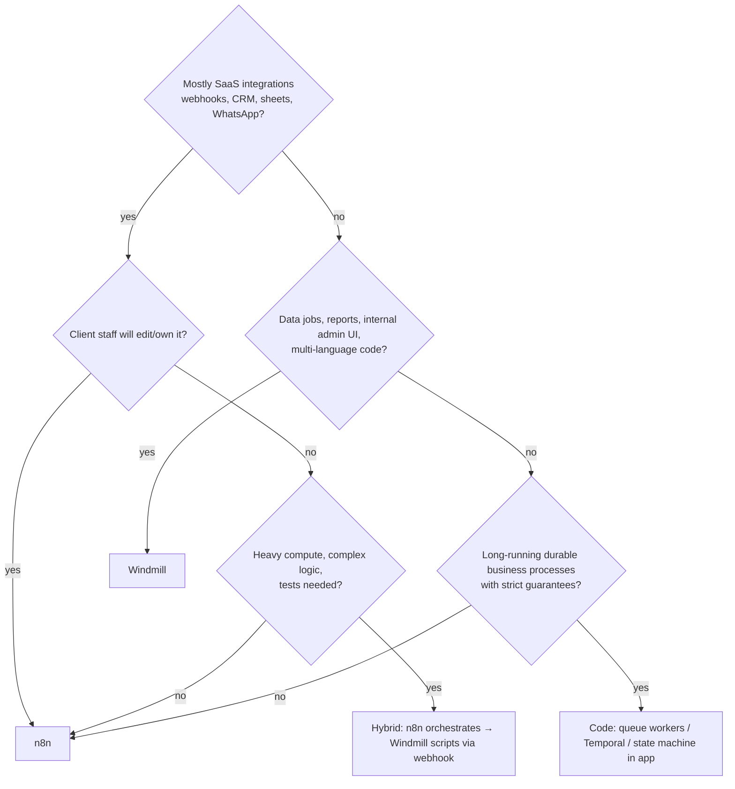

# Windmill - Windmill vs n8n Architecture Decision

> [!info] Deep dive of [[Windmill]]

> [!abstract] TL;DR
> - **Choose [[n8n]]** when the workflow is **integration-shaped** (connectors, webhooks, SaaS APIs) and **someone non-technical** may read or edit it.
> - **Choose Windmill** when the work is **code-shaped**: real Python/TypeScript/Go with Git review and tests, heavy compute, or internal admin UIs. It runs on just Postgres + workers.
> - **Hybrid** (n8n orchestrates integrations, Windmill runs heavy scripts behind a webhook) is a good agency default.
> - **Decide licensing before you resell**: n8n is fair-code (Sustainable Use License), Windmill is AGPL with a proprietary CE image and EE gating.

## Concept

### Decision matrix
| Dimension | n8n | Windmill | Edge |
|---|---|---|---|
| Primary author | Low-code builders, ops staff, agencies | Developers | Depends on who maintains it |
| Building block | Visual nodes + Code node (JS/Python) | Scripts (Python, TS/Bun/Deno, Go, Rust, Bash, SQL…) composed into flows | Code-heavy → Windmill |
| Integrations | 400+ native nodes, AI Agent nodes, community nodes | Hub scripts + resource types, you write API calls more often | n8n |
| Versioning / review | Workflow JSON (Git via source control feature/export), diffs hard to review | Git sync of real code files, PR review, local dev CLI (`wmill`) | Windmill |
| Testing | Manual/pinned data, limited unit testing | Normal unit tests on scripts, typed inputs | Windmill |
| Performance | Node.js per execution in queue mode, OK for I/O-bound | Rust core, fast worker cold starts, good for CPU/batch | Windmill |
| Internal tools / UIs | Forms, chat triggers | Auto-generated UIs + App builder (Retool-like) | Windmill |
| Human approvals | Wait/Form nodes | Approval steps with suspend/resume | Tie |
| Infra footprint | Postgres + Redis + main + workers (queue mode) | Postgres + server + workers | Windmill (fewer components) |
| Handover to SME client | Client staff can follow the canvas | Needs a developer | n8n |
| Ecosystem / hiring | Very large community, tutorials, freelancers | Smaller | n8n |

### Licensing scenarios (get written confirmation for your case)
| Scenario | n8n (Sustainable Use License) | Windmill (AGPLv3 source + proprietary CE image + EE) |
|---|---|---|
| Internal automations for your own company | ✅ Free self-host | ✅ Free CE |
| Agency builds workflows on the **client's** instance | ✅ Generally fine | ✅ Generally fine |
| You host one multi-client instance and charge for "automation platform" access | ⚠️ Likely needs commercial license | ⚠️ AGPL network clause + EE terms. Review |
| Embedding the engine in your SaaS product | ❌ Needs n8n Embed license | ⚠️ AGPL obligations or commercial agreement |

## How It Works


### Runtime architecture side by side
| | n8n (queue mode) | Windmill |
|---|---|---|
| Control plane | Main process (UI, triggers, webhooks) | Server (API, UI, webhooks) |
| Queue | Redis (Bull) | Postgres (jobs table, `SKIP LOCKED`) |
| Execution | Workers (Node.js), task runners for Code nodes | Workers by group/tag (default, native, GPU, high-mem) |
| State | Postgres (executions, credentials encrypted with `N8N_ENCRYPTION_KEY`) | Postgres (scripts, flows, jobs, resources/secrets) |
| Scaling | Add workers, separate webhook processors ([[n8n - Queue Mode & Scaling]]) | Add workers per group |
| Single point to protect | Encryption key + Postgres + Redis | Postgres + secrets encryption key |

## Practical Usage

### Hybrid pattern: n8n → Windmill for heavy steps
```text
WhatsApp webhook (n8n) → validate + dedupe → HTTP Request to Windmill webhook (sync or async job)
                                         ← result JSON (or Windmill calls back n8n webhook when done)
                       → reply via Meta Cloud API (n8n node)
```
```python
# Windmill script: f/finance/reconcile_bank_csv.py: typed inputs → auto UI + webhook
import polars as pl

def main(csv_url: str, tenant_id: str, tolerance_sen: int = 0) -> dict:
    df = pl.read_csv(csv_url)
    # ... heavy matching logic with unit tests in the repo ...
    return {"matched": 1240, "unmatched": 17, "report_url": upload_report(df, tenant_id)}
```
- Call it with a Windmill webhook token scoped to that script only. Run it on a `high-mem` worker group so it can't starve webhook-driven jobs.

### Selection checklist for a new client project
1. **Who maintains it after handover?** If the client's ops person, choose n8n. If you or a developer, either works.
2. **How many integrations need native nodes** versus custom HTTP? More than 5 native-node integrations points to n8n.
3. **Any job > 1 min CPU, or big data transforms?** Use Windmill or a code worker for that part.
4. **Does it need an internal UI** (approve refunds, run reports)? Use Windmill apps, or Next.js + Supabase if the UI is customer-facing.
5. **Licensing model**: on the client's infra, either works. On your multi-tenant platform, check both licenses first.
6. **Ops budget**: both need backups, updates and monitoring. Fewer platforms is better, so don't add Windmill for one script.

### Ops baseline (either platform on Coolify)
- Dedicated Postgres (not the app's Supabase DB), nightly dumps to R2, and the encryption key stored separately ([[Coolify - Operations, Backups & Hardening]]).
- Editors behind Cloudflare Access, with webhooks on a separate hostname ([[Cloudflare - Zero Trust Tunnel & Access]]).
- Pin versions and read release notes. Windmill ships weekly minors, and n8n had several critical CVEs in 2025–26 ([[n8n]]).

## Patterns & Anti-patterns
| Pattern | When | Anti-pattern to avoid |
|---|---|---|
| n8n for integration glue, code for business-critical logic | SME automation | 200-node n8n workflows implementing core billing logic |
| Windmill for code-first jobs with tests and Git review | Finance/reporting/data jobs | Long Python in n8n Code nodes with no tests or versioning |
| Hybrid via webhooks with idempotency keys | Mixed workloads | Two platforms calling each other in loops without dedupe |
| One platform per client unless a clear need exists | Small clients | n8n + Windmill + Zapier for 10 workflows (3× ops) |
| Decide license model before productizing | Reselling automation | Building a "platform" on n8n/Windmill, then discovering license terms |
| Move durable money/state flows into the app (state machine + queue) | Payments, orders | Relying on any workflow engine's retry as the system of record |

## Performance & Trade-offs
- **Throughput**:
  - **n8n**: queue mode scales horizontally, but per-execution overhead is higher, and large items/binaries stress memory.
  - **Windmill**: lower per-job overhead, with native workers for compute.
- **Developer velocity**: n8n is fastest for "connect A to B". Windmill is faster once logic grows (IDE, types, tests, reuse).
- **Lock-in**:
  - **n8n**: workflows are n8n-specific JSON.
  - **Windmill**: scripts are plain code, portable to any runtime. Flows and apps are Windmill-specific.
- **Cost**: both are cheap to self-host (1 small VPS for low volume). Paid tiers are needed for SSO/audit/scale features, so check if the client requires SSO.

## Tips & Reminders
> [!tip]
> - **Prototype in n8n, harden in code**: once a workflow becomes business-critical and complex, port the core logic to a tested script (Windmill or app worker), and keep n8n as the trigger/integration shell.
> - **Document in the SOW** which platform runs what, who owns credentials, update cadence, and what happens at contract end (export workflows/scripts, hand over instance).
> - **AI agents**: n8n's AI Agent nodes are quicker for chatbots. Code-first agents with evals live better in scripts ([[AI Agents - Tool Calling & Agent Loops]]).
> - **In ZP's stack**:
>   - **Defaults**: n8n stays the default delivery tool. Windmill is optional for reconciliation, PDF/report generation and internal admin apps.
>   - **Sharing**: never share the n8n Redis/DB with Windmill or app queues.

## Version Notes
N/A: decision framework. Platform versions and breaking changes live in [[n8n]] (2.0 hardened defaults, 2025–26 CVEs) and [[Windmill]] (weekly 1.x releases).

## Critical Issues & Gotchas
> [!danger] Workflow engines are high-value targets
> - **Why**: both platforms store **every integration credential** a client has (CRM, payment, WhatsApp, Google) and can execute code.
> - **Precedent**: n8n's 2025–26 critical CVEs showed that an exposed editor equals full compromise.
> - **Controls**: editors never public, 2FA/SSO, patch within days of security releases, separate instances per sensitive client, and least-privilege credentials per workflow.

> [!danger] Licensing surprises when productizing
> Agencies often start by hosting one n8n or Windmill instance for many clients and charging a monthly "platform fee". Depending on the license terms, that can require a commercial agreement (n8n Sustainable Use License, Windmill AGPL/EE). Clarify with the vendor and document it, or deploy per-client instances on the client's own infra/account.

> [!warning] Gotchas
> - Mixing both platforms doubles patching, backups and monitoring. Only add the second when the decision table clearly says so.
> - n8n workflow JSON diffs are noisy (node positions, IDs), so code review is hard. Windmill Git sync is better, but flows still have generated files.
> - Windmill's weekly releases mean upgrading across many minors at once. Read the migration notes and test on staging.
> - Hand-written HTTP integrations in Windmill must implement retries, pagination and rate limits that n8n nodes give you for free.

## Related
- [[Windmill]]
- [[n8n]] — default integration platform
- [[n8n - Queue Mode & Scaling]] — n8n runtime architecture
- [[Message Queues - BullMQ in Production]] — code-first background jobs alternative
- [[Coolify]] — hosting either platform
- [[AI Agents - Tool Calling & Agent Loops]] — where agents should live

## References
- Windmill docs: https://www.windmill.dev/docs/intro
- Windmill vs n8n (vendor comparison, read critically): https://www.windmill.dev/docs/compared_to/peers
- Windmill pricing / EE features: https://www.windmill.dev/pricing
- n8n Sustainable Use License: https://docs.n8n.io/sustainable-use-license/
- n8n queue mode: https://docs.n8n.io/hosting/scaling/queue-mode/
