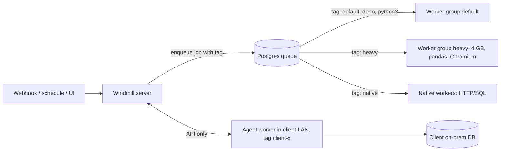

# Windmill - Worker Groups & Sandboxing

> [!info] Deep dive of [[Windmill]]

> [!abstract] TL;DR
> - **Routing**: Windmill workers pull jobs from a Postgres queue by **tag**. A **worker group** is a set of workers listening to chosen tags, configured in the UI and hot-reloaded. Route heavy, untrusted or network-special jobs to their own groups so webhooks and light scripts never wait behind them.
> - **Sandboxing**: **nsjail is disabled by default**. Enable it (`DISABLE_NSJAIL=false`, privileged containers) or enforce it instance-wide with the `job_isolation` setting before running code you didn't write.
> - **Agent workers** talk to the server only via the API, so they're ideal for running inside a client's network.

## Concept
| Component | Role | Notes |
|---|---|---|
| Server | API, UI, schedules, triggers | Stateless. Scale horizontally |
| Postgres | Queue + state + results | Single source of truth. Back it up |
| **Worker** | Pulls jobs matching its tags, runs Bun/Deno/Python/Go/Bash/SQL | One job at a time per worker process (scale by replicas) |
| **Worker group** | Config shared by workers: tags, init script, env, dedicated script | e.g. `default`, `heavy`, `native`, `gpu`, `client-x` |
| **Native workers** | Lightweight executors for HTTP/SQL/REST-only jobs, many concurrent | Fast for API glue |
| **Dedicated workers** | Worker pinned to one script/flow, kept warm | Lowest latency for hot webhooks |
| **Agent workers** | Remote workers that connect via API only (no direct DB access) | Run in another network or client premises |

**Isolation levels**:

| Level | How | Protects against |
|---|---|---|
| None (default) | Scripts run as the worker process user inside its container | Nothing between jobs on the same worker |
| Container per worker group | Separate Docker services/networks/limits per group | Noisy neighbours, network reach |
| **nsjail** per job | Linux namespaces + seccomp + mount restrictions per execution | Untrusted code reading other jobs' files/env, escaping the worker FS |
| Separate instance | Different server + DB | Tenant data isolation and compliance |

## How It Works

- A job's tag comes from the script/flow step settings (or language defaults). Workers only pick jobs whose tag is in their group's list.
- With nsjail on, each execution gets its own jail with configured mounts and limits. That requires a **privileged** container (or the right capabilities) on the host.

## Practical Usage
**Compose: separate worker groups with limits** (Coolify):
```yaml
x-worker: &worker
  image: ghcr.io/windmill-labs/windmill:1.830.0          # pin; upgrade on a schedule
  command: ["windmill"]
  restart: unless-stopped
  environment: &wenv
    DATABASE_URL: ${WM_DATABASE_URL}
    MODE: worker
    DISABLE_NSJAIL: "false"                              # turn sandboxing on
  privileged: true                                       # nsjail needs it (or specific caps)
  networks: [windmill]

services:
  worker-default:
    <<: *worker
    environment: { <<: *wenv, WORKER_GROUP: default }
    deploy: { replicas: 3, resources: { limits: { cpus: "1", memory: 1g } } }
  worker-heavy:
    <<: *worker
    environment: { <<: *wenv, WORKER_GROUP: heavy }
    deploy: { replicas: 1, resources: { limits: { cpus: "2", memory: 4g } } }
  worker-native:
    <<: *worker
    environment: { <<: *wenv, WORKER_GROUP: native, NUM_WORKERS: "8" }
    privileged: false                                    # HTTP/SQL only; no user code sandbox needed
```
**Worker group config** (UI → Workers → group `heavy`): tags `heavy, python3-heavy`, an init script that preinstalls system packages (`apt-get install -y chromium`), and environment variables scoped to the group.

**Route a script to a group** (script metadata in the git-synced repo):
```yaml
# f/reports/build_monthly_pdf.script.yaml
summary: Build monthly PDF report
tag: heavy                 # runs only on workers listening to "heavy"
timeout: 900
concurrency_limit: 2       # at most 2 concurrent runs instance-wide
```
**Agent worker in a client network** (reaches their on-prem DB; nothing exposed inbound):
```bash
docker run -d --name wm-agent \
  -e MODE=agent -e BASE_URL=https://windmill.example.my -e AGENT_TOKEN=… \
  -e WORKER_GROUP=client-acme ghcr.io/windmill-labs/windmill:1.830.0
```
Scripts tagged `client-acme` then execute next to the client's ERP database.

**Wrong way**:
```text
❌ One default worker group running webhooks, nightly ETL and Chromium scraping → webhook latency spikes to minutes
❌ Multi-client instance without nsjail                                         → one client's script can read another job's temp files/env
❌ Exposing a client's on-prem DB to the internet so cloud workers can reach it → use an agent worker inside their network
```

## Patterns & Anti-patterns
| Pattern | When | Anti-pattern to avoid |
|---|---|---|
| Groups by workload class (default / heavy / native / gpu) | Mixed workloads | Everything on `default` |
| Dedicated worker for latency-critical webhook scripts | WhatsApp/payment handlers | Cold starts + queueing behind batch jobs |
| nsjail on (instance `job_isolation`) when anyone else writes scripts | Multi-user or multi-client | Trusting "internal" users with full worker access |
| Per-group network policy (egress allowlist) | Scripts handling sensitive data | All workers with unrestricted internet |
| Agent workers for on-prem/client networks | Hybrid integrations | VPN/port-forward from client DB to cloud |
| `concurrency_limit` + timeouts per script | Rate-limited APIs, heavy jobs | Unbounded parallel runs hitting vendor limits |

## Performance & Trade-offs
- **Throughput**: each worker processes one job at a time, so scale replicas per group. Native workers run many lightweight HTTP/SQL jobs concurrently and are cheaper for API glue.
- **nsjail overhead** is small per job (milliseconds), but needs privileged containers, which some PaaS hosts (e.g. Railway) don't allow. On your own Coolify/KVM host it's fine; weigh the privileged-container risk itself.
- **Dependency caching**: workers cache resolved Python/Bun dependencies on local disk. Mount a cache volume per group to avoid re-resolving on restart, and pre-warm heavy groups via init scripts.
- **Postgres as queue**: simple and transactional, but high job rates churn the jobs tables. Keep result retention short and vacuum healthy ([[PostgreSQL - Transactions & MVCC]]).

## Tips & Reminders
> [!tip] In ZP's stack
> - **When to pick Windmill over n8n**: code-heavy client automations (Python data jobs, reports, internal tools), with three groups on Coolify:
>   - `default` (2–3 replicas);
>   - `heavy` (4 GB, Chromium/pandas);
>   - `native` (API glue).
> - **Client-premises access**: use agent workers per client instead of VPNs ([[Windmill - Windmill vs n8n Architecture Decision]]).

- Keep worker groups and tags in git (instance config export) alongside scripts, so a rebuild is reproducible.
- Alert on queue depth and the oldest queued job per tag. A growing `heavy` queue shouldn't page you, but a growing `default` queue should.
- Give each group only the environment variables and resources (secrets) it needs. Scope workspace resources by folder/permissions.
- Check the license boundary: some worker-group management features are Enterprise. Confirm what your CE deployment supports before designing around it.

## Version Notes
| Version / date | Change relevant here |
|---|---|
| Launch week 1 (2023) | Worker groups with tags, hot-reloaded config, dedicated workers |
| 1.634.0 | Instance setting `job_isolation` = `nsjail_sandboxing` to enforce sandboxing for all jobs |
| 1.7xx–1.8xx (2025–26) | Native and agent workers mature. Frequent releases (pin versions) |
| 2026 | 1.830.0 pinned by the Railway template. The overview's v1.79x snapshot is already behind |

> [!warning] Unverified — check before relying on this
> Agent-worker environment variable names (`MODE=agent`, `AGENT_TOKEN`) and which worker-group features are CE vs EE weren't verified this run. See https://www.windmill.dev/docs/core_concepts/worker_groups and https://www.windmill.dev/docs/advanced/security_isolation.

## Critical Issues & Gotchas
> [!danger] Sandboxing is off by default
> Out of the box, scripts run as the worker's user with access to the worker's filesystem and environment. In a multi-user or multi-client instance, one script can read secrets or temp files of others on the same worker. Enable nsjail (or `job_isolation`), and keep secrets out of worker env vars.

> [!danger] Privileged containers widen the host attack surface
> nsjail needs privileges, and a container escape from a privileged container is a host compromise. Run sandboxed worker groups on a dedicated server, never on the box hosting Postgres or Coolify's control plane ([[Coolify - Multi-Server, Build Servers & Scaling]]).

- **Tag typos** silently strand jobs in the queue (no worker listens). Monitor jobs queued longer than N minutes per tag.
- **Init scripts** run at worker start. A failing `apt-get` makes the whole group crash-loop. Pin package versions and test images.
- **Agent tokens** grant job execution on that group. Rotate them when a client relationship ends, and revoke on offboarding.
- **Long jobs and deploys**: restarting workers mid-job kills runs. Set timeouts, make jobs idempotent, and drain before upgrades.

## Related
- [[Windmill]]
- [[Windmill - Windmill vs n8n Architecture Decision]] — when Windmill fits better than n8n
- [[n8n - Security, Credentials & Self-Hosting Hardening]] — the n8n-side equivalent hardening
- [[Docker - Compose Patterns for Production]] — limits, replicas, privileged containers
- [[Coolify - Multi-Server, Build Servers & Scaling]] — dedicated servers for sandboxed workers
- [[Network Security]] — egress control per worker group

## References
- https://www.windmill.dev/docs/advanced/security_isolation
- https://www.windmill.dev/blog/launch-week-1/worker-groups
- https://www.windmill.dev/changelog/tags/self-hosting
- https://www.windmill.dev/docs/core_concepts/worker_groups
- https://railway.com/deploy/windmill-v1-scripts-flows-and-internal-apps--windmill-v1-scripts-flows-and-internal-a
