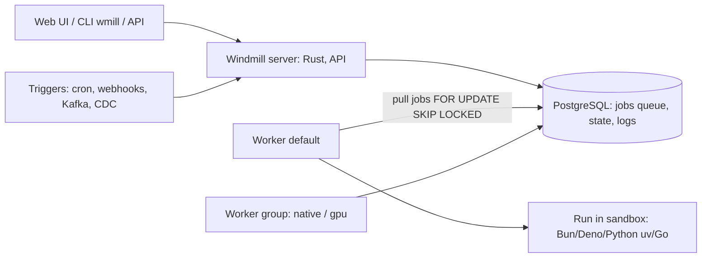

# Windmill

> [!abstract] TL;DR
> Windmill is an open-source, **code-first** developer platform for scripts, workflows, internal UIs and cron jobs. You write normal [[TypeScript]] (Bun/Deno), [[Python]], [[Go]], Bash, SQL and more, and Windmill turns each script into a runnable endpoint with an auto-generated form UI, schedules, webhooks, permissions, logs and retries.
> - **Architecture**: Rust core, and **[[PostgreSQL]] is the only dependency** (it's also the job queue).
> - **vs [[n8n]]**: Windmill is better for engineers who want versioned code, fast execution and Retool-like internal apps. n8n wins for visual integrations with a huge connector catalog and non-developer handoff.
> - **Licensing nuance**: AGPLv3 source, while the prebuilt CE image bundles proprietary parts. Enterprise features (SSO beyond limits, audit logs, worker groups at scale) are paid.

## Introduction
- **Origin**: founded by Ruben Fiszel (Y Combinator S22). Developed in the open at `windmill-labs/windmill`, with very frequent releases (1.x minor versions weekly; ~v1.799 by late August 2026).
- **Problem**: teams accumulate cron scripts, one-off Python jobs and Retool dashboards with no shared auth, secrets, logs or retries. Windmill turns them into a governed platform.
- **Where it sits**: next to or instead of [[n8n]], Airflow/Prefect (data orchestration), Temporal (durable execution) and Retool (internal tools). Self-hosted on [[Docker]]/[[Coolify]] or [[Kubernetes]] (Helm), or Windmill Cloud.

## Core Concepts
| Concept | What it is |
|---|---|
| **Script** | A single function (`main`) in TS/Python/Go/Bash/SQL/PHP/Rust/C#/Java/PowerShell/Ansible/GraphQL. Parameters become a JSON-schema form and API input |
| **Flow** | DAG of steps (scripts, branches, for-loops, approvals/suspend, error handlers, retries), stored as OpenFlow JSON/YAML |
| **App** | Low-code UI builder (drag-and-drop or React/Svelte "full-code" apps) wired to scripts/flows |
| **Resource** | Typed connection config (Postgres, Stripe, Supabase, S3…) shared across scripts |
| **Variable / secret** | Encrypted values with path-based permissions |
| **Trigger** | Schedules (cron), webhooks, HTTP routes, email, WebSocket, Kafka, NATS, SQS/MQTT, Postgres CDC |
| **Workspace / folders / groups** | Multi-tenant isolation and RBAC |
| **Worker / worker group** | Processes that pull jobs from the queue. Tags route jobs to specific groups (GPU, high-memory, native) |

```ts
// f/billing/send_invoice_reminders.ts (Bun runtime)
import * as wmill from "windmill-client";
import postgres from "postgres";

type Postgresql = { host: string; port: number; user: string; password: string; dbname: string };

export async function main(db: Postgresql, overdueDays = 7, dryRun = true) {
  const sql = postgres({ ...db, database: db.dbname });
  const rows = await sql`select id, phone, total_sen from invoices
                         where status = 'unpaid' and due_at < now() - make_interval(days => ${overdueDays})`;
  if (!dryRun) await wmill.runScriptAsync("f/whatsapp/send_template", { to: rows.map(r => r.phone) });
  return { count: rows.length, sample: rows.slice(0, 5) };   // shown in the run log / UI
}
```
```python
# f/reports/daily_sales.py: dependencies auto-resolved (uv) from imports or a requirements comment
import pandas as pd
import wmill

def main(date: str):
    db = wmill.get_resource("f/resources/main_db")
    ...
    return {"rows": len(df)}
```

## Architecture / How It Works

- **Postgres as queue**: jobs are rows. Workers poll with `SELECT … FOR UPDATE SKIP LOCKED`. No Redis or RabbitMQ needed, and backups/HA are just Postgres.
- **Workers** are stateless and scale horizontally. Each runs one job at a time by default (more with "native" workers for lightweight scripts). **Dedicated workers** keep a script warm for ultra-low latency.
- **Dependency caching**: lockfiles are computed per script version (Bun/uv/Go modules) and cached on workers, giving millisecond starts for warm scripts.
- **Isolation**: nsjail sandboxing (Linux) is optional but recommended for multi-tenant/untrusted code. Without it, scripts run as the worker process user.
- **Versioning**: every script/flow deploy creates an immutable hash. **Git sync** mirrors the workspace to a Git repo, and the `wmill` CLI enables local dev + CI deploys.

## Project Structure
```text
windmill-workspace/            # wmill sync pull / push
├── wmill.yaml                 # sync settings, includes/excludes
├── f/                         # folders (permissions boundary)
│   ├── billing/
│   │   ├── send_invoice_reminders.ts
│   │   └── send_invoice_reminders.script.yaml   # metadata, schema, tags
│   └── reports/daily_sales.py
├── u/zp/                      # user-private scripts
└── flows/onboarding.flow/flow.yaml
```
```yaml
# docker-compose (abridged): server + workers + Postgres; Caddy/Traefik in front
services:
  windmill_server:
    image: ghcr.io/windmill-labs/windmill:main     # pin a version tag in production
    environment: [DATABASE_URL=postgres://windmill:${PG_PW}@db/windmill, MODE=server]
  windmill_worker:
    image: ghcr.io/windmill-labs/windmill:main
    environment: [DATABASE_URL=postgres://windmill:${PG_PW}@db/windmill, MODE=worker, WORKER_GROUP=default]
    deploy: { replicas: 2, resources: { limits: { cpus: "1", memory: 2048M } } }
  db:
    image: postgres:17
```

## Use Cases
| Use case | Why it fits |
|---|---|
| Internal tools/admin panels for SME clients | Script + auto-generated form, or Apps builder, with RBAC |
| Code-heavy data jobs (ETL, reports, PDF generation, scraping) | Real Python/TS with any library, fast execution, retries |
| Scheduled ops scripts (backups, reconciliation, cleanup) | Cron + logs + alerts in one place |
| Event-driven backends (webhooks, Kafka, Postgres CDC) | Triggers + scalable workers |
| AI pipelines (embedding batches, LLM calls with retries) | Python/TS SDKs, concurrency limits, GPU worker tags |
| Non-technical client builds and edits their own integrations | **Weaker fit**. [[n8n]]'s visual nodes are friendlier |

## Pros & Cons
| Pros | Cons |
|---|---|
| Code-first: real languages, Git sync, code review, tests | Smaller integration catalog than n8n/Zapier. You write API calls yourself |
| Only Postgres needed. Simple, robust architecture | AGPL + proprietary CE image + EE gating needs a license review for resale |
| Fast execution and horizontal workers | Very fast release cadence. Upgrade discipline needed |
| Auto-generated UIs and full App builder | UI/UX denser than n8n for non-developers |
| Fine-grained permissions, approvals, audit (EE) | Some team features (SSO > limits, audit logs, worker group management) are paid |
| Multi-language in one platform | Smaller community and fewer tutorials than n8n |

## Alternatives & Peers
| Alternative | Strength vs Windmill | Weakness vs Windmill | Pick it when… |
|---|---|---|---|
| [[n8n]] | Visual canvas, 400+ integrations, AI agent nodes, huge community | Node.js only, code nodes are second-class, Sustainable Use License | Client-facing automations, non-dev handoff (ZP's main tool) |
| Temporal | Durable execution, long-running workflows with strong guarantees | Heavy infra, SDK learning curve | Mission-critical, multi-day business processes |
| Airflow / Prefect / Dagster | Data-pipeline focus, lineage, scheduling | Not for internal UIs/webhooks | Data engineering teams |
| Retool / Appsmith / Budibase | Polished internal-tool builders | Weaker job/workflow engine | UI-first internal tools |
| Trigger.dev / Inngest | TS-native background jobs in your codebase | Tied to app repo, less ops UI | Jobs that belong inside a Next.js/Node app |

## Tips & Reminders
> [!tip]
> - Pin the image tag (`ghcr.io/windmill-labs/windmill:1.7xx.x`) and upgrade on a schedule. `main` moves daily.
> - Use folders for permission boundaries per client/team. Store credentials as **resources/secrets**, never in script bodies.
> - Enable Git sync from day one so every change is reviewable and recoverable.
> - Set job retention (`RETENTION_PERIOD`) and monitor Postgres size. Job logs grow fast.
> - Separate worker groups for heavy jobs (Python/pandas, Chromium) from the default group, so long jobs don't starve webhooks.
> - **In ZP's stack**: keep [[n8n]] as the default for client automations (WhatsApp, CRM, sheets). Add Windmill on [[Coolify]] when you need code-heavy jobs (reconciliation, PDF/report generation, AI batch processing) or internal admin UIs for clients, sharing a dedicated [[PostgreSQL]] database (not the Supabase app DB). Check the license before offering Windmill as a hosted service to clients.

## Versions & Breaking Changes
| Version | Released | Key changes | Breaking / migration notes |
|---|---|---|---|
| 1.0 | 2022-12 | Scripts, flows, apps, Postgres queue | — |
| 1.2xx–1.4xx | 2023–2024 | Bun runtime, Go/Rust/C#, full-code apps, worker groups, HTTP routes | Some deprecations of Deno-first defaults |
| 1.4xx–1.6xx | 2024–2025 | Python via uv, Kafka/NATS/SQS/MQTT/Postgres triggers, AI assistant, private hub | Check migration notes per minor |
| 1.7xx (2026) | 2026 | Continued weekly releases (~v1.799 by 2026-08-28) | Read release notes before jumping many minors |

> [!warning] Unverified — check before relying on this
> Exact current version, CE vs EE feature limits, and license terms for the published images weren't confirmed from primary sources. Check https://github.com/windmill-labs/windmill/releases, the LICENSE file, and https://www.windmill.dev/pricing.

## Critical Issues & Gotchas
> [!danger] Licensing for client/resale scenarios
> The source is AGPLv3 (with some Apache-2.0 parts), but the **prebuilt Community Edition image includes proprietary code**, and several features require an Enterprise license. Offering Windmill as a managed service, or embedding it in a commercial product, can trigger AGPL obligations or need EE terms. Get this clear in writing before reselling.

> [!danger] Workers execute arbitrary code with access to secrets
> Anyone who can deploy scripts can read resources they're permitted to use and run code on the worker host. Without nsjail sandboxing, scripts share the worker container (network, filesystem). Restrict deploy permissions, enable sandboxing, run workers on isolated networks with egress limits, and keep the Docker socket out of workers unless required.

> [!warning] Gotchas
> - Postgres is a single point of failure for both state and queue. Back it up and size it for job-log volume.
> - Long-running jobs need explicit timeouts. Default limits can kill legit long ETL runs.
> - Webhook endpoints are authenticated with tokens by default. Exposing them publicly requires scoped tokens or public HTTP routes, and you must think about abuse/rate limiting.
> - Flow input/output payloads are stored in Postgres. Large binary data should go to S3/R2 via the workspace object storage integration.
> - Fast-moving UI: tutorials and screenshots from older versions may not match.

## Deep Dives
- [[Windmill - Windmill vs n8n Architecture Decision]]

Candidates: worker groups & sandboxing.

## Related
- [[n8n]] — visual workflow peer, ZP's primary automation tool
- [[PostgreSQL]] — Windmill's only dependency (state + queue)
- [[Python]] · [[TypeScript]] — main script languages
- [[Docker]] · [[Coolify]] — self-hosting
- [[Kafka]] — event triggers
- [[Redis]] — contrast: n8n queue mode uses Redis, Windmill doesn't

## References
- Docs: https://www.windmill.dev/docs/intro
- GitHub: https://github.com/windmill-labs/windmill
- Self-host guide: https://www.windmill.dev/docs/advanced/self_host
- Pricing / editions: https://www.windmill.dev/pricing
- n8n vs Windmill (2026): https://automationatlas.io/guides/n8n-vs-windmill-2026-comparison/
