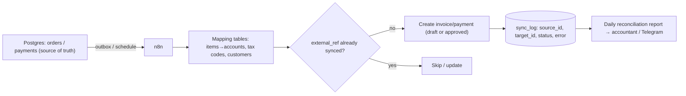

# n8n - Accounting Integrations with Xero, QuickBooks & SQL Accounting

> [!info] Deep dive of [[n8n]]

> [!abstract] TL;DR
> Accounting integrations remove double entry: **orders/POS → invoices**, **payment gateway settlements → payments/reconciliation**, **supplier invoices (extracted) → bills**, **won CRM deals → invoices**.
> - **Cloud APIs**: **Xero** and **QuickBooks Online** have mature OAuth2 APIs and n8n nodes.
> - **Malaysian desktop-first products** (**SQL Accounting**, **AutoCount**) are very common among SMEs. They usually integrate via vendor SDKs, local APIs or import files, so confirm the client's version and integration options early.
> - **Non-negotiables**:
>   - **idempotency** (one source document → one accounting document, via external reference);
>   - **mapping tables** (items, chart of accounts, tax codes such as SST, customers);
>   - **reconciliation reports**;
>   - **the accountant signs off the mapping**.
>
> Draft documents first, approve and post later, until the flow is proven.

## Concept
| Flow | Source | Target document | Key mapping |
|---|---|---|---|
| Sales | Orders/POS/booking app | Invoice / cash sale | Customer, item/service, revenue account, tax code |
| Payments | Stripe/Billplz/FPX settlements | Payment / bank deposit | Gateway clearing account, fees account |
| Purchases | Supplier invoices (email/extraction) | Bill / purchase invoice | Supplier, expense account, tax |
| Credit notes | Refunds | Credit note | Link to original invoice |
| E-invoicing | Validated documents | MyInvois UUID stored on invoice | Where software supports it ([[n8n - MyInvois e-Invoicing Integration]]) |

**Software landscape (Malaysia SMEs)**:

| Software | Integration path | Notes |
|---|---|---|
| Xero | REST API + OAuth2, n8n node | Rate limits per tenant/app. Good docs |
| QuickBooks Online | REST API + OAuth2, n8n node | Sandbox companies for testing |
| SQL Accounting (eStream) | Vendor SDK/API/import (version-dependent) | Very common locally. Often on-prem Windows |
| AutoCount | Vendor API/plugins/import | Common locally. Check edition/API module |
| Zoho Books | REST API (Zoho DC-specific) | Pairs with Zoho CRM |

## How It Works


## Practical Usage
**Sync log for idempotency**:
```sql
create table public.accounting_sync (
  tenant_id uuid not null,
  source_type text not null,          -- 'order', 'payment', 'refund', 'bill'
  source_id text not null,
  target_system text not null,        -- 'xero', 'qbo', 'sqlacc'
  target_id text,
  status text not null default 'pending',   -- pending|synced|failed|skipped
  error text,
  synced_at timestamptz,
  primary key (tenant_id, source_type, source_id, target_system)
);
```
**Mapping table** (owned by the accountant, editable via admin UI):
```sql
create table public.accounting_mappings (
  tenant_id uuid, kind text,          -- 'item', 'payment_method', 'tax'
  source_key text, target_code text,  -- e.g. 'svc_haircut' → '4000', 'SST6' → 'SR'
  primary key (tenant_id, kind, source_key)
);
```
**Xero invoice creation** (n8n Xero node or HTTP Request):
```json
{
  "Type": "ACCREC",
  "Contact": { "Name": "Walk-in Customer" },
  "Date": "2026-11-28",
  "DueDate": "2026-11-28",
  "Reference": "ORD-2026-11-000123",
  "Status": "DRAFT",
  "LineAmountTypes": "Exclusive",
  "LineItems": [
    { "Description": "Haircut", "Quantity": 1, "UnitAmount": 35.0, "AccountCode": "4000", "TaxType": "OUTPUT" }
  ]
}
```
**Daily settlement → payment with fees** (gateway payout of RM 970 for RM 1,000 sales):
```text
Payout report (Stripe/Billplz) → n8n:
  for each paid invoice in payout → Payment (account: Gateway Clearing)
  bank deposit RM 970 → transfer Clearing → Bank; fee RM 30 → Expense: Payment Gateway Fees
→ clearing account should net to zero per payout (reconciliation check)
```
**SQL Accounting / AutoCount** (desktop): integrate via the vendor's supported API/SDK on a Windows host or middleware, or generate import files on a schedule. Confirm with the client's reseller before promising real-time sync.

**Wrong way**:
```text
❌ Creating invoices without an external reference check       → duplicates after retries; accountant cleanup
❌ Hard-coding account codes/tax codes in workflows             → breaks when the chart of accounts changes
❌ Posting directly as APPROVED from day one                    → errors become official records
❌ Recording gross sales as bank deposits (ignoring fees)       → books never reconcile
```

## Patterns & Anti-patterns
| Pattern | When | Anti-pattern to avoid |
|---|---|---|
| Sync log keyed by source doc + target system | Every flow | Relying on n8n execution history |
| Accountant-owned mapping tables | Accounts/tax/items | Developer guesses |
| Drafts first, approve after review period | New integrations | Auto-approve immediately |
| Clearing account for gateway settlements | Online payments | Matching gross to net deposits |
| Daily reconciliation report | All clients | Discovering mismatches at year-end |
| Batch syncing within API rate limits | Xero/QBO | Burst calls per order |
| Store accounting IDs back in source DB | Traceability | One-way fire-and-forget |

## Performance & Trade-offs
- **Real-time vs batched**: real-time invoice creation per order hits rate limits and adds failure points. A batch every 15–60 minutes, or a daily summary invoice (where acceptable to the accountant), is often better.
- **Summary vs per-transaction**: per-transaction invoices are needed for B2B/e-invoicing. B2C daily summaries reduce volume but must align with MyInvois consolidated rules.
- **Desktop software** (SQL Accounting/AutoCount) integration is slower to build and maintain (Windows host, SDK versions). Price it accordingly.
- **Rate limits**: Xero/QBO enforce per-minute/day limits. Use batch endpoints, and keep a queue in n8n/BullMQ ([[n8n - Error Handling & Workflow Patterns]]).

## Tips & Reminders
> [!tip] In ZP's stack
> - **High-value package**: "orders + payment gateway settlements auto-posted to Xero/SQL Accounting, reconciled daily". It saves bookkeeping hours monthly and pairs naturally with MyInvois and invoice extraction ([[AI Agents - Document Processing & Invoice Extraction]]).
> - **Scope in SOW**: which documents, which software/version, mapping ownership (accountant), number of test cycles, and that tax treatment is the client's/accountant's responsibility.
> - **Malaysian payment gateways**: model fees and settlement timing (T+1/T+2) explicitly ([[Next.js - Payments with Stripe & Malaysian Gateways]]).

- Use the accounting system's sandbox/demo company for testing.
- Keep amounts in sen. Round only per accounting rules (line vs total rounding).
- Set up a failure queue with a staff-facing "retry" button.
- Log every posted document with source snapshot for audits ([[PostgreSQL - Audit Logging & Change History]]).

## Version Notes
| Date | Change relevant here |
|---|---|
| 2023–25 | Xero/QBO APIs stable with OAuth2. n8n nodes for both |
| 2024–26 | Malaysian accounting packages add MyInvois modules (verify per product/version) |
| 2025–26 | Xero API pricing/tier changes for app partners reported (verify current terms) |

> [!warning] Unverified — check before relying on this
> SQL Accounting and AutoCount API/SDK availability per edition, Xero/QBO current rate limits and partner pricing, and Xero tax type codes for Malaysian SST weren't verified this run. Confirm with vendors/resellers and the client's accountant.

## Critical Issues & Gotchas
> [!danger] Duplicate or wrong postings corrupt the books
> Retries without idempotency, missing mappings defaulting to the wrong account, or tax codes misapplied create errors that accountants must reverse manually. Worse, they flow into tax filings and e-invoices. Enforce unique external references, fail closed on missing mappings (don't default), post as drafts initially, and reconcile daily.

> [!danger] Integrating without the accountant
> Developers deciding revenue accounts, tax treatment (SST) or consolidation rules creates compliance risk that lands on the client and on you. Get the client's accountant to define and sign off mappings, document responsibilities in the SOW, and limit your scope to technical posting.

- **OAuth token expiry** (Xero refresh tokens) breaks syncs silently. Alert on auth failures.
- **Multi-company/tenant**: Xero tenant IDs per organisation. Never post to the wrong org.
- **Locked periods**: posting into closed periods fails. Handle gracefully and notify.
- **Currency/rounding** mismatches (inclusive vs exclusive tax) cause small differences. Agree on rules.

## Related
- [[n8n]]
- [[n8n - MyInvois e-Invoicing Integration]] — e-invoices alongside accounting documents
- [[AI Agents - Document Processing & Invoice Extraction]] — supplier bills from documents
- [[n8n - CRM Integrations with HubSpot, Zoho & Pipedrive]] — deals that become invoices
- [[Next.js - Payments with Stripe & Malaysian Gateways]] — payment sources and fees
- [[n8n - Error Handling & Workflow Patterns]] — retries and failure queues

## References
- https://docs.n8n.io/integrations/builtin/app-nodes/n8n-nodes-base.xero/
- https://docs.n8n.io/integrations/builtin/app-nodes/n8n-nodes-base.quickbooks/
- https://developer.xero.com/documentation/api/accounting/invoices
- https://developer.intuit.com/app/developer/qbo/docs/api/accounting/all-entities/invoice
- https://www.sql.com.my/
