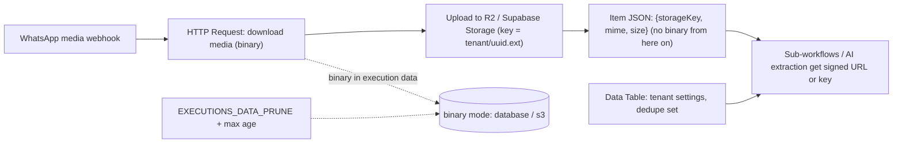

# n8n - Binary Data, Files & Data Tables

> [!info] Deep dive of [[n8n]]

> [!abstract] TL;DR
> - **Binary data** (WhatsApp media, PDFs, images, CSVs) travels with items as references, and where n8n stores it matters:
>   - `database` works in queue mode but bloats Postgres;
>   - `filesystem` is single-instance only;
>   - `s3` (external storage, licensed) scales.
>   
>   For SME workloads: **move files out of n8n quickly** (R2/Supabase Storage), pass **keys/URLs** between workflows, and prune executions.
> - **Data Tables** are built-in key-value/table storage for small workflow state (lookups, dedupe sets, settings). The default cap is **50 MB total per instance**, and they're not a database replacement. Use Postgres/Supabase for real data.

## Concept
| Storage | Where files live | Queue mode | Pros | Cons |
|---|---|---|---|---|
| `database` | Postgres (execution data) | ✅ | Works everywhere, no extra infra | DB bloat, slow with large files, backups balloon |
| `filesystem` | Local disk of the n8n process | ❌ Not supported | Fast, simple | Single instance only. Disk fills |
| `s3` (external storage) | S3-compatible bucket (R2, MinIO) | ✅ (set on all instances) | Scales, keeps DB small | License required. n8n won't start in s3 mode without one |
| Your own storage (pattern) | R2/Supabase Storage via nodes/HTTP | ✅ | Durable, shareable URLs, retention control | You manage keys and cleanup |

**File nodes you'll use**:

| Node | Purpose |
|---|---|
| HTTP Request (Response: File) | Download media (e.g. WhatsApp media URLs with auth header) |
| Extract From File | CSV/XLSX/PDF/JSON → items/text |
| Convert to File | Items → CSV/XLSX/JSON/text file |
| Edit Image / Compression | Resize, compress, zip |
| S3 / Supabase / Google Drive nodes | Upload/download to storage |

**Data Tables**:

| Fit | Not a fit |
|---|---|
| Dedupe keys (processed message IDs, small scale) | Customer/order records (PII, reporting, relations) |
| Lookup tables (tenant settings, template names) | High-write event logs |
| Prompt/config versions for AI workflows | Anything > tens of thousands of rows or that clients query |

## How It Works


## Practical Usage
**Instance settings** (queue mode on Coolify):
```bash
N8N_DEFAULT_BINARY_DATA_MODE=database      # queue mode without a license; keep files small and short-lived
# licensed: N8N_DEFAULT_BINARY_DATA_MODE=s3 + N8N_EXTERNAL_STORAGE_S3_HOST/BUCKET_NAME/BUCKET_REGION/ACCESS_KEY/ACCESS_SECRET on main AND workers
EXECUTIONS_DATA_PRUNE=true
EXECUTIONS_DATA_MAX_AGE=168                # hours (7 days)
EXECUTIONS_DATA_SAVE_ON_SUCCESS=none       # high-volume workflows: keep errors only
N8N_PAYLOAD_SIZE_MAX=16                    # MiB, protects against huge webhook bodies
N8N_DATA_TABLES_MAX_SIZE_BYTES=209715200   # 200 MB if you rely on Data Tables (default 50 MB)
```
**WhatsApp media → R2, pass a key** (pattern):
```text
1. HTTP Request  GET https://graph.facebook.com/{version}/{media_id}         (header Authorization: Bearer <system user token>) → JSON {url, mime_type}
2. HTTP Request  GET {{$json.url}}  Response format: File                    (same auth header)
3. S3 node (R2)  Upload  Bucket: client-media  Key: {{ tenantId }}/{{ $now.toFormat('yyyy/MM') }}/{{ $json.id }}.{{ ext }}
4. Set           { storageKey, mime, size }   ← continue with JSON only; drop binary
5. Execute Sub-workflow (e.g. receipt OCR) with storageKey → presigned GET URL inside the sub-workflow
```
**Extract a PDF invoice to text for an AI step**:
```text
HTTP Request (file) → Extract From File (PDF → text) → Code: trim to 20k chars → Information Extractor / AI Agent (structured output)
Large/scanned PDFs: send to a parsing service or Docling worker instead of extracting inside n8n
```
**Data Table as a dedupe set** (small scale):
```text
Data Table "processed_wamids": columns wamid (string), received_at (datetime)
Flow: Get rows where wamid = {{$json.wamid}} → If found → stop; else Insert row → continue
Cleanup: daily Schedule → delete rows older than 7 days
(At scale: use Postgres unique constraint / Redis SET NX instead)
```
**Wrong way**:
```text
❌ Passing a 20 MB video through 12 nodes and 3 sub-workflows → each step persists binary; DB grows by GBs/day
❌ filesystem binary mode with queue workers                  → workers can't read files written by main; random failures
❌ Data Table holding all customers and orders                 → hits the cap; inserts start failing mid-workflow
❌ Saving successful executions forever with media attached   → Postgres backups explode, disk full
```

## Patterns & Anti-patterns
| Pattern | When | Anti-pattern to avoid |
|---|---|---|
| Upload early to R2/Supabase Storage, pass keys | Any file > ~1 MB | Binary carried through the whole workflow |
| Prune executions, save errors only on high-volume flows | Media-heavy workflows | Keeping all execution data |
| S3 external storage (licensed) for heavy file workloads | Large/many files in queue mode | Database mode with GBs of media |
| Data Tables for small config/dedupe | Lightweight state | Data Tables as the system of record |
| Size limits on inbound files, MIME checks | Webhooks accepting uploads | Accepting anything users send |
| Presigned URLs with short expiry for downstream services | OCR/AI/partners | Public bucket URLs |
| Per-tenant storage prefixes + retention policies | Multi-client | One flat bucket forever |

## Performance & Trade-offs
- **Memory**: binary data loaded into Code nodes or processed by Extract nodes sits in memory per execution. Big files with high worker concurrency cause OOMs, so lower concurrency for file-heavy workers ([[n8n - Queue Mode & Scaling]]).
- **Database mode cost**: every saved execution with binaries inflates Postgres and backups. Pruning and errors-only saving are mandatory.
- **S3 mode**: keeps Postgres lean, but needs a license and adds bucket costs (R2 has zero egress fees).
- **Data Tables** live in n8n's database. Raising the limit is possible on self-hosted (community guidance: keep it to a fraction of the DB volume), but query capability is basic compared with SQL tables.

## Tips & Reminders
> [!tip] In ZP's stack
> - **WhatsApp receipts/photos/voice notes**: download → R2 (`tenant/yyyy/MM/id.ext`) → store key + metadata in Supabase → process via sub-workflows with presigned URLs ([[n8n - WhatsApp Cloud API Workflows & Template Messaging]], [[Cloudflare - R2 Storage & Presigned Uploads]]).
> - **Client-facing files** (invoices, reports): generate via Convert to File or a PDF service, upload to Supabase Storage private buckets, and send signed links ([[Supabase - Storage, Uploads & Image Transformations]]).
> - **Data Tables** only for tiny per-workflow state. Client data lives in Supabase with RLS and backups.

- Set lifecycle rules on buckets (delete raw media after N days unless referenced).
- Validate MIME type and size from metadata before downloading large media.
- Keep media URLs out of logs. WhatsApp media URLs require auth, but other providers' links may be bearer-style.
- For PDF-heavy RAG ingestion, use a dedicated parser pipeline rather than n8n nodes ([[RAG - Document Ingestion & PDF Parsing Pipelines]]).

## Version Notes
| Version | Change relevant here |
|---|---|
| 1.x | Binary data modes (filesystem/S3 external storage), Extract From File / Convert to File nodes |
| 1.113 (2025, reported) | **Data Tables** introduced (default 50 MB total, `N8N_DATA_TABLES_MAX_SIZE_BYTES`) |
| 2.0 (2025-12) | In-memory binary mode removed. Queue mode uses `database` or `s3` |

> [!warning] Unverified — check before relying on this
> The exact version that introduced Data Tables, per-project limits, and 2.x environment variable names for external storage weren't confirmed. Check https://docs.n8n.io/build/work-with-data/data-tables and the binary data / external storage docs.

## Critical Issues & Gotchas
> [!danger] Execution data growth fills the disk
> Media-heavy workflows in `database` mode with default execution saving can add gigabytes per day to Postgres. Once the disk fills, Postgres stops and every client workflow on the instance fails. Prune executions, save errors only, move files to object storage early, and alert on DB size ([[Docker - Logging, Metrics & Resource Limits on a VPS]]).

> [!danger] Personal data in files and execution logs
> IC scans, receipts, voice notes and invoices stored in execution data and Data Tables are personal data under PDPA, and they're visible to anyone with editor access and included in backups. Minimize retention, restrict editor access, use private buckets with short-lived signed URLs, and document retention per client.

- **Data Table cap reached**: inserts/updates fail with execution errors, and manual additions are disabled. Monitor usage, or move the data to Postgres.
- **S3 mode without a license**: n8n won't start. Validate config on staging first.
- **Large webhook payloads** beyond `N8N_PAYLOAD_SIZE_MAX` are rejected. Use direct-to-storage uploads (presigned URLs) instead of posting files to n8n.
- **Binary property names** (`data`, `attachment_0`) differ by node. Map them explicitly to avoid "No binary data found".

## Related
- [[n8n]]
- [[n8n - Queue Mode & Scaling]] — binary modes across main and workers
- [[n8n - WhatsApp Cloud API Workflows & Template Messaging]] — media download flow
- [[Cloudflare - R2 Storage & Presigned Uploads]] — durable, zero-egress file storage
- [[Supabase - Storage, Uploads & Image Transformations]] — client-facing file storage with RLS
- [[n8n - Error Handling & Workflow Patterns]] — execution saving and pruning policies

## References
- https://docs.n8n.io/build/work-with-data/data-tables
- https://docs.n8n.io/deploy/host-n8n/configure-n8n/scaling/handle-binary-data
- https://docs.n8n.io/deploy/host-n8n/configure-n8n/scaling/use-external-storage
- https://community.n8n.io/t/practical-limits-to-n8n-data-tables-max-size-bytes-in-self-hosted-postgres-setup/297897
- https://nordflux.de/en/guides/n8n-binary-data-filesystem-s3
