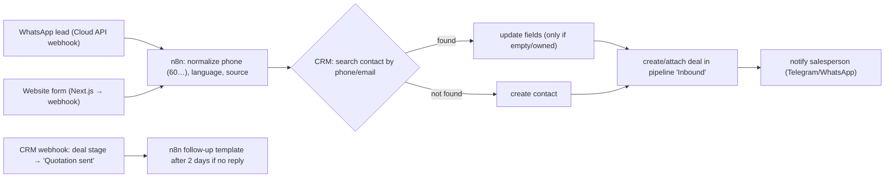

# n8n - CRM Integrations with HubSpot, Zoho & Pipedrive

> [!info] Deep dive of [[n8n]]

> [!abstract] TL;DR
> CRM automation is one of the most sellable SME workflows: **WhatsApp/web leads → CRM contact + deal**, **deal stage changes → WhatsApp/email follow-ups**, **won deals → invoice/accounting**.
> - n8n has native nodes and triggers for HubSpot, Zoho CRM and Pipedrive. Use the HTTP Request node for endpoints the nodes don't cover.
> - **Rules that prevent CRM chaos**:
>   - **upsert by a normalized key** (E.164 phone or lowercase email), never blind creates;
>   - **one direction of truth per field**;
>   - **loop guards** for two-way sync;
>   - **rate-limit-aware batching**.
> - **Auth**: HubSpot **private app tokens** (legacy API keys are gone), Zoho OAuth tied to the account's **data center** (`.com`, `.eu`, `.in`, `.com.au`…), Pipedrive OAuth or API tokens.
> - **Client-owned CRM accounts and credentials**: you configure, they own.

## Concept
| CRM | SME fit (Malaysia) | Auth | n8n support | Watch out |
|---|---|---|---|---|
| HubSpot | Free CRM tier, marketing-oriented | Private app token / OAuth | Node + trigger | Rate limits per app, association API complexity |
| Zoho CRM | Popular and cheap, Zoho One bundles | OAuth (data-center specific) | Node + trigger | DC-specific URLs, module/field API names |
| Pipedrive | Simple pipelines for sales teams | API token / OAuth | Node + trigger | Custom field keys are hashes |

**Common workflows**:

| Workflow | Trigger | Steps |
|---|---|---|
| Lead capture | WhatsApp/Form/Website webhook | Normalize → find contact → upsert → create deal → notify sales |
| Follow-up automation | CRM deal stage changed | Template WhatsApp/email → log activity in CRM |
| Won deal → invoice | Deal won | Create invoice (accounting/MyInvois) → attach link to deal |
| Data hygiene | Schedule nightly | Find duplicates/missing fields → report to Telegram |
| Two-way sync with app DB | App events + CRM webhooks | Field ownership rules + loop guard |

## How It Works


## Practical Usage
**Normalize identity first** (Code node):
```js
const raw = String($json.phone || '').replace(/\D/g, '');
const phone = raw.startsWith('60') ? raw : raw.startsWith('0') ? '6' + raw : raw;
const email = ($json.email || '').trim().toLowerCase() || null;
return [{ json: { ...$json, phone_e164: phone ? `+${phone}` : null, email,
                  source: $json.source || 'whatsapp', dedupe_key: email || phone } }];
```
**HubSpot upsert pattern**:
```text
HubSpot node: Contact → Search (filter: phone EQ {{$json.phone_e164}}) 
  → IF results.length > 0 → Contact → Update (only set fields that are empty or n8n-owned)
  → else                   → Contact → Create (email, phone, firstname, lifecyclestage=lead, lead_source)
  → Deal → Create (pipeline=default, dealstage=appointmentscheduled) → Associate deal ↔ contact
```
**Zoho CRM via HTTP Request** (data-center aware base URL):
```http
POST https://www.zohoapis.com/crm/v6/Leads/upsert        # .eu / .in / .com.au etc. per account DC
Authorization: Zoho-oauthtoken {{token}}
Content-Type: application/json

{ "data": [{ "Last_Name": "Ali", "Mobile": "+60123456789", "Lead_Source": "WhatsApp" }],
  "duplicate_check_fields": ["Mobile"] }
```
**Pipedrive: find person by phone, then create deal**:
```text
Pipedrive node: Person → Search (term={{$json.phone_e164}}, fields=phone, exact_match=true)
  → create if missing → Deal → Create (title="{{$json.name}} – WhatsApp enquiry", person_id, stage_id)
```
**Loop guard for two-way sync**:
```text
App → CRM updates set custom field last_sync_source = "app" and last_sync_at
CRM webhook → n8n: IF last_sync_source == "app" AND last_sync_at within 60 s → stop (our own echo)
Field ownership: phone/email owned by app; deal stage owned by CRM; notes append-only
```
**Wrong way**:
```text
❌ Create contact on every WhatsApp message               → hundreds of duplicates per month
❌ Two-way sync without ownership rules or echo detection  → infinite update loops, rate-limit bans
❌ Personal CRM login credentials of a salesperson in n8n   → breaks when they leave; over-privileged
❌ Hard-coding Pipedrive custom field hash keys everywhere  → brittle; map them once in a config node
```

## Patterns & Anti-patterns
| Pattern | When | Anti-pattern to avoid |
|---|---|---|
| Normalize + search-then-upsert (or native upsert APIs) | Every inbound lead | Blind creates |
| Field ownership matrix per integration | Two-way sync | Last-write-wins on every field |
| Batch + throttle (Split in Batches + Wait) | Bulk imports/backfills | Parallel bursts hitting rate limits |
| Store CRM IDs in your app DB | Linking records | Searching by name each time |
| Error workflow + retry with backoff | API failures | Silent drops of leads |
| Dedicated integration user/app in the CRM | Credentials | Personal accounts |
| Minimal fields synced (data minimization) | PDPA | Copying ICs and full chat transcripts into CRM |

## Performance & Trade-offs
- **Rate limits**: CRMs enforce per-app/per-account limits (requests per second/10 s/day). Lead volumes for SMEs are small, but backfills and syncs need batching and backoff ([[n8n - Error Handling & Workflow Patterns]]).
- **Native node vs HTTP Request**: nodes speed up common operations. HTTP gives access to newer API versions (Zoho v6, HubSpot v3/v4 associations, Pipedrive v2) and bulk endpoints.
- **Webhooks vs polling triggers**: CRM webhooks are instant but need public endpoints and signature checks. Polling triggers are simpler but delayed and quota-consuming.
- **CRM as source of truth vs app DB**: sales teams live in the CRM, while operations data lives in the app. Decide per entity, and avoid mirroring everything both ways.

## Tips & Reminders
> [!tip] In ZP's stack
> - **Productized package**: "WhatsApp leads into your CRM in real time + follow-up reminders" is a fast, clearly valuable build for SMEs using Zoho/HubSpot free/Pipedrive. Combine it with the WhatsApp agent for qualification ([[AI Agents - Customer Support Agents for WhatsApp & Messaging]]).
> - **Malaysian data**: phone numbers are the primary identifier (many leads have no email). Normalize to `+60…` consistently across WhatsApp, CRM and app DB ([[n8n - WhatsApp Cloud API Workflows & Template Messaging]]).
> - **Zoho data center**: confirm the client's Zoho domain at onboarding. Wrong DC endpoints produce confusing auth errors.

- Keep a mapping table (n8n Data Table/Postgres) of CRM field API names per client.
- Log every create/update with CRM IDs for audit and debugging.
- Respect consent: only add marketing-subscribed status when the lead opted in (PDPA).
- Test with a sandbox/developer CRM account before touching the client's production CRM.

## Version Notes
| Date | Change relevant here |
|---|---|
| 2022-11 | HubSpot API keys sunset. Private apps/OAuth required |
| 2023–25 | HubSpot v3/v4 objects and associations. Zoho CRM API v6/v7. Pipedrive API v2 endpoints rolling out |
| n8n 1.x–2.x | CRM nodes and triggers. HTTP Request node with predefined credential types |

> [!warning] Unverified — check before relying on this
> Current API versions (Zoho v6/v7, Pipedrive v2 coverage), specific rate limits and n8n node operation names weren't verified this run. Check each CRM's developer docs and the n8n integration docs.

## Critical Issues & Gotchas
> [!danger] Duplicate and corrupted CRM data
> Without normalization and upsert logic, every channel creates its own contact (`0123…`, `+60123…`, `60 12-3…`). Sales teams lose trust in the CRM, and automations message the same lead multiple times. Normalize identities, use native upsert/duplicate checks, and run a nightly duplicate report.

> [!danger] Sync loops and mass updates
> Two-way sync without echo detection can ping-pong updates between app and CRM thousands of times. That hits rate limits (temporary bans), floods activity timelines, or overwrites good data. Define field ownership, mark sync-originated updates, and add circuit breakers (max updates per record per hour).

- **Token expiry**: OAuth refresh failures stop syncs silently. Alert on 401s.
- **Custom field changes** by client admins break mappings. Validate field existence at workflow start.
- **Timezones**: CRM date fields may be stored in UTC or account timezone. Set `Asia/Kuala_Lumpur` explicitly.
- **Webhook security**: verify CRM webhook signatures (HubSpot v3 signatures, Pipedrive basic auth) before processing ([[REST API - Webhooks & Idempotency]]).

## Related
- [[n8n]]
- [[n8n - WhatsApp Cloud API Workflows & Template Messaging]] — lead source and follow-ups
- [[n8n - Error Handling & Workflow Patterns]] — retries and alerts
- [[n8n - Google Workspace & Sheets Integrations]] — the Sheets-based alternative for tiny teams
- [[REST API - Webhooks & Idempotency]] — webhook verification and idempotency
- [[AI Agents - Customer Support Agents for WhatsApp & Messaging]] — qualification before CRM

## References
- https://docs.n8n.io/integrations/builtin/app-nodes/n8n-nodes-base.hubspot/
- https://docs.n8n.io/integrations/builtin/app-nodes/n8n-nodes-base.zohocrm/
- https://docs.n8n.io/integrations/builtin/app-nodes/n8n-nodes-base.pipedrive/
- https://developers.hubspot.com/docs/api/private-apps
- https://www.zoho.com/crm/developer/docs/api/v6/upsert-records.html
