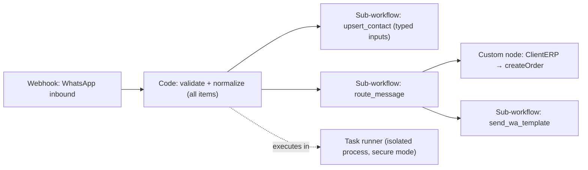

# n8n - Code Node, Sub-workflows & Custom Nodes

> [!info] Deep dive of [[n8n]]

> [!abstract] TL;DR
> Three ways to keep n8n maintainable as client workflows grow:
> - **Code node** for small, pure transformations. Prefer **Run Once for All Items**, return `[{ json }]`, and keep it free of secrets and network calls. In 2.x it runs in **task runners** (secure mode). Python is **native via external runners** only (Pyodide removed).
> - **Sub-workflows** with a **typed input schema** as reusable functions ("send WhatsApp template", "upsert contact"). One trigger per workflow, shared logic in one place.
> - **Custom nodes** (TypeScript, from `n8n-nodes-starter`) once you repeat the same client API calls across many workflows. Ship them baked into your Docker image, not installed ad hoc from npm.

## Concept
| Tool | Use for | Don't use for |
|---|---|---|
| Expressions `{{ }}` | One-line field mapping, dates (`$now`, Luxon) | Multi-step logic |
| Code node (JS) | Reshaping arrays, validation, small computations | HTTP calls with credentials (use HTTP Request), long CPU work |
| Code node (Python, native) | Data munging where Python is clearer | Anything requiring Pyodide-era builtins or `_input` |
| Sub-workflow | Reusable steps with clear inputs/outputs | Hiding 40 nodes of unrelated logic |
| Custom node | Repeated integration with a client/system API, credential type | One-off logic (a sub-workflow is cheaper) |
| Community node (npm) | Quick integration you trust and have reviewed | Production on client instances without pinning/review |

**Code node modes**:

| Mode | Runs | Access | Return |
|---|---|---|---|
| Run Once for All Items | Once per execution step | `$input.all()` | Array of `{ json, binary?, pairedItem? }` |
| Run Once for Each Item | Once per item | `$json`, `$input.item` | One `{ json }` (or array) |

## How It Works


## Practical Usage
**Code node, all-items mode** (normalize WhatsApp messages; keep item linking):
```js
const out = [];
for (const [i, item] of $input.all().entries()) {
  const m = item.json.m ?? {};
  if (!m.id || !m.from) continue;                                   // drop malformed items
  out.push({
    json: {
      wamid: m.id,
      contactKey: item.json.contact?.user_id ?? m.from,              // BSUID-ready
      type: m.type,
      text: m.type === 'text' ? m.text.body.trim().slice(0, 4000) : null,
      ts: new Date(Number(m.timestamp) * 1000).toISOString(),
    },
    pairedItem: { item: i },                                         // keeps $('Webhook').item lookups working downstream
  });
}
return out;
```
**Referencing other nodes correctly**:
```js
const tenant = $('Lookup Tenant').first().json;        // single-row node: first()
const original = $('Webhook').item.json;               // per-item linked value (needs pairedItem chain)
const all = $('Get Orders').all().map((i) => i.json);  // whole list
```
**Python Code node (native runner)**:
```python
# n8n 2.x native Python: items are plain dicts, no `_input` helpers or dot-notation.
# `items` stands for the injected input list; confirm its name in the docs for your version.
return [{"json": {"sku": item["json"]["sku"].upper()}} for item in items]
```
**Sub-workflow with a typed contract**:
```text
Workflow "lib/send_wa_template"
  Trigger: When Executed by Another Workflow → Input data mode: "Define using fields below"
    tenantId (string, required), to (string, required), template (string), language (string, default "ms"), params (array)
  → Postgres: load tenant WA credentials ref + window state
  → HTTP Request: POST /{phone_number_id}/messages
  → Return: { ok, wamid, error }

Caller: Execute Sub-workflow node → source "Database" (by ID) → mode "Run once for each item" → Wait for completion ✔
```
**Custom node skeleton** (declarative style, from `n8n-nodes-starter`):
```ts
import type { INodeType, INodeTypeDescription } from 'n8n-workflow';

export class ClientErp implements INodeType {
  description: INodeTypeDescription = {
    displayName: 'Client ERP', name: 'clientErp', group: ['transform'], version: 1,
    description: 'Orders and stock in the client ERP',
    defaults: { name: 'Client ERP' },
    inputs: ['main'], outputs: ['main'],
    credentials: [{ name: 'clientErpApi', required: true }],
    requestDefaults: { baseURL: '={{$credentials.baseUrl}}', headers: { Accept: 'application/json' } },
    properties: [
      { displayName: 'Operation', name: 'operation', type: 'options', noDataExpression: true,
        options: [{ name: 'Create Order', value: 'createOrder',
          routing: { request: { method: 'POST', url: '/orders', body: '={{ $json }}' } } }],
        default: 'createOrder' },
    ],
  };
}
```
```dockerfile
# bake custom nodes into the image (no runtime npm installs on client servers)
FROM n8nio/n8n:2.42.1
COPY --chown=node:node custom-nodes/dist /home/node/.n8n/custom
ENV N8N_CUSTOM_EXTENSIONS=/home/node/.n8n/custom
```
**Wrong way**:
```js
// ❌ secrets and HTTP in a Code node, per item, no error handling
const res = await fetch('https://erp.client.my/api', { headers: { key: 'sk_live_123' } });
return res.json();          // ❌ not an array of {json}; key leaked in workflow JSON exports
```

## Patterns & Anti-patterns
| Pattern | When | Anti-pattern to avoid |
|---|---|---|
| All-items mode for transforms | Lists > a few items | Each-item mode with per-item overhead |
| `pairedItem` preserved in custom transforms | Downstream `$('X').item` lookups | Broken item linking ("can't determine which item to use") |
| `lib/` sub-workflows with typed inputs, called by ID | Shared steps across client workflows | Copy-pasted node groups in 12 workflows |
| One responsibility per sub-workflow, returns `{ ok, data, error }` | Reusable building blocks | Sub-workflows that silently swallow errors |
| Credentials in n8n credential types (custom node or HTTP node) | Any secret | Keys inside Code node strings |
| Custom nodes versioned in git, built in CI, baked into the image | Repeated client APIs | Installing random community nodes from the UI |
| Export workflows to git (`n8n export:workflow --backup`) or source control | All client instances | Workflows living only in the n8n DB |

## Performance & Trade-offs
- **Task runner overhead**: each Code node execution crosses a process boundary (a few ms). That's negligible per execution, but avoid splitting trivial logic into many Code nodes in hot workflows.
- **Memory**: Code nodes hold all items in memory. 50k-row payloads in one execution can OOM the runner, so batch with Loop Over Items / Split in Batches ([[n8n - Queue Mode & Scaling]]).
- **Sub-workflow cost**: each call is another execution (logged, counted in some plans), with extra latency (~10–50 ms). Fine for business steps, wasteful for tiny helpers inside loops.
- **Custom nodes vs HTTP Request**: custom nodes cost build/maintenance time, but give typed UI, credential types and fewer copy-paste errors. Worth it after ~3–5 workflows use the same API.
- **Python native** runs in a separate runner image, which means one more container to run and update.

## Tips & Reminders
> [!tip] In ZP's stack
> - **Per-client library**: `lib/upsert_contact`, `lib/send_wa_template`, `lib/notify_owner`, `lib/log_usage`. Client workflows compose them, and fixes land once.
> - **Rarticle custom nodes** for recurring SME systems (e.g. a local POS or accounting API) live in one repo, are built in GitHub Actions, and are shipped in a custom n8n image deployed via Coolify. Pin the n8n version in the image.
> - **External runners** (`n8nio/runners`) in queue-mode setups, with only the JS/Python packages you allowlist ([[n8n - Security, Credentials & Self-Hosting Hardening]]).

- Keep Code nodes short (< 40 lines). Longer logic means a sub-workflow, a custom node or an API endpoint in your Next.js backend.
- Validate inputs at sub-workflow boundaries (required fields, types), and return explicit errors ([[n8n - Error Handling & Workflow Patterns]]).
- Use pinned data and test executions for Code nodes, and keep sample payloads in the repo.
- Name workflows with a prefix (`[client] flow`, `lib/…`) and tag them for search and permissions.

## Version Notes
| Version | Change relevant here |
|---|---|
| 1.0 (2023) | Python in Code node (Pyodide). New execution order |
| 1.x (2024–25) | Task runners introduced. Sub-workflow input schemas ("When Executed by Another Workflow") |
| 2.0 (2025-12) | Task runners default (secure mode). `$env` blocked by default. **Pyodide removed**: Python only via external runners (`n8nio/runners`) with native Python. `$evaluateExpression()` unavailable in secure mode |

> [!warning] Unverified — check before relying on this
> The exact variable names injected into native Python Code nodes, how to allowlist extra npm/pip packages for external runners (runner config vs env vars), and custom-node loading paths in 2.x weren't confirmed. Check https://docs.n8n.io/build/code-in-n8n/using-the-code-node and the 2.0 breaking-changes page.

## Critical Issues & Gotchas
> [!danger] Community nodes are code execution on your server
> Installing a community node pulls an npm package that runs with n8n's privileges and sees decrypted credentials at runtime. A malicious or compromised package (typosquat, hijacked maintainer) can exfiltrate every client credential. Disable community package installs in production, review and pin what you need, and prefer your own audited custom nodes ([[Node.js - Supply Chain Security & Dependency Hygiene]]).

> [!danger] Python migration breaks on 2.0 upgrade
> Pyodide-based Python Code nodes stop working on n8n 2.0 unless external runners with native Python are configured. Syntax and built-in differences (`_input`, dot-notation) need code changes. Run the migration report, inventory Python nodes, and test before upgrading client instances.

- **Bare object returns** (`return {…}`) or missing `json` keys break downstream nodes or produce confusing errors.
- **`$('Node').item` without item linking** fails after nodes that create new items without `pairedItem`.
- **Sub-workflow called "by name"/from a URL** breaks when renamed or moved. Call by workflow ID from the database, and document dependencies.
- **Error propagation**: a failing sub-workflow fails the parent node unless handled. Decide per call whether to continue on error, and return error objects.

## Related
- [[n8n]]
- [[n8n - Error Handling & Workflow Patterns]] — error workflows, retries, DLQs
- [[n8n - Security, Credentials & Self-Hosting Hardening]] — runners, env access, community packages
- [[n8n - Queue Mode & Scaling]] — memory limits, batching, workers
- [[n8n - AI Agent Nodes & LLM Workflows]] — sub-workflows as agent tools
- [[Node.js - Supply Chain Security & Dependency Hygiene]] — vetting npm packages

## References
- https://docs.n8n.io/build/code-in-n8n/using-the-code-node
- https://docs.n8n.io/2-0-breaking-changes
- https://docs.n8n.io/flow-logic/subworkflows/
- https://github.com/n8n-io/n8n-nodes-starter
- https://docs.n8n.io/integrations/creating-nodes/overview/
