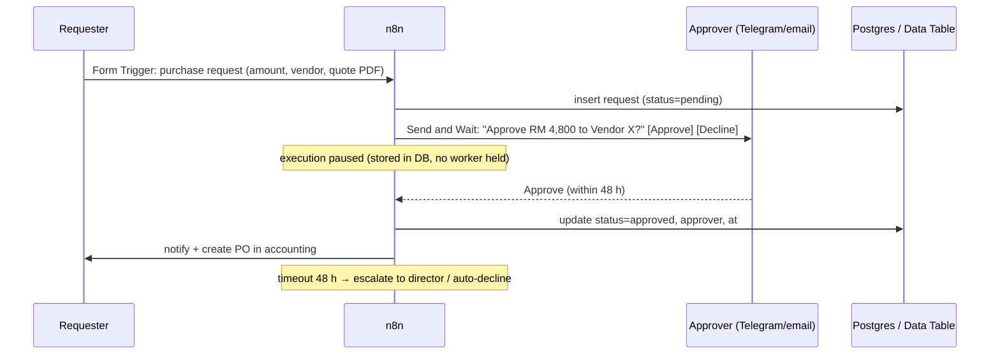

# n8n - Forms, Approvals & Human-in-the-Loop Workflows

> [!info] Deep dive of [[n8n]]

> [!abstract] TL;DR
> n8n can pause an execution until a person acts:
> - **Form Trigger / Form node**: hosted forms (multi-page, file uploads, conditional pages) that start or continue a workflow.
> - **Wait node**: resume on webhook call (`$execution.resumeUrl`), form submission, or a time/date.
> - **"Send and Wait for Response"** operations (email, Slack, Telegram, etc.): send an approve/decline or free-text request, and continue with the answer.
> - **Human review for AI agent tools**: require approval before a tool runs.
>
> Production rules: **authenticate approvers** (signed links, not guessable URLs), **set timeouts and escalation**, make approvals **idempotent** (double-click = one action), **persist the decision** (who, when, what) outside n8n, and remember waiting executions are stored in the DB and **survive restarts only with a persistent database**.

## Concept
| Building block | Use | Notes |
|---|---|---|
| Form Trigger | Public/internal intake (leads, requests, claims) | Own URL. Basic auth option. Fields incl. file, dropdown, date |
| Form node (after trigger) | Multi-step forms, conditional pages, completion page/redirect | Continues same execution |
| Wait: On webhook call | Approve via link/button (`$execution.resumeUrl`) | Add auth/signing yourself |
| Wait: On form submitted | Approver fills a form (reason, amount adjustments) | Good for structured decisions |
| Wait: After time interval / at time | Reminders, SLAs, cool-off periods | Long waits are offloaded to DB |
| Send and Wait (Gmail/Slack/Telegram/…) | Approve/Decline buttons or free-text reply in the channel | Simplest approvals |
| AI Agent tool approval | Human confirms risky tool calls | Pairs with [[n8n - AI Agent Nodes & LLM Workflows]] |
| Data Table / Postgres | Approval records, audit trail | Source of truth outside execution data |

## How It Works


## Practical Usage
**Purchase approval flow** (structure):
```text
Form Trigger "Purchase request" (fields: requester email, amount RM, vendor, quote file)
  → Code: validate amount > 0, normalize
  → Postgres: insert into approvals (id, kind, payload, status='pending') returning id
  → IF amount > 5000 → approver = director, else manager
  → Telegram: Send and Wait for Response (Approve/Decline, limit wait 48 h)
  → Switch on response
      approved → Postgres update status='approved', approver, decided_at → create PO → notify requester
      declined → update status='declined' (+ reason via follow-up form) → notify requester
      timeout  → update status='expired' → escalate to director (second Send and Wait)
```
**Custom approval links with Wait (On webhook call)** when the channel has no built-in buttons (e.g. WhatsApp template with URL buttons):
```text
Set: approveUrl = {{$execution.resumeUrl}}?decision=approve&sig={{ $json.sig }}
     declineUrl = {{$execution.resumeUrl}}?decision=decline&sig={{ $json.sig }}
  → WhatsApp template "approval_request" with the two URLs
  → Wait (Resume: On Webhook Call, Limit wait time: 2 days)
  → Code: verify HMAC(sig) over execution id + decision + approver id → reject if invalid
```
**Signing the decision link** (Code node):
```js
const crypto = require('crypto');                 // allow-list 'crypto' in NODE_FUNCTION_ALLOW_BUILTIN
const secret = $env.APPROVAL_SECRET;              // or a credential; $env may be blocked in 2.x
const payload = `${$execution.id}:${$json.approverId}`;
return [{ json: { ...$json, sig: crypto.createHmac('sha256', secret).update(payload).digest('hex') } }];
```
**Multi-page form with conditional page**:
```text
Form Trigger (page 1: claim type, amount)
  → IF claim type = "travel" → Form node (page 2a: trip dates, receipts upload)
  → else                     → Form node (page 2b: description, receipt upload)
  → Form node (Completion: "Submitted. Ref #{{ $json.ref }}")
```
**Wrong way**:
```text
❌ Raw resumeUrl sent in an email anyone can forward     → whoever clicks first approves
❌ No wait limit                                         → thousands of zombie executions waiting forever
❌ Decision stored only in execution data                → pruned after 14 days; no audit trail
❌ Approve link that runs the action on every click       → double payments/POs
```

## Patterns & Anti-patterns
| Pattern | When | Anti-pattern to avoid |
|---|---|---|
| Approval record in Postgres/Data Table | Every approval | Relying on execution history |
| Wait limit + escalation branch | SLAs | Indefinite waits |
| Idempotent decision (`update … where status='pending'`) | Buttons/links | Acting on every resume |
| Signed/authenticated decision links | Email/WhatsApp approvals | Bare `resumeUrl` |
| Channel-native Send and Wait | Telegram/Slack/email teams | Custom webhooks when built-in works |
| Forms for structured data, chat for yes/no | UX | Long free-text approvals via chat |
| Human approval for AI tools that write/send/pay | AI agents | Fully autonomous refunds/messages |

## Performance & Trade-offs
- **Waiting executions** consume DB rows, not workers. Thousands are fine, but they inflate the execution table. Keep wait limits and prune.
- **Queue mode**: resumed executions go back on the queue. Webhook/form resumes hit the main or webhook instances, so make sure `WEBHOOK_URL` is correct behind Traefik ([[n8n - Queue Mode & Scaling]]).
- **n8n forms vs a custom Next.js form**: n8n forms are instant and client-editable but limited in branding/validation. Use Next.js for customer-facing branded flows, posting to an n8n webhook.
- **File uploads** in forms become binary data. Use filesystem/S3 binary mode for large files ([[n8n - Binary Data, Files & Data Tables]]).

## Tips & Reminders
> [!tip] In ZP's stack
> - **High-value SME automations**: leave/claim approvals, purchase approvals, discount approvals for sales staff, AI-drafted WhatsApp replies approved by staff before sending. Easy to sell, quick to build.
> - **Telegram Send and Wait** is the cheapest reliable approval channel for Malaysian SME owners. WhatsApp needs approved templates with URL buttons ([[n8n - WhatsApp Cloud API Workflows & Template Messaging]]).
> - **Audit evidence**: store approver ID, decision, timestamp, request snapshot. It resolves "I never approved that" disputes.

- Put Form Trigger URLs behind Cloudflare Access or basic auth for internal forms. Public intake forms need Turnstile or rate limits.
- Use `Asia/Kuala_Lumpur` for "at time" waits and SLA calculations.
- Test the timeout branch. It's the one that breaks unnoticed.
- Version form fields carefully: changing fields breaks in-flight multi-page executions.

## Version Notes
| Version | Change relevant here |
|---|---|
| 1.x (2024) | Form Trigger v2, Form node for multi-page forms, Wait node "On form submitted" |
| 1.x (late 2024–25) | "Send and Wait for Response" operations on messaging/email nodes |
| 1.x–2.x (2025) | Human review/approval for AI agent tool calls |
| 2.0 (2025-12) | `$env` access blocked by default in Code/expressions. Use credentials for secrets ([[n8n - Security, Credentials & Self-Hosting Hardening]]) |
| 2.47.x (2026-11) | Current stable at writing |

> [!warning] Unverified — check before relying on this
> Exact versions that introduced Send and Wait per node, the AI tool human-review feature, and current Form Trigger auth options weren't verified this run. Check https://docs.n8n.io/integrations/builtin/core-nodes/n8n-nodes-base.wait/ and the Form node docs.

## Critical Issues & Gotchas
> [!danger] Unauthenticated approval links
> `$execution.resumeUrl` is a capability URL: anyone with it can resume the execution with any query parameters. Forwarded emails, link previews (some chat apps prefetch URLs) and logs can trigger or leak approvals. Sign decision parameters, bind them to the approver, require a confirmation form (POST) instead of acting on GET, and verify before acting.

> [!danger] Lost waiting executions
> With SQLite on ephemeral storage, or a DB restore from before the wait started, paused executions vanish. Approvals silently never complete. Use Postgres with backups, and keep an `approvals` table so you can detect "pending for too long" and re-send requests.

- **Link prefetchers** (email security scanners, WhatsApp previews) can call GET URLs. Never perform the action on GET.
- **Execution pruning** can delete waiting executions if retention is shorter than the wait. Align `EXECUTIONS_DATA_MAX_AGE` with wait limits.
- **Workflow edits** while executions wait: resumed executions continue with the saved version at pause time. Test changes carefully.
- **Multiple approvers**: Send and Wait handles one response. Quorum approvals need a loop with state in the DB.

## Related
- [[n8n]]
- [[AI Agents - Human-in-the-Loop & Approval Workflows]] — HITL design beyond n8n
- [[n8n - Error Handling & Workflow Patterns]] — timeouts, retries, escalation
- [[n8n - WhatsApp Cloud API Workflows & Template Messaging]] — approval templates on WhatsApp
- [[n8n - AI Agent Nodes & LLM Workflows]] — tool approval for agents
- [[n8n - Binary Data, Files & Data Tables]] — form uploads and approval tables

## References
- https://docs.n8n.io/integrations/builtin/core-nodes/n8n-nodes-base.formtrigger/
- https://docs.n8n.io/integrations/builtin/core-nodes/n8n-nodes-base.form/
- https://docs.n8n.io/integrations/builtin/core-nodes/n8n-nodes-base.wait/
- https://docs.n8n.io/advanced-ai/human-in-the-loop-tools/
- https://docs.n8n.io/code/builtin/n8n-metadata/
