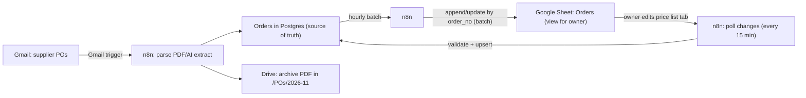

# n8n - Google Workspace & Sheets Integrations

> [!info] Deep dive of [[n8n]]

> [!abstract] TL;DR
> Google Sheets, Gmail, Drive and Calendar are the most common SME integration surface: lead sheets, order logs, booking calendars, invoice PDFs to Drive.
> - **Auth**: OAuth2 per user (Gmail/Calendar on behalf of a person), or a **service account** (Sheets/Drive shared with it, or Workspace domain-wide delegation).
> - **Biggest gotcha**: a Google Cloud OAuth app left in **"Testing"** mode issues refresh tokens that **expire after 7 days**, and workflows silently break weekly. Publish the app (internal for Workspace orgs, or verified external), or use a service account.
> - **Sheets** is a fine **human-facing view and input**, but a poor database: quotas (per-minute read/write limits), no transactions, no types, concurrent edits. Keep the source of truth in Postgres/Data Tables and sync to Sheets.
> - **Batch** reads/writes, use a stable key column for upserts, and handle 429 with backoff.

## Concept
| Service | Typical workflow | Auth recommendation |
|---|---|---|
| Google Sheets | Leads log, daily sales export, staff-maintained price list | Service account (share the sheet with its email) |
| Gmail | Parse incoming orders/enquiries, send transactional mails | OAuth2 (user) or Workspace delegation |
| Google Drive | Store generated PDFs (invoices, reports), watch folders | Service account + shared drive |
| Google Calendar | Bookings → calendar events, availability checks | OAuth2 of the calendar owner, or delegation |
| Google Forms | Intake → Sheets → n8n trigger | Prefer n8n Form Trigger or a Next.js form ([[n8n - Forms, Approvals & Human-in-the-Loop Workflows]]) |

**Auth options**:

| Option | Pros | Cons |
|---|---|---|
| OAuth2 user credential | Acts as the user (Gmail send-as, personal calendar) | Consent screen setup. Token breaks if user leaves/revokes. Testing-mode 7-day expiry |
| Service account (shared resources) | No user dependency, no expiry | Must share each sheet/folder. Can't read a user's Gmail |
| Service account + domain-wide delegation | Impersonate Workspace users centrally | Workspace admin setup. Powerful, so scope tightly |

## How It Works


## Practical Usage
**OAuth consent setup that doesn't expire weekly**:
```text
Google Cloud Console → APIs & Services
  → Enable: Sheets API, Drive API, Gmail API, Calendar API (only what you use)
  → OAuth consent screen: User type "Internal" (Workspace org) OR "External" + Publish app
     (sensitive/restricted scopes like Gmail read require Google verification for external apps)
  → Credentials → OAuth client (Web) → redirect URI: https://n8n.client.my/rest/oauth2-credential/callback
```
**Service account for Sheets/Drive**:
```text
Create service account → JSON key → n8n credential "Google Service Account"
Share the target Sheet/Drive folder with svc-n8n@project.iam.gserviceaccount.com (Editor)
```
**Upsert rows by key** (Google Sheets node):
```text
Operation: Append or Update Row
Document: Orders 2026 | Sheet: Orders
Column to match on: order_no
Mapping: order_no, date (MYT), customer, total_rm, status
→ Batch: feed 100–500 items per execution (one node call handles many rows), not one execution per order
```
**Throttle and retry**:
```text
Node settings: Retry On Fail = true, Max Tries = 5, Wait Between Tries = 5000 ms
For large syncs: Loop Over Items (batch 200) → Sheets node → Wait 2 s → next batch
```
**Read a staff-maintained price list safely**:
```js
// Code node after "Get Rows": validate before writing to the DB
const rows = $input.all().map(i => i.json);
const bad = rows.filter(r => !r.sku || isNaN(Number(r.price_rm)) || Number(r.price_rm) <= 0);
if (bad.length) throw new Error(`Invalid price rows: ${bad.map(b => b.sku || '(blank)').join(', ')}`);
return rows.map(r => ({ json: { sku: String(r.sku).trim(), price_cents: Math.round(Number(r.price_rm) * 100) } }));
```
**Wrong way**:
```text
❌ OAuth app in Testing mode for a client's production workflows → refresh token dies every 7 days
❌ Sheets as the order database written by 3 workflows at once  → overwritten rows, quota 429s, lost data
❌ One HTTP call per row for 5,000 rows                         → rate-limit errors, slow runs
❌ Personal Gmail of a staff member as the integration account  → breaks when they leave; data in a personal account
```

## Patterns & Anti-patterns
| Pattern | When | Anti-pattern to avoid |
|---|---|---|
| Postgres/Data Table as source of truth, Sheets as view | Reporting/exports | Sheets as primary DB |
| Service account owned by the client's Google Cloud project | Client handover | Your personal project hosting client credentials |
| Published/internal OAuth app | User-delegated access | Testing mode in production |
| Key column + Append or Update | Sync jobs | Append-only duplicates |
| Validation before importing human-edited data | Price lists, stock sheets | Trusting cell contents |
| Batch + backoff | Large syncs | Per-row executions |
| Shared drives for generated files | Team access | Files owned by one user's My Drive |

## Performance & Trade-offs
- **Quotas**: the Sheets API enforces per-minute read/write request limits per project and per user. Bursts from parallel executions hit 429 quickly, so serialize Sheets-writing workflows (queue mode concurrency 1 for that workflow, or batching).
- **Polling triggers** (Sheets/Drive "on change") poll on an interval, which is a cost and a delay. Gmail push via Pub/Sub is faster but more setup.
- **Large sheets** (> 10k rows) get slow to read fully. Read ranges, or move to a database.
- **Service account vs OAuth**: service accounts avoid token expiry and person dependency, but can't access users' own mailboxes without delegation.

## Tips & Reminders
> [!tip] In ZP's stack
> - **Quick wins for SME clients**: "every WhatsApp lead lands in your Google Sheet", "daily sales summary sheet", "supplier invoices auto-filed in Drive". Low effort, high perceived value, ideal entry projects for retainers.
> - **Ownership**: create the Google Cloud project and service account under the **client's** Google account/Workspace, and add yourself as a member. It eases handover and PDPA clarity ([[n8n - Managing Multiple Client Instances]]).
> - **Scopes**: request the minimum (e.g. `drive.file` instead of full `drive`) to avoid restricted-scope verification.

- Store dates in sheets as ISO strings or real date cells in MYT, and document the format.
- Protect header rows and key columns in the sheet to stop staff breaking mappings.
- Add an `updated_by_n8n_at` column for traceability.
- Monitor credential errors (401/invalid_grant) via the error workflow ([[n8n - Error Handling & Workflow Patterns]]).

## Version Notes
| Date / version | Change relevant here |
|---|---|
| n8n 1.x | Google Sheets node v4 (Append or Update, column matching), service-account support |
| 2023–24 | Google OAuth policy: Testing-mode refresh tokens expire after 7 days. Stricter verification for sensitive/restricted scopes |
| 2025 | Google phases out "less secure apps"/basic auth for Workspace. OAuth only |
| n8n 2.x (2026) | Data Tables as a lightweight in-n8n store alternative to Sheets ([[n8n - Binary Data, Files & Data Tables]]) |

> [!warning] Unverified — check before relying on this
> Current Sheets API quota numbers, Gmail restricted-scope verification requirements and the exact n8n Google node versions weren't verified this run. Check Google's API quota pages and n8n integration docs.

## Critical Issues & Gotchas
> [!danger] Weekly silent breakage from OAuth Testing mode
> A client's workflows run fine for 7 days, then every Google node fails with `invalid_grant`. The OAuth consent screen was never published. Leads stop flowing into sheets and nobody notices until the owner asks. Publish the app (or use an Internal Workspace app / service account), and alert on credential errors.

> [!danger] Spreadsheets as a concurrent database
> Multiple workflows and humans editing the same sheet cause race conditions: rows shifted by sorting, columns renamed, and formulas overwritten. "Append or Update" may then update the wrong row. Keep authoritative data in Postgres, treat sheets as views or controlled inputs, and lock structure with protected ranges.

- **Column renames** by staff break n8n mappings silently (empty values). Validate headers at the start of each run.
- **Time zone** of the spreadsheet (File → Settings) affects date parsing. Set it to Kuala Lumpur.
- **Drive file ownership**: service-account-owned files may count against its quota and be invisible to users unless shared.
- **Gmail sending limits** for Workspace/consumer accounts cap daily volume. Use a transactional email provider for bulk.

## Related
- [[n8n]]
- [[n8n - Binary Data, Files & Data Tables]] — Data Tables vs Sheets, file handling
- [[OAuth 2.0 & OIDC]] — consent, scopes, refresh tokens
- [[n8n - Error Handling & Workflow Patterns]] — retries and credential alerts
- [[n8n - Security, Credentials & Self-Hosting Hardening]] — credential storage
- [[n8n - Forms, Approvals & Human-in-the-Loop Workflows]] — alternatives to Google Forms

## References
- https://docs.n8n.io/integrations/builtin/app-nodes/n8n-nodes-base.googlesheets/
- https://docs.n8n.io/integrations/builtin/credentials/google/
- https://developers.google.com/sheets/api/limits
- https://developers.google.com/identity/protocols/oauth2#expiration
- https://support.google.com/cloud/answer/13463073
