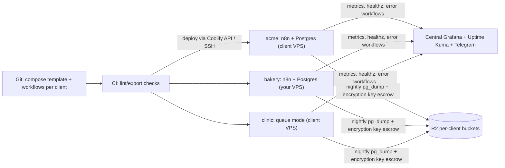

# n8n - Managing Multiple Client Instances

> [!info] Deep dive of [[n8n]]

> [!abstract] TL;DR
> For an automation consultancy, choose the **tenancy model per client**:
> - **Instance per client** on client-owned (or client-billed) infrastructure is the default for paying clients: isolation, clean handover, clear data-controller roles.
> - **Shared instance with Projects** only for your own internal/low-risk work.
>
> Then run the fleet like a product:
> - **One compose template** with pinned versions.
> - **A fleet inventory** (client, host, version, owner, backup status).
> - **Staged upgrades** (internal → canary client → rest).
> - **Central monitoring/alerting**, and **workflows in git** with per-client credentials never shared.
>
> Check the **Sustainable Use License** before hosting n8n *as a service* for clients.

## Concept
| Model | Isolation | Cost | Handover | Pick it when… |
|---|---|---|---|---|
| Instance per client, client's VPS/account | Full | Client pays infra | Easiest (they own it) | Default for retainers and projects |
| Instance per client on your server(s) | Process/container | You pass through cost | Requires migration at exit | Small clients who don't want infra |
| One shared instance, Projects/RBAC per client | Logical only | Cheapest | Hard (export/import) | Internal tools, prototypes |
| Queue-mode cluster per large client | Full + scale | Highest | Client-owned | High-volume clients ([[n8n - Queue Mode & Scaling]]) |

**Fleet inventory** (one row per instance, kept in a sheet/Data Table/Postgres):

| Field | Example |
|---|---|
| Client / environment | `acme` / prod |
| URL | `n8n.acme.my` |
| Host / provider / owner of account | Hostinger KVM 2, client-owned |
| n8n version, DB, mode | 2.47.2, Postgres 17, regular |
| Backup target + last verified restore | R2 `acme-n8n/`, 2026-10-30 |
| Monitoring | Uptime Kuma check ID, Grafana label `client=acme` |
| Contract | Retainer tier, SLA, renewal date |
| Encryption key location | Password manager entry (never in git) |

## How It Works


## Practical Usage
**Standard compose template** (parameterized per client, deployed via Coolify):
```yaml
services:
  n8n:
    image: docker.n8n.io/n8nio/n8n:${N8N_VERSION}          # pinned per client, e.g. 2.47.2
    environment:
      N8N_HOST: ${N8N_HOST}
      WEBHOOK_URL: https://${N8N_HOST}/
      N8N_ENCRYPTION_KEY: ${N8N_ENCRYPTION_KEY}             # unique per client, escrowed
      DB_TYPE: postgresdb
      DB_POSTGRESDB_HOST: postgres
      GENERIC_TIMEZONE: Asia/Kuala_Lumpur
      EXECUTIONS_DATA_PRUNE: "true"
      EXECUTIONS_DATA_MAX_AGE: "336"                        # 14 days
      N8N_METRICS: "true"
      N8N_DIAGNOSTICS_ENABLED: "false"
    depends_on: [postgres]
  postgres:
    image: postgres:17
    volumes: [pgdata:/var/lib/postgresql/data]
volumes: { pgdata: {} }
```
**Fleet version report** (n8n workflow or script, run weekly):
```bash
while IFS=, read -r client url; do
  v=$(curl -s "https://$url/rest/settings" | jq -r '.data.versionCli // "unknown"')
  echo "$client,$url,$v"
done < fleet.csv
```
**Staged upgrade runbook**:
```text
1. Read release notes for every minor between current and target (weekly minors add up)
2. Upgrade internal/staging instance → run smoke workflows (webhook in, WhatsApp out, AI node)
3. Canary: one low-risk client → watch error workflows for 48 h
4. Rest of fleet in a maintenance window (MYT evening) → pg_dump before each, keep previous image tag
5. Update inventory: version, date, issues
```
**Reusable workflows across clients**: keep a "template" folder in git, import per client with the n8n CLI or API, and **re-create credentials per client**. Never copy credential exports between instances.
```bash
n8n import:workflow --input=templates/whatsapp-lead-capture.json     # inside the client container
```
**Wrong way**:
```text
❌ Same N8N_ENCRYPTION_KEY on every client           → one leak decrypts all clients' credentials
❌ All clients on "latest" tag with auto-update      → one breaking minor takes down the whole fleet
❌ Client workflows on your personal n8n Cloud       → client data processed under your account; exit = migration project
❌ No record of which instance runs which version     → security patches applied inconsistently
```

## Patterns & Anti-patterns
| Pattern | When | Anti-pattern to avoid |
|---|---|---|
| Client-owned accounts, you as admin member | Paying clients | Everything on your card and accounts |
| One template, per-client `.env` | All instances | Hand-tuned snowflake servers |
| Pinned versions + staged rollout | Upgrades | `latest` + Watchtower auto-updates |
| Per-client encryption key in a password manager | Always | Keys only inside the container env |
| Central monitoring with `client` labels | ≥ 3 clients | Logging into each instance to check |
| Workflows exported to git per client | Change control | Only living in the UI |
| Offboarding checklist (exports, keys, access removal) | Contract end | Silent access lingering for years |

## Performance & Trade-offs
- **Per-client instances** cost ~RM 25–60/month each on small KVMs (or share a larger VPS with memory limits). Isolation is worth it for paying clients.
- **Shared VPS, several instances**: set container memory limits, and use separate Postgres DBs or users. One runaway workflow shouldn't starve neighbours ([[Coolify - Multi-Server, Build Servers & Scaling]]).
- **Upgrade effort** scales with instance count. Batch upgrades monthly unless a security release lands.
- **Central monitoring** is a single shared VPS (Grafana + Kuma). Keep it outside client hosts.

## Tips & Reminders
> [!tip] In ZP's stack
> - **Retainer tiers** map naturally to fleet operations: Basic (monitoring + monthly updates), Standard (+ backups verified quarterly, 1 business-day response), Premium (+ queue mode, 4-hour response).
> - **Handover pack per client**: compose file, `.env` names (not values), encryption-key escrow instructions, backup locations, workflow list, credentials inventory. This is your liability boundary.
> - **Coolify as the fleet console**: one Coolify instance can manage multiple client servers via SSH. Keep client servers in separate Coolify projects, and remember that compromising your Coolify compromises every client ([[Coolify - Operations, Backups & Hardening]]).

- Put the client name prefix in workflow names (`[acme] Lead → WhatsApp`) even within dedicated instances, so it shows in central alerts.
- Use Cloudflare Access in front of every client editor UI ([[n8n - Security, Credentials & Self-Hosting Hardening]]).
- Track AI token spend per client, since API keys are often the client's own.
- Calendar reminders for each client's renewal, domain expiry and SSL/DNS ownership.

## Version Notes
| Date / version | Change relevant here |
|---|---|
| 2022 | n8n moves to the Sustainable Use License (fair-code) |
| 1.x (2024–25) | Projects and RBAC (paid tiers for some features), environments/source control on Enterprise |
| 2.0 (2025-12) | Security-hardened defaults. Check per-client migration reports before upgrading |
| 2.47.x (2026-11) | Current stable at writing. Weekly minors |

> [!warning] Unverified — check before relying on this
> The exact Sustainable Use License boundaries for consultants (setting up n8n for a client's internal use vs. hosting it as a paid service you operate) and which Projects/RBAC features need paid plans weren't re-verified. Read https://docs.n8n.io/sustainable-use-license/ and ask n8n if hosting on your own infrastructure for clients.

## Critical Issues & Gotchas
> [!danger] License risk when you host n8n as a service
> The Sustainable Use License allows internal business use and consulting, but **offering n8n itself as a hosted service** that clients access can require a commercial (Embed/Enterprise) license. Running client instances on **client-owned** infrastructure, with you as a contractor, is the low-risk model. Hosting many clients on your servers and billing for access is the grey zone. Get written clarity before scaling that model.

> [!danger] Your access is the single point of compromise
> One laptop/password manager/Coolify instance with admin access to every client's n8n (with their WhatsApp, CRM, payment and email credentials) is a high-value target. Use hardware-key MFA, separate credentials per client, least-privilege accounts, Cloudflare Access with per-client policies, and remove access promptly at offboarding.

- **Encryption key loss** makes all stored credentials unrecoverable after a rebuild. Escrow it per client.
- **Timezone drift**: one instance missing `GENERIC_TIMEZONE` runs schedules 8 hours off.
- **Community nodes** installed ad hoc per client diverge. Keep an allow-list in the template.
- **Client admins** editing workflows directly breaks your git source of truth. Agree on change control in the contract.

## Related
- [[n8n]]
- [[n8n - Security, Credentials & Self-Hosting Hardening]] — per-instance hardening baseline
- [[n8n - Monitoring, Metrics & Alerting]] — central monitoring across the fleet
- [[n8n - Testing, Versioning & Deploying Workflows]] — git-based workflow changes
- [[Coolify - Multi-Server, Build Servers & Scaling]] — managing many servers
- [[Coolify - Operations, Backups & Hardening]] — backups and Coolify security

## References
- https://docs.n8n.io/hosting/
- https://docs.n8n.io/sustainable-use-license/
- https://docs.n8n.io/hosting/cli-commands/
- https://docs.n8n.io/hosting/configuration/environment-variables/
- https://docs.n8n.io/release-notes/
