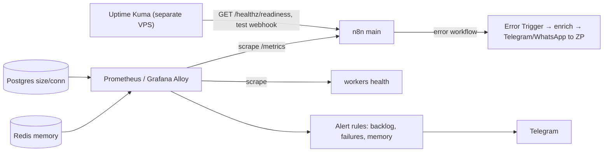

# n8n - Monitoring, Metrics & Alerting

> [!info] Deep dive of [[n8n]]

> [!abstract] TL;DR
> Monitor n8n on four levels:
> - **Up**: external checks on `/healthz` (liveness) and `/healthz/readiness` (DB connected and migrated).
> - **Healthy**: Prometheus `/metrics` with `N8N_METRICS=true`, including **queue metrics** (waiting/active/failed jobs) on the main instance.
> - **Correct**: an **error workflow** on every production workflow that alerts with client, workflow and execution link.
> - **Sustainable**: Postgres size, Redis memory, disk and execution volume.
>
> Alert on **symptoms that need action** (queue backlog, failure-rate spikes, workers down, webhook 5xx), not on every single failed execution.

## Concept
| Signal | Source | Alert when |
|---|---|---|
| Liveness | `GET /healthz` (main, workers with `QUEUE_HEALTH_CHECK_ACTIVE`) | Non-200 for > 2 minutes |
| Readiness | `GET /healthz/readiness` | DB unavailable/migrating |
| Queue backlog | `n8n_scaling_mode_queue_jobs_waiting` | Waiting > N for > 5 minutes |
| Failed jobs | `…_queue_jobs_failed`, error workflow events | Failure rate spike vs baseline |
| Process health | Default Node metrics (memory, event loop lag, GC) | Memory near container limit, event-loop lag > 1 s |
| Webhook latency | Traefik metrics/access logs (n8n webhook metrics in newer 2.x) | p95 > a few seconds, 5xx rate |
| Infrastructure | Postgres size/connections, Redis memory, disk | DB/disk > 80%, Redis near maxmemory |
| Business outcome | Custom: messages sent, orders synced per hour | Drops to zero during business hours |

**Metrics configuration** (main instance; workers expose health checks):

| Variable | Effect |
|---|---|
| `N8N_METRICS=true` | Enables `/metrics` (self-hosted only) |
| `N8N_METRICS_INCLUDE_DEFAULT_METRICS=true` | Node.js process metrics |
| `N8N_METRICS_INCLUDE_QUEUE_METRICS=true` | Bull queue gauges (main instance, single-main mode) |
| `N8N_METRICS_QUEUE_METRICS_INTERVAL` | Refresh interval (seconds) |
| `N8N_METRICS_INCLUDE_WORKFLOW_ID_LABEL` | Per-workflow labels (watch cardinality) |
| `QUEUE_HEALTH_CHECK_ACTIVE=true` | Health endpoint on workers |

## How It Works


## Practical Usage
**Environment** (main):
```bash
N8N_METRICS=true
N8N_METRICS_INCLUDE_DEFAULT_METRICS=true
N8N_METRICS_INCLUDE_QUEUE_METRICS=true
N8N_METRICS_QUEUE_METRICS_INTERVAL=20
N8N_METRICS_INCLUDE_WORKFLOW_ID_LABEL=false     # enable only if series count stays small
QUEUE_HEALTH_CHECK_ACTIVE=true                  # on workers
```
**Keep `/metrics` private** (scrape over the Docker network; exclude the path from the public router):
```yaml
# public router serves everything except /metrics
- traefik.http.routers.n8n.rule=Host(`n8n.client.my`) && !PathPrefix(`/metrics`)
# Alloy/Prometheus scrapes http://n8n:5678/metrics on the internal Docker network
```
**Prometheus alert rules** (examples):
```yaml
groups:
  - name: n8n
    rules:
      - alert: N8nQueueBacklog
        expr: n8n_scaling_mode_queue_jobs_waiting > 50
        for: 5m
        labels: { severity: warning }
        annotations: { summary: "n8n queue backlog {{ $value }} jobs on {{ $labels.instance }}" }
      - alert: N8nJobFailuresSpike
        expr: increase(n8n_scaling_mode_queue_jobs_failed[15m]) > 20
        labels: { severity: critical }
      - alert: N8nMainDown
        expr: up{job="n8n"} == 0
        for: 2m
        labels: { severity: critical }
```
**Error workflow template** (attach as "Error workflow" in every production workflow's settings):
```text
Error Trigger
  → Set: client = {{$json.workflow.name.split(']')[0].replace('[','')}}, workflow = {{$json.workflow.name}},
         node = {{$json.execution.lastNodeExecuted}}, error = {{$json.execution.error.message.slice(0,300)}},
         url = {{$json.execution.url}}
  → Redis/Data Table: dedupe key = workflow + error message hash, TTL 30 min (avoid alert storms)
  → Telegram: "⚠️ [client] workflow failed at node X: error… → link"
```
**Business heartbeat** (catch silent failures):
```text
Schedule (hourly 9am–10pm MYT) → Postgres: count(messages sent last hour) per tenant
  → If count = 0 for an active tenant → alert "No WhatsApp replies sent for tenant X in the last hour"
```
**Wrong way**:
```text
❌ /metrics exposed on the public n8n domain             → leaks workflow names/IDs and load info
❌ Email for every failed execution                       → alert fatigue; real outages ignored
❌ Monitoring only the n8n container "running" status     → stuck queue / broken credentials go unnoticed
❌ Uptime checks from the same VPS                        → VPS down = monitor down
```

## Patterns & Anti-patterns
| Pattern | When | Anti-pattern to avoid |
|---|---|---|
| External uptime + readiness checks | Every instance | Self-monitoring on the same box |
| Error workflow on all production workflows, deduped | Failure alerts | One alert per execution |
| Queue backlog + worker health alerts | Queue mode | Watching CPU only |
| Business heartbeats (outputs per hour) | Customer-facing automations | Assuming "no errors" means "working" |
| Low-cardinality metrics labels | Prometheus | Per-execution or per-customer labels |
| Weekly review of top failing workflows | Maintenance retainers | Fixing alerts reactively forever |
| Incident notes per client (what, impact, fix) | SLA reporting | No record of outages |

## Performance & Trade-offs
- **Metrics overhead** is small. Workflow-ID labels multiply series count, so keep them off on instances with hundreds of workflows.
- **Prometheus + Grafana** on the same small VPS costs RAM (~500 MB–1 GB). Grafana Cloud's free tier or a shared monitoring VPS across clients is often better ([[Docker - Logging, Metrics & Resource Limits on a VPS]]).
- **Error-workflow alerts** are cheap and fast, but only fire for failures n8n sees. Heartbeats catch silent "nothing happened" failures (expired tokens, webhook unsubscribed).
- **Log streaming** (to syslog/webhooks/Sentry) is a paid-edition feature. On Community, use container logs → Loki plus error workflows.

## Tips & Reminders
> [!tip] In ZP's stack
> - **Per client instance**: Uptime Kuma on readiness + one test webhook, Alloy scraping `/metrics` into a shared Grafana (labels `client=`), error workflows to a Telegram group per client, and WhatsApp alerts only for critical ones.
> - **Monthly retainer report**: uptime %, executions, failure rate, top 3 incidents and fixes. That turns monitoring into visible value ([[n8n - Testing, Versioning & Deploying Workflows]]).
> - **WhatsApp token expiry / Meta outages**: a heartbeat on "messages sent per hour" catches these faster than error alerts.

- Name workflows with a `[client]` prefix so alerts and dashboards group cleanly.
- Track Postgres growth (execution data) and Redis memory alongside n8n metrics ([[n8n - Queue Mode & Scaling]]).
- Add Traefik access-log alerts for webhook 5xx and latency ([[Traefik - Observability & Troubleshooting]]).
- For AI workflows, track token cost per tenant separately (Langfuse or a usage table) ([[AI Evals & Observability - Tracing & Production Monitoring with Langfuse]]).

## Version Notes
| Version | Change relevant here |
|---|---|
| 1.x | `/metrics` Prometheus endpoint, queue metrics flag, worker health checks, error workflows |
| 2.0 (2025-12) | Security-hardened defaults. Metrics remain opt-in |
| 2.28 (reported) | Webhook and form timing metrics (`N8N_METRICS_INCLUDE_WEBHOOK_METRICS`, `…_FORM_METRICS`) |

> [!warning] Unverified — check before relying on this
> Exact metric names, the 2.28 webhook/form metrics, the n8n Insights dashboard availability per edition, and worker health port behaviour weren't confirmed in official docs. Check https://docs.n8n.io/deploy/host-n8n/configure-n8n/basic-configuration/configuration-examples/enable-prometheus-metrics/.

## Critical Issues & Gotchas
> [!danger] Silent failures look healthy
> Expired OAuth/WhatsApp tokens, a disabled trigger, a webhook no longer registered at Meta, or a workflow accidentally unpublished produce **no errors**, just no work. Container health stays green while the client's customers get no replies. Add business heartbeats and synthetic test messages for critical flows.

> [!danger] Alert storms hide real incidents
> A downstream API outage can fail thousands of executions, each triggering an alert, and the channel becomes noise exactly when attention matters. Deduplicate by workflow + error signature, aggregate counts, and route only critical, actionable alerts to WhatsApp/phone.

- **Queue metrics only on main (single-main mode)**: workers don't report queue gauges, so scrape the main instance.
- **Metrics endpoint auth**: n8n doesn't add auth to `/metrics`. Restrict it at the network/proxy level.
- **Clock/timezone**: schedule-based heartbeats must use `Asia/Kuala_Lumpur`, or quiet-hours logic misfires.
- **Execution pruning** removes history used for debugging. Keep failed executions longer than successful ones ([[n8n - Error Handling & Workflow Patterns]]).

## Related
- [[n8n]]
- [[n8n - Error Handling & Workflow Patterns]] — error workflows, retries, DLQs
- [[n8n - Queue Mode & Scaling]] — what the queue metrics mean
- [[Docker - Logging, Metrics & Resource Limits on a VPS]] — Alloy/Loki/Prometheus stack
- [[Traefik - Observability & Troubleshooting]] — webhook entry-point metrics
- [[n8n - Testing, Versioning & Deploying Workflows]] — staging checks before alerts fire in prod

## References
- https://docs.n8n.io/deploy/host-n8n/configure-n8n/basic-configuration/configuration-examples/enable-prometheus-metrics/
- https://docs.n8n.io/hosting/configuration/configuration-examples/prometheus
- https://nordflux.de/en/guides/monitoring-n8n-logs-healthchecks-prometheus-grafana
- https://openobserve.ai/blog/n8n-monitoring-opentelemetry.md
- https://hostadvice.com/blog/web-hosting/vps/server-monitoring-stack-for-n8n-infrastructure/
