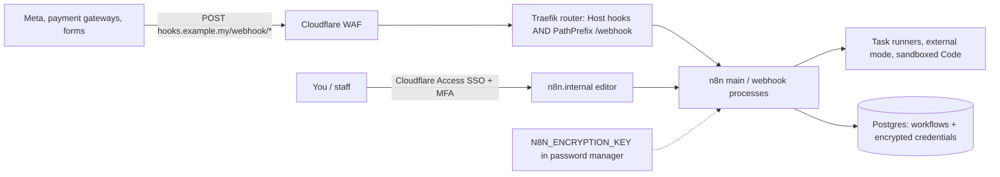

# n8n - Security, Credentials & Self-Hosting Hardening

> [!info] Deep dive of [[n8n]]

> [!abstract] TL;DR
> **Editor access = code execution on your server** (Code, Execute Command, file and SSH nodes) **plus every stored credential**. 2026 brought several CVSS 9–10 RCEs, some unauthenticated via webhooks.
> Hardening checklist:
> - patch within days;
> - editor only behind Cloudflare Access (+ MFA);
> - expose only `/webhook/*` publicly, on a separate hostname, and verify webhook signatures;
> - exclude dangerous nodes, run task runners in external mode, disable community packages;
> - one instance (or at least project) per client;
> - `N8N_ENCRYPTION_KEY` backed up outside the server.

## Concept
**Threat model**:

| Attacker / vector | Impact | Control |
|---|---|---|
| Unauthenticated request to a webhook (e.g. CVE-2026-21858, CVSS 10) | RCE / data access | Patch; expose only webhook paths; WAF; signature checks |
| Any editor user (malicious or phished) | Code execution as the n8n process, read all credentials | Editor behind Access + MFA; few editors; exclude dangerous nodes |
| Compromised community node (npm) | Supply-chain RCE | Disable community packages, or pin + review |
| Leaked DB backup without key isolation | Credentials decrypted if the key leaks too | Key stored separately; encrypted backups |
| Cross-client workflows on one instance | One client's breach reaches others | Instance per client (or strict projects + RBAC) |

**2026 advisories** (check your version against each):

| CVE | Type | Fixed in |
|---|---|---|
| CVE-2026-21858 "Ni8mare" | Unauthenticated, via webhooks, CVSS 10.0 | ≥ 1.121.0 (some configs up to 1.121.3 at risk) |
| CVE-2026-21877 | Authenticated RCE (Git node path), CVSS 10.0 | 1.121.3 |
| CVE-2026-25049 | Unauthenticated command execution, public PoC | 1.123.17 / 2.5.2 (per CSA SG) |
| CVE-2026-33660 | Authenticated RCE via Merge node "Combine by SQL", CVSS 9.4 | **2.14.1 / 2.13.3 / 1.123.27** |

## How It Works


## Practical Usage
**Hardened environment** (Coolify / compose `.env`):
```bash
N8N_ENCRYPTION_KEY=<64 random chars; stored in password manager>
N8N_HOST=n8n.internal.example.my
N8N_EDITOR_BASE_URL=https://n8n.internal.example.my
WEBHOOK_URL=https://hooks.example.my/
N8N_PROXY_HOPS=1                                  # behind Traefik: trust one X-Forwarded-For hop
N8N_SECURE_COOKIE=true
N8N_BLOCK_ENV_ACCESS_IN_NODE=true                 # no $env in expressions/Code (2.0 default)
N8N_RESTRICT_FILE_ACCESS_TO=/home/node/.n8n-files
N8N_COMMUNITY_PACKAGES_ENABLED=false
N8N_DIAGNOSTICS_ENABLED=false
N8N_PERSONALIZATION_ENABLED=false
NODES_EXCLUDE=["n8n-nodes-base.executeCommand","n8n-nodes-base.ssh","n8n-nodes-base.readWriteFile"]
N8N_RUNNERS_ENABLED=true
N8N_RUNNERS_MODE=external                         # Code node runs in a separate runner container
EXECUTIONS_DATA_PRUNE=true
EXECUTIONS_DATA_MAX_AGE=336                       # hours (14 days): execution data holds PII
```
**Traefik**: public router for webhooks only (editor reachable via Access/Tunnel):
```yaml
labels:
  - traefik.http.routers.n8n-hooks.rule=Host(`hooks.example.my`) && (PathPrefix(`/webhook/`) || PathPrefix(`/webhook-waiting/`))
  - traefik.http.routers.n8n-hooks.entrypoints=websecure
  - traefik.http.routers.n8n-hooks.middlewares=hooks-ratelimit@docker
  - traefik.http.middlewares.hooks-ratelimit.ratelimit.average=20
  - traefik.http.middlewares.hooks-ratelimit.ratelimit.burst=40
```
**Verify webhook signatures** inside the workflow (first node after the Webhook trigger), e.g. Meta's `X-Hub-Signature-256`:
```js
// Code node — requires "Raw body" enabled on the Webhook node
const crypto = require('crypto');
const sig = $input.first().json.headers['x-hub-signature-256'] ?? '';
const raw = Buffer.from($input.first().binary.data.data, 'base64');
const expected = 'sha256=' + crypto.createHmac('sha256', $vars.META_APP_SECRET).update(raw).digest('hex');
if (sig.length !== expected.length || !crypto.timingSafeEqual(Buffer.from(sig), Buffer.from(expected))) {
  throw new Error('invalid signature');
}
return $input.all();
```
**Built-in security audit** and an upgrade routine:
```bash
docker exec n8n n8n audit                         # reports risky nodes, credentials, instance settings
docker compose pull n8n && docker compose up -d --wait n8n   # after reading release notes; DB backup first
```
**Wrong way**:
```text
❌ Editor on a public hostname with only n8n login           → credential stuffing + every editor-level CVE exposed
❌ One instance for all clients, credentials shared by name   → one leaked workflow export maps every client's systems
❌ Webhook path as the only secret (/webhook/abc123)          → paths leak via logs, browser history, screenshots
```

## Patterns & Anti-patterns
| Pattern | When | Anti-pattern to avoid |
|---|---|---|
| Editor behind Cloudflare Access (SSO + MFA) | Always | Public editor login page |
| Separate public hostname limited to `/webhook*` | Any internet-facing trigger | Routing the whole n8n app publicly |
| Signature/HMAC or header-auth on every webhook | Inbound integrations | Relying on obscure URLs |
| Least-privilege, per-client API tokens in credentials | Client integrations | Admin/owner tokens "because it's easier" |
| Instance-per-client for regulated or high-value clients | Agencies/consulting | Mixing clients on one instance without RBAC |
| Patch SLA (critical: ≤ 72 h) + GitHub advisory alerts | Self-hosting | "Upgrade when something breaks" |

## Performance & Trade-offs
- **External task runners** add a container and a little latency per Code execution, but isolate untrusted JS/Python from the main process. Worth it on any instance with more than one editor or client.
- **Excluding nodes** (Execute Command, SSH, file access) removes the easiest RCE paths, at the cost of workflows that need them. Run those on a separate, locked-down instance if required.
- **Execution data retention**: keeping full execution data helps debugging but stores customer PII (WhatsApp messages, phone numbers) in Postgres. Prune at 7–30 days and save only errors longer.
- **Instance per client** multiplies upgrades (automate with Coolify + image pinning) but caps the blast radius, and makes offboarding a client a clean delete.

## Tips & Reminders
> [!tip] In ZP's stack
> - **Topology**: n8n on Coolify in queue mode ([[n8n - Queue Mode & Scaling]]):
>   - editor at `n8n.<client>.internal` behind Cloudflare Access;
>   - webhooks at `hooks.<client>.my` via Traefik with a path-limited router and rate limit;
>   - Meta/WhatsApp signatures verified in the first node.
> - **Contracts**: state who patches n8n and how fast, where credentials live, and that client tokens are least-privilege and revocable ([[n8n]]).

- Back up `N8N_ENCRYPTION_KEY` **and** the Postgres DB, separately. Test a restore on a scratch instance quarterly ([[PostgreSQL - Backups, PITR & Restore Drills]]).
- Use n8n Variables (`$vars`) or external secrets for shared config, not hard-coded values in Code nodes. Never paste secrets into workflow JSON shared on forums.
- Rotate credentials immediately after any CVE that could have exposed them (an RCE on an unpatched internet-facing instance = assume compromised).
- Review users monthly: remove ex-staff and contractors, and keep the owner account for emergencies only.

## Version Notes
| Version / date | Change relevant here |
|---|---|
| 1.x (2024–25) | Task runners introduced (opt-in), external secrets & SSO (Enterprise), projects/RBAC |
| 2.0 (2025-12) | Security-first defaults: task runners on, `$env` blocked in nodes, Save vs Publish |
| 2026-01 → 03 | Critical CVE streak (Ni8mare CVE-2026-21858, CVE-2026-21877, CVE-2026-25049, CVE-2026-33660). Minimum safe: **2.14.1** (2.x) / **1.123.27** (1.x) |
| 2.42.x (2026-10) | Stable line per third-party tracker. Read weekly release notes for security fixes |

> [!warning] Unverified — check before relying on this
> CVE fix versions come from vendor-neutral advisories (Qualys, CSA SG, CCB Belgium, Upwind), not the GHSA pages directly. Node type names for `NODES_EXCLUDE` and runner env vars should be checked against your n8n version's docs.

## Critical Issues & Gotchas
> [!danger] Internet-exposed, unpatched n8n is a known mass-exploitation target
> The 2026 webhook-reachable RCEs were exploited against exposed instances shortly after disclosure. An unpatched instance with stored client credentials (Gmail, Meta, CRM, payment APIs) is a multi-client breach waiting to happen. Patch fast, and keep the editor off the public internet.

> [!danger] Losing or leaking `N8N_ENCRYPTION_KEY`
> Lose it and every credential is unrecoverable after a restore, so all client integrations must be re-authorized. Leak it together with a DB dump and every credential is readable. Store it separately from backups, and never commit it.

- **`N8N_PROXY_HOPS` missing behind Traefik** makes rate limits and logs see the proxy IP, and can break secure-cookie behaviour.
- **Workflow exports** can include credential names and IDs (not secrets) and sensitive logic. Treat them as confidential.
- **Webhook test URLs** (`/webhook-test/`) left active in production expose an extra entry point. Keep test triggers on staging.
- **Shared Redis/Postgres** with app workloads widens the blast radius. Give n8n its own DB and Redis ([[Message Queues - Choosing BullMQ, pgmq, RabbitMQ or NATS]]).

## Related
- [[n8n]]
- [[n8n - Queue Mode & Scaling]] — process topology, Redis, workers
- [[n8n - Error Handling & Workflow Patterns]] — error workflows, retries
- [[Cloudflare - Zero Trust Tunnel & Access]] — protecting the editor
- [[Traefik - Middlewares, TLS & Routing]] — path-limited routers, rate limits
- [[REST API - Webhooks & Idempotency]] — signature verification and dedupe

## References
- https://docs.n8n.io/hosting/securing/overview/
- https://docs.n8n.io/hosting/configuration/environment-variables/security/
- https://threatprotect.qualys.com/2026/03/30/n8n-patches-critical-remote-code-execution-vulnerability-cve-2026-33660/
- https://www.csa.gov.sg/alerts-and-advisories/alerts/al-2026-011/
- https://ccb.belgium.be/advisories/warning-two-critical-vulnerabilities-n8n-can-lead-remote-code-execution-patch
- https://thehackernews.com/2026/01/n8n-warns-of-cvss-100-rce-vulnerability.html
