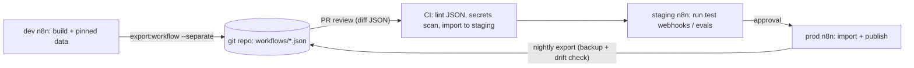

# n8n - Testing, Versioning & Deploying Workflows

> [!info] Deep dive of [[n8n]]

> [!abstract] TL;DR
> - **Version workflows in git**: n8n's built-in history and 2.0's **Save vs Publish** help with rollbacks, but git is your audit trail across instances and the backup when the DB is lost.
> - **Community edition**: export with the CLI (`n8n export:workflow --separate`) or the public API on a schedule, and promote dev → staging → prod by importing the same JSON.
> - **Credentials**: same names, environment-specific values. Never export decrypted.
> - **Testing**: pinned data for unit-like checks, a staging instance with mocked/sandbox APIs for end-to-end runs, and eval datasets for AI steps.
> - Publish in prod only after staging passes, and keep the previous version one click away.

## Concept
| Mechanism | What it gives | Limits |
|---|---|---|
| Save vs **Publish** (2.0) | Drafts don't change the live version. Rollback = publish an older version | History retention on self-hosted may be short (reported). Not cross-instance |
| Workflow history / autosave | Recent versions, named versions | Pruned over time. Lives in the n8n DB |
| CLI `export:workflow` / `import:workflow` | JSON files you commit and import elsewhere | Manual or scripted. IDs and credential references need care |
| Public REST API (`/api/v1/workflows`) | Scripted export/import/activation | API key = admin-level power, so protect it |
| Source control + environments (git) | Native push/pull between instances | Paid plans (Business/Enterprise) |
| Pinned data | Freeze node output to test downstream nodes | Not a real integration test |
| Evaluations (AI) | Dataset-driven runs with metrics | AI workflows only, needs datasets |

**Environment layout**:

| Instance | Purpose | Credentials | Data |
|---|---|---|---|
| dev (local Docker or small VPS) | Building, pinned-data testing | Sandbox keys | Fake data |
| staging | End-to-end runs, client UAT | Sandbox/test numbers (WhatsApp test number, payment sandbox) | Seeded test data |
| prod | Live client automations | Live keys (client-owned) | Real data |

## How It Works


## Practical Usage
**Export from an instance** (inside the n8n container; one file per workflow, stable diffs):
```bash
docker exec -u node n8n n8n export:workflow --all --separate --pretty --output=/home/node/backup/workflows/
docker cp n8n:/home/node/backup/workflows ./workflows
# credentials: export ENCRYPTED only (useless without that instance's N8N_ENCRYPTION_KEY) — never --decrypted into git
```
**Import into staging/prod** (same JSON, environment-specific credentials by name):
```bash
docker cp ./workflows n8n:/home/node/import/
docker exec -u node n8n n8n import:workflow --separate --input=/home/node/import/workflows/
# then publish/activate the intended workflows (UI or API); keep previous version for rollback
```
**Nightly drift check** (prod changed outside git?):
```bash
#!/usr/bin/env bash
set -euo pipefail
docker exec -u node n8n n8n export:workflow --all --separate --pretty --output=/tmp/wf >/dev/null
docker cp n8n:/tmp/wf ./snapshot
# normalize volatile fields before diffing
for f in snapshot/*.json; do jq 'del(.updatedAt, .versionId, .meta)' "$f" > "$f.tmp" && mv "$f.tmp" "$f"; done
git diff --no-index --stat workflows/ snapshot/ || echo "DRIFT: prod differs from git" | ./notify.sh
```
**End-to-end test against staging** (webhook-triggered workflow with sandbox dependencies):
```ts
// vitest: send a signed fake WhatsApp payload to staging and assert side effects
const res = await fetch(`${STAGING_N8N}/webhook/wa/acme`, {
  method: 'POST', headers: { 'content-type': 'application/json', 'x-hub-signature-256': sign(payload) },
  body: JSON.stringify(payload),
});
expect(res.status).toBe(200);
await expect.poll(() => db.waMessages.findByWamid(payload.wamid)).toBeTruthy();   // stored once
await expect.poll(() => mockMeta.sentMessages(to)).toHaveLength(1);               // replied once (mock Graph API)
```
**Wrong way**:
```text
❌ Editing prod workflows directly in the UI           → no review, no record, "who changed this?" after an incident
❌ Exporting credentials --decrypted into the repo      → every client key in git history
❌ Sub-workflows referenced by different IDs per instance → imports break callers; keep IDs stable across envs
❌ Testing against the client's live WhatsApp number    → real customers receive test messages
```

## Patterns & Anti-patterns
| Pattern | When | Anti-pattern to avoid |
|---|---|---|
| Git as source of truth, prod imported from it | All client instances | UI-only changes in prod |
| One JSON file per workflow (`--separate --pretty`) | Reviewable diffs | One giant export file |
| Credentials referenced by stable names, created per env | Promotion | Credentials embedded/duplicated per workflow |
| Stable workflow IDs across envs (import with IDs) | Sub-workflow calls by ID | Re-created workflows with new IDs |
| Staging with sandbox APIs + mock servers | End-to-end tests | Testing in prod "carefully" |
| Pinned data + small Code-node unit tests | Fast feedback | Only manual clicking |
| Nightly export + drift alert | Prod hygiene | Discovering drift during an incident |
| Upgrade n8n on staging first, run the test suite | Every n8n version bump | Upgrading prod directly (2.0 breaking changes) |

## Performance & Trade-offs
- **Native git source control** (paid) gives push/pull UX and environments. The CLI/API approach is free but needs scripting and discipline. For a solo consultant with several client instances, scripts + git are usually enough.
- **Staging instances cost money and RAM**. One shared staging instance with per-client projects/folders is a pragmatic compromise, but keep client credentials separated.
- **JSON diffs are noisy** (positions, IDs). Normalize before review, and focus reviews on node parameters and expressions.
- **Test depth**: full E2E tests through Meta/payment sandboxes are slow and flaky. Cover critical paths (inbound message → reply, payment webhook → order paid), and pin the rest.

## Tips & Reminders
> [!tip] In ZP's stack
> - **One repo per client** (`client-n8n/workflows/*.json`, `scripts/`, `tests/`), exported nightly from prod via a cron job on the VPS, with a drift alert to Telegram. The repo doubles as a deliverable at handover.
> - **Promotion**: build on dev, open a PR, a CI job imports to staging and runs webhook tests, then you import to prod and publish. Use Coolify to pin the n8n image version per environment ([[CI-CD - Deploy Pipelines for Coolify & Flutter Releases]]).
> - **AI workflows**: an eval dataset (real anonymized messages) run on staging before changing prompts or models ([[AI Evals & Observability - Eval Datasets & LLM-as-Judge]]).

- Name versions before risky edits ("before-template-v3"), so rollback targets are obvious in history.
- Store `N8N_ENCRYPTION_KEY` per instance in the secrets manager. Without it, encrypted credential exports are useless ([[CI-CD - Secrets Management with SOPS & Infisical]]).
- Keep shared `lib/` sub-workflows versioned like an internal library, with changelog notes in the workflow description ([[n8n - Code Node, Sub-workflows & Custom Nodes]]).
- Run a secrets scan (gitleaks) on exported JSON. Hardcoded keys in HTTP Request headers show up there.

## Version Notes
| Version | Change relevant here |
|---|---|
| 1.x | CLI export/import, public API, workflow history, source control/environments (paid) |
| 2.0 (2025-12) | **Save vs Publish**: drafts don't affect the live version. Rollback by publishing a previous version |
| 2.4 (2026-01, reported) | Autosave (drafts every few seconds) and pruning of redundant versions |

> [!warning] Unverified — check before relying on this
> Self-hosted history retention (a community report says ~1 day for published versions), the exact autosave/pruning version, and which source-control features are in which plan weren't confirmed. Check https://docs.n8n.io/source-control-environments/ and the release notes.

## Critical Issues & Gotchas
> [!danger] Workflow JSON contains secrets and personal data
> Exports can include hardcoded API keys in node parameters, pinned data with real customer messages, phone numbers or IC numbers, and webhook paths that act as bearer secrets. Strip pinned data before committing, scan for secrets, keep repos private, and rotate any key that was committed ([[n8n - Security, Credentials & Self-Hosting Hardening]]).

> [!danger] Importing over production without a rollback path
> `import:workflow` overwrites workflows with matching IDs. A bad import can break live automations (WhatsApp replies stop, orders not processed). Export prod first, import during a quiet window, verify critical flows with a smoke test, and keep the previous JSON ready to re-import.

- **Webhook URLs change** between test (`/webhook-test/`) and production (`/webhook/`) paths, and between instances. External services (Meta, payment gateways) must point to the right environment.
- **Activation state** isn't always carried by imports. Verify which workflows are published/active after each deployment.
- **Credential IDs vs names**: imported workflows may reference credential IDs that don't exist on the target. Recreate credentials with consistent names and re-link if needed.
- **n8n upgrades** can change node versions and behaviour (2.0 security defaults, Python runners). Test exported workflows on the new version in staging first.

## Related
- [[n8n]]
- [[n8n - Error Handling & Workflow Patterns]] — error workflows tested in staging
- [[n8n - Code Node, Sub-workflows & Custom Nodes]] — library sub-workflows and stable IDs
- [[n8n - Security, Credentials & Self-Hosting Hardening]] — credential exports and encryption keys
- [[CI-CD - Deploy Pipelines for Coolify & Flutter Releases]] — pipeline stages and approvals
- [[Git - Branching, Releases & Recovery]] — branching and rollback practices

## References
- https://docs.n8n.io/hosting/cli-commands/
- https://docs.n8n.io/source-control-environments/
- https://docs.n8n.io/api/
- https://community.n8n.io/t/announcing-autosave/246161
- https://dev.to/techstuff/n8n-20-a-complete-guide-to-save-and-publish-workflows-17hh
