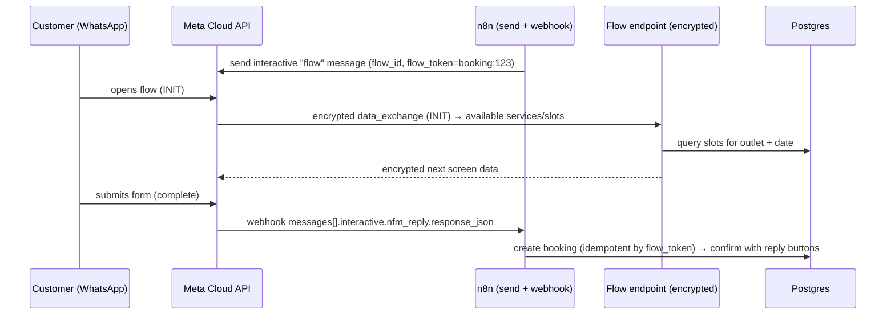

# n8n - WhatsApp Flows & Interactive Messages

> [!info] Deep dive of [[n8n]]

> [!abstract] TL;DR
> Structured WhatsApp UX beats free-text parsing for bookings, orders and lead capture:
> - **Interactive messages** (inside the 24 h window):
>   - **reply buttons**: up to 3;
>   - **list messages**: up to 10 rows in sections;
>   - **CTA URL buttons**, **location requests**, and **Flow messages**.
>
>   Replies arrive as typed webhook payloads (button/list IDs), with no NLP needed.
> - **WhatsApp Flows**: multi-screen native forms (dropdowns, date pickers, checkboxes) defined in **Flow JSON**.
>   - Static flows **navigate** locally and submit once.
>   - Dynamic flows call your **data_exchange endpoint**, which must be **end-to-end encrypted** (RSA-2048 key uploaded to the phone number, AES payloads) and fast.
>   - Results arrive as `nfm_reply` webhooks.
> - Outside the 24 h window, start a Flow via an **approved template** with a Flow button.
> - **In n8n**, send interactive payloads via the HTTP Request node to the Graph API, route replies by ID in a Switch, and host the encrypted Flow endpoint as a Code-node webhook or a small Worker/Edge Function.

## Concept
| Type | Limits (approx.) | Use for |
|---|---|---|
| Reply buttons | ≤ 3 buttons, title ≤ 20 chars | Yes/No, confirm booking, choose language |
| List message | ≤ 10 rows total, sections, row title ≤ 24 chars | Service menu, outlet selection, time slots |
| CTA URL | 1 URL button | Pay link, track order, open portal |
| Location request | Asks user to share location | Delivery address, nearest outlet |
| Flow message | Opens a WhatsApp Flow | Multi-field forms, bookings, surveys |
| Template with Flow/quick-reply buttons | Approved template | Start interactions outside 24 h window |

**Flow building blocks**:

| Element | Meaning |
|---|---|
| Screens | Pages with components (TextInput, Dropdown, DatePicker, RadioButtonsGroup, CheckboxGroup, OptIn, Footer) |
| `navigate` action | Go to next screen using local JSON only (no server call) |
| `data_exchange` action | POST to your endpoint for dynamic data/validation (encrypted) |
| `complete` action | End the flow, send the response to your webhook (`nfm_reply`) |
| `flow_token` | Your correlation ID (conversation/booking draft) |
| Draft vs published | Drafts testable. Published flows are immutable (create new versions) |

## How It Works


## Practical Usage
**Reply buttons** (HTTP Request node → `POST https://graph.facebook.com/v{N}/{PHONE_NUMBER_ID}/messages`):
```json
{
  "messaging_product": "whatsapp",
  "to": "60123456789",
  "type": "interactive",
  "interactive": {
    "type": "button",
    "body": { "text": "Confirm your booking for Sat 22 Nov, 3:00 PM at Kuching Central?" },
    "action": { "buttons": [
      { "type": "reply", "reply": { "id": "bk_confirm:123", "title": "Confirm" } },
      { "type": "reply", "reply": { "id": "bk_change:123", "title": "Change time" } },
      { "type": "reply", "reply": { "id": "bk_cancel:123", "title": "Cancel" } }
    ] }
  }
}
```
**List message** (service menu):
```json
{
  "type": "interactive",
  "interactive": {
    "type": "list",
    "header": { "type": "text", "text": "Our services" },
    "body": { "text": "Choose a service to book" },
    "action": {
      "button": "View services",
      "sections": [
        { "title": "Hair", "rows": [ { "id": "svc_cut", "title": "Haircut", "description": "45 min · RM35" },
                                     { "id": "svc_color", "title": "Colouring", "description": "2 h · from RM120" } ] },
        { "title": "Spa",  "rows": [ { "id": "svc_massage", "title": "Massage 60 min", "description": "RM98" } ] }
      ]
    }
  }
}
```
**Route replies** (Switch node on the webhook payload):
```text
{{$json.entry[0].changes[0].value.messages[0].interactive.button_reply.id}}   → "bk_confirm:123"
{{$json.entry[0].changes[0].value.messages[0].interactive.list_reply.id}}     → "svc_cut"
{{$json.entry[0].changes[0].value.messages[0].interactive.nfm_reply.response_json}} → Flow result (JSON string)
```
**Send a Flow** (inside 24 h window):
```json
{
  "type": "interactive",
  "interactive": {
    "type": "flow",
    "body": { "text": "Book your appointment in 30 seconds" },
    "action": { "name": "flow", "parameters": {
      "flow_message_version": "3", "flow_id": "1234567890", "flow_token": "booking:123",
      "flow_cta": "Book now", "flow_action": "data_exchange"
    } }
  }
}
```
**Encrypted data_exchange endpoint** (Node, e.g. Cloudflare Worker / Express; n8n Code node is possible but fiddly):
```ts
import crypto from "node:crypto";
export function decryptRequest(body: any, privateKeyPem: string) {
  const aesKey = crypto.privateDecrypt(
    { key: privateKeyPem, padding: crypto.constants.RSA_PKCS1_OAEP_PADDING, oaepHash: "sha256" },
    Buffer.from(body.encrypted_aes_key, "base64"));
  const iv = Buffer.from(body.initial_vector, "base64");
  const data = Buffer.from(body.encrypted_flow_data, "base64");
  const tag = data.subarray(-16), ct = data.subarray(0, -16);
  const d = crypto.createDecipheriv("aes-128-gcm", aesKey, iv); d.setAuthTag(tag);
  return { payload: JSON.parse(Buffer.concat([d.update(ct), d.final()]).toString()), aesKey, iv };
}
export function encryptResponse(resp: object, aesKey: Buffer, iv: Buffer) {
  const flipped = Buffer.from(iv.map((b) => ~b & 0xff));               // response uses bit-flipped IV
  const c = crypto.createCipheriv("aes-128-gcm", aesKey, flipped);
  return Buffer.concat([c.update(JSON.stringify(resp)), c.final(), c.getAuthTag()]).toString("base64");
}
// handle payload.action: "ping" (health check), "INIT", "data_exchange", "BACK"; respond within a few seconds
```
**Wrong way**:
```text
❌ Parsing "1", "one", "satu" from free text for menu choices   → brittle; use list/buttons with IDs
❌ Slow DB/LLM calls inside the Flow endpoint                   → timeouts, users see errors mid-form
❌ Re-using one RSA key pair across clients' WABAs               → one leak exposes all; Meta advises per-WABA keys
❌ Trusting nfm_reply data without validation                    → forged/edited values (prices, dates) accepted
```

## Patterns & Anti-patterns
| Pattern | When | Anti-pattern to avoid |
|---|---|---|
| Buttons/lists for menus, AI for open questions | Support bots | LLM parsing every menu answer |
| Encode context in IDs (`bk_confirm:123`) | Reply routing | Ambiguous button IDs |
| Static (navigate-only) Flows first | Lead forms, surveys | Endpoint complexity when not needed |
| Endpoint for live slots/stock only | Booking/ordering | Hard-coded options that go stale |
| `flow_token` = server-side draft ID + idempotent completion | Bookings | Creating duplicate bookings on retries |
| Template with Flow button for re-engagement | Outside 24 h window | Free-form messages failing |
| Per-client endpoint + key pair | Agencies | Shared secrets across WABAs |

## Performance & Trade-offs
- **Flows vs web forms**: Flows keep users inside WhatsApp (higher completion), but the UI is constrained, they need Meta review/publishing, and debugging is harder. Web forms (Next.js) allow richer validation and payment, linked via a CTA URL button.
- **Endpoint latency**: keep responses well under the Meta timeout (a few seconds). Precompute slot lists, cache in Redis, and avoid LLM calls in the endpoint.
- **n8n hosting the endpoint**: possible with Code nodes (crypto builtin), but cold paths and execution overhead add latency. A small Worker/Edge Function is more reliable ([[Cloudflare - Workers for Webhooks & Edge APIs]]).
- **Template costs**: Flow-button templates sent outside the window are billed per message (marketing/utility category).

## Tips & Reminders
> [!tip] In ZP's stack
> - **High-value SME use cases**: salon/clinic booking Flow (service → outlet → date → slot), F&B pre-orders, property viewing requests, warranty registration, feedback surveys. Package them as reusable templates per vertical.
> - **Combine with the AI agent**: the agent answers questions, and when intent = booking, it sends the Flow instead of collecting fields conversationally ([[AI Agents - Customer Support Agents for WhatsApp & Messaging]]).
> - **Language**: build separate Flow versions or localized strings for BM/EN/ZH. Detect the preferred language first via reply buttons.

- Keep button titles short (BM text is often longer than English). Test truncation.
- Use the Flow Builder's preview and the "health check" (`ping`) before publishing.
- Version Flow JSON in git, since published flows can't be edited.
- Log every interactive reply with conversation ID for support and analytics.

## Version Notes
| Date | Change relevant here |
|---|---|
| 2023 | WhatsApp Flows launched (Cloud API) |
| 2024 | Flow JSON versions expand components (date picker, opt-in, navigation list) |
| 2025 | On-Premises API sunset (Cloud API only). Per-message pricing (Jul 2025) |
| 2025–26 | Flow JSON 7.x. Data API 4.0 with `flow_token_signature` for stronger endpoint security |

> [!warning] Unverified — check before relying on this
> Exact character/row limits, current Flow JSON and Data API versions, and endpoint timeout values weren't re-verified this run. Check Meta's Flows changelog and interactive message reference before building.

## Critical Issues & Gotchas
> [!danger] Weak endpoint security exposes customer data
> The Flow endpoint receives personal data (names, phones, booking details) and returns business data. Without proper decryption validation, signature checks (`flow_token_signature` with Data API 4.0) and key hygiene, attackers can probe or forge requests. Keep the private key in a secret store, use one key pair per WABA, validate tokens, and never log decrypted payloads in plain text.

> [!danger] Trusting client-side form values
> Flow responses are user-controlled data. A modified client or replayed `nfm_reply` can submit slots that aren't available, or prices that don't exist. Re-validate every value server-side against the DB (slot availability, price lists), and make completion idempotent per `flow_token`.

- **24-hour window**: interactive messages (including Flow messages) need an open window. Otherwise use a template.
- **Published flows are immutable**. Changing a field means a new flow version, so update `flow_id` references.
- **Webhook payload shapes differ** for button vs list vs nfm replies. Normalize them in one sub-workflow.
- **Users can type instead of tapping**. Handle free-text replies to button prompts gracefully.

## Related
- [[n8n]]
- [[n8n - WhatsApp Cloud API Workflows & Template Messaging]] — templates, windows, pricing, webhooks
- [[AI Agents - Customer Support Agents for WhatsApp & Messaging]] — combining agents with structured UX
- [[n8n - Forms, Approvals & Human-in-the-Loop Workflows]] — web form alternative
- [[REST API - Webhooks & Idempotency]] — idempotent completion handling
- [[Cloudflare - Workers for Webhooks & Edge APIs]] — hosting the encrypted endpoint

## References
- https://developers.facebook.com/docs/whatsapp/flows/guides
- https://developers.facebook.com/docs/whatsapp/flows/guides/implementingyourflowendpoint
- https://developers.facebook.com/docs/whatsapp/cloud-api/reference/whatsapp-business-encryption
- https://developers.facebook.com/docs/whatsapp/flows/changelogs
- https://n8n.io/workflows/3973-create-secure-interactive-applications-with-whatsapp-flows-end-to-end-encryption/
