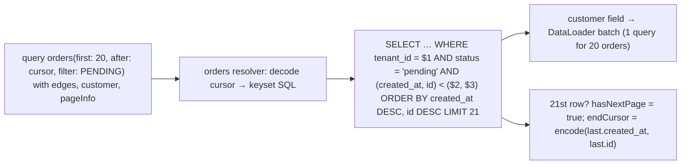

# GraphQL - Schema Design & Pagination

> [!info] Deep dive of [[GraphQL]]

> [!abstract] TL;DR
> - **Design the schema for clients, not tables**: domain types (`Order`, `Customer`), connections for lists, specific mutations (`confirmOrder`, not `updateOrder(status)`), input types, and mutation payloads that include **typed business errors** (unions/result types).
> - **Nullability**: fields are nullable by default. Make fields non-null when they're truly always present, and be careful, since one null in a non-null field nulls the whole parent.
> - **Pagination**: use **Relay cursor connections** (`first/after`, `edges { cursor node }`, `pageInfo`) backed by **keyset** queries, never offsets on large tables.
> - **Evolution**: evolve by addition plus `@deprecated`, not versions.
> - **Performance and safety**: batch with DataLoader, and enforce auth per field/resolver ([[GraphQL - Security Hardening]]).

## Concept
| Design decision | Recommendation | Why |
|---|---|---|
| Schema-first vs code-first | Code-first in TS (Pothos) or schema-first + codegen | Type safety end-to-end either way |
| IDs | Opaque global IDs (`Order:123` base64) or UUIDs | Stable caching and refetching (Relay `node(id:)`) |
| Lists | Connections with cursors | Stable pagination, metadata, edges for relationship data |
| Mutations | One per business action, `input` object, payload type | Clear intent, extensible without breaking |
| Errors | Expected errors as typed results. Top-level `errors` for faults | Clients can switch on `__typename` |
| Nullability | Non-null for invariants (`id`, `createdAt`). Nullable for anything that can fail independently | Partial results instead of whole-query failure |
| Versioning | Additive changes + `@deprecated(reason:)` + usage tracking | One evolving graph |
| Naming | `camelCase` fields, `PascalCase` types, `SCREAMING_CASE` enums | Ecosystem conventions |

**Connection shape (Relay spec)**:

| Field | Meaning |
|---|---|
| `edges[].node` | The item |
| `edges[].cursor` | Opaque position (encode sort key + id) |
| `pageInfo { hasNextPage, endCursor, hasPreviousPage, startCursor }` | Navigation |
| `totalCount` (optional) | Expensive on large tables: make it optional/estimated |

## How It Works


## Practical Usage
**Schema excerpt** (SDL):
```graphql
type Order implements Node {
  id: ID!
  status: OrderStatus!
  totalCents: Int!
  createdAt: DateTime!
  customer: Customer          # nullable: resolver may fail independently
  items(first: Int = 50): OrderItemConnection!
}

type OrderConnection { edges: [OrderEdge!]!  pageInfo: PageInfo!  totalCount: Int }
type OrderEdge { cursor: String!  node: Order! }

input OrdersFilter { status: OrderStatus  createdAfter: DateTime }

type Query {
  node(id: ID!): Node
  orders(first: Int = 20, after: String, filter: OrdersFilter): OrderConnection!
}

input ConfirmOrderInput { orderId: ID!  idempotencyKey: String! }
union ConfirmOrderResult = ConfirmOrderSuccess | OrderNotFound | OrderAlreadyConfirmed | OutOfStock
type ConfirmOrderSuccess { order: Order! }
type OutOfStock { sku: String!  available: Int! }
type Mutation { confirmOrder(input: ConfirmOrderInput!): ConfirmOrderResult! }
```
**Keyset-backed connection resolver** (TypeScript):
```ts
const encode = (c: { t: string; id: string }) => Buffer.from(JSON.stringify(c)).toString('base64url');
const decode = (s?: string | null) => (s ? JSON.parse(Buffer.from(s, 'base64url').toString()) as { t: string; id: string } : null);

async function orders(_: unknown, args: { first?: number; after?: string; filter?: OrdersFilter }, ctx: Ctx) {
  const first = Math.min(args.first ?? 20, 100);                       // cap page size
  const after = decode(args.after);
  const rows = await ctx.db.query(
    `select * from orders where tenant_id = $1
       and ($2::text is null or status = $2)
       and ($3::timestamptz is null or (created_at, id) < ($3, $4))
     order by created_at desc, id desc limit $5`,
    [ctx.tenantId, args.filter?.status ?? null, after?.t ?? null, after?.id ?? null, first + 1]);
  const page = rows.slice(0, first);
  return {
    edges: page.map((r) => ({ cursor: encode({ t: r.created_at.toISOString(), id: r.id }), node: r })),
    pageInfo: { hasNextPage: rows.length > first, endCursor: page.length ? encode({ t: page.at(-1)!.created_at.toISOString(), id: page.at(-1)!.id }) : null },
  };
}
// index: create index on orders (tenant_id, created_at desc, id desc);
```
**Client handling typed mutation results**:
```graphql
mutation Confirm($input: ConfirmOrderInput!) {
  confirmOrder(input: $input) {
    __typename
    ... on ConfirmOrderSuccess { order { id status } }
    ... on OutOfStock { sku available }
    ... on OrderAlreadyConfirmed { orderId }
  }
}
```
**Wrong way**:
```graphql
type Query { orders(offset: Int, limit: Int): [Order] }                 # ❌ offset scans, unbounded nullable list, no pageInfo
type Mutation { updateOrder(id: ID!, data: JSON): Order }                # ❌ untyped, intent-less, authorization nightmare
type Order { customer: Customer! }                                       # ❌ one failing customer lookup nulls the whole order list
```

## Patterns & Anti-patterns
| Pattern | When | Anti-pattern to avoid |
|---|---|---|
| Domain-driven types, not table mirrors | Public/client APIs | Auto-exposing every column |
| Cursor connections over keyset SQL | All lists | Offset pagination on growing tables |
| Specific mutations + input + payload/union | Writes | Generic CRUD `update*(data: JSON)` |
| Typed business errors in results | Expected failures | Throwing GraphQL errors for "out of stock" |
| DataLoader per request (keyed by tenant) | Nested relations | Per-item DB calls (N+1) |
| `@deprecated` + field usage metrics before removal | Evolution | `/v2` endpoints, silent removals |
| Max page size, depth/complexity limits | Every server | Unbounded `first: 100000` |

## Performance & Trade-offs
- **Keyset pagination** stays O(log n) per page with the right composite index. Offset pagination degrades linearly with page depth ([[PostgreSQL - Indexing]]).
- **`totalCount`** requires a `count(*)`, which is expensive on large tables. Make it opt-in or estimated.
- **Non-null everywhere** simplifies client types but makes partial failures cascade. Choose per field.
- **Auto-generated GraphQL** (pg_graphql in Supabase, Hasura, PostGraphile) gives instant connections and filters, but the schema mirrors tables and leans on RLS for authorization. It's good for internal tools, and less ideal as a curated public API.
- **GraphQL vs REST/RPC**: GraphQL pays off with many clients needing different shapes. For one Next.js app + one Flutter app, typed REST/RPC is often simpler ([[REST API - Versioning, Pagination & Error Design]]).

## Tips & Reminders
> [!tip] In ZP's stack
> - **Default to Supabase RPC/PostgREST or typed REST** for SME apps. Consider GraphQL for a multi-client platform (several partner apps, a dashboard and mobile with different needs).
> - **pg_graphql** (enabled in Supabase) gives Relay-style collections with RLS for quick internal dashboards. Don't treat it as your curated public contract ([[Supabase]]).
> - **Codegen** (GraphQL Code Generator) produces TS types for Next.js and Dart types for Flutter from the same schema.

- Encode cursors opaquely (base64url JSON of sort key + id), and validate them. Never accept raw SQL fragments.
- Include `tenantId` from auth context in every resolver and DataLoader key ([[System Design - Multi-Tenant SaaS Architecture]]).
- Track field usage (Apollo/Hive/Yoga plugins) before deprecating.
- Keep error codes consistent with your REST/RPC error codes so clients share handling ([[TypeScript - Error Handling & Result Types]]).

## Version Notes
| Date | Change relevant here |
|---|---|
| 2015 | GraphQL open-sourced. Relay cursor connection spec |
| 2021 / 2025 | Spec editions (Oct 2021, Sept 2025). Incremental improvements, no breaking changes |
| GraphQL.js 17 | Modern ESM-first reference implementation ([[GraphQL]]) |
| Ongoing | Semantic nullability / `@defer`/`@stream` proposals: check server support before relying on them |

## Critical Issues & Gotchas
> [!danger] Unbounded queries as denial of service
> Connections without page-size caps, nested lists without limits, and deep recursive relations let one query fetch millions of rows. Cap `first`, enforce depth/complexity limits, use persisted queries for public clients, and rate-limit per client ([[GraphQL - Security Hardening]]).

> [!danger] Authorization only at the entry point
> Checking access in `Query.orders` but not in nested fields (`Customer.orders`, `node(id:)`) leaks other tenants' data through alternate paths. Authorize in every resolver/type (or in a data layer with RLS), especially for global `node(id:)` lookups.

- **Cursor instability**: sorting by non-unique columns without a tiebreaker (`id`) skips or duplicates rows across pages.
- **DataLoader caching across requests** leaks data between users. Create loaders per request.
- **Breaking changes via nullability**: changing a field from non-null to nullable breaks strict clients. Treat nullability changes as breaking.
- **Error unions need client discipline**: clients must handle unknown `__typename` values gracefully when you add new result types.

## Related
- [[GraphQL]]
- [[GraphQL - Security Hardening]] — depth/complexity limits, persisted queries, introspection
- [[REST API - Versioning, Pagination & Error Design]] — the REST counterpart
- [[Supabase]] — pg_graphql auto-generated GraphQL
- [[TypeScript - Error Handling & Result Types]] — typed results across APIs
- [[PostgreSQL - Indexing]] — composite indexes for keyset pagination

## References
- https://spec.graphql.org/September2025/
- https://relay.dev/graphql/connections.htm
- https://graphql.org/learn/best-practices/
- https://github.com/graphql/dataloader
- https://supabase.com/docs/guides/graphql
