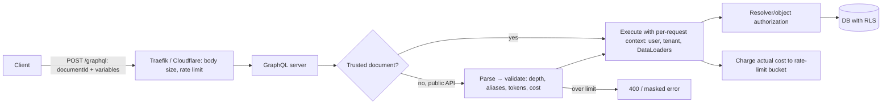

# GraphQL - Security Hardening

> [!info] Deep dive of [[GraphQL]]

> [!abstract] TL;DR
> GraphQL lets clients write arbitrary queries against one endpoint, so security shifts to **limiting what queries can exist and cost**. Production baseline:
> 1. **Trusted documents** (persisted, allow-listed operations) for first-party clients, which removes most attack surface.
> 2. **Query limits**: depth, alias, token and cost limits, plus batching limits.
> 3. **Introspection off** for public APIs, plus field suggestions blocked.
> 4. **Authorization per resolver/object**, not per endpoint.
> 5. **Hardening**: masked errors, CSRF protection, timeouts, and rate limiting by **cost**.

## Concept

### Threats specific to GraphQL
| Threat | How | Example | Control |
|---|---|---|---|
| **Schema discovery** | `__schema` introspection, "Did you mean…?" suggestions | Attacker maps admin mutations | Disable introspection + suggestions (public APIs) |
| **Deep/recursive queries** | `user { friends { friends { friends … } } }` | Exponential resolver fan-out | Depth limit (≈ 7–10) |
| **Wide/alias amplification** | 1,000 aliases of an expensive field | `a1: search(q:"x") a2: search(q:"x") …` | Max aliases (≈ 15), max tokens |
| **Batching brute force** | Array of 500 operations, or aliased `login` mutations in one HTTP request | Bypasses per-request rate limits for OTP/password guessing | Disable/limit batching, cost-based rate limits, per-field limits on auth mutations |
| **Expensive lists** | `orders(first: 100000)` | DB overload | Pagination caps, cost analysis using `first`/`last` |
| **Broken object-level authorization** | `node(id: "T3JkZXI6NDI=")` or nested `customer { orders }` returning other tenants' data | BOLA via global IDs | Authorize in every resolver/data access, tenant scoping in DB (RLS) |
| **Field-level leaks** | Private fields exposed on shared types | `User.email` visible via `post.author` | Field-level auth directives/rules, separate public types |
| **CSRF** | GET queries or `multipart/form-data`/`text/plain` POSTs skip CORS preflight | Mutations via a malicious site | Require `application/json` or a preflight header, disable GET mutations |
| **Injection/SSRF in resolvers** | Arguments passed to SQL, shell or URL fetches | `webhookUrl: "http://169.254.169.254/"` | Parameterized queries, URL allow-lists |
| **Verbose errors** | Stack traces, SQL errors in `errors[]` | Internal details leak | Masked errors in production |
| **Parser/transport DoS** | Malformed bodies, exotic encodings | CVE-2026-23897 (Apollo standalone server) | Patch servers, body size limits at proxy |

## How It Works

- **Validation happens before execution**: limits reject abusive documents cheaply. Cost analysis estimates work from field weights × list sizes (`first: 50`).
- **Trusted documents**: at build time, the client's operations are extracted and hashed. The server accepts only known hashes, so arbitrary queries are impossible for that client.

## Practical Usage

### GraphQL Yoga + graphql-armor + persisted operations
```ts
import { createYoga, useErrorHandler } from "graphql-yoga";
import { usePersistedOperations } from "@graphql-yoga/plugin-persisted-operations";
import { EnvelopArmorPlugin } from "@escape.tech/graphql-armor";
import { useDisableIntrospection } from "@graphql-yoga/plugin-disable-introspection";
import operations from "./persisted-operations.json";            // { "<sha256>": "query Orders(...) {...}" }

const isProd = process.env.NODE_ENV === "production";

export const yoga = createYoga({
  schema,
  context: ({ request }) => buildContext(request),               // user + tenant from verified JWT, fresh DataLoaders
  maskedErrors: isProd,                                          // generic "Unexpected error" to clients, details to logs
  batching: { limit: 5 },                                        // or false
  plugins: [
    usePersistedOperations({
      getPersistedOperation: (key) => operations[key] ?? null,
      allowArbitraryOperations: (req) => !isProd || req.headers.get("x-internal-tool") === process.env.INTERNAL_TOKEN,
    }),
    EnvelopArmorPlugin({
      maxDepth: { n: 8 },
      maxAliases: { n: 15 },
      maxTokens: { n: 2000 },
      maxDirectives: { n: 20 },
      costLimit: { maxCost: 5000, objectCost: 2, scalarCost: 1, depthCostFactor: 1.5 },
      blockFieldSuggestion: { enabled: isProd },
    }),
    ...(isProd ? [useDisableIntrospection()] : []),
  ],
});
```

### Authorization in resolvers (not in the gateway only)
```ts
const resolvers = {
  Query: {
    order: async (_: unknown, { id }: { id: string }, ctx: Ctx) => {
      const order = await ctx.loaders.order.load(id);             // loader query scoped by ctx.tenantId
      if (!order || order.tenantId !== ctx.tenantId) return null; // don't reveal existence across tenants
      return order;
    },
  },
  Mutation: {
    refundOrder: async (_: unknown, args: RefundArgs, ctx: Ctx) => {
      requireRole(ctx, ["owner", "admin"]);
      await rateLimitField(ctx, "refundOrder", { perMinute: 5 });
      return refunds.create(ctx.tenantId, args);
    },
  },
  User: {
    email: (u: User, _: unknown, ctx: Ctx) => (ctx.userId === u.id || ctx.isAdmin ? u.email : null),
  },
};
```
- **Create DataLoaders per request.** A global DataLoader cache shares results across users, which leaks data between tenants.
- With [[Supabase]], pass the user's JWT through so the DB enforces RLS as a second line ([[Supabase - Row Level Security]]).

### CSRF protection
- **Apollo Server 4+**: CSRF prevention is on by default. It requires `Content-Type: application/json`, or a non-simple header like `apollo-require-preflight`, for operations.
- **Other servers**: reject GET for mutations, reject `text/plain`/`application/x-www-form-urlencoded` bodies, and only allow `multipart` for upload endpoints with a preflight header.
- **Cookie auth**: needs `SameSite=Lax`+ cookies and an `Origin` check ([[Network Security - Common Web Attacks]]).

### Supabase pg_graphql exposure
```sql
-- pg_graphql reflects only what the role can access; anon sees tables anon has privileges on
revoke select on all tables in schema public from anon;           -- if the app doesn't need anon reads
-- Not using GraphQL at all? remove the surface:
drop extension if exists pg_graphql;
```
- `/graphql/v1` respects RLS like PostgREST, so policy gaps leak through GraphQL too. Comment directives (`@graphql({...})`) control naming, not security.

## Patterns & Anti-patterns
| Pattern | When | Anti-pattern to avoid |
|---|---|---|
| Trusted documents for own web/mobile clients | First-party apps | Public arbitrary-query endpoint for an app only your frontend uses |
| Depth + alias + token + cost limits | Any public GraphQL API | "We'll add limits if someone abuses it" |
| Rate limit by query cost and per sensitive field | Auth/OTP/payment mutations | Per-HTTP-request limits only (batching bypass) |
| Resolver/object-level authZ + DB RLS | Multi-tenant | Auth check only at the HTTP middleware ("logged in = allowed") |
| Per-request DataLoaders | Always | Module-level DataLoader caching across users |
| Masked errors + server-side logging with trace IDs | Production | Raw resolver exceptions in `errors[].message` |
| Introspection on for internal tooling only (auth-gated) | Dev/internal | Introspection open on public production endpoints |

## Performance & Trade-offs
- **Trusted documents** remove parse/validate cost for known operations and enable GET + CDN caching. The trade-off is a build step and client release coupling (old app versions need their hashes kept).
- **Cost analysis accuracy**: static estimates miss resolver-specific costs (an external API call). Assign custom costs via directives (`@cost(weight: 10)`), and measure real cost (resolver timings) to tune.
- **Disabling introspection** doesn't secure anything by itself: attackers can still probe fields and infer schemas from client bundles. Treat it as noise reduction, with authZ as the real control.
- **Federation**: limits must run at the router (Apollo Router, Hive Gateway, Cosmo) *and* subgraphs, because subgraphs exposed directly bypass router protections. Keep subgraphs private.

## Tips & Reminders
> [!tip]
> - **Run the attack tools** in CI or periodically: `graphql-cop`, InQL (Burp), Clairvoyance (schema recovery without introspection). They catch suggestions leaks, batching and CSRF quickly.
> - **Log the operation name + hash** for every request, and alert on unknown operations when using trusted documents.
> - **Keep old persisted operations** until all mobile app versions using them are deprecated ([[Flutter]] apps update slowly).
> - **In ZP's stack**:
>   - **Default**: prefer REST/PostgREST or RPC on Supabase for client projects ([[REST API]]).
>   - **When you need GraphQL** (multi-source BFF): use Yoga + graphql-armor + trusted documents behind Traefik, with per-request DataLoaders and RLS-enforced data access.
>   - **Supabase hygiene**: drop `pg_graphql` if unused.

## Version Notes
| Item | Note |
|---|---|
| Apollo Server 4 (2022) | CSRF prevention on by default. AS2/3 are EOL |
| CVE-2026-23897 (2026-02) | ReDoS/DoS in `startStandaloneServer` body parsing via exotic charsets. Affected <4.13.0, 5.0–<5.4.0 (and 2.x–3.x). Express/Next integrations unaffected. **Upgrade** |
| GraphQL spec (Sept 2025 edition) | Clarifications. Security relies on server implementations |
| Trusted documents | Supported in Yoga, Apollo (persisted query safelisting in GraphOS Router), Relay, urql/codegen client presets |

> [!warning] Unverified — check before relying on this
> Fixed-version details for CVE-2026-23897 vary between databases. Check the Apollo GitHub advisory. graphql-armor option names may differ by version, so check its README.

## Critical Issues & Gotchas
> [!danger] Batching and aliases defeat naive rate limits
> - **The bypass**: a single HTTP request can carry hundreds of `login(otp: …)` attempts as aliases or a batched array. 6-digit OTPs then fall in minutes while the WAF counts "one request".
> - **Fix**: limit aliases and batch size, rate-limit **per resolver** for auth/OTP/payment fields, and lock accounts or OTPs after N failures server-side.

> [!danger] Object-level authorization gaps (BOLA) through the graph
> GraphQL makes it easy to reach objects through relationships the original endpoint designer never considered (`invoice.customer.paymentMethods`). Every type that holds sensitive data needs its own authorization rule, applied wherever it's resolved. A missing check on one nested path is the same breach as a missing REST check ([[OWASP Top 10]] A01).

> [!warning] Gotchas
> - Introspection disabled but **field suggestions** enabled still leaks schema ("Did you mean `adminDeleteUser`?").
> - GET support for queries is great for caching, but never allow mutations via GET.
> - Subscriptions over WebSockets need auth at connection init and per-event authorization, with connection limits ([[WebSocket]]).
> - File uploads (`graphql-upload`, multipart) historically enabled CSRF and DoS. Prefer presigned uploads to storage (R2/Supabase Storage).
> - Error masking hides bugs during development. Enable it only in production, with full server logs.

## Related
- [[GraphQL]]
- [[OWASP Top 10]] — BOLA, injection, security misconfiguration
- [[REST API]] — alternative with simpler caching and rate limiting
- [[Supabase - Row Level Security]] — DB-level enforcement behind pg_graphql/resolvers
- [[Authentication & Authorization]] — roles, scopes, tenant context
- [[Network Security - Common Web Attacks]] — CSRF, SSRF, brute force

## References
- OWASP GraphQL Cheat Sheet: https://cheatsheetseries.owasp.org/cheatsheets/GraphQL_Cheat_Sheet.html
- GraphQL Armor: https://escape.tech/graphql-armor/docs/getting-started
- GraphQL Yoga persisted operations: https://the-guild.dev/graphql/yoga-server/docs/features/persisted-operations
- Apollo Server CSRF prevention: https://www.apollographql.com/docs/apollo-server/security/cors#preventing-cross-site-request-forgery-csrf
- NVD CVE-2026-23897: https://nvd.nist.gov/vuln/detail/CVE-2026-23897
- Supabase pg_graphql: https://supabase.com/docs/guides/graphql
