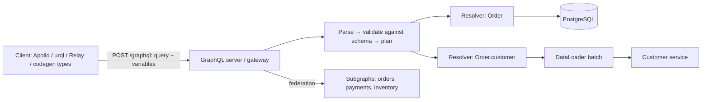

# GraphQL

> [!abstract] TL;DR
> GraphQL is a query language and runtime for APIs: clients send a **typed query** describing exactly the fields they need, and a single endpoint resolves it against a **schema**. That solves over/under-fetching and N round trips for rich UIs (mobile, dashboards) and aggregates many backends behind one graph (federation).
> - **The costs move to the server**: N+1 resolvers (fix with DataLoader), caching complexity (POST, one URL), and **abuse vectors** (deep/expensive queries, batching brute force, introspection leaks).
> - **Spec**: the **September 2025 edition** (first since 2021) added OneOf input objects and schema coordinates. `@defer`/`@stream` are still RFCs.
> - **For ZP**: [[REST API]] or Supabase's auto-generated APIs are usually simpler. GraphQL earns its place for complex client-driven UIs or multi-source aggregation.

## Introduction
- **Origin**: built at Facebook (2012) for the mobile News Feed, open-sourced in 2015. Governed by the **GraphQL Foundation** (Linux Foundation) since 2019. Spec editions: 2016, 2018, 2021, **2025-09**.
- **Problem**: REST endpoints shaped by the server cause mobile clients to over-fetch (wasted bytes) or under-fetch (waterfalls of requests). Versioned endpoints also multiply.
- **Where it sits**: BFF/API gateway for web and mobile clients, federated graphs over microservices (Apollo Federation, Hive, WunderGraph Cosmo), auto-generated APIs over databases (**pg_graphql** in [[Supabase]], Hasura, PostGraphile), and Shopify/GitHub public APIs.

## Core Concepts

### Schema (SDL)
```graphql
scalar DateTime

type Order {
  id: ID!
  number: String!
  status: OrderStatus!
  totalSen: Int!
  customer: Customer!          # resolved by a separate resolver (watch N+1)
  items(first: Int = 20, after: String): OrderItemConnection!
  createdAt: DateTime!
}

enum OrderStatus { PENDING PAID CANCELLED }

input OrderFilter @oneOf {     # exactly one field must be provided (Sept 2025 spec)
  status: OrderStatus
  customerId: ID
}

type Query {
  order(id: ID!): Order
  orders(filter: OrderFilter, first: Int = 20, after: String): OrderConnection!
}

type Mutation {
  markOrderPaid(id: ID!, idempotencyKey: String!): MarkOrderPaidPayload!
}

type Subscription { orderUpdated(tenantId: ID!): Order! }
```

### Operations
```graphql
query OrderDetail($id: ID!) {
  order(id: $id) {
    number
    status
    totalSen
    customer { name phone }
    items(first: 10) { edges { node { sku qty } } pageInfo { hasNextPage endCursor } }
  }
}
```
| Concept | Notes |
|---|---|
| Query / Mutation / Subscription | Read / write (executed serially at top level) / realtime (usually over [[WebSocket]] `graphql-ws` or SSE) |
| Fragments | Reusable field sets, colocated with UI components (Relay, Apollo, urql) |
| Variables | Typed inputs, so never string-interpolate queries |
| Nullability | `!` = non-null. A null in a non-null field bubbles up to the nearest nullable parent |
| Errors | `200 OK` with an `errors` array + partial `data`. Model expected business errors as union/result types |
| Pagination | Relay cursor connections (`edges`, `pageInfo`) are the convention |
| Introspection | Schema is queryable (`__schema`), which powers tooling, codegen and GraphiQL |

## Architecture / How It Works

- **Execution**: parse → validate (types, fields, variables) → execute resolvers field by field. Sibling fields can resolve in parallel. Each resolver gets `(parent, args, context, info)`.
- **N+1 problem**: fetching 50 orders and then each `customer` triggers 50 queries. **DataLoader** batches and caches per request. Alternatives: join-aware resolvers or SQL compilation (PostGraphile, pg_graphql, Hasura).
- **Caching**: HTTP caching is hard with POST to one URL. Use **persisted queries** (hash → GET, CDN cacheable), client normalized caches (Apollo/urql/Relay) and response caches keyed on query + variables + auth.
- **Federation**: each team owns a subgraph. A router (Apollo Router, Hive Gateway, Cosmo) composes the supergraph and plans cross-subgraph queries.
- **Transport**: the GraphQL-over-HTTP spec (`application/graphql-response+json`), with WebSocket/SSE for subscriptions.

## Project Structure
```text
api/
├── schema/*.graphql          # SDL-first (or code-first: Pothos, Nexus, TypeGraphQL, Strawberry)
├── src/
│   ├── resolvers/            # per type
│   ├── loaders/              # DataLoaders, created per request in context
│   ├── context.ts            # auth user, tenant, loaders
│   └── server.ts             # GraphQL Yoga / Apollo Server / Mercurius
├── codegen.ts                # graphql-codegen: TS types for resolvers + client operations
└── persisted-operations.json # allow-listed operations (production)
```
```ts
// GraphQL Yoga + envelop plugins: depth/cost limits, disable introspection in prod
const yoga = createYoga({
  schema,
  context: ({ request }) => ({ user: authenticate(request), loaders: createLoaders() }),
  plugins: [useDepthLimit({ maxDepth: 8 }), useCostLimit({ maxCost: 5000 }), useDisableIntrospection({ disableIf: () => isProd })],
});
```
```sql
-- Supabase: pg_graphql exposes tables via /graphql/v1, honoring RLS
select graphql.resolve($$ { ordersCollection(first: 10) { edges { node { id status } } } } $$);
```

## Use Cases
| Use case | Why it fits |
|---|---|
| Rich client UIs (dashboards, mobile) with varied data needs | Clients fetch exactly what each screen needs in one round trip |
| BFF aggregating multiple services/SaaS APIs | One typed graph over REST/gRPC/DB sources |
| Large orgs with many teams/services | Federation with ownership per subgraph |
| Public developer platforms (Shopify, GitHub) | Flexible, self-documenting, typed |
| Simple CRUD, file uploads, webhooks, cache-heavy public content | **Weaker fit**. [[REST API]] + HTTP caching is simpler |
| Internal service-to-service calls | **Weaker fit**. [[gRPC]] is faster, with stronger contracts |

## Pros & Cons
| Pros | Cons |
|---|---|
| No over/under-fetching. One request per screen | N+1 and resolver performance pitfalls |
| Strong typing + introspection → codegen, autocomplete, docs | HTTP caching and CDN use require persisted queries |
| Evolve without versions (add fields, deprecate old ones) | Query cost is client-controlled, so DoS risk without limits |
| Great DX with Relay/Apollo/urql and fragments | More server complexity than REST for simple APIs |
| Federation scales across teams | Error handling (200 + errors) confuses monitoring |
| Subscriptions for realtime | Authorization must be enforced per field/resolver |

## Alternatives & Peers
| Alternative | Strength vs GraphQL | Weakness vs GraphQL | Pick it when… |
|---|---|---|---|
| [[REST API]] (+ OpenAPI) | Simple, HTTP caching, universal tooling | Over/under-fetching, many endpoints | Most CRUD/SME APIs (ZP's default) |
| [[gRPC]] | Fast binary protocol, streaming, strict contracts | Poor browser support, not for flexible queries | Service-to-service |
| tRPC | End-to-end TS types, no schema language | TS-only, coupled client/server | Full-stack TS monorepos |
| Supabase PostgREST | Auto REST from Postgres with RLS, zero code | Tied to DB shape | Supabase apps (vs pg_graphql) |
| OData | Query semantics over REST | Verbose, Microsoft-centric | Enterprise/Microsoft integrations |

## Tips & Reminders
> [!tip]
> - In production: **persisted/allow-listed operations**, depth + cost limits, max aliases/batch size, timeouts, and introspection disabled for public APIs (keep it for internal tooling).
> - Create DataLoaders **per request** (never global, to avoid cross-user cache leaks). Monitor resolver timings with tracing (OpenTelemetry).
> - Authorization belongs in the business layer, not only at the gateway. Check every field/node access (`node(id:)` is a classic IDOR vector).
> - Use codegen (`graphql-codegen`) for typed resolvers and client hooks. Colocate fragments with components.
> - Make mutations idempotent (idempotency keys) and return payload types with user-facing errors.
> - **In ZP's stack**: for [[Supabase]] apps, prefer supabase-js/PostgREST. Use `pg_graphql` only if a client tool needs GraphQL. Consider GraphQL Yoga as a BFF when a Flutter/Next.js app aggregates several sources (Supabase + payment gateway + CRM). Shopify integrations via [[n8n]] use Shopify's GraphQL Admin API.

## Versions & Breaking Changes
| Version | Released | Key changes | Breaking / migration notes |
|---|---|---|---|
| Spec 2015 (draft) / 2016 | 2015-07 / 2016-10 | Open-sourced, first editions | — |
| Spec June 2018 | 2018-06 | Block strings, SDL in spec | — |
| Spec October 2021 | 2021-10 | Interfaces implementing interfaces, repeatable directives | — |
| **Spec September 2025** | 2025-09 | **OneOf input objects** (`@oneOf`), **schema coordinates**, descriptions on executable documents, clarified execution/error terminology | Additive |
| GraphQL.js 17 | 2026-06 | Modernized reference implementation (ESM, spec 2025 features) | Major version. Check deprecated APIs |
| `@defer` / `@stream` | RFC | Incremental delivery supported by Apollo/Yoga/Relay experimentally | Not yet in the spec |

> [!warning] Unverified — check before relying on this
> GraphQL.js 17 GA date and the incremental-delivery RFC status came from secondary sources. Check https://github.com/graphql/graphql-js/releases and https://github.com/graphql/graphql-spec.

## Critical Issues & Gotchas
> [!danger] Query-cost DoS and batching brute force
> Deeply nested or aliased queries (`a1: login(...) a2: login(...) …` × 1000) let attackers multiply work or brute-force OTPs/passwords in **one HTTP request**, bypassing per-request rate limits. Circular relationships (`author → posts → author …`) explode resolver counts. Enforce depth/cost/alias limits, rate-limit by operation cost, and use persisted queries for public clients.

> [!danger] Broken object-level authorization and data exposure
> GraphQL makes every relationship traversable, so a missing check on `Order.customer` or a global `node(id:)` resolver leaks other tenants' data (IDOR, OWASP A01). Introspection plus field suggestions ("Did you mean…") reveal the schema to attackers even when introspection is disabled. Turn suggestions off in production, and enforce authorization per resolver.

> [!warning] Gotchas
> - CSRF: GraphQL over GET, or POST with `text/plain`/form content types, can be triggered cross-site. Require `application/json` + CSRF protection for cookie auth.
> - Non-null fields that error null out their parent chain, so one failing resolver can blank a whole page. Be deliberate with `!`.
> - File uploads aren't in the spec (multipart request spec is a community add-on, and was a CSRF vector in Apollo). Prefer presigned URLs (R2/S3).
> - Monitoring: HTTP 200 for errors hides failures. Log and alert on `errors[]` per operation name.
> - Schema changes: removing or renaming fields breaks old mobile app versions. Deprecate first and track field usage.

## Deep Dives
N/A — no deep dives planned yet. Candidates: GraphQL security hardening, federation architecture.

## Related
- [[REST API]] — default API style, comparison
- [[gRPC]] — service-to-service peer
- [[HTTP & HTTPS]] — transport, caching semantics
- [[WebSocket]] — subscriptions transport
- [[Supabase]] — pg_graphql, RLS-backed APIs
- [[OWASP Top 10]] — access control, DoS, injection in GraphQL contexts

## References
- GraphQL spec (Sept 2025): https://spec.graphql.org/September2025/
- Announcement: https://graphql.org/blog/2025-09-08-september-edition/
- GraphQL over HTTP: https://graphql.github.io/graphql-over-http/
- OWASP GraphQL Cheat Sheet: https://cheatsheetseries.owasp.org/cheatsheets/GraphQL_Cheat_Sheet.html
- GraphQL Yoga: https://the-guild.dev/graphql/yoga-server
- pg_graphql: https://supabase.github.io/pg_graphql/
