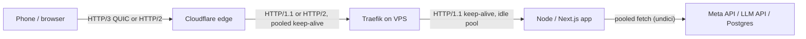

# HTTP & HTTPS - HTTP-2, HTTP-3 & Connection Management

> [!info] Deep dive of [[HTTP & HTTPS]]

> [!abstract] TL;DR
> Each hop negotiates its own protocol:
> - **client → Cloudflare**: HTTP/3 (QUIC) or HTTP/2;
> - **Cloudflare → origin**: usually HTTP/1.1 or HTTP/2;
> - **Traefik → app**: HTTP/1.1 keep-alive.
>
> Most "random 502s" are **keep-alive timeout mismatches** between hops: an upstream closes an idle connection the proxy is about to reuse. The rule is **upstream idle timeout > downstream idle timeout**. Reuse outbound connections (one pooled client per host). Enable HTTP/3 at the edge first; on your own origin it is optional and needs UDP 443 plus kernel buffer tuning.

## Concept
| | HTTP/1.1 | HTTP/2 | HTTP/3 |
|---|---|---|---|
| Transport | TCP (+TLS) | TCP + TLS (ALPN `h2`) or cleartext `h2c` | QUIC over UDP (TLS 1.3 built in) |
| Concurrency | 1 request at a time per connection (pipelining unused) | Many streams per connection (typical max 100–250) | Many independent streams |
| Head-of-line blocking | Per connection | At TCP level: one lost packet stalls all streams | None across streams |
| Header compression | None | HPACK | QPACK |
| Handshake | TCP + TLS 1.3 = 2 RTT | Same | 1 RTT; 0-RTT on resumption |
| Network change (Wi-Fi ↔ 4G) | Reconnect | Reconnect | Connection migration via connection IDs |
| Discovery | — | ALPN during TLS | `Alt-Svc: h3=":443"` header or DNS HTTPS records |

- **Adoption**: W3Techs reported HTTP/3 on **38.6%** of websites (March 2026). Most of it comes from CDNs: 88.8% of Cloudflare-proxied sites use it. Origins serving HTTP/3 directly without a CDN are rare.
- **Connection pooling**: reusing a warm connection skips DNS + TCP + TLS (often 50–300 ms from Malaysia to overseas APIs). Keep-alive pools are the cheapest latency win for server-to-server calls.

## How It Works

**Idle-timeout race** (the classic 502):
1. Traefik keeps an idle connection to Node in its pool for up to `idleConnTimeout` (default 90 s).
2. Node's `server.keepAliveTimeout` (default **5 s**) closes it after 5 s idle.
3. Traefik reuses the "idle" connection just as Node closes it, gets `ECONNRESET`, and returns 502.

Fix: Node keep-alive **longer** than the proxy's idle timeout, or the proxy's idle timeout **shorter** than Node's.

## Practical Usage
**Node / Next.js server timeouts** (custom server or standalone `server.js`):
```ts
const server = app.listen(3000);
server.keepAliveTimeout = 95_000;     // > Traefik idleConnTimeout (90s)
server.headersTimeout = 96_000;       // must exceed keepAliveTimeout
server.requestTimeout = 120_000;      // whole request, including body upload
```
**Or shorten Traefik's backend idle pool** (dynamic config):
```yaml
http:
  serversTransports:
    app-transport:
      forwardingTimeouts:
        dialTimeout: 5s
        responseHeaderTimeout: 60s
        idleConnTimeout: 4s            # < Node default 5s, if you can't change the app
      maxIdleConnsPerHost: 50
```
**Enable HTTP/3 on Traefik** (static config; needs UDP 443 open on the host firewall **and** in Docker port mapping):
```yaml
entryPoints:
  websecure:
    address: ":443"
    http3:
      advertisedPort: 443
```
```bash
# quic-go (Traefik's QUIC library) wants larger UDP buffers
sysctl -w net.core.rmem_max=7500000 net.core.wmem_max=7500000   # persist in /etc/sysctl.d/
ufw allow 443/udp
curl -sI --http3 https://app.example.my | head -1               # verify (curl built with HTTP/3)
```
**Pooled outbound HTTP in Node** (undici is the engine behind `fetch`):
```ts
import { Agent, setGlobalDispatcher } from 'undici';
setGlobalDispatcher(new Agent({
  keepAliveTimeout: 30_000,           // default ~4s: too short for bursty API calls
  keepAliveMaxTimeout: 600_000,
  connections: 64,                    // per origin; protects you and the upstream
  connect: { timeout: 5_000 },
  allowH2: true,                      // HTTP/2 to upstreams that support it
}));
```
**Flutter client**: `dart:io` `HttpClient` speaks HTTP/1.1 only. For HTTP/2 or HTTP/3 and the OS network stack, use `cronet_http` (Android) and `cupertino_http` (iOS) behind `package:http`:
```dart
final client = Platform.isAndroid
    ? CronetClient.fromCronetEngine(CronetEngine.build(enableHttp2: true, enableQuic: true))
    : CupertinoClient.defaultSessionConfiguration();
```
**Measure each phase**:
```bash
curl -so /dev/null -w 'dns=%{time_namelookup} tcp=%{time_connect} tls=%{time_appconnect} ttfb=%{time_starttransfer} total=%{time_total} proto=%{http_version}\n' https://app.example.my/api/health
```
**Wrong way**:
```ts
// ❌ new agent / client per request: full DNS+TCP+TLS every call, socket exhaustion under load
await fetch(url, { dispatcher: new Agent() });
// ❌ no timeouts: one hung upstream holds sockets and requests forever
await fetch('https://graph.facebook.com/…');
```

## Patterns & Anti-patterns
| Pattern | When | Anti-pattern to avoid |
|---|---|---|
| Upstream idle timeout > proxy idle timeout, at every hop | Always | Defaults on both sides (Node 5 s vs proxy 60–90 s) |
| One pooled client per upstream host, module-level | Server-to-server calls | Creating clients per request |
| Explicit connect + response timeouts + `AbortSignal` | Every outbound call | Infinite waits on third-party APIs |
| HTTP/3 at the CDN edge | Mobile-heavy audiences | Debugging QUIC on your own VPS before the edge has it |
| HTTP/2 (h2c or TLS) to backends for gRPC / many small calls | Internal services | Assuming HTTP/2 to Node apps helps generic web traffic (rarely the bottleneck) |
| 0-RTT only for idempotent GETs | TLS early data | Accepting 0-RTT POSTs (replayable) |

## Performance & Trade-offs
- **HTTP/2 vs HTTP/1.1 at the origin**: behind Cloudflare and Traefik on the same box, the proxy→app hop is a LAN hop with pooled keep-alive. HTTP/1.1 is fine, and HTTP/2 there adds CPU for little gain.
- **HTTP/3 wins** on lossy, high-latency mobile links (no TCP head-of-line blocking, faster handshakes, migration). Gains are small on clean wired links. QUIC also costs more CPU per byte than TCP+TLS.
- **Stream limits**: HTTP/2 `SETTINGS_MAX_CONCURRENT_STREAMS` (often 100) caps per-connection parallelism. Clients open more connections past it. Proxies must enforce stream and reset limits against Rapid Reset-style floods.
- **Pool sizing**: `connections × instances` must stay below the upstream's limits. For Postgres, that's the pooler's role (PgBouncer/Supavisor), not HTTP.

## Tips & Reminders
> [!tip] In ZP's stack
> - **Cloudflare**: turn on HTTP/3 (one toggle). Users get QUIC to the edge while the origin stays HTTP/1.1/2.
> - **Timeouts**: align Traefik's `idleConnTimeout` with Node's `keepAliveTimeout`, and keep Cloudflare's 100 s proxy read timeout in mind for long requests: stream, or move work to queues.
> - **Outbound APIs** (Meta Cloud API, LLM providers, payment gateways): use a single tuned undici `Agent`. It cuts latency to US/EU endpoints from Malaysia noticeably.

- `Connection: close` responses or `Keep-Alive: timeout=5` headers from the app reveal its idle timeout. Check with `curl -v`.
- Watch for `ECONNRESET`/`socket hang up` bursts right after idle periods. That's the keep-alive race signature.
- SSE and long-polling hold connections open. Count them against proxy and Cloudflare limits, and send heartbeats (`: ping` every 15–30 s).
- Keep `Alt-Svc` consistent across servers behind a load balancer, or clients will flip-flop between protocols.

## Version Notes
| Spec / release | Change |
|---|---|
| RFC 7540 → RFC 9113 (2022) | HTTP/2 republished. Priority scheme deprecated in favour of RFC 9218 (Extensible Priorities) |
| RFC 9000 (2021) / RFC 9114 (2022) | QUIC and HTTP/3 |
| 2023 | HTTP/2 Rapid Reset (CVE-2023-44487) forced stream-reset limits in every proxy |
| 2025 | MadeYouReset (CVE-2025-8671) HTTP/2 DoS variant. Patch proxies |
| 2026-03 | HTTP/3 on 38.6% of websites (W3Techs), mostly via CDNs |

## Critical Issues & Gotchas
> [!danger] 0-RTT replay
> TLS 1.3 / QUIC early data can be replayed by an attacker. Servers must accept 0-RTT only for idempotent requests (proxies forward an `Early-Data: 1` header; respond `425 Too Early` otherwise). Never allow early data on payment or state-changing endpoints.

> [!danger] UDP 443 blocked or unconfigured
> Advertising `h3` via `Alt-Svc` while UDP 443 is blocked (host firewall, Docker port mapping without `/udp`, or the VPS provider) makes clients try QUIC first and fall back after delays. Expose `443:443/udp` and test from outside before advertising HTTP/3.

- **HTTP/2 → HTTP/1.1 downgrades at proxies** can enable request smuggling when front- and back-end parse differently. Keep proxies patched and reject ambiguous requests ([[HTTP & HTTPS]]).
- **`h2c` (cleartext HTTP/2)** to backends needs explicit configuration on both sides (`h2c://` scheme in Traefik). Otherwise gRPC calls fail with protocol errors.
- **Mobile connection churn**: aggressive OS power management kills idle sockets. Clients must retry idempotent requests on connection reset.
- **Header size limits** differ per hop (Cloudflare, Traefik, Node `maxHeaderSize` 16 KB). Large cookies or JWTs give 431/400 at one hop only.

## Related
- [[HTTP & HTTPS]]
- [[HTTP & HTTPS - TLS Handshake & Certificates]] — ALPN, session resumption, 0-RTT
- [[Traefik]] — entrypoints, HTTP/3, server transports
- [[Cloudflare]] — edge protocols, origin connections, 100 s timeout
- [[Node.js - Performance & Diagnostics]] — server timeouts, socket exhaustion
- [[gRPC]] — HTTP/2-only RPC

## References
- https://www.rfc-editor.org/rfc/rfc9113
- https://www.rfc-editor.org/rfc/rfc9114
- https://w3techs.com/technologies/changes/ce-http3
- https://doc.traefik.io/traefik/routing/entrypoints/#http3
- https://undici.nodejs.org/
- https://pub.dev/packages/cronet_http
