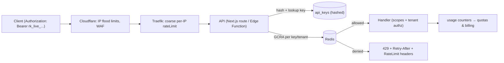

# REST API - Rate Limiting & API Keys for Public APIs

> [!info] Deep dive of [[REST API]]

> [!abstract] TL;DR
> When you expose an API to clients, partners or integrators (POS sync, partner booking, Zapier/n8n users), you need:
> 1. **API keys done right**: random 32+ bytes with a **readable prefix** (`rk_live_…`), **store only a hash**, show once, **scopes** per key, per-tenant ownership, rotation and revocation, last-used tracking.
> 2. **Layered rate limiting**: an edge limit (Cloudflare/Traefik) against floods, plus an **application limit per key/tenant** (Redis token bucket/GCRA) with plan-based quotas.
> 3. **Clear contract**: `429` + `Retry-After`, `RateLimit`/`RateLimit-Policy` headers, documented limits, idempotency keys for writes.
>
> Keys authenticate **machines**, not users. Bind them to a tenant and least-privilege scopes, and never let them bypass RLS/authorization.

## Concept
**API key anatomy**:

| Part | Example | Purpose |
|---|---|---|
| Prefix | `rk_live_` / `rk_test_` | Identify product/environment. Enables secret scanning |
| Key ID | first 8 chars after prefix | Lookup without revealing secret |
| Secret | 32 random bytes (base62) | Shown once to the user |
| Stored | `sha256(secret)` or HMAC with server pepper | DB leak doesn't reveal usable keys |
| Metadata | tenant, scopes, created_by, expires_at, last_used_at, revoked_at | Governance |

**Rate limiting algorithms**:

| Algorithm | Behaviour | Pick it when… |
|---|---|---|
| Fixed window | Count per minute, resets | Simple quotas (daily/monthly) |
| Sliding window | Smoother, avoids boundary bursts | Per-minute API limits |
| Token bucket / GCRA | Allows bursts up to capacity, steady refill | Most API rate limits |
| Concurrency limit | Max in-flight requests | Expensive endpoints (exports, AI) |
| Quota (monthly) | Plan entitlement | Billing alignment |

## How It Works


## Practical Usage
**Key generation and storage**:
```ts
import { randomBytes, createHash, timingSafeEqual } from "node:crypto";
const b62 = (buf: Buffer) => buf.toString("base64url").replace(/[-_]/g, "").slice(0, 43);

export function createApiKey(env: "live" | "test") {
  const keyId = b62(randomBytes(12)).slice(0, 8);         // extra bytes so 8 alphanumerics remain after stripping -/_
  const secret = b62(randomBytes(32));
  const full = `rk_${env}_${keyId}_${secret}`;
  const hash = createHash("sha256").update(full).digest("hex");
  return { full, keyId, hash };            // store keyId + hash; show `full` once
}
```
```sql
create table public.api_keys (
  id uuid primary key default gen_random_uuid(),
  tenant_id uuid not null references tenants,
  key_id text unique not null,
  key_hash text not null,
  name text not null,
  scopes text[] not null default '{orders:read}',
  expires_at timestamptz, last_used_at timestamptz, revoked_at timestamptz,
  created_by uuid, created_at timestamptz default now()
);
```
**Verify on each request**:
```ts
export async function authenticate(req: Request) {
  const raw = req.headers.get("authorization")?.replace(/^Bearer\s+/i, "") ?? "";
  const m = raw.match(/^rk_(live|test)_([A-Za-z0-9]{8})_[A-Za-z0-9]{20,}$/);
  if (!m) return null;
  const row = await db.oneOrNone("select * from api_keys where key_id = $1 and revoked_at is null and (expires_at is null or expires_at > now())", [m[2]]);
  if (!row) return null;
  const a = Buffer.from(createHash("sha256").update(raw).digest("hex")), b = Buffer.from(row.key_hash);
  if (a.length !== b.length || !timingSafeEqual(a, b)) return null;
  void db.none("update api_keys set last_used_at = now() where id = $1", [row.id]);   // throttle in practice
  return { tenantId: row.tenant_id, scopes: row.scopes as string[], keyId: row.key_id };
}
```
**GCRA rate limit in Redis** (atomic Lua):
```lua
-- KEYS[1]=key  ARGV: now_ms, emission_interval_ms (period/limit), burst_tolerance_ms
local tat = tonumber(redis.call('GET', KEYS[1]) or ARGV[1])
local now = tonumber(ARGV[1]); local ei = tonumber(ARGV[2]); local bt = tonumber(ARGV[3])
tat = math.max(tat, now)
local new_tat = tat + ei
if new_tat - now > bt + ei then return {0, math.ceil((new_tat - now - bt - ei) / 1000)} end  -- denied, retry-after s
redis.call('SET', KEYS[1], new_tat, 'PX', math.ceil(bt + ei))
return {1, 0}
```
**Response headers**:
```ts
if (!allowed) return new Response(JSON.stringify({ error: { code: "rate_limited", message: "Too many requests" } }), {
  status: 429,
  headers: { "Retry-After": String(retryAfter), "RateLimit-Policy": '"default";q=120;w=60', "RateLimit": `"default";r=0;t=${retryAfter}` },
});
```
**Scope check**:
```ts
if (!auth.scopes.includes("orders:write")) return problem(403, "insufficient_scope");
```
**Wrong way**:
```text
❌ Storing API keys in plaintext                   → DB leak = every integration compromised
❌ Keys tied to a user account that leaves          → integrations break, or ex-staff key keeps working
❌ Only IP-based limits                             → one partner behind NAT blocks others; attackers rotate IPs
❌ Service-role DB access for API-key requests without tenant checks → cross-tenant data exposure
```

## Patterns & Anti-patterns
| Pattern | When | Anti-pattern to avoid |
|---|---|---|
| Prefixed keys + hashed storage + show once | All API keys | Retrievable plaintext keys |
| Scopes and per-tenant ownership | Partner/integration APIs | All-powerful keys |
| Multiple active keys for rotation | Zero-downtime rotation | Single key per tenant |
| Edge + app-layer limits | Public endpoints | Only one layer |
| Limits by plan (entitlements) | SaaS APIs | Same limits for free and paid |
| Separate limits for expensive endpoints | Exports, AI, bulk | One global limit |
| `429` with `Retry-After` and docs | Always | Silent drops / 500s |

## Performance & Trade-offs
- **Key lookup** per request: index on `key_id`, and cache verified keys in memory/Redis for 30–60 s. Revocation then takes effect within the cache TTL.
- **Redis GCRA** costs one round trip (~1 ms on the same host). Use Upstash/Workers KV-equivalents only if the API runs at the edge.
- **Edge vs origin limits**: Cloudflare rate limiting stops floods before they cost origin CPU, but it can't see tenant plans. Combine both ([[Network Security - Cloudflare WAF & Rate Limiting Rules]]).
- **Hashing choice**: API keys are high-entropy, so a fast hash (SHA-256/HMAC) is fine. Slow hashes (bcrypt) add latency without security benefit.

## Tips & Reminders
> [!tip] In ZP's stack
> - **Common case**: exposing a client's booking/order data to their POS vendor or to n8n/Zapier users. Issue per-integration keys with read-only scopes, and log usage per key.
> - **Supabase**: don't hand out the service-role key as a "partner API key". Build a thin API (Edge Function/Next.js route) that validates your own keys and queries with tenant filters ([[OWASP Top 10 - API Security Top 10 in Practice]]).
> - **Redis**: reuse the GCRA script from your Redis setup, with separate key namespaces per environment ([[Redis - Rate Limiting & Distributed Locks]]).

- Register your key prefix pattern with GitHub secret scanning (partner program) if the API becomes public.
- Offer test keys (`rk_test_`) hitting sandbox data.
- Expose key management in the tenant admin UI: create, name, scope, revoke, last used.
- Alert on sudden usage spikes per key (leaked key or runaway script).

## Version Notes
| Date / spec | Change relevant here |
|---|---|
| RFC 6585 (2012) | `429 Too Many Requests` |
| RFC 9110 (2022) | `Retry-After` semantics |
| IETF httpapi draft | `RateLimit` and `RateLimit-Policy` header fields (replacing older `X-RateLimit-*` conventions) |
| 2023–26 | Secret scanning programs (GitHub) detect prefixed keys in public repos |

> [!warning] Unverified — check before relying on this
> The RateLimit header draft's current syntax/version (it changed across drafts) wasn't verified this run. Check the latest IETF draft before documenting headers for clients.

## Critical Issues & Gotchas
> [!danger] Leaked keys with broad access
> API keys end up in frontend bundles, Postman collections, screenshots, GitHub repos and n8n exports. A leaked key with write scopes and no limits lets attackers exfiltrate or modify a tenant's data at full speed. Use least-privilege scopes, prefixes for secret scanning, per-key rate limits, anomaly alerts, and fast revocation.

> [!danger] Rate limiting that fails open or locks everyone out
> If the Redis limiter errors and the code allows all requests, a flood goes straight to the database. If it denies all, every integration breaks. Decide the failure mode per endpoint (fail closed for expensive/write endpoints, fail open with edge limits for reads), and monitor limiter errors.

- **Timing attacks**: compare hashes with `timingSafeEqual`.
- **Clock skew** across instances affects window algorithms. Use Redis time or a single source.
- **Shared NAT IPs** (offices, mobile carriers in Malaysia) make IP limits unfair. Prefer per-key limits.
- **Retries without idempotency** after 429s can duplicate writes. Require `Idempotency-Key` for POSTs ([[REST API - Webhooks & Idempotency]]).

## Related
- [[REST API]]
- [[REST API - Versioning, Pagination & Error Design]] — error envelopes and versioning
- [[REST API - Webhooks & Idempotency]] — idempotency keys for writes
- [[Redis - Rate Limiting & Distributed Locks]] — limiter implementations
- [[Network Security - Cloudflare WAF & Rate Limiting Rules]] — edge rate limiting
- [[Traefik - Rate Limiting, ForwardAuth & Multi-Tenant Routing]] — proxy-level limits

## References
- https://datatracker.ietf.org/doc/draft-ietf-httpapi-ratelimit-headers/
- https://www.rfc-editor.org/rfc/rfc6585#section-4
- https://brandur.org/rate-limiting
- https://docs.github.com/en/code-security/secret-scanning/secret-scanning-partnership-program
- https://cheatsheetseries.owasp.org/cheatsheets/REST_Security_Cheat_Sheet.html
