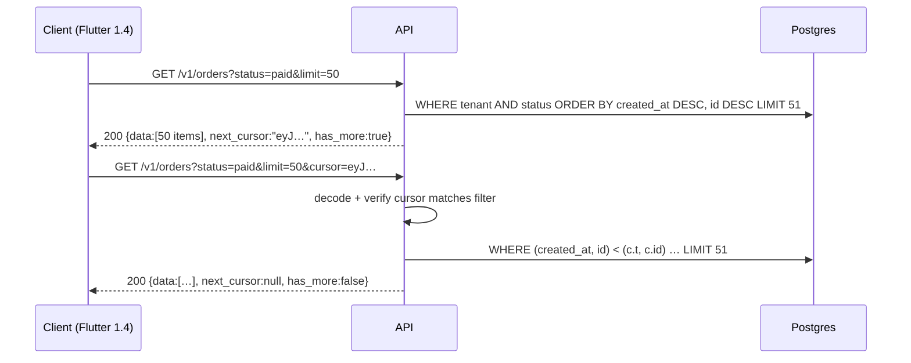

# REST API - Versioning, Pagination & Error Design

> [!info] Deep dive of [[REST API]]

> [!abstract] TL;DR
> Three contracts outlive your code:
> - **Evolution**: additive changes only within a major version, clients must tolerate unknown fields and enum values, and deprecate with `Deprecation`/`Sunset` headers plus a date.
> - **Pagination**: opaque **cursor (keyset)** with a stable sort and `has_more`, not offsets or total counts.
> - **Errors**: RFC 9457 `application/problem+json` with a stable machine `code`, field-level `errors[]` and a `request_id`.
>
> Mobile apps pin old versions for months, so design as if every response shape is permanent.

## Concept
**What breaks clients**:

| Change | Breaking? | Notes |
|---|---|---|
| Add optional response field | No (if clients are tolerant readers) | Default rule for evolution |
| Add enum value | **Often yes** for strongly-typed clients | Dart/Swift `switch` without a default crashes or throws on decode |
| Add required request field | Yes | Make it optional with a server default |
| Remove/rename field, change type or unit | Yes | New field name (`amount_sen`), deprecate the old one |
| Change default sort, page size or error code | Yes (behavioural) | Document behaviour as contract |
| Tighten validation | Yes for existing callers | Roll out with warnings first |

**Versioning strategies**:

| Strategy | Example | Pick it when… |
|---|---|---|
| URL major version | `/v1/orders` | Most APIs. Simple routing, caching, docs |
| Date-based header (Stripe-style) | `Api-Version: 2026-09-30` | Many external integrators. You can maintain version transforms |
| No versioning + strict additive evolution | Internal APIs with one client you deploy together | Next.js server actions, BFFs |

## How It Works


## Practical Usage
**Keyset pagination with an opaque cursor** (TypeScript + SQL):
```ts
type Cursor = { t: string; id: string; f: string };          // last created_at, last id, filter fingerprint
const enc = (c: Cursor) => Buffer.from(JSON.stringify(c)).toString('base64url');
const dec = (s: string): Cursor => JSON.parse(Buffer.from(s, 'base64url').toString());

export async function listOrders(tenantId: string, q: { status?: string; limit?: number; cursor?: string }) {
  const limit = Math.min(q.limit ?? 50, 100);                  // cap page size
  const f = hash({ status: q.status });                        // cursor only valid for the same filter
  const c = q.cursor ? dec(q.cursor) : null;
  if (c && c.f !== f) throw problem(400, 'cursor_filter_mismatch', 'Cursor does not match the current filters');

  const rows = await sql`
    select id, status, total_sen, created_at from orders
    where tenant_id = ${tenantId}
      ${q.status ? sql`and status = ${q.status}` : sql``}
      ${c ? sql`and (created_at, id) < (${c.t}, ${c.id})` : sql``}
    order by created_at desc, id desc
    limit ${limit + 1}`;                                        // +1 row tells us has_more without COUNT(*)

  const page = rows.slice(0, limit);
  const last = page.at(-1);
  return { data: page, has_more: rows.length > limit,
           next_cursor: rows.length > limit && last ? enc({ t: last.created_at, id: last.id, f }) : null };
}
```
```sql
create index on orders (tenant_id, status, created_at desc, id desc);   -- matches filter + sort exactly
```
**Problem details (RFC 9457) helper**:
```ts
export function problem(status: number, code: string, detail: string, extra: Record<string, unknown> = {}) {
  return Response.json(
    { type: `https://api.example.my/problems/${code}`, title: TITLES[code] ?? 'Request failed', status, code, detail,
      request_id: currentRequestId(), ...extra },
    { status, headers: { 'content-type': 'application/problem+json' } });
}
// validation: field-level errors with JSON Pointers
return problem(422, 'validation_failed', 'One or more fields are invalid', {
  errors: zodIssues.map((i) => ({ pointer: '/' + i.path.join('/'), code: i.code, detail: i.message })),
});
```
**Status code map**:

| Situation | Status | `code` example |
|---|---|---|
| Malformed JSON, bad query param | 400 | `invalid_request` |
| Schema-valid shape but invalid values | 422 | `validation_failed` |
| No/expired credentials | 401 + `WWW-Authenticate` | `unauthenticated` |
| Authenticated, not allowed | 403, or **404 to hide existence** across tenants | `forbidden` / `not_found` |
| State conflict (already paid), duplicate | 409 | `order_already_paid` |
| `If-Match` ETag mismatch | 412 | `precondition_failed` |
| Rate limited | 429 + `Retry-After` | `rate_limited` |
| Dependency down (payment gateway) | 503 + `Retry-After` | `upstream_unavailable` |

**Deprecating an endpoint or field**:
```http
HTTP/1.1 200 OK
Deprecation: @1767225600
Sunset: Wed, 31 Mar 2027 00:00:00 GMT
Link: <https://docs.example.my/migrate/v2-orders>; rel="deprecation"
```
**Tolerant client** (Dart / Flutter): unknown enum values must not crash old apps.
```dart
enum OrderStatus { pending, paid, shipped, unknown }
OrderStatus parseStatus(String s) =>
    OrderStatus.values.firstWhere((e) => e.name == s, orElse: () => OrderStatus.unknown);
```
**Wrong way**:
```http
GET /orders?page=2000&per_page=50        ❌ OFFSET 99950: reads and discards 100k rows; items shift when new orders arrive
200 OK {"error": "Something went wrong"} ❌ errors with 200, no code, no request id
500 {"stack": "at Object.<anonymous> (/app/server.js:42)"}   ❌ stack traces leak internals
```

## Patterns & Anti-patterns
| Pattern | When | Anti-pattern to avoid |
|---|---|---|
| Stable sort with a unique tiebreaker (`created_at, id`) | Every list | Sorting by a non-unique column → duplicates/skips across pages |
| Opaque, base64url cursors (optionally HMAC-signed) | Public APIs | Exposing raw offsets or IDs clients start constructing |
| `has_more` instead of `total` | Large tables | `COUNT(*)` on every list request (slow on big Postgres tables) |
| Machine `code` + human `detail`; clients localize by `code` | Multi-language apps (BM/EN/ZH) | Clients parsing English `detail` strings |
| Deprecation headers + changelog + usage metrics per version | Retiring versions | Turning off `/v1` on a date nobody was told |
| Min-supported-app-version endpoint for mobile | Flutter apps | Breaking old app versions still in the stores |
| Same error schema for 4xx and 5xx, including from the gateway | All responses | Traefik/Nginx HTML error pages for JSON clients |

## Performance & Trade-offs
- **Keyset vs offset**: keyset is O(log n + page) with the right index regardless of depth. Offset is O(offset + page) and gets slow past ~10k rows. Offset keeps "jump to page N" UI, which you should reserve for small admin tables.
- **Totals**: if the UI needs counts, use an estimate (`reltuples`, or `EXPLAIN` row estimates) or a cached count updated asynchronously. Exact counts on filtered multi-million-row tables cost seconds.
- **Date-based versioning** gives fine-grained evolution but requires a transform layer (response downgraders per version) and tests for every supported version. That's worth it for public platforms, overkill for a single Flutter client.
- **Payload size**: support sparse fieldsets (`?fields=id,status`) or purpose-built endpoints for mobile lists. Over-fetching costs real money on Malaysian mobile data and battery.

## Tips & Reminders
> [!tip] In ZP's stack
> - **Supabase PostgREST pagination**: `.range(from, to)` is **offset** pagination. For large or infinite-scroll lists, use keyset filters (`.lt('created_at', cursor)` + `.order(...)`) or an RPC.
> - **Errors**: Next.js route handlers return problem+json built from Zod issues ([[TypeScript - Runtime Validation with Zod & Type-Safe APIs]]).
> - **Flutter**: generate the client from OpenAPI, and keep `unknown` fallbacks on every enum.

- Express money as integer minor units (`total_sen`) and never change units within a version.
- Put `request_id` in every error and log line, and show it in app error screens. Support then needs one ID instead of screenshots.
- Rate-limit headers: the IETF `RateLimit` / `RateLimit-Policy` fields are still an Internet-Draft (-11, May 2026). Many APIs send `X-RateLimit-*`. Always send `Retry-After` on 429.
- Document behavioural guarantees (default sort, max page size, ID formats) in the OpenAPI spec descriptions. They're part of the contract.

## Version Notes
| Spec | Status | Relevance |
|---|---|---|
| RFC 7807 → **RFC 9457** (2023) | Standard | Problem Details. 9457 obsoletes 7807, adds a registry and multiple-problem guidance |
| RFC 8594 (2019) | Informational | `Sunset` header |
| RFC 9745 (2025) | Standards track (from memory) | `Deprecation` header (`@<unix-ts>` format) |
| draft-ietf-httpapi-ratelimit-headers-11 (2026-05) | Internet-Draft | `RateLimit`, `RateLimit-Policy`. Not final, so expect changes |
| OpenAPI 3.2 (2025-09) | Spec | Better streaming/SSE and tag descriptions for documenting these contracts |

> [!warning] Unverified — check before relying on this
> RFC 9745's number and status are from memory, not re-checked this run. See https://datatracker.ietf.org/ before citing it in client documentation.

## Critical Issues & Gotchas
> [!danger] Enum additions crash shipped mobile apps
> A new `status: "refunded"` value breaks every installed Flutter/iOS build that decodes enums strictly, and you can't hot-fix binaries. Ship `unknown` fallbacks first, then add values server-side. Or gate new values by client version.

> [!danger] Cross-tenant ID probing
> Returning 403 for another tenant's order confirms the ID exists, which enables enumeration and leaks business volume. Return 404, and authorize by tenant in the query itself, not after the fetch ([[OWASP Top 10]] BOLA/A01).

- **Unstable cursors**: sorting by `updated_at` while records are being updated makes items jump pages. Paginate on immutable columns, or snapshot (`as_of` timestamp in the cursor).
- **Cursor tampering**: decoded cursors are user input. Validate types, bind them to the filter fingerprint and tenant, and never interpolate them into SQL.
- **Error format inconsistency**: framework defaults (Next.js HTML 404s, Traefik plain-text 404/502) leak through to clients. Add catch-all handlers and custom proxy error pages for API hosts.
- **Silent behaviour changes** (default sort or limit) break integrations as surely as schema changes. Treat them as versioned changes.

## Related
- [[REST API]]
- [[REST API - Webhooks & Idempotency]] — retries, idempotency keys, webhook contracts
- [[TypeScript - Runtime Validation with Zod & Type-Safe APIs]] — validation → problem details
- [[PostgreSQL - Indexing]] — composite indexes for keyset pagination
- [[Flutter]] — tolerant clients and min-version gating
- [[HTTP & HTTPS]] — status codes, caching, conditional requests

## References
- https://www.rfc-editor.org/rfc/rfc9457
- https://www.rfc-editor.org/rfc/rfc8594
- https://datatracker.ietf.org/doc/html/draft-ietf-httpapi-ratelimit-headers
- https://use-the-index-luke.com/no-offset
- https://stripe.com/blog/api-versioning
