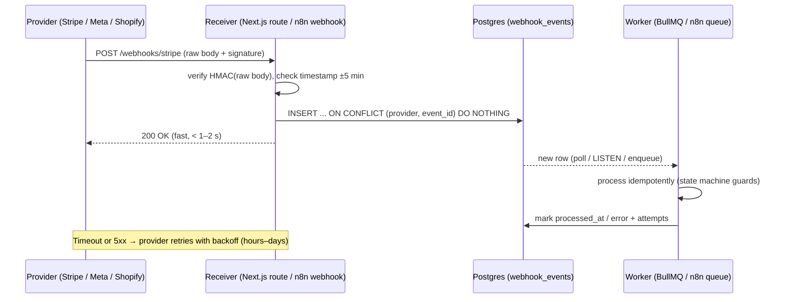

# REST API - Webhooks & Idempotency

> [!info] Deep dive of [[REST API]]

> [!abstract] TL;DR
> Webhooks and retries guarantee **at-least-once** delivery, so duplicates and reordering *will* happen. These are the rules.
> - **Inbound webhooks**:
>   - Verify the HMAC signature over the **raw body**, and reject stale timestamps.
>   - **Persist the event, return 2xx fast** (< 5 s), and process asynchronously.
>   - **Dedupe on the event ID** with a unique constraint.
> - **Your own `POST` APIs**: accept an `Idempotency-Key`, store the request fingerprint plus the response, and replay it on retry.
> - **Outbound webhooks**: sign them, retry with backoff, deliver from an **outbox** table, and document that receivers must be idempotent.

## Concept

### Delivery semantics
| Guarantee | Reality | Consequence |
|---|---|---|
| At-most-once | Fire-and-forget, no retry | Lost events (payment paid, order never fulfilled) |
| **At-least-once** | Retry until 2xx (Stripe, Meta, GitHub, Shopify, Svix) | **Duplicates**: the receiver must be idempotent |
| Exactly-once | Not achievable over HTTP between independent systems | Emulate it: at-least-once + idempotent processing = *effectively once* |
| Ordering | Not guaranteed (parallel retries, multiple regions) | Use event timestamps/versions. Fetch current state from the API when order matters |

### Idempotency in HTTP
- `GET`, `PUT`, `DELETE` and `HEAD` are idempotent by spec. `POST` and `PATCH` are not.
- **`Idempotency-Key`** (IETF httpapi draft, de facto standard via Stripe): the client sends a unique key per logical operation. The server guarantees the same effect and the same response for retries with that key.
- **Request fingerprint**: a hash of method + path + body. The same key with a *different* body is a client bug → `422` (the draft suggests `422`/`409`).

### Common provider signature schemes
| Provider | Header(s) | Signed payload | Algo |
|---|---|---|---|
| **Standard Webhooks** (Svix, OpenAI, Anthropic, Supabase…) | `webhook-id`, `webhook-timestamp`, `webhook-signature: v1,<b64>` | `{id}.{timestamp}.{body}` | HMAC-SHA256, secret `whsec_…` (base64) |
| Stripe | `Stripe-Signature: t=…,v1=…` | `{t}.{body}` | HMAC-SHA256, 5 min tolerance default |
| Meta (WhatsApp Cloud API, Messenger) | `X-Hub-Signature-256: sha256=<hex>` | raw body | HMAC-SHA256 with the **App Secret** |
| GitHub | `X-Hub-Signature-256`, `X-GitHub-Delivery` (ID) | raw body | HMAC-SHA256 |
| Shopify | `X-Shopify-Hmac-Sha256` (base64), `X-Shopify-Webhook-Id` | raw body | HMAC-SHA256 |

> [!warning] Meta has no timestamp in its signature
> A captured Meta payload can be replayed. Dedupe on the message/entry IDs (`messages[].id`, `statuses[].id`) and ignore events older than your window.

## How It Works


## Practical Usage

### Inbound: verify, persist, ack
```ts
// app/api/webhooks/whatsapp/route.ts (Next.js App Router)
import crypto from "node:crypto";

export async function POST(req: Request) {
  const raw = await req.text();                          // raw body. Never re-serialise parsed JSON
  const sig = req.headers.get("x-hub-signature-256") ?? "";
  const expected = "sha256=" + crypto.createHmac("sha256", process.env.META_APP_SECRET!).update(raw).digest("hex");
  const a = Buffer.from(sig), b = Buffer.from(expected);
  if (a.length !== b.length || !crypto.timingSafeEqual(a, b)) return new Response("bad signature", { status: 401 });

  const body = JSON.parse(raw);
  const events = body.entry.flatMap((e: any) => e.changes.flatMap((c: any) =>
    [...(c.value.messages ?? []), ...(c.value.statuses ?? [])].map((m: any) => ({ id: m.id, payload: m }))));

  await sql`
    insert into webhook_events (provider, event_id, payload)
    select 'meta', x.id, x.payload from jsonb_to_recordset(${JSON.stringify(events)}::jsonb) as x(id text, payload jsonb)
    on conflict (provider, event_id) do nothing`;
  return new Response("ok");                               // ack even if processing will fail later
}
```
```sql
create table webhook_events (
  id           bigint generated always as identity primary key,
  provider     text not null,
  event_id     text not null,
  payload      jsonb not null,
  received_at  timestamptz not null default now(),
  processed_at timestamptz,
  attempts     int not null default 0,
  last_error   text,
  unique (provider, event_id)
);
create index on webhook_events (received_at) where processed_at is null;
```

### Idempotent processing (business-level guard)
```sql
-- Order state machine: a duplicate "payment_succeeded" is a no-op
update orders set status = 'paid', paid_at = now(), payment_ref = $2
where id = $1 and status = 'pending_payment'
returning id;   -- 0 rows = already paid (or invalid transition) → skip side effects
```
- Put side effects (emails, WhatsApp sends, stock decrements) **after** the guarded state transition, in the same transaction or via an outbox.
- **Use the unique `event_id` *and* state guards.** Providers can send *different* events with the same meaning, e.g. `charge.succeeded` and `payment_intent.succeeded`.

### Your API: `Idempotency-Key` middleware
```ts
// Postgres-backed; Redis works too (SET key NX EX 86400) but loses keys on eviction
export async function withIdempotency(req: Request, userId: string, handler: () => Promise<Response>) {
  const key = req.headers.get("idempotency-key");
  if (!key) return handler();                          // or require it on payment endpoints
  const body = await req.clone().text();
  const fp = crypto.createHash("sha256").update(req.method + new URL(req.url).pathname + body).digest("hex");

  const claimed = await sql`
    insert into idempotency_keys (user_id, key, fingerprint, status)
    values (${userId}, ${key}, ${fp}, 'in_progress')
    on conflict (user_id, key) do nothing returning key`;
  if (claimed.length === 0) {
    const [row] = await sql`select * from idempotency_keys where user_id = ${userId} and key = ${key}`;
    if (row.fingerprint !== fp) return problem(422, "Idempotency-Key reused with a different payload");
    if (row.status === "in_progress") return problem(409, "Request with this key is still in progress");
    return new Response(row.response_body, { status: row.response_status, headers: { "Idempotent-Replayed": "true" } });
  }
  const res = await handler();
  await sql`update idempotency_keys set status='done', response_status=${res.status}, response_body=${await res.clone().text()}
            where user_id=${userId} and key=${key}`;
  return res;
}
```
- Scope keys per **user/tenant** and expire them after 24–72 h (a cron `delete … where created_at < now() - interval '3 days'`).
- Don't cache `5xx` as a final result: delete the key (or mark it retryable) so the client's retry actually runs again.

### Outbound: transactional outbox + retries
```sql
-- Same transaction as the business change → no "committed but webhook never sent"
begin;
update orders set status='shipped' where id=$1;
insert into outbox (topic, aggregate_id, payload) values ('order.shipped', $1, $2);
commit;
```
- A dispatcher (BullMQ worker, n8n schedule, or `pg_cron`) reads the outbox with `for update skip locked`. It then signs each request (Standard Webhooks), POSTs it with a 10 s timeout, and retries with exponential backoff plus jitter. A typical schedule is 1 m, 5 m, 30 m, 2 h, 6 h, 24 h, then disable the endpoint and alert.

## Patterns & Anti-patterns
| Pattern | When | Anti-pattern to avoid |
|---|---|---|
| Verify signature on raw bytes, constant-time compare | Every inbound webhook | `JSON.stringify(req.body)` before HMAC (key order/whitespace change → always fails, so someone disables verification) |
| Persist-then-ack, process async | Any non-trivial handler | Calling 3 external APIs before responding → provider timeout → retry storm |
| Unique `(provider, event_id)` + state guards | Payments, orders, messaging | Dedupe in memory/Redis only (lost on restart/eviction) |
| Reconcile periodically via the provider's API | Payments, subscriptions | Trusting webhooks as the only source of truth (missed events = silent drift) |
| Transactional outbox for outbound events | Your platform emits webhooks | Sending HTTP inside the DB transaction, or after commit without persistence |
| `Idempotency-Key` on create/charge endpoints | Mobile clients on flaky networks | Client generates a new key per retry (defeats the purpose) |
| Dead-letter + replay tooling | Production | Failed events only in logs |

## Performance & Trade-offs
- **Ack latency**: Stripe times out around 10–20 s, and Meta expects a fast `200` and degrades endpoints that keep failing. Keep receivers under ~1 s by doing only the verify plus insert.
- **Storage**: webhook payloads add up. A busy WhatsApp number can generate 10k+ status events a day. Partition by month or delete processed rows after 30–90 days, keeping `event_id` long enough to cover provider retry windows (days).
- **Postgres vs Redis for idempotency**:
  - **Postgres**: durable, transactional with the business write. That's the right default.
  - **Redis**: faster but not durable under eviction or failover ([[Redis]]). Acceptable for low-stakes dedupe only.
- **Ordering**: enforcing per-entity ordering (a per-customer queue) reduces parallelism. Prefer version checks (`where version < $new`) so out-of-order events are discarded.

## Tips & Reminders
> [!tip]
> - Use separate endpoints per provider (`/webhooks/stripe`, `/webhooks/meta`), each with its own secret. Rotate secrets with overlap. Standard Webhooks supports multiple signatures for this.
> - Log `event_id`, provider, latency and the result, but not full payloads with PII (PDPA). Mask phone numbers in WhatsApp payloads.
> - Test duplicates on purpose: replay the same event twice in staging (`stripe events resend`, the Svix replay UI).
> - Return `2xx` for events you deliberately ignore. A `4xx` makes most providers retry or disable the endpoint.
> - **In ZP's stack**:
>   - **Receivers**: [[n8n]] Webhook nodes on a non-Access hostname. The first node verifies the HMAC using the raw body option, the second inserts into Postgres with `ON CONFLICT DO NOTHING` and responds immediately, and processing runs in a separate workflow ([[n8n - Queue Mode & Scaling]]).
>   - **[[Supabase]]**: use Edge Functions or Next.js route handlers as receivers, with the `webhook_events` table under RLS so only the service role can access it.

## Version Notes
| Spec / provider | Status |
|---|---|
| IETF `draft-ietf-httpapi-idempotency-key-header` | Still an Internet-Draft (rev 07 Oct 2025, newer revisions posted). **Not an RFC yet**. The semantics are stable in practice (Stripe-style) |
| Standard Webhooks v1 | Stable spec (`webhook-id/timestamp/signature`, `v1,` prefix), used by Svix, OpenAI, Anthropic, Supabase and others |
| OpenAPI 3.1+ | Top-level `webhooks` object to document outbound events ([[REST API]]) |
| Meta Graph API | `X-Hub-Signature` (SHA-1) is legacy. Use `X-Hub-Signature-256` |

> [!warning] Unverified — check before relying on this
> Provider timeouts and retry windows (Stripe ~3 days, Meta up to several days) change over time. Check each provider's current webhook docs before setting dedupe retention.

## Critical Issues & Gotchas
> [!danger] Unverified webhooks = forged payments
> An endpoint that trusts `{"type":"payment_intent.succeeded"}` without checking the signature lets anyone mark orders as paid. This is a recurring real-world bug in e-commerce plugins. Always verify, reject when the secret is missing (fail closed), and re-fetch critical objects from the provider API (`GET /v1/payment_intents/:id`) before fulfilling high-value orders.

> [!danger] Retry storms and endpoint disablement
> A slow receiver times out → the provider retries → load grows → more timeouts. Providers then **disable** the endpoint: Stripe emails you and disables it after days of failures, and Meta stops delivering to failing apps. During incidents, keep the ack path alive (a queue/DB insert only) even if downstream processing is down.

> [!warning] Gotchas
> - Body parsers (Express `json()`, frameworks) consume the raw body. Configure raw access (`express.raw({ type: "application/json" })`, `await req.text()` in Next.js).
> - Proxies and CDNs that re-encode or decompress bodies break signatures. Watch out for Cloudflare transforms and gzip handling.
> - Timestamp checks fail with clock drift, so keep NTP on and allow ±5 min.
> - Outbound webhooks are an **SSRF vector**: customers can register `http://169.254.169.254/` or internal hostnames. Resolve the DNS, block private ranges, and disallow redirects ([[Network Security]]).
> - `Idempotency-Key` without a fingerprint check silently returns the old response for a different request.

## Related
- [[REST API]]
- [[HTTP & HTTPS]] — methods, idempotency semantics, status codes
- [[Message Queues]] — async processing, DLQs, at-least-once delivery
- [[PostgreSQL]] — unique constraints, `SKIP LOCKED` outbox dispatch
- [[n8n]] — webhook receivers and async processing workflows
- [[Network Security]] — SSRF protection for outbound webhooks

## References
- IETF Idempotency-Key draft: https://datatracker.ietf.org/doc/draft-ietf-httpapi-idempotency-key-header/
- Standard Webhooks spec: https://github.com/standard-webhooks/standard-webhooks
- Stripe webhooks: https://docs.stripe.com/webhooks
- Stripe idempotent requests: https://docs.stripe.com/api/idempotent_requests
- Meta webhooks (signature verification): https://developers.facebook.com/docs/graph-api/webhooks/getting-started
- Transactional outbox pattern: https://microservices.io/patterns/data/transactional-outbox.html
