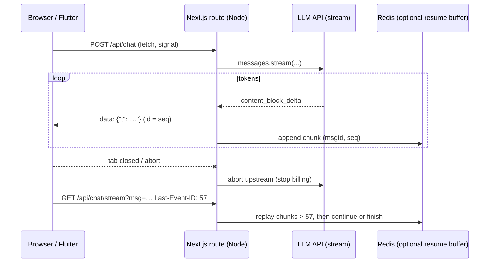

# WebSocket - SSE & Streaming LLM Responses

> [!info] Deep dive of [[WebSocket]]

> [!abstract] TL;DR
> For **server → client streams** (LLM tokens, progress, notifications), **Server-Sent Events** over plain HTTP beat WebSockets: proxy- and CDN-friendly, auto-reconnect with `Last-Event-ID`, multiplexed on HTTP/2.
> Stream LLM output as SSE from a Next.js route handler:
> - **forward cancellation** (client abort → abort the upstream LLM request, which stops token billing);
> - send **heartbeats** under proxy idle limits;
> - disable proxy buffering;
> - for long answers, persist chunks so a reconnect can **resume** instead of regenerating.

## Concept
| | SSE | WebSocket | Fetch streaming (no SSE framing) |
|---|---|---|---|
| Direction | Server → client | Bidirectional | Server → client |
| Transport | HTTP/1.1 or HTTP/2 response (`text/event-stream`) | Upgraded TCP connection | HTTP response body |
| Reconnect | Built into `EventSource` (`retry`, `Last-Event-ID`) | DIY | DIY |
| Custom headers / POST | Not with `EventSource` (GET, cookies only). Use fetch + parser | Yes (at handshake) | Yes |
| Proxies/CDNs | Works if buffering is off | Needs upgrade support, sticky sessions | Works if buffering is off |
| Best for | LLM tokens, progress, live feeds | Chat with typing, collaboration, games | Single streamed result to a known client |

**Wire format** (UTF-8, events separated by a blank line):
```text
id: 42
event: delta
data: {"text":"Hello"}

: heartbeat comment (ignored by clients)

retry: 3000
```

## How It Works


## Practical Usage
**Next.js route handler**: Claude stream → SSE, with abort and heartbeat:
```ts
import Anthropic from '@anthropic-ai/sdk';
const client = new Anthropic();
const enc = new TextEncoder();

export async function POST(req: Request) {
  const { messages } = await req.json();               // validate + authorize first (tenant, quotas)
  const upstream = new AbortController();
  req.signal.addEventListener('abort', () => upstream.abort());   // client gone → stop generating

  const body = new ReadableStream<Uint8Array>({
    async start(controller) {
      const send = (event: string, data: unknown, id?: number) =>
        controller.enqueue(enc.encode(`${id !== undefined ? `id: ${id}\n` : ''}event: ${event}\ndata: ${JSON.stringify(data)}\n\n`));
      const hb = setInterval(() => controller.enqueue(enc.encode(': hb\n\n')), 15_000);   // under proxy idle limits
      let seq = 0;
      try {
        const stream = client.messages.stream(
          { model: 'claude-sonnet-5-5', max_tokens: 4000, messages },
          { signal: upstream.signal },
        );
        for await (const ev of stream) {
          if (ev.type === 'content_block_delta' && ev.delta.type === 'text_delta') send('delta', { t: ev.delta.text }, seq++);
        }
        const final = await stream.finalMessage();
        send('done', { stop_reason: final.stop_reason, usage: final.usage });
      } catch (e) {
        if (!upstream.signal.aborted) send('error', { message: 'generation failed' });
      } finally {
        clearInterval(hb);
        controller.close();
      }
    },
    cancel() { upstream.abort(); },
  });

  return new Response(body, {
    headers: {
      'Content-Type': 'text/event-stream; charset=utf-8',
      'Cache-Control': 'no-cache, no-transform',
      'X-Accel-Buffering': 'no',                       // Nginx: don't buffer
      Connection: 'keep-alive',
    },
  });
}
```
**Client (POST + custom headers → fetch + parser instead of `EventSource`)**:
```ts
const ctrl = new AbortController();
const res = await fetch('/api/chat', { method: 'POST', body: JSON.stringify({ messages }), signal: ctrl.signal });
const reader = res.body!.pipeThrough(new TextDecoderStream()).getReader();
let buf = '';
for (;;) {
  const { value, done } = await reader.read();
  if (done) break;
  buf += value;
  let i;
  while ((i = buf.indexOf('\n\n')) >= 0) {
    const raw = buf.slice(0, i); buf = buf.slice(i + 2);
    const data = raw.split('\n').filter((l) => l.startsWith('data: ')).map((l) => l.slice(6)).join('\n');
    if (raw.includes('event: delta')) appendToken(JSON.parse(data).t);
  }
}
// stop button → ctrl.abort()
```
**Simple GET feed with native `EventSource`** (cookies auth, auto-reconnect):
```ts
const es = new EventSource(`/api/jobs/${jobId}/events`);
es.addEventListener('progress', (e) => setProgress(JSON.parse((e as MessageEvent).data).pct));
es.onerror = () => { /* browser reconnects with Last-Event-ID automatically */ };
```
**Wrong way**:
```ts
const text = (await client.messages.create({ … })).content;   // ❌ 30 s blank screen, then a wall of text
return new Response(stream);                                   // ❌ no text/event-stream, no X-Accel-Buffering → proxies buffer it all
// ❌ ignoring req.signal: users close the tab, you keep paying for 3,000 output tokens
```

## Patterns & Anti-patterns
| Pattern | When | Anti-pattern to avoid |
|---|---|---|
| SSE for one-way streams | LLM output, job progress | WebSocket infrastructure for one-way data |
| Propagate abort to the LLM call | Every stream | Orphaned generations after disconnect |
| Heartbeat comments every 15–30 s | Behind Cloudflare/Traefik/Nginx | Silent streams killed by idle timeouts |
| Persist chunks keyed by message ID + seq | Long answers, flaky mobile networks | Regenerating the whole answer on reconnect |
| Structured events (`delta`, `tool`, `done`, `error`) | Rich UIs | Plain text you must re-parse |
| Auth + rate limit + token budget before streaming | Public chat endpoints | Unmetered streaming endpoints |

## Performance & Trade-offs
- **Connection limits**: browsers allow ~6 HTTP/1.1 connections per origin, so many open SSE tabs exhaust them. HTTP/2/3 (Cloudflare edge) multiplexes streams and removes the limit.
- **Server cost**: each open stream holds a request and sometimes a DB connection. In Node it's cheap (async I/O), but release DB connections before streaming.
- **Proxy timeouts**: Cloudflare's proxy read timeout (~100 s without bytes) and Traefik/Nginx idle timeouts end silent streams. Heartbeats keep them alive, and long-running jobs should stream progress events.
- **Token rendering**: rendering Markdown on every token is CPU-heavy on low-end phones. Batch DOM updates per animation frame (e.g. every 30–50 ms).

## Tips & Reminders
> [!tip] In ZP's stack
> - **Web**: Next.js route handlers on Coolify stream SSE through Traefik → Cloudflare. Send heartbeats and `X-Accel-Buffering: no`, and avoid caching rules on `/api/chat*`.
> - **Flutter**: consume the same SSE endpoint with an `http` streamed request + line parser. Pause or abort on app background, and resume via message ID.
> - **WhatsApp**: there's no token streaming. Generate fully, then send, or send a short "typing…" acknowledgement first.

- Log `usage` from the final message per stream (input/output/cache tokens) for cost per conversation ([[LLM APIs & SDKs]]).
- Make the `done` event carry `stop_reason`, so the UI can show "cut off" (`max_tokens`) or refusal states correctly.
- Use `Cache-Control: no-transform` so CDNs and proxies don't compress or alter the stream.
- For agent UIs, stream tool-call progress as separate events, so users see "Looking up order 1042…" during tool latency.

## Version Notes
| Date | Change |
|---|---|
| 2009–2015 | SSE standardized in HTML (WHATWG). `EventSource` in all modern browsers except old IE/Edge Legacy |
| 2015+ | HTTP/2 multiplexing removes the per-origin connection pain for SSE |
| 2023–26 | LLM APIs standardize on SSE streaming. SDK helpers (`messages.stream`, `finalMessage()`) |

## Critical Issues & Gotchas
> [!danger] Buffered streams look like hangs
> Nginx (`proxy_buffering on`), compression middleware or misconfigured CDN rules hold the whole response until the end, and users see nothing for 30 s. Set `X-Accel-Buffering: no`, disable compression for `text/event-stream`, and test through the full proxy chain ([[Nginx - Caching & Performance Tuning]]).

> [!danger] Unbounded cost on public streams
> A public chat endpoint that streams without auth, rate limits or a max-token budget is an open tap on your LLM bill. Enforce per-user/tenant quotas before calling the model, and cap `max_tokens` per route.

- **`EventSource` can't send headers** (no `Authorization`). Use cookies for auth, or switch to fetch streaming for bearer tokens.
- **Partial chunks**: network reads can split an event mid-line. Buffer until `\n\n` before parsing.
- **Serverless timeouts**: some platforms cap response duration. On Coolify/Node this is your own setting, but serverless hosts may cut long streams.
- **Retry storms**: `EventSource` reconnects automatically. A failing endpoint plus many clients means constant reconnects, so send `retry:` with a backoff and return 204 to stop.

## Related
- [[WebSocket]]
- [[WebSocket - Scaling & Reliability]] — when you do need bidirectional sockets
- [[HTTP & HTTPS - HTTP-2, HTTP-3 & Connection Management]] — keep-alive and multiplexing
- [[Node.js - Streams & Backpressure]] — Web streams in Node
- [[LLM APIs & SDKs]] — streaming APIs and usage accounting
- [[Cloudflare]] — proxy timeouts and caching rules

## References
- https://html.spec.whatwg.org/multipage/server-sent-events.html
- https://developer.mozilla.org/en-US/docs/Web/API/Server-sent_events/Using_server-sent_events
- https://docs.claude.com/en/docs/build-with-claude/streaming
- https://nginx.org/en/docs/http/ngx_http_proxy_module.html#proxy_buffering
