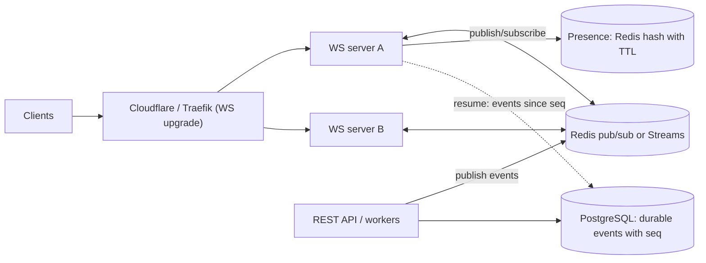

# WebSocket - Scaling & Reliability

> [!info] Deep dive of [[WebSocket]]

> [!abstract] TL;DR
> A WebSocket server is **stateful**: each connection pins a client to one process. Scaling it means three things:
> - Fan messages out across instances via a **pub/sub backplane** ([[Redis]], NATS).
> - Survive deploys and network drops with **heartbeats, reconnect with backoff + jitter, and resumable sequences**.
> - Protect servers with **backpressure, per-connection limits and auth refresh**.
>
> Treat the socket as an unreliable, at-most-once pipe. Durable state and replay live in your database or stream, not in the connection.

## Concept

### What changes when you go from 1 to N instances
| Concern | Single instance | Multiple instances |
|---|---|---|
| Fan-out (send to room/user) | In-memory map of sockets | **Backplane**: publish to Redis/NATS, and each instance delivers to its local sockets |
| Presence (who's online) | Local set | Shared store with TTL heartbeats (Redis sorted set / hash), or CRDT-ish presence |
| Sticky routing | N/A | Not required for pure WebSocket (one long TCP connection). Required for **Socket.IO long-polling fallback** or HTTP-based handshakes across requests |
| Deploys | Restart drops everyone | Rolling drain: stop accepting, close with code 1012, clients reconnect elsewhere |
| Ordering | Per connection | Per channel only if one publisher/sequence per channel |

### Delivery guarantees
- A WebSocket frame delivered to a closed or half-open socket is lost. TCP doesn't tell the app what the client processed.
- For reliable delivery:
  - Assign **monotonic sequence numbers per channel**.
  - Persist events (DB/stream).
  - Let clients **resume from the last seen sequence** on reconnect, the way SSE's `Last-Event-ID` works.
  - Make client handling idempotent.

### Connection limits (per Node.js instance, rough)
| Resource | Typical limit | Mitigation |
|---|---|---|
| File descriptors | `ulimit -n` (1024 default!) | Raise to 100k+ (`LimitNOFILE` in systemd, `ulimits` in Docker) |
| Memory | ~10–50 KB per idle socket (more with `permessage-deflate`) | Disable/limit compression, small buffers |
| CPU | Broadcast fan-out and JSON serialization | Serialize once per broadcast, binary formats, uWebSockets.js for very high counts |
| Proxy/LB | Idle timeouts, max connections | Heartbeats under the idle timeout, tune proxy limits |

## How It Works

- **Heartbeats**: the server sends `ping` frames every ~25–30 s, and the client must `pong` (browsers do this automatically). Missing pongs mean you terminate and clean up. This keeps NATs, proxies and Cloudflare (idle timeouts around 100 s on proxied connections) from silently dropping idle connections, and detects half-open sockets.
- **Backpressure**: if a client reads slower than you send, data piles up in server memory. Check `ws.bufferedAmount` (browser) / `socket.bufferedAmount` (Node `ws`) and drop, coalesce or disconnect slow consumers.
- **Graceful shutdown**: on `SIGTERM`, stop accepting upgrades, send close frames (`1012 Service Restart` or `1001 Going Away`), wait for drain, then exit. Clients reconnect to other instances.
- **Auth**: authenticate on upgrade (cookie or short-lived token in the first message, not the URL query, which ends up in logs). Re-authenticate or close when tokens expire, and authorize per channel subscription.

## Practical Usage

### Node `ws` server with heartbeats, backplane and backpressure
```ts
import { WebSocketServer, WebSocket } from "ws";
import Redis from "ioredis";

const wss = new WebSocketServer({ noServer: true, perMessageDeflate: false, maxPayload: 64 * 1024 });
const sub = new Redis(REDIS_URL), pub = new Redis(REDIS_URL);
const rooms = new Map<string, Set<WebSocket>>();

server.on("upgrade", async (req, socket, head) => {
  const user = await authenticate(req);                          // cookie / ticket; reject early
  if (!user) return socket.destroy();
  wss.handleUpgrade(req, socket, head, (ws) => wss.emit("connection", ws, user));
});

wss.on("connection", (ws: WebSocket & { alive?: boolean }, user) => {
  ws.alive = true;
  ws.on("pong", () => (ws.alive = true));
  ws.on("message", async (raw) => {
    const msg = JSON.parse(raw.toString());                      // validate with Zod in real code
    if (msg.type === "join" && (await canJoin(user, msg.room))) {
      (rooms.get(msg.room) ?? rooms.set(msg.room, new Set()).get(msg.room)!).add(ws);
      await sub.subscribe(`room:${msg.room}`);
    }
  });
  ws.on("close", () => rooms.forEach((set) => set.delete(ws)));
});

sub.on("message", (channel, payload) => {                        // fan-out from the backplane
  for (const ws of rooms.get(channel.slice(5)) ?? []) {
    if (ws.readyState !== WebSocket.OPEN) continue;
    if (ws.bufferedAmount > 1_000_000) { ws.terminate(); continue; }   // slow consumer protection
    ws.send(payload);                                            // payload serialized once by the publisher
  }
});

setInterval(() => wss.clients.forEach((ws: any) => {             // heartbeat
  if (!ws.alive) return ws.terminate();
  ws.alive = false; ws.ping();
}), 25_000);

export const publish = (room: string, event: object & { seq: number }) => pub.publish(`room:${room}`, JSON.stringify(event));
```

### Client reconnect with backoff, jitter and resume
```ts
function connect(lastSeq = 0, attempt = 0) {
  const ws = new WebSocket(`wss://rt.example.my/ws`);
  ws.onopen = () => { attempt = 0; ws.send(JSON.stringify({ type: "resume", room, since: lastSeq })); };
  ws.onmessage = (e) => { const ev = JSON.parse(e.data); if (ev.seq > lastSeq) { apply(ev); lastSeq = ev.seq; } };
  ws.onclose = () => {
    const delay = Math.min(30_000, 500 * 2 ** attempt) * Math.random();   // full jitter
    setTimeout(() => connect(lastSeq, attempt + 1), delay);
  };
}
```

## Patterns & Anti-patterns
| Pattern | When | Anti-pattern to avoid |
|---|---|---|
| Redis/NATS backplane, serialize once per broadcast | >1 instance | Looping over all instances via HTTP to deliver messages |
| Durable events + sequence numbers + resume | Chat, orders, notifications | Treating sockets as the source of truth |
| Heartbeats < proxy idle timeout | All deployments | Relying on TCP keepalive defaults (2 hours) |
| Full-jitter exponential reconnect | Clients | Immediate reconnect loops → thundering herd after deploys/outages |
| Per-connection rate limits + max payload | Public endpoints | Unbounded message sizes/rates (DoS) |
| Separate realtime service from REST API | Scale independently | Mixing long-lived sockets into short-lived serverless functions |

## Performance & Trade-offs
- **Redis pub/sub** is fire-and-forget: messages are lost if an instance is down or disconnected. Use **Redis Streams** or a DB for replay. It's fine as a backplane when combined with resume.
- **Broadcast cost** scales with subscribers × message rate. Shard rooms across instances, coalesce updates (send state diffs at most N/s), or use a managed service.
- **Compression** (`permessage-deflate`) saves bandwidth but costs memory/CPU per connection, and is a known memory hog in Node `ws` at scale. Often disable it, or enable it with tight limits.
- **SSE** (Server-Sent Events) is simpler for server→client-only streams (LLM token streaming, notifications): plain HTTP, auto-reconnect with `Last-Event-ID`, works through most proxies.

## Tips & Reminders
> [!tip]
> - Load-test with realistic connection counts (k6 WebSocket, Artillery). Watch fd counts, memory per connection and event-loop lag.
> - Expose metrics: open connections per instance, messages/s, send buffer sizes, reconnect rate, auth failures.
> - In [[Kubernetes - Core Objects|Kubernetes]], set `terminationGracePeriodSeconds` long enough to drain, and use a `preStop` delay. In [[Traefik]]/[[Cloudflare]], confirm WebSocket support and timeouts for the route.
> - **In ZP's stack**:
>   - **Default**: [[Supabase]] Realtime (Postgres changes, broadcast, presence) for app realtime, so you don't run your own WS fleet.
>   - **Custom**: when you need your own (WhatsApp-style chat dashboards), Node `ws` or Socket.IO with the Redis adapter on [[Coolify]], heartbeats under Cloudflare's idle timeout, and message history in [[PostgreSQL]] with per-conversation sequence numbers.

## Version Notes
| Change | Date | Notes |
|---|---|---|
| RFC 6455 | 2011 | WebSocket protocol |
| RFC 7692 | 2015 | `permessage-deflate` compression |
| RFC 8441 | 2018 | WebSockets over HTTP/2 (extended CONNECT) |
| RFC 9220 | 2022 | WebSockets over HTTP/3 |
| Node.js 22 | 2024 | Global `WebSocket` client (server still via `ws`/frameworks) |
| WebTransport (HTTP/3) | 2023+ | Interop 2026 focus area. Datagrams + streams, an alternative for low-latency use cases |

## Critical Issues & Gotchas
> [!danger] Cross-Site WebSocket Hijacking (CSWSH)
> Browsers send cookies on WebSocket upgrades from any origin, and the Same-Origin Policy doesn't block the connection. A malicious site can open a socket as the logged-in user and read private streams. Validate the `Origin` header on upgrade, prefer short-lived tokens/tickets over ambient cookies, and authorize every channel subscription server-side.

> [!danger] Reconnect storms after outages and deploys
> When an instance or region restarts, tens of thousands of clients reconnecting immediately (and re-fetching state) can overload auth, DB and the new instances, keeping the system down (metastable failure). Use full-jitter backoff, server-advertised retry hints, rate limits on the upgrade path, and cheap resume (send only missed events).

> [!warning] Gotchas
> - Half-open connections (mobile networks switching cells) look alive until a write fails. Heartbeats and timeouts are mandatory.
> - Tokens in query strings (`wss://…?token=`) leak into proxy/CDN logs. Use cookies with Origin checks, or one-time tickets.
> - Serverless platforms (Vercel functions, Lambda) can't hold sockets. Use dedicated services, managed realtime, or edge-specific APIs (Durable Objects).
> - Large broadcasts with per-recipient JSON serialization burn CPU. Serialize once and send the same buffer.
> - Message ordering across multiple publishers isn't guaranteed. Use a single sequencer per channel (DB sequence) when order matters.

## Related
- [[WebSocket]]
- [[Redis]] — pub/sub backplane, Streams for replay, presence
- [[Traefik]] · [[Cloudflare]] — proxies, timeouts, WS support
- [[Kubernetes - Core Objects]] — graceful termination, probes
- [[Supabase]] — managed realtime alternative
- [[Message Queues]] — durable delivery vs realtime fan-out

## References
- RFC 6455: https://www.rfc-editor.org/rfc/rfc6455
- `ws` library (Node): https://github.com/websockets/ws
- Socket.IO Redis adapter: https://socket.io/docs/v4/redis-adapter/
- Supabase Realtime: https://supabase.com/docs/guides/realtime
- Cloudflare WebSockets: https://developers.cloudflare.com/network/websockets/
- AWS: exponential backoff and jitter: https://aws.amazon.com/blogs/architecture/exponential-backoff-and-jitter/
