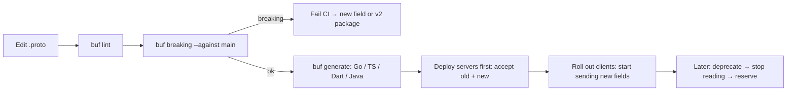

# gRPC - Protobuf Schema Evolution

> [!info] Deep dive of [[gRPC]]

> [!abstract] TL;DR
> Protobuf messages are identified on the wire by **field numbers, not names**. Evolution is safe if you:
> - only **add** fields (new numbers)
> - never **reuse or change** a number or its type
> - **`reserve`** numbers and names you delete
> - keep enum zero values as `*_UNSPECIFIED`
>
> Remember that JSON/Connect clients depend on **names** too. Enforce it all in CI with `buf breaking --against main`. For truly incompatible changes, ship a new package version (`orders.v2`) and run both.

## Concept

### Why it works: the wire format
- Each field is encoded as `tag = (field_number << 3) | wire_type`, followed by the value (varint, 64-bit, length-delimited, 32-bit).
- Decoders **skip unknown fields** (and preserve them in most languages), so old clients ignore new fields and new clients see defaults for missing ones.
- Names don't appear in binary encoding, but they **do** in JSON mapping (`lowerCamelCase`), reflection, and generated code.

### Change safety matrix
| Change | Binary wire | JSON / Connect | Generated code | Verdict |
|---|---|---|---|---|
| Add a field (new number) | ✅ | ✅ | ✅ | **Safe** |
| Delete a field + `reserved` number & name | ✅ | ✅ (ignored) | ⚠️ callers break at compile | Safe if consumers stopped using it |
| Delete without `reserved` | ✅ now, ❌ later (number reuse) | — | — | **Unsafe** |
| Rename a field | ✅ | ❌ JSON key changes | ❌ source break | Wire-safe only, avoid for public APIs |
| Change field number | ❌ | ❌ | — | **Never** |
| Change type (`int32`→`string`) | ❌ | ❌ | ❌ | **Never** (new field instead) |
| Compatible type change (`int32`↔`int64`↔`uint32`↔`bool`) | ⚠️ truncation risk | ⚠️ | ⚠️ | Avoid |
| `singular` → `repeated` (scalars) | ⚠️ last-value-wins on old readers | ❌ | ❌ | Avoid |
| Move existing field into a `oneof` | ⚠️ semantics change | ⚠️ | ❌ | Avoid |
| Add enum value | ✅ (open enums) | ✅ | ⚠️ exhaustive switches | Safe with UNSPECIFIED + default handling |
| Remove/renumber enum value | ❌ | ❌ | ❌ | **Never** (reserve it) |
| Add RPC method / service | ✅ | ✅ | ✅ | **Safe** |
| Change request/response type of an RPC | ❌ | ❌ | ❌ | New method |

### Field presence
- **proto3 scalars** have no presence by default, so `0`, `""` and `false` are indistinguishable from "not set". Use **`optional`** (proto3 ≥ 3.15) or wrapper types when "unset" matters (PATCH semantics, nullable price).
- **Editions** (2023+): presence is a feature (`features.field_presence = EXPLICIT` default in edition 2023, `IMPLICIT` mimics proto3).

## How It Works

- **Deployment order**: servers learn new fields first (readers before writers). When removing, stop *writing* first, then stop *reading*, then reserve.
- **Mobile clients** ([[Flutter]]) stay old for months, so treat every shipped app version as a consumer you can't upgrade on demand.

## Practical Usage

### Evolving a message safely
```protobuf
syntax = "proto3";                                  // editions: edition = "2023" (reserved names become unquoted identifiers)
package rarticle.orders.v1;
option go_package = "github.com/rarticle/api/gen/orders/v1;ordersv1";

import "google/protobuf/timestamp.proto";

message Order {
  reserved 5, 9;                                    // deleted fields: numbers can never be reused
  reserved "coupon_code", "legacy_status";          // names too (JSON/source safety)

  string id = 1;
  string tenant_id = 2;
  int64 total_sen = 3;
  OrderStatus status = 4;
  google.protobuf.Timestamp created_at = 6;
  string channel = 7 [deprecated = true];           // still read for old clients; plan removal
  SalesChannel sales_channel = 8;                   // replacement for `channel`
  int64 discount_sen = 10;                          // new field: old clients ignore it
}

enum OrderStatus {
  ORDER_STATUS_UNSPECIFIED = 0;                     // must exist: default for unknown/unset
  ORDER_STATUS_PENDING = 1;
  ORDER_STATUS_PAID = 2;
  ORDER_STATUS_SHIPPED = 3;
  reserved 4;                                       // removed ORDER_STATUS_ON_HOLD
  ORDER_STATUS_REFUNDED = 5;
}
enum SalesChannel { SALES_CHANNEL_UNSPECIFIED = 0; SALES_CHANNEL_WEB = 1; SALES_CHANNEL_WHATSAPP = 2; }
```

### Buf configuration and CI gate
```yaml
# buf.yaml
version: v2
modules:
  - path: proto
lint:
  use: [STANDARD]
breaking:
  use: [WIRE_JSON]          # FILE (strictest, source compat) | PACKAGE | WIRE_JSON | WIRE (binary only)
```
```bash
buf lint
buf breaking --against ".git#branch=main"          # local / CI against main
buf breaking --against "buf.build/rarticle/api"    # against the published registry module
```
- Pick **`WIRE_JSON`** if any client uses JSON (Connect, gRPC-Gateway, REST transcoding). Pick **`FILE`** for SDKs where generated-code compatibility matters.

### Handling unknown enum values in clients
```ts
// TypeScript (protobuf-es): unknown future enum numbers arrive as numbers → handle default
switch (order.status) {
  case OrderStatus.PAID: return "Paid";
  case OrderStatus.SHIPPED: return "Shipped";
  default: return "Processing";                       // includes UNSPECIFIED and values added later
}
```

### Breaking changes: version the package
```text
proto/rarticle/orders/v1/orders.proto   # frozen except additive changes
proto/rarticle/orders/v2/orders.proto   # new shape; both services served side by side
```
- Run v1 and v2 handlers on the same server (shared domain logic). Measure v1 traffic, announce a sunset, and remove only when traffic is gone.

## Patterns & Anti-patterns
| Pattern | When | Anti-pattern to avoid |
|---|---|---|
| Additive changes + `reserved` on delete | Every change | Deleting a field, later reusing number 5 for something else (silent data corruption) |
| `*_UNSPECIFIED = 0` in every enum | Always | `ACTIVE = 0` (unset looks like active) |
| `optional` for fields where unset ≠ zero | PATCH/update APIs, nullable values | Using `0` as "not provided" |
| `buf breaking` in CI on every PR | Shared contracts | Reviewing compatibility by eye |
| New package version for incompatible redesigns | Major changes | Mutating v1 messages in place |
| Request/response messages per RPC (`GetOrderRequest`) | API design | Reusing domain messages as RPC inputs (can't evolve independently) |

## Performance & Trade-offs
- **Field numbers 1–15** encode in 1 byte (tag), and 16–2047 in 2 bytes. Reserve 1–15 for frequent fields when designing new messages.
- **Deprecated fields** cost nothing on the wire when unset, so keeping them for a long migration window is cheap. Removing them early is what's expensive.
- **JSON transcoding** adds name-coupling. The flexibility for web/partner clients costs you the freedom to rename.
- **Editions migration** (proto2/proto3 → `edition = "2023"`): behaviour-preserving conversion tooling exists (e.g. Prototiller). Do it per file, and verify generated code diffs.

## Tips & Reminders
> [!tip]
> - **Document semantics in comments** (units: `total_sen` in sen, timezone of timestamps). Renaming later to add units is a breaking JSON change.
> - **Kafka/event streams**: the same rules apply with a Schema Registry (protobuf schemas, `BACKWARD`/`FULL` compatibility modes), because consumers replay old events for years ([[Kafka]]).
> - **Publish generated SDKs** with semver tied to proto changes. Additive proto changes are minor bumps.
> - **In ZP's stack**:
>   - **Mostly REST/JSON** with OpenAPI ([[REST API]]). The same discipline applies: additive changes, never repurpose fields.
>   - **When gRPC/Connect is used** (internal services, Flutter ↔ Go backends): Buf in [[CI-CD]] with `WIRE_JSON` breaking rules.

## Version Notes
| Item | Note |
|---|---|
| proto2 → proto3 (2016) | No required fields, implicit presence. `optional` re-added in 3.15 (2021) |
| **Editions 2023** (protobuf 27+, 2024) | `edition` replaces `syntax`, behaviour via features (presence, enum openness, UTF-8 validation) |
| Edition 2024 | Further feature defaults. Tooling/language support rolling out (check protoc and Buf support before adopting) |
| Buf CLI v2 config (2024) | `buf.yaml` v2 with modules, categories `FILE`/`PACKAGE`/`WIRE_JSON`/`WIRE` |

> [!warning] Unverified — check before relying on this
> Edition 2024 support status in protoc and Buf for your languages wasn't confirmed. Check protobuf.dev/editions and the Buf changelog before switching files to `edition = "2024"`.

## Critical Issues & Gotchas
> [!danger] Field number reuse = silent data corruption
> Reusing a deleted field's number with a different meaning (or type) makes old clients and stored data decode garbage **without errors**. For example, `coupon_code = 5` is read as the new `int64 loyalty_points = 5`, or bytes are misinterpreted. Always `reserved` deleted numbers and names. This also applies to persisted protobuf blobs and Kafka topics.

> [!danger] "Required" semantics leak into proto3 by convention
> Making a new field "required" in server validation breaks every old client that doesn't send it. Treat new fields as optional on the server, default sensibly, and enforce requiredness only after all supported client versions send it.

> [!warning] Gotchas
> - `oneof` members can't be `repeated`, and adding an existing field to a `oneof` changes semantics (setting another member clears it).
> - Default values aren't serialised in proto3 implicit presence, so "set to 0" and "not set" look the same to the receiver.
> - Closed enums (proto2, or editions `enum_type = CLOSED`) treat unknown values as unknown fields, so values can disappear for old readers.
> - `map<string, X>` field keys can't be changed to another key type compatibly.
> - Generated code in some languages (Dart, Swift) makes enum switches exhaustive. Always include a default branch for forward compatibility.

## Related
- [[gRPC]]
- [[REST API]] — versioning and evolution rules for JSON APIs
- [[Kafka]] — schema registry compatibility for events
- [[CI-CD]] — `buf breaking` as a required check
- [[Go]] / [[TypeScript]] — code generation targets
- [[Flutter]] — long-lived mobile clients as consumers

## References
- Protobuf language guide, updating messages: https://protobuf.dev/programming-guides/proto3/#updating
- Protobuf Editions overview: https://protobuf.dev/editions/overview/
- Protobuf encoding: https://protobuf.dev/programming-guides/encoding/
- Buf breaking change detection: https://buf.build/docs/breaking/
- API Improvement Proposals (AIP) on versioning: https://google.aip.dev/185
