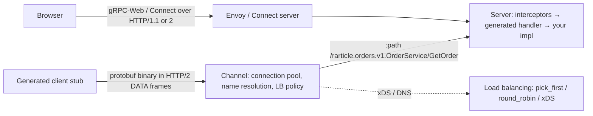

# gRPC

> [!abstract] TL;DR
> gRPC is a high-performance RPC framework: you define services and messages in **Protocol Buffers** (`.proto`), generate typed clients and servers in 10+ languages, and talk over **HTTP/2** with binary framing, multiplexing, **streaming** and deadlines.
> - **Strengths**: the standard for **service-to-service** traffic in microservices ([[Kubernetes]], Envoy/Istio), mobile ↔ backend at scale, and low-latency internal APIs.
> - **Weaknesses**: browsers can't speak native gRPC (you need gRPC-Web or **Connect**), it's hard to debug with curl, and it's overkill for public CRUD APIs, where [[REST API]] is simpler.

## Introduction
- **Origin**: Google's internal **Stubby** RPC system (2001+), open-sourced as gRPC in 2015, now a **CNCF** graduated project. Protocol Buffers (2008 open source) is the default IDL and serialization.
- **Problem**: JSON/REST between hundreds of services wastes CPU and bandwidth, lacks strict contracts, and has no first-class streaming or deadline propagation.
- **Where it sits**: internal microservice meshes, Kubernetes ecosystems (etcd, containerd, Kubernetes CRI, Envoy xDS all use gRPC), ML serving (TensorFlow Serving, Triton), mobile clients (Flutter/Swift/Kotlin `grpc` packages), and since 2026 auto-configuration in [[Spring Boot]] 4.1.

## Core Concepts

### Protobuf contract
```protobuf
syntax = "proto3";                     // or: edition = "2023";
package rarticle.orders.v1;
option go_package = "github.com/rarticle/api/gen/orders/v1;ordersv1";

import "google/protobuf/timestamp.proto";

service OrderService {
  rpc GetOrder(GetOrderRequest) returns (Order);                           // unary
  rpc ListOrders(ListOrdersRequest) returns (stream Order);                // server streaming
  rpc UploadReceipts(stream ReceiptChunk) returns (UploadSummary);         // client streaming
  rpc Chat(stream ChatMessage) returns (stream ChatMessage);                // bidirectional
}

message Order {
  string id = 1;                        // field numbers are the wire contract: never reuse
  OrderStatus status = 2;
  int64 total_sen = 3;
  google.protobuf.Timestamp created_at = 4;
  optional string customer_name = 5;    // explicit presence
  reserved 6; reserved "legacy_note";   // retired fields
}

enum OrderStatus { ORDER_STATUS_UNSPECIFIED = 0; ORDER_STATUS_PENDING = 1; ORDER_STATUS_PAID = 2; }
message GetOrderRequest { string id = 1; }
message ListOrdersRequest { string tenant_id = 1; int32 page_size = 2; string page_token = 3; }
```

### RPC types and semantics
| Concept | Notes |
|---|---|
| Unary / server / client / bidi streaming | Streams are long-lived HTTP/2 streams with flow control |
| **Deadlines** | Client sets a deadline. It propagates across hops, and servers should check `ctx.Done()` |
| Status codes | `OK`, `INVALID_ARGUMENT`, `NOT_FOUND`, `ALREADY_EXISTS`, `PERMISSION_DENIED`, `UNAUTHENTICATED`, `RESOURCE_EXHAUSTED`, `UNAVAILABLE` (retryable), `DEADLINE_EXCEEDED`, `INTERNAL` |
| Rich errors | `google.rpc.Status` with details (`BadRequest`, `ErrorInfo`, `RetryInfo`) |
| Metadata | Key-value headers (auth tokens, request IDs). `-bin` suffix for binary |
| Interceptors / middleware | Auth, logging, metrics, retries (unary and stream variants) |
| Health checking / reflection | `grpc.health.v1` for load balancers and K8s probes. Server reflection for grpcurl/Postman |

### Schema evolution rules
- Add fields with new numbers (old clients ignore unknown fields). **Never change or reuse field numbers or types**. Mark removed ones `reserved`.
- Enum zero value must be `*_UNSPECIFIED`. Version packages (`orders.v1` → `v2`) for breaking changes.
- Enforce rules with **Buf** (`buf lint`, `buf breaking --against .git#branch=main`).

## Architecture / How It Works

- **Wire format**: each message is length-prefixed protobuf in HTTP/2 DATA frames, and status comes in HTTP/2 **trailers** (`grpc-status`, `grpc-message`). Trailers are why browsers and some proxies can't do native gRPC.
- **Long-lived HTTP/2 connections** multiplex many RPCs. L4 load balancers then pin all traffic to one backend, so use client-side LB (`round_robin` with headless K8s services), an L7 proxy (Envoy, Linkerd, [[Traefik]] h2c) or xDS.
- **Protobuf encoding**: tag-length-value varints, typically 3–10× smaller and faster to parse than JSON. Not self-describing: you need the schema to decode.
- **Connect** (Buf): a protocol + libraries that serve gRPC, gRPC-Web and a simple JSON/HTTP protocol from one handler, so it works with `curl` and browsers natively.

## Project Structure
```text
proto/
├── buf.yaml                      # lint + breaking rules
├── buf.gen.yaml                  # code generation plugins (go, ts/es, dart, kotlin, swift)
└── rarticle/orders/v1/orders.proto
services/orders-go/
├── gen/orders/v1/*.pb.go         # generated (committed or generated in CI)
└── internal/server/orders.go     # implementation
apps/web/src/gen/                 # @bufbuild/protobuf + @connectrpc/connect clients
```
```bash
buf lint && buf breaking --against '.git#branch=main'
buf generate
grpcurl -plaintext localhost:50051 list
grpcurl -d '{"id":"o_42"}' -H "authorization: Bearer $TOKEN" localhost:50051 rarticle.orders.v1.OrderService/GetOrder
```

## Use Cases
| Use case | Why it fits |
|---|---|
| Microservice-to-microservice calls | Typed contracts, low latency, deadlines, streaming |
| Polyglot systems ([[Go]] + [[Java]]/[[Kotlin]] + [[Python]]) | Codegen for every language from one `.proto` |
| Streaming (telemetry, chat, live prices, AI token streams) | Native bidirectional streams with flow control |
| Mobile apps with heavy traffic | Smaller payloads, HTTP/2 multiplexing |
| Infrastructure APIs (K8s CRI/CSI, Envoy xDS, etcd) | Ecosystem standard |
| Public third-party APIs, webhooks, browser-first apps | **Weaker fit**. [[REST API]]/JSON is easier for consumers |

## Pros & Cons
| Pros | Cons |
|---|---|
| Strict, versionable contracts with codegen | Not human-readable. Debugging needs grpcurl/reflection |
| Fast binary serialization, HTTP/2 multiplexing | Browsers need gRPC-Web/Connect + proxy |
| Four streaming modes, deadlines, cancellation | Load balancing long-lived connections is non-trivial |
| Rich ecosystem (interceptors, health, xDS, OTel) | HTTP caching/CDNs don't apply |
| Backward-compatible evolution rules | Proto toolchain/codegen setup overhead |
| Polyglot | Error model less familiar than HTTP status codes |

## Alternatives & Peers
| Alternative | Strength vs gRPC | Weakness vs gRPC | Pick it when… |
|---|---|---|---|
| [[REST API]] + JSON (+ OpenAPI) | Universal, cacheable, curl-friendly | Larger payloads, weaker contracts, no streaming | Public/partner APIs, SME apps (ZP's default) |
| Connect RPC | gRPC-compatible + browser/JSON friendly | Smaller ecosystem | New gRPC-style APIs needing web clients |
| [[GraphQL]] | Client-driven queries for UIs | Server complexity, not for internal RPC | Rich frontends |
| tRPC | TS end-to-end types, zero schema | TS-only | Full-stack TypeScript |
| Message queues ([[Kafka]], NATS) | Async decoupling, replay | Not request/response | Event-driven workflows |
| Cap'n Proto / Thrift | Zero-copy (Cap'n Proto) / legacy Thrift ecosystems | Smaller communities | Niche performance needs |

## Tips & Reminders
> [!tip]
> - **Always set deadlines** on the client (e.g. 2–5 s) and propagate context. Calls without deadlines can hang forever.
> - Retry only idempotent RPCs on `UNAVAILABLE`, with exponential backoff (service config `retryPolicy`). Never blindly retry `DEADLINE_EXCEEDED` on writes.
> - Use Buf for lint/breaking checks in [[CI-CD]], and keep protos in one repo or the Buf Schema Registry.
> - Enable TLS (mTLS between services), the health service, and keepalive settings tuned to proxies' idle timeouts.
> - Observability: OpenTelemetry interceptors, metrics per method/status code.
> - **In ZP's stack**: you rarely need gRPC for SME apps. REST/Supabase covers them. Use it for a high-throughput internal service (e.g. a [[Go]]/[[Rust]] worker called from Node), streaming AI responses between services, or integrating vendor APIs that only offer gRPC. Prefer Connect for browser/Flutter-web reachable endpoints.

## Versions & Breaking Changes
| Version | Released | Key changes | Breaking / migration notes |
|---|---|---|---|
| gRPC 1.0 | 2016-08 | GA | — |
| proto3 | 2016 | Simplified syntax, no required fields | `required` removed. Presence via `optional` (3.15+) |
| gRPC-Web GA | 2018 | Browser support via proxy | — |
| Connect (Buf) | 2022 | gRPC/gRPC-Web/Connect protocol in one | — |
| **Protobuf Editions 2023** | 2024 (protobuf 27) | Replaces `syntax` with editions + feature flags | Migrate with `prototiller`. proto2/proto3 still supported |
| Editions 2024 | 2025 | Further feature defaults (symbol visibility, etc.) | Check language support |
| gRPC 1.7x | 2025–2026 | Regular ~6-week releases. Language implementations versioned separately (grpc-go, grpc-java, @grpc/grpc-js) | Follow per-language release notes |
| Spring Boot 4.1 gRPC | 2026-06 | gRPC auto-configuration in Spring | — |

> [!warning] Unverified — check before relying on this
> Current gRPC core/per-language versions and Editions 2024 support weren't checked this run. Check https://github.com/grpc/grpc/releases and https://protobuf.dev/editions/overview/.

## Critical Issues & Gotchas
> [!danger] HTTP/2-level DoS affects gRPC servers
> **HTTP/2 Rapid Reset** (CVE-2023-44487) and CONTINUATION floods (2024) hit gRPC implementations directly (grpc-go, grpc-java, Netty, Envoy), since gRPC is HTTP/2. Keep gRPC libraries and proxies patched, set `MaxConcurrentStreams`, message size limits and connection age limits, and put an L7 proxy in front of public endpoints.

> [!danger] Protobuf parsing DoS
> Deeply nested or malformed messages have caused stack exhaustion / excessive CPU in protobuf parsers (e.g. CVE-2024-7254 in protobuf-java's handling of nested groups). Enforce max message sizes (default 4 MB receive), recursion limits, and update protobuf runtimes alongside gRPC.

> [!warning] Gotchas
> - Reusing or renumbering a field silently corrupts data between old and new clients. Use `reserved` and `buf breaking`.
> - `proto3` scalars have no presence by default (`0`, `""` and `false` can't be distinguished from unset). Use `optional` or wrapper types.
> - L4 load balancers + long-lived HTTP/2 connections lead to uneven load. Use client-side LB or L7 proxies, and set `MAX_CONNECTION_AGE`.
> - Proxies/CDNs that don't support HTTP/2 trailers or h2c (some PaaS, [[Cloudflare]] configurations) break gRPC. Verify end-to-end support.
> - Default max receive message size 4 MB → `RESOURCE_EXHAUSTED` on large payloads. Stream large data or use object storage.

## Deep Dives
- [[gRPC - Protobuf Schema Evolution]]

Candidates: gRPC load balancing & service mesh.

## Related
- [[REST API]] · [[GraphQL]] — other API styles
- [[HTTP & HTTPS]] — HTTP/2 framing and trailers
- [[Go]] — first-class gRPC ecosystem
- [[Kubernetes]] — service-to-service traffic, health probes
- [[Spring Boot]] — gRPC auto-configuration (4.1)
- [[Kafka]] — async alternative

## References
- gRPC docs: https://grpc.io/docs/
- Protocol Buffers: https://protobuf.dev/
- Protobuf Editions: https://protobuf.dev/editions/overview/
- Buf CLI: https://buf.build/docs/
- Connect RPC: https://connectrpc.com/
- gRPC status codes: https://grpc.io/docs/guides/status-codes/
