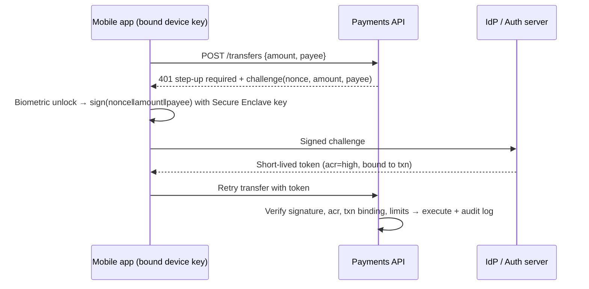

# Authentication & Authorization - Interview Questions

> [!info] Reference for [[Authentication & Authorization]] · index: [[Backend Interview Questions]]

> [!abstract] TL;DR
> Q1: **authentication for a finance app**. OIDC + PKCE against a dedicated IdP, passkeys + device binding, step-up and transaction signing for money movement, short-lived sender-constrained tokens, BFF for web, and BNM's SMS-OTP migration and cooling-off rules.

## Q1. Which authentication approach would you pick for a finance app?

**Grading**: threat model first (account takeover, phishing, SIM swap, token theft, insider), phishing-resistant MFA, token handling, **regulatory awareness**.

**Recommendation** (the one-liner): *OIDC Authorization Code + PKCE against a dedicated IdP, passkeys plus device binding as primary factors, short-lived sender-constrained tokens, step-up re-authentication and transaction signing for money movement, and no SMS OTP for high-risk actions.*

| Concern | Choice | Why |
|---|---|---|
| Protocol | [[OAuth 2.0 & OIDC]], Auth Code + **PKCE**. Follow the **FAPI 2.0** security profile for open-banking-style APIs | Standard, auditable. FAPI tightens OAuth for financial-grade APIs (PAR, sender-constrained tokens) |
| Identity provider | Keycloak (self-hosted) or a certified managed IdP | MFA policies, sessions, audit logs and brute-force protection without building them. Avoid hand-rolled auth |
| Primary factor | **Passkeys / WebAuthn** (phishing-resistant). Password only as fallback with breach checks per NIST SP 800-63-4 | Phishing is the #1 takeover vector |
| Mobile | **Device binding**: key pair generated in Secure Enclave / Android StrongBox at enrolment. Biometrics unlock the key locally | Server verifies signatures from the bound device, not a shared secret |
| Money movement | **Step-up auth + transaction signing**: sign `{amount, payee, nonce}` with the device key. Show amount and payee on the approval screen | Defeats session hijack and man-in-the-browser. The approval is bound to *this* transaction |
| Tokens | Access token 5–10 min, refresh token rotation with **reuse detection**, sender-constrained (DPoP or mTLS) | A stolen token is useless elsewhere or quickly expired |
| Web client | **BFF pattern**: tokens stay server-side; browser gets an `HttpOnly; Secure; SameSite=Strict` session cookie | No tokens reachable by XSS (no `localStorage`) |
| Sessions | Idle timeout ~5–15 min, absolute timeout, revoke-all on password/device change, new-device alerts | Limits blast radius |
| Authorization | RBAC + attribute rules (limits, ownership) enforced server-side; Postgres RLS where applicable | AuthN is half the job ([[Authentication & Authorization]]) |
| Ops | Rate limiting, credential-stuffing detection, risk signals (new device, geo, velocity), immutable audit log | Required for disputes and regulators |

> [!info] Malaysia: BNM requirements (genuinely relevant here)
> - Bank Negara Malaysia directed banks (2022 anti-scam measures) to **migrate away from SMS OTP** for account opening, fund transfers, payments and changes to personal details or settings. Banks moved to in-app approval on a bound device (e.g. Maybank Secure2u, Public Bank SecureSign).
> - **Cooling-off period** on first-time enrolment of online banking or a secure device (bank-defined, e.g. 12 h). Banks also enforce **one secure device per customer**.
> - Policy frame: BNM **RMiT** (Risk Management in Technology). Reports describe a later RMiT update tightening device binding, phone-number changes and interception-resistant MFA. Unverified against the BNM text, so check the current RMiT before quoting specifics.
> - **PDPA**: auth logs and device identifiers are personal data, so define retention and access controls.

- **Trap**: "JWT in `localStorage` + refresh token", "SMS OTP is our 2FA", or building auth yourself. Also forgetting that biometrics only *unlock a key locally*; the server never receives a fingerprint.
- Deep dive: [[Authentication & Authorization]] · [[OAuth 2.0 & OIDC]] · [[JWT]] · [[OWASP Top 10]]

## Related
- [[Authentication & Authorization]] — overview
- [[OAuth 2.0 & OIDC]] · [[JWT]] — protocols and tokens
- [[OWASP Top 10]] — broken access control, auth failures
- [[System Design - Interview Questions]] — step-up auth on refunds in the payment design
- [[Backend Interview Questions]] — interview index

## References
- NIST SP 800-63-4: https://pages.nist.gov/800-63-4/
- OpenID FAPI 2.0 Security Profile: https://openid.net/specs/fapi-security-profile-2_0-final.html
- BNM anti-scam measures, SMS OTP migration (RinggitPlus summary): https://ringgitplus.com/en/blog/personal-finance-news/bnm-announces-five-additional-safeguards-against-financial-scams-including-migrating-from-sms-otp.html
- BNM policy documents (RMiT): https://www.bnm.gov.my/
