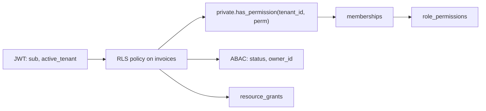

# Authentication & Authorization - Multi-Tenant Authorization with RLS

> [!info] Deep dive of [[Authentication & Authorization]]

> [!abstract] TL;DR
> Model authorization as **data**: `membership → role → permission`, with per-resource grants for sharing. Make RLS policies call one small, indexed, `stable` helper such as `has_permission(tenant_id, 'invoice.update')` rather than hard-coding role names.
> Mechanics (roles, keys, policy anatomy) are in [[Supabase - Row Level Security]]. This note covers the **authorization model** that sits on top of them.

## Concept
- **Tenant isolation ≠ authorization.** Isolation answers "can this user see tenant X at all?". Authorization answers "can they do *this action* on *this row* inside X?". Most multi-tenant leaks come from implementing only isolation and adding `if (role === 'admin')` checks in app code.
- Three models stack on top of each other. Use only the layers you need:

| Layer | Question | Postgres shape |
|---|---|---|
| **RBAC** (per tenant) | Does the user's role in tenant T grant permission P? | `memberships(user, tenant, role)` + `role_permissions(role, perm)` |
| **ABAC** conditions | Do row attributes allow it (owner, status, amount, region)? | Extra predicates in the policy: `status = 'draft'`, `owner_id = auth.uid()` |
| **ReBAC-lite** sharing | Was this specific resource shared with the user or a group? | `resource_grants(resource_id, principal, relation)` |

- **Permissions are strings, roles are bundles.** Policies and code check permissions (`invoice.approve`). Roles are just editable sets of them. Adding a "Finance Lead" role then needs no migration or policy change.
- **System roles vs custom roles.** Ship `owner/admin/member/viewer` as immutable rows with `tenant_id IS NULL`. Let paying tenants clone them into tenant-scoped custom roles (an enterprise-tier feature).

## How It Works


1. Postgres sets `auth.uid()` from the verified JWT for every request: PostgREST via Supabase, or `set_config('request.jwt.claims', …)` in your own pool.
2. The policy calls the helper once per **distinct argument set**. With `(select …)` wrapping, Postgres evaluates it as an initPlan rather than once per row (see Performance).
3. The helper is `security definer` so it can read `memberships` without recursive RLS. It returns a boolean, and is not `leakproof` unless audited.
4. ABAC predicates and sharing grants are OR-ed or AND-ed in the policy itself, so the planner can still use indexes on `tenant_id`, `owner_id` and `status`.

## Practical Usage
**Schema** (the RBAC core):
```sql
create table public.permissions (key text primary key);           -- 'invoice.read', 'invoice.approve'
create table public.roles (
  id uuid primary key default gen_random_uuid(),
  tenant_id uuid references public.tenants on delete cascade,      -- null = system role
  name text not null,
  unique nulls not distinct (tenant_id, name)                      -- PG15+
);
create table public.role_permissions (
  role_id uuid references public.roles on delete cascade,
  permission text references public.permissions on update cascade,
  primary key (role_id, permission)
);
create table public.memberships (
  tenant_id uuid references public.tenants on delete cascade,
  user_id uuid references auth.users on delete cascade,
  role_id uuid not null references public.roles,
  primary key (tenant_id, user_id)
);
create index on public.memberships (user_id, tenant_id) include (role_id);
```

**Helper**: one function, called by every policy.
```sql
create or replace function private.has_permission(_tenant uuid, _perm text)
returns boolean
language sql stable security definer set search_path = ''
as $$
  select exists (
    select 1
    from public.memberships m
    join public.role_permissions rp on rp.role_id = m.role_id
    where m.user_id = (select auth.uid())
      and m.tenant_id = _tenant
      and rp.permission = _perm
  );
$$;
revoke all on function private.has_permission(uuid, text) from public;
grant usage on schema private to authenticated;
grant execute on function private.has_permission(uuid, text) to authenticated;
```

**Policies**: RBAC + ABAC + sharing, one policy per command.
```sql
-- read: any role with invoice.read, or explicitly shared
create policy invoices_select on public.invoices for select to authenticated
using (
  (select private.has_permission(tenant_id, 'invoice.read'))
  or exists (select 1 from public.resource_grants g
             where g.resource_id = invoices.id
               and g.principal_id = (select auth.uid())
               and g.relation in ('viewer','editor'))
);

-- update: members edit their own drafts; approvers edit anything not yet paid
create policy invoices_update on public.invoices for update to authenticated
using (
  ((select private.has_permission(tenant_id, 'invoice.update')) and owner_id = (select auth.uid()) and status = 'draft')
  or ((select private.has_permission(tenant_id, 'invoice.approve')) and status <> 'paid')
)
with check ((select private.has_permission(tenant_id, 'invoice.update')));   -- blocks moving rows to another tenant
```

**Wrong way**: role names baked into policies, and the tenant taken from user-editable input.
```sql
-- ❌ every new role needs a migration; user_metadata is client-writable in Supabase
using ( (auth.jwt() -> 'user_metadata' ->> 'role') = 'admin'
        and tenant_id = (auth.jwt() -> 'user_metadata' ->> 'tenant_id')::uuid )
```

**App-layer mirror**: the UI needs the same answers to show or hide buttons. Expose a read-only RPC rather than duplicating the logic:
```sql
create function public.my_permissions(_tenant uuid) returns setof text
language sql stable security invoker as $$
  select rp.permission from public.memberships m
  join public.role_permissions rp using (role_id)
  where m.user_id = auth.uid() and m.tenant_id = _tenant;
$$;
```
```ts
const { data: perms } = await supabase.rpc('my_permissions', { _tenant: tenantId });
const can = (p: string) => perms?.includes(p) ?? false;   // UI hint only; RLS is the enforcement
```

## Patterns & Anti-patterns
| Pattern | When | Anti-pattern to avoid |
|---|---|---|
| Permission strings + role bundles | Always, from day one | `role = 'admin'` checks scattered across policies and API code |
| One `has_permission()` helper | Every policy | Copy-pasted `exists (select … from memberships …)` drifting between tables |
| Separate policy per command (`select/insert/update/delete`) | Writes need different rules | One `for all` policy that accidentally lets readers delete |
| `with check` mirrors tenant rule | Every insert/update | Update policy without `with check`, so a row can be moved into another tenant |
| `resource_grants` table for sharing | Per-document share links, guests | Adding guests as tenant members with a "viewer" role (they then see everything) |
| Claims for **active tenant** only | Fast tenant switch | Putting the full permission list in the JWT (stale until refresh, header bloat) |
| Audit table on `memberships` and `role_permissions` | Compliance, debugging "who gave X access" | Silent role edits with no history |

## Performance & Trade-offs
- **Wrap function calls in `(select …)`.** `using (private.has_permission(tenant_id, 'x'))` with a column argument can run per row. Wrapping makes the call per distinct value, and the `auth.uid()` part becomes an initPlan. Supabase benchmarks show 100×+ speedups on large tables.
- **Index the join path**: `memberships(user_id, tenant_id) include (role_id)` and the `role_permissions` PK. On data tables, `tenant_id` should lead composite indexes (see [[PostgreSQL - Indexing]]).
- **Prefer tenant-set filters for lists.** For `select` on big tables, `tenant_id in (select private.user_tenants())` lets the planner do an index scan. A per-row boolean helper may force a seq scan with a filter. Check with `explain (analyze, buffers)` as the `authenticated` role.
- **Claims vs table lookup**:

| Source | Latency | Freshness | Use for |
|---|---|---|---|
| JWT claim (Custom Access Token Hook) | ~0 (no query) | Stale until token refresh (default 1 h) | Active tenant, coarse role |
| Table lookup in helper | 1 indexed probe, cached per statement | Immediate | Permissions, revocation-sensitive actions |
| Hybrid | Claim narrows tenant, table confirms permission | Immediate for perms | Default recommendation |

- **ReBAC depth.** Nested groups and folder inheritance in SQL need recursive CTEs, which get slow past a few levels and are hard to reason about. That is the signal to move to a dedicated engine.

| Move to | Signal |
|---|---|
| OpenFGA / SpiceDB (Zanzibar) | Nested sharing (folders → docs → comments), groups of groups, more than 3 services needing the same answers |
| Cerbos / OPA / Cedar | Policy-as-code reviewed by non-DB folks, ABAC-heavy rules, auditable decision logs |
| Stay on RLS | One Postgres, at most 2 levels of sharing, permissions per tenant under ~50 |

## Tips & Reminders
> [!tip] In ZP's stack
> For Supabase + Next.js + Flutter SaaS, keep RBAC in tables and the active tenant in the JWT claim. Enforce with RLS, and have both clients read `my_permissions()` to drive UI state. n8n workers use the `service_role` key and bypass RLS, so re-check tenancy explicitly in those workflows: pass `tenant_id` and filter on it.

> [!tip] Test the matrix, not the happy path
> Generate a table of `role × permission × resource state` and assert each cell as the real role. Do it in pgTAP or in [[Testing Strategy - Integration Testing with Testcontainers & Supabase|Testcontainers integration tests]] using `set local role authenticated; set local request.jwt.claims = '{"sub":"…"}'`. Include **cross-tenant** cells: user A with an admin role in tenant 1 must get 0 rows from tenant 2.

- Seed `permissions` and system roles in a migration, never by hand in the dashboard, so dev, staging and prod match.
- Removing a membership must take effect immediately. Table lookups give you that for free. With claims, also revoke refresh tokens (see [[JWT - Refresh Tokens, Revocation & Storage]]).
- Guard role escalation: only users holding `member.manage` can write `memberships`. Add a trigger forbidding a user from assigning a role with permissions they don't hold themselves.
- Keep the last `owner` undeletable with a trigger. Orphaned tenants become support tickets.
- Name permissions `resource.action` and keep them under ~50 per product. If there are more, the model is probably doing ABAC's job.

## Version Notes
| Version | Change relevant here |
|---|---|
| PostgreSQL 15 | `unique nulls not distinct` (system + tenant roles in one table); `security_invoker` views, so views stop bypassing RLS |
| PostgreSQL 16–18 | No RLS semantic changes; planner improvements help `in (select …)` tenant filters |
| Supabase Auth hooks (2024+) | Custom Access Token Hook is the supported way to inject `tenant_id` / role claims |
| OpenFGA v1.x | CNCF incubating; v1.18.0 referenced in June 2026 advisories. Several 2026 CVEs (e.g. CVE-2026-24851, fixed in v1.11.3) |

> [!warning] Unverified — check before relying on this
> The latest OpenFGA release was not confirmed from the official releases page.

## Critical Issues & Gotchas
> [!danger] Views bypass RLS by default
> A plain view runs with the **owner's** rights, usually `postgres`, so `select * from invoice_summary` returns every tenant's rows. Use `create view … with (security_invoker = true)` (PG15+), or revoke access to the view from `anon` and `authenticated`.

> [!danger] `user_metadata` is user-writable
> In Supabase, `raw_user_meta_data` can be changed by the user via `supabase.auth.updateUser()`. Authorization claims must come from `app_metadata` or a Custom Access Token Hook reading your tables, never from `user_metadata`.

> [!danger] Missing `with check` = tenant hopping
> An `update` policy with only `using` lets a user update `tenant_id` to another tenant's ID. The row then leaves their tenant and lands in someone else's. Always pair `using` with `with check`.

- **`security definer` + mutable `search_path`** lets an attacker shadow `auth.uid()` or table names. Always `set search_path = ''` and schema-qualify everything.
- **`service_role` in clients**: any key that bypasses RLS shipped in a Flutter build or `NEXT_PUBLIC_*` env var is a full-database leak. It is the most common Supabase incident class.
- **Realtime and Storage** enforce RLS on their own tables (`realtime.messages`, `storage.objects`). Data-table policies don't cover them.
- **IDOR via RPC**: `security definer` RPCs skip RLS. Every such function must call `has_permission()` itself. This is [[OWASP Top 10]] A01 Broken Access Control.

## Related
- [[Authentication & Authorization]]
- [[Supabase - Row Level Security]] — policy mechanics, keys, storage policies
- [[System Design - Multi-Tenant SaaS Architecture]] — tenancy models (pool/bridge/silo), tenant routing
- [[JWT - Refresh Tokens, Revocation & Storage]] — claim staleness and revocation
- [[Testing Strategy - Integration Testing with Testcontainers & Supabase]] — testing as real roles
- [[PostgreSQL - Indexing]] — composite `tenant_id`-leading indexes

## References
- https://supabase.com/docs/guides/database/postgres/row-level-security
- https://supabase.com/docs/guides/database/postgres/custom-claims-and-role-based-access-control-rbac
- https://www.postgresql.org/docs/current/ddl-rowsecurity.html
- https://openfga.dev/docs/authorization-concepts
- https://cvefeed.io/vuln/detail/CVE-2026-24851
