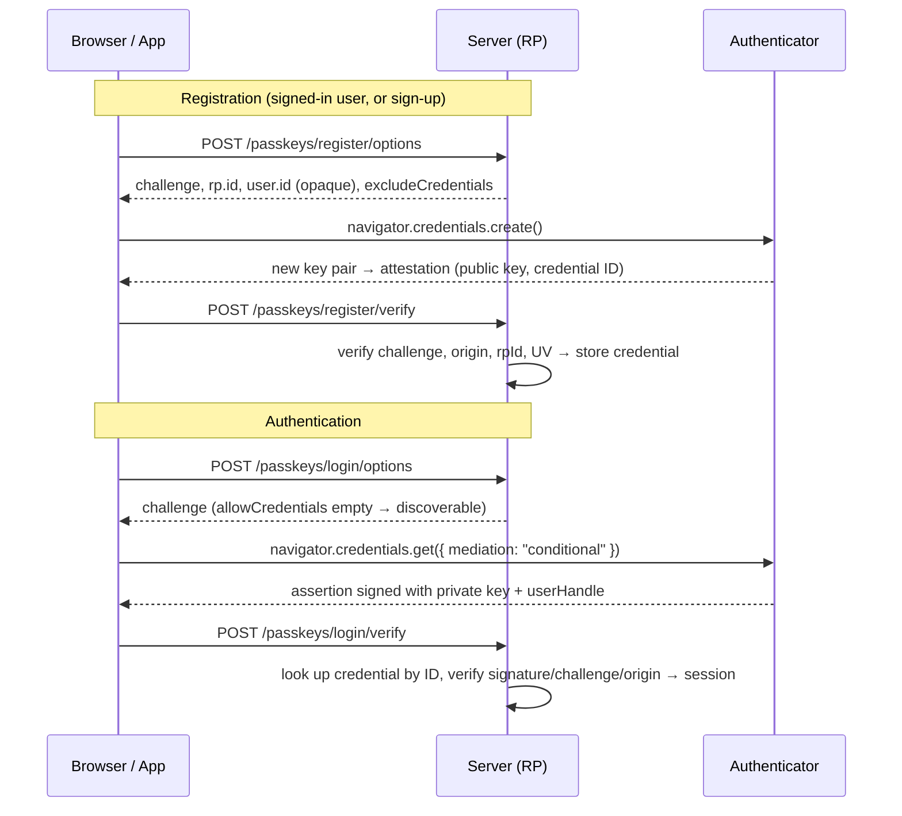

# Authentication & Authorization - Passkeys & WebAuthn

> [!info] Deep dive of [[Authentication & Authorization]]

> [!abstract] TL;DR
> - **What a passkey is**: a WebAuthn/FIDO2 key pair scoped to your **RP ID** (domain). The private key never leaves the authenticator (phone, laptop, security key, password manager), and your server stores only the public key.
> - **Why it's stronger**: logins are **phishing-resistant by construction**. A look-alike domain can't get a valid signature, and there's no shared secret to leak or stuff.
> - **What to build**:
>   - registration and authentication ceremonies with a vetted library (SimpleWebAuthn)
>   - **conditional UI** (passkey in autofill)
>   - a recovery path that isn't weaker than the passkey
>   - for mobile apps: well-known association files
> - **Spec status**: WebAuthn Level 3 became a W3C Recommendation on 2026-08-25.

## Concept

### Vocabulary
| Term | Meaning |
|---|---|
| **RP (Relying Party) / RP ID** | Your app and its registrable domain (`example.my`). Credentials work on that domain and its subdomains, never elsewhere |
| **Authenticator** | Platform (Touch ID, Windows Hello, Android), roaming (YubiKey), or a password manager (1Password, Bitwarden) |
| **Discoverable credential** (resident key) | The authenticator stores the user handle, so login works **without typing a username**. Required for "passkeys" UX |
| **Synced vs device-bound** | Synced via iCloud Keychain / Google Password Manager / 3rd-party managers (`credentialBackedUp = true`), vs hardware-bound keys (AAL3-capable) |
| **User verification (UV)** | Biometric/PIN on the device. `required` makes the passkey itself two-factor (possession + inherence/knowledge) |
| **Attestation** | Proof of authenticator make/model. Use `none` for consumer apps. Enterprise may require it |
| **Signature counter** | Monotonic counter to detect cloned keys. **Synced passkeys usually report 0**, so don't treat 0 as an error |

### Passkeys vs alternatives
| Method | Phishing-resistant | Server stores | UX | Main weakness |
|---|---|---|---|---|
| Password + SMS OTP | ❌ | Hash + phone | Poor | Phishing, SIM swap, OTP relays |
| Password + TOTP | ❌ | Hash + TOTP secret | OK | Real-time phishing proxies (Evilginx) |
| Magic link / email OTP | ❌ (partially) | Email | Good | Email account takeover, link forwarding |
| **Passkey** | **✅** | Public key + metadata | **Best** (1 tap) | Recovery and cross-ecosystem UX |
| Hardware security key | ✅ | Public key | Good for admins | Cost, loss |

## How It Works

- **Origin binding**: the browser puts the actual origin into `clientDataJSON`, and the authenticator signs over it plus the RP ID hash. A phishing domain produces an origin your server rejects, and the authenticator won't even offer credentials for a different RP ID.
- **Challenges** must be random (≥16 bytes), single-use and short-lived (≤5 min). Store them server-side, bound to the session or attempt.
- **Level 3 additions**:
  - `getClientCapabilities()` for feature detection
  - **conditional create** (auto-upgrade password users to passkeys)
  - **Related Origin Requests** (`/.well-known/webauthn` lets `example.com` and `example.my` share credentials)
  - the **PRF** extension (derive encryption keys from a passkey)
  - signal APIs to tell password managers about deleted or renamed credentials

## Practical Usage

### Server (Next.js route handlers + SimpleWebAuthn v13)
```ts
import {
  generateRegistrationOptions, verifyRegistrationResponse,
  generateAuthenticationOptions, verifyAuthenticationResponse,
} from "@simplewebauthn/server";

const rpID = "example.my";
const origin = ["https://example.my", "https://app.example.my"];

export async function registerOptions(user: User) {
  const existing = await db.passkeys.byUser(user.id);
  const options = await generateRegistrationOptions({
    rpName: "Rarticle Shop",
    rpID,
    userName: user.email,
    userID: new TextEncoder().encode(user.webauthnUserId), // random opaque ID, NOT email/PII
    attestationType: "none",
    excludeCredentials: existing.map((c) => ({ id: c.id, transports: c.transports })),
    authenticatorSelection: { residentKey: "required", userVerification: "preferred" },
  });
  await challenges.set(user.id, options.challenge, { ttlSec: 300 });
  return options;
}

export async function registerVerify(user: User, body: RegistrationResponseJSON) {
  const { verified, registrationInfo } = await verifyRegistrationResponse({
    response: body,
    expectedChallenge: await challenges.take(user.id),   // take = get + delete (single use)
    expectedOrigin: origin,
    expectedRPID: rpID,
  });
  if (!verified || !registrationInfo) throw new Error("passkey registration failed");
  const { credential, credentialDeviceType, credentialBackedUp } = registrationInfo;
  await db.passkeys.insert({
    id: credential.id, userId: user.id, publicKey: Buffer.from(credential.publicKey),
    counter: credential.counter, transports: credential.transports,
    deviceType: credentialDeviceType, backedUp: credentialBackedUp, name: guessName(body),
  });
}

export async function loginVerify(attemptId: string, body: AuthenticationResponseJSON) {
  const cred = await db.passkeys.byId(body.id);
  if (!cred) throw new Error("unknown credential");       // generic error to the client
  const { verified, authenticationInfo } = await verifyAuthenticationResponse({
    response: body,
    expectedChallenge: await challenges.take(attemptId),
    expectedOrigin: origin,
    expectedRPID: rpID,
    credential: { id: cred.id, publicKey: cred.publicKey, counter: cred.counter, transports: cred.transports },
  });
  if (!verified) throw new Error("passkey login failed");
  await db.passkeys.touch(cred.id, authenticationInfo.newCounter);
  return createSession(cred.userId, { amr: ["passkey"] });  // rotate session ID, HttpOnly cookie
}
```

### Browser: conditional UI (autofill)
```html
<input type="text" name="username" autocomplete="username webauthn" />
```
```ts
import { startAuthentication, browserSupportsWebAuthnAutofill } from "@simplewebauthn/browser";

if (await browserSupportsWebAuthnAutofill()) {
  const optionsJSON = await fetch("/api/passkeys/login/options", { method: "POST" }).then((r) => r.json());
  const assertion = await startAuthentication({ optionsJSON, useBrowserAutofill: true }); // resolves when user picks a passkey
  await fetch("/api/passkeys/login/verify", { method: "POST", body: JSON.stringify(assertion) });
}
```

### Native apps (Flutter / iOS / Android)
```json
// https://example.my/.well-known/apple-app-site-association  (iOS: Associated Domains → webcredentials:example.my)
{ "webcredentials": { "apps": ["ABCDE12345.my.rarticle.shop"] } }
```
```json
// https://example.my/.well-known/assetlinks.json  (Android Credential Manager)
[{ "relation": ["delegate_permission/common.handle_all_urls", "delegate_permission/common.get_login_creds"],
   "target": { "namespace": "android_app", "package_name": "my.rarticle.shop",
               "sha256_cert_fingerprints": ["AB:CD:...:EF"] } }]
```
- Android native assertions report the origin as `android:apk-key-hash:<base64url-sha256>`. Add it to `expectedOrigin`.
- In [[Flutter]], use a passkeys plugin that wraps Credential Manager (Android) and ASAuthorization (iOS). The server side stays identical.

## Patterns & Anti-patterns
| Pattern | When | Anti-pattern to avoid |
|---|---|---|
| Discoverable credentials + conditional UI | Consumer login | Username-first page followed by a modal passkey prompt every time |
| Offer passkey creation right after a successful password/OTP login | Migration from passwords | Forcing passkeys at sign-up with no fallback (drop-off) |
| Multiple passkeys per user + a management page (name, last used, revoke) | Always | One credential per account (phone loss = lockout) |
| Recovery: second passkey, verified email + delay + re-verification, or support with ID checks | Account recovery | SMS OTP recovery that bypasses the passkey (attackers take the weakest path) |
| Opaque random `userID` | Registration | Email or phone as user handle (leaks PII to authenticators/password managers) |
| Server-stored single-use challenges | Every ceremony | Challenge in a client-readable cookie or reused across attempts |
| Require passkey/security key for admin and Coolify/Supabase dashboard accounts | Privileged users | Admins on password + SMS |

## Performance & Trade-offs
- **Synced passkeys** solve device loss but put trust in the sync provider account (Apple/Google). That's fine for AAL2 consumer and SME apps. Use device-bound keys for AAL3/privileged access (NIST SP 800-63-4).
- **Cross-ecosystem gaps**: a passkey saved in iCloud on an iPhone isn't on a Windows PC. Hybrid transport (QR + Bluetooth) works but is clunky, and third-party managers smooth it.
- **`userVerification: "required"`** gives strong assurance but fails on authenticators without biometrics/PIN. `preferred` plus checking `uv` for sensitive actions is the pragmatic choice.
- **Step-up**: use a fresh WebAuthn assertion (`authenticationInfo.userVerified`) to authorise high-risk actions (payouts, changing email) instead of a separate OTP.
- **Cost**: zero per-auth cost, versus SMS OTP at RM 0.05–0.20 per message for Malaysian numbers.

## Tips & Reminders
> [!tip]
> - Pick the RP ID carefully: `example.my` covers `app.example.my` and `admin.example.my`. Changing the domain later invalidates all passkeys, so use Related Origin Requests for multi-domain brands.
> - Store `transports` and pass them back in `allowCredentials` and `excludeCredentials`. This improves prompts, especially for security keys and hybrid.
> - Log the `amr` (authentication methods) in sessions and audit logs, e.g. `["passkey"]` vs `["pwd","otp"]`.
> - Test in Chrome DevTools → WebAuthn panel (virtual authenticators), Safari, Android, and a YubiKey.
> - **In ZP's stack**:
>   - **Client apps**: Next.js + SimpleWebAuthn, with credential tables in [[Supabase]] Postgres (RLS: users read their own rows only), then issue your session or Supabase-compatible JWT after verification ([[JWT]]).
>   - **Mobile**: Flutter apps share the same RP ID through the association files.
>   - **Your own access**: passkeys or hardware keys for Coolify, Cloudflare, GitHub and Hostinger.

## Version Notes
| Version / milestone | Change |
|---|---|
| WebAuthn Level 1 (2019) | W3C Recommendation, FIDO2 |
| Level 2 (2021) | Large blobs, cross-origin iframes, more extensions |
| 2022–2023 | Apple/Google/Microsoft synced passkeys, conditional UI shipping |
| Level 3 (CR 2026-05-26 → **Rec 2026-08-25**) | `getClientCapabilities()`, conditional create, Related Origin Requests, PRF, signal APIs, JSON serialisation helpers (`toJSON`, `parseCreationOptionsFromJSON`) |
| Level 4 | In progress (FIDO Alliance) |
| SimpleWebAuthn v13 | Current major. 13.3.x latest seen. `credential` object shape in verify APIs (v10+ renamed fields), `{ optionsJSON }` param in browser helpers (v11+) |

> [!warning] Unverified — check before relying on this
> Built-in passkey support in Supabase Auth and other BaaS providers wasn't verified. Check the current Supabase Auth docs before building a custom flow, and pin the SimpleWebAuthn major version (fields were renamed between majors).

## Critical Issues & Gotchas
> [!danger] Recovery is the real attack surface
> Passkeys stop phishing of the login, so attackers move to **account recovery** and **session theft**: SIM swap → SMS reset, a social-engineered support desk, or stolen cookies via infostealer malware.
> - Make recovery at least as strong as login: a second passkey, a waiting period with notifications to all channels, and re-binding only after re-verification.
> - Bind sessions to the device where possible, use short idle timeouts for admin sessions, and re-auth for sensitive actions ([[Network Security - Common Web Attacks]]).

> [!danger] Verifying the wrong things
> Hand-rolled WebAuthn verification commonly skips one of these checks:
> - the challenge match (allows replay)
> - the origin and RP ID hash (re-opens phishing)
> - the UV/UP flags
> - binding the credential ID to the user
>
> Use a maintained library, keep it updated, and never accept an assertion whose credential belongs to a different user than the one being stepped up.

> [!warning] Gotchas
> - A signature counter of 0 on every login is normal for synced passkeys. Only flag a *decrease* on authenticators that use counters.
> - `excludeCredentials` missing → the same authenticator registers twice, and users see duplicate passkeys.
> - Deleting a passkey server-side doesn't remove it from the user's password manager. Use the Level 3 signal APIs (`PublicKeyCredential.signalUnknownCredential`) where supported.
> - Running on `localhost` works (secure context), but the RP ID must be `localhost`. A LAN IP or a custom hostname without HTTPS fails.
> - iframes need `allow="publickey-credentials-get *"`, and cross-origin creation has extra restrictions.

## Related
- [[Authentication & Authorization]]
- [[OAuth 2.0 & OIDC]] — passkeys at the IdP, then federated SSO
- [[JWT]] — issuing sessions/tokens after verification
- [[Supabase]] — storing credentials, RLS, Auth integration
- [[Flutter]] — native passkeys via Credential Manager / ASAuthorization
- [[Network Security - Common Web Attacks]] — phishing, session hijacking

## References
- WebAuthn Level 3 (W3C Recommendation): https://www.w3.org/TR/webauthn-3/
- FIDO Alliance on Level 3: https://fidoalliance.org/webauthn-level-3-is-now-a-w3c-recommendation/
- passkeys.dev (developer guide): https://passkeys.dev/
- SimpleWebAuthn docs: https://simplewebauthn.dev/docs/
- NIST SP 800-63B-4 (syncable authenticators): https://pages.nist.gov/800-63-4/sp800-63b.html
- Android Credential Manager passkeys: https://developer.android.com/identity/sign-in/credential-manager
