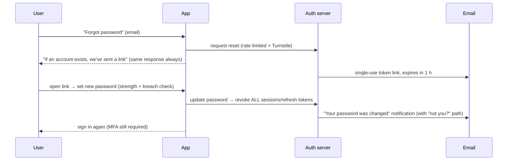

# Authentication & Authorization - Session Management & Account Recovery

> [!info] Deep dive of [[Authentication & Authorization]]

> [!abstract] TL;DR
> Login is the easy part. Most account takeovers happen through **sessions** and **recovery**.
> - **Sessions**: short-lived access tokens + **rotating refresh tokens** with reuse detection, HttpOnly/Secure/SameSite cookies on the web, **idle and absolute timeouts** by risk level, **sign out everywhere**, and **revocation on password/MFA change**.
> - **Recovery**: single-use, short-lived (≤ 1 h) reset links, **no account enumeration**, rate limits + CAPTCHA, notify the user on every change, invalidate sessions after reset, and **MFA recovery codes**.
> - **SMS/WhatsApp OTP recovery** is vulnerable to SIM swap and recycled numbers. Don't let a phone number alone reset an admin account.
>
> Recovery is only as strong as its weakest path: a passkey-protected account with an email-only reset is an email-protected account.

## Concept
**Session timeouts by risk** (NIST 800-63B-inspired, adapt per app):

| App type | Idle timeout | Absolute (re-auth) | Notes |
|---|---|---|---|
| Customer app (ordering, loyalty) | 30 days | 90 days | Convenience. Step-up for payments/profile changes |
| Staff back office | 30–60 min | 12 h | Shared devices in shops/clinics |
| Admin / finance / PII export | 15 min | 8–12 h + MFA | Step-up re-auth for sensitive actions |
| Mobile app with biometrics | Long refresh | Re-auth on device change | Bind refresh to device/secure storage |

**Session controls**:

| Control | Purpose | Implementation |
|---|---|---|
| Short access token (5–60 min) | Limit stolen-token window | JWT `exp` |
| Refresh token rotation + reuse detection | Detect token theft | New refresh token per use. Reuse → revoke family |
| HttpOnly + Secure + SameSite cookies | Block XSS theft and CSRF | `@supabase/ssr` cookies, `SameSite=Lax` |
| Session regeneration on login/privilege change | Prevent fixation | New session ID/tokens |
| Device/session list + sign out everywhere | User control, incident response | `signOut({ scope: 'global' })` |
| Revoke on password/MFA/email change | Kick attackers out | Global sign-out on change |
| Step-up auth | Sensitive actions | Re-enter password/passkey, AAL2 required |

**Recovery methods ranked** (strongest → weakest):

| Method | Strength | Risk |
|---|---|---|
| Second registered passkey / security key | High | Users rarely register two |
| MFA recovery codes (one-time) | High if stored safely | Lost codes → support escalation |
| Email magic link to verified address | Medium | Email account compromise |
| SMS / WhatsApp OTP | Low–medium | SIM swap, number recycling, OTP phishing |
| Support/manual identity check | Varies | Social engineering of staff |

## How It Works


## Practical Usage
**Supabase: sign out everywhere and after sensitive changes**:
```ts
await supabase.auth.updateUser({ password: newPassword });
await supabase.auth.signOut({ scope: "others" });    // keep current session, revoke other devices
// "Sign out of all devices" button:
await supabase.auth.signOut({ scope: "global" });
```
**Reset request with no enumeration** (Server Action):
```ts
"use server";
export async function requestReset(form: FormData) {
  const email = z.string().email().parse(form.get("email"));
  await verifyTurnstile(form.get("cf-turnstile-response"));
  await rateLimit(`reset:${email}`, { max: 3, windowSec: 3600 });
  await supabase.auth.resetPasswordForEmail(email, { redirectTo: `${APP_URL}/auth/update-password` });
  return { message: "If an account exists for this email, a reset link has been sent." };   // identical for all cases
}
```
**Step-up for sensitive actions** (require recent auth + MFA):
```ts
const { data: { session } } = await supabase.auth.getSession();
const claims = (await supabase.auth.getClaims()).data?.claims;
const recent = claims && Date.now() / 1000 - (claims.iat ?? 0) < 10 * 60;
if (claims?.aal !== "aal2" || !recent) redirect("/auth/reauthenticate?next=/admin/export");
```
**Recovery codes** (store hashed, single use):
```sql
create table auth_recovery_codes (
  user_id uuid references auth.users on delete cascade,
  code_hash text not null,                 -- argon2id/bcrypt of the code
  used_at timestamptz,
  primary key (user_id, code_hash)
);
-- generate 10 random codes, show once, store hashes; on use: verify hash, set used_at, alert user
```
**Session settings to review** (Supabase dashboard → Auth → Sessions):
```text
Access token (JWT) expiry: 3600 s (shorter for admin apps)
Refresh token rotation: enabled, reuse interval: 10 s
Time-box user sessions: e.g. 12 h for staff projects
Inactivity timeout: e.g. 1 h for back office
Single session per user: on for admin-only apps
```
**Wrong way**:
```text
❌ "No account found for this email"                → account enumeration for credential stuffing
❌ Reset link valid for 7 days, reusable            → leaked email = takeover weeks later
❌ Password change without revoking sessions        → attacker's session stays alive
❌ Phone OTP alone resets an admin account          → SIM-swap takeover of the whole tenant
❌ Tokens in localStorage on the web                → any XSS exfiltrates sessions
```

## Patterns & Anti-patterns
| Pattern | When | Anti-pattern to avoid |
|---|---|---|
| Uniform responses + rate limits on login/reset | Always | Different messages per case |
| Notify on password, email, MFA, new-device login | Always | Silent security changes |
| Step-up auth for exports, payouts, role changes | Admin/finance | One login unlocks everything forever |
| Multiple recovery factors encouraged (2 passkeys, codes) | Passkey/MFA rollouts | Single factor with weak fallback |
| Delay + confirm for email change (old address notified) | Profile changes | Instant email swap |
| Support recovery runbook with verification steps | Staff-assisted recovery | Ad-hoc "verify by name and DOB" |
| Session list UI with device/location | Apps with sensitive data | No way to see or kill sessions |

## Performance & Trade-offs
- **Shorter access tokens** mean more refresh calls (cheap) and faster revocation effect. Stateless JWTs can't be revoked before expiry without a denylist, so keep `exp` short for high-risk apps ([[JWT - Refresh Tokens, Revocation & Storage]]).
- **Strict timeouts** frustrate staff on shared tablets. Combine short idle timeouts with fast re-auth (passkeys, PIN on managed devices).
- **SMS/WhatsApp OTP** costs money per message and invites OTP pumping. Use rate limits, Turnstile and country restrictions ([[Cloudflare - Turnstile & Bot Protection for Forms]]).
- **Support-assisted recovery** is the most expensive and riskiest path. Reduce its volume with good self-service options.

## Tips & Reminders
> [!tip] In ZP's stack
> - **Client admin accounts** (owners of SME tenants) are high-value: require MFA or passkeys, short sessions, and step-up for exports and staff management ([[Authentication & Authorization - Passkeys & WebAuthn]]).
> - **Malaysian phone numbers** are recycled after inactivity, and SIM swap fraud is reported. Treat phone OTP as a convenience login for customers, not as admin recovery.
> - **Handover/SOW**: document the recovery process (who can reset a tenant owner, and with what proof). Staff-assisted resets without a process are a liability.

- Breached-password checks (k-anonymity HIBP API) on signup and reset.
- Log auth events (login, failed login, reset requested/completed, MFA changes) to an audit table ([[PostgreSQL - Audit Logging & Change History]]).
- Expire invitation links like reset links: single use, short life.
- Test the full recovery flow for each role before launch.

## Version Notes
| Date | Change relevant here |
|---|---|
| 2017 | NIST 800-63B: no forced periodic password changes, breach checks, rate limiting |
| 2024–25 | NIST SP 800-63B revision 4 (final 2025): stronger phishing-resistant guidance, passkeys (syncable authenticators) |
| 2024–25 | Supabase Auth: session time-box, inactivity timeout, single-session option (paid plans), `signOut` scopes |
| 2025–26 | Supabase JWT signing keys, `getClaims()` for local verification ([[Supabase - Auth Flows, MFA & Custom Claims]]) |

> [!warning] Unverified — check before relying on this
> NIST 800-63B rev. 4 publication date and exact timeout numbers, and which Supabase session controls require paid plans, weren't verified this run. Check https://pages.nist.gov/800-63-4/ and Supabase Auth session docs.

## Critical Issues & Gotchas
> [!danger] Recovery bypasses strong authentication
> Teams roll out passkeys/MFA, then leave "reset via email" or "reset via SMS" unprotected by any second factor. Attackers target the recovery path (compromised email, SIM swap, phished OTP) and take over accounts despite MFA. Require a second factor or recovery code during recovery for privileged accounts, add delays and notifications, and lock admin recovery behind a documented manual process.

> [!danger] Sessions survive the incident
> After a credential leak, changing the password doesn't help if existing sessions and refresh tokens stay valid. The attacker keeps access for weeks. Revoke all sessions on password, email and MFA changes, provide "sign out everywhere", and have an admin-side "revoke user sessions" control for incident response.

- **Session fixation**: always issue new tokens after login and privilege elevation.
- **Magic links in shared inboxes** (company `info@` addresses) give access to anyone reading that mailbox.
- **Email change** without confirming the old address enables silent takeover. Notify and confirm both.
- **Remember-me** on shared shop/clinic devices: offer "this is a shared device" with short sessions.

## Related
- [[Authentication & Authorization]]
- [[JWT - Refresh Tokens, Revocation & Storage]] — token lifetimes and revocation
- [[Supabase - Auth Flows, MFA & Custom Claims]] — Supabase implementation
- [[Authentication & Authorization - Passkeys & WebAuthn]] — phishing-resistant factors and recovery
- [[OAuth 2.0 & OIDC - Attacks & Hardening]] — social login session risks
- [[OWASP Top 10 - Web Application Top 10 2025 in Practice]] — A07 Authentication Failures

## References
- https://cheatsheetseries.owasp.org/cheatsheets/Session_Management_Cheat_Sheet.html
- https://cheatsheetseries.owasp.org/cheatsheets/Forgot_Password_Cheat_Sheet.html
- https://pages.nist.gov/800-63-4/sp800-63b.html
- https://supabase.com/docs/guides/auth/sessions
- https://haveibeenpwned.com/API/v3#PwnedPasswords
