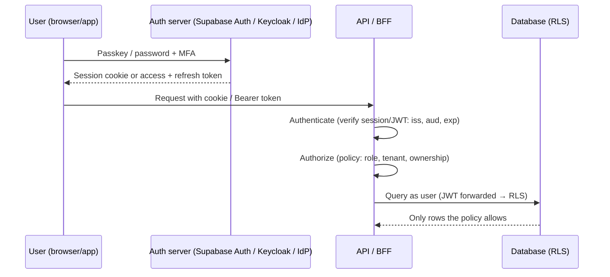

# Authentication & Authorization

> [!abstract] TL;DR
> - **Authentication (AuthN)**: *who are you?* Passwords, passkeys/WebAuthn, OTP, SSO via [[OAuth 2.0 & OIDC]]/SAML.
> - **Authorization (AuthZ)**: *what may you do?* RBAC, ABAC, ReBAC, enforced server-side on every request (in ZP's stack, ideally in the database via [[Supabase]] RLS).
> - **2026 baseline**:
>   - **Passkeys first**, phishing-resistant MFA for admins.
>   - Long passwords checked against breach lists with no forced rotation (NIST SP 800-63-4).
>   - HttpOnly session cookies or short-lived [[JWT]] access tokens + rotated refresh tokens.
>   - **Deny-by-default authorization**.
> - **Broken access control is #1** in the OWASP Top 10 (2021 and 2025). Most real breaches are IDOR/tenant leaks and stolen sessions, not crypto failures.

## Introduction
- **Evolution**:
  - Passwords + server sessions (1990s).
  - SSO (SAML 2005, [[OAuth 2.0 & OIDC]] 2012–14).
  - Token-based APIs ([[JWT]]).
  - MFA everywhere (TOTP, push).
  - **Phishing-resistant FIDO2/WebAuthn passkeys** (synced passkeys mainstream since 2022–23).
  - Fine-grained authorization services inspired by Google **Zanzibar** (OpenFGA, SpiceDB) and policy languages (OPA/Rego, AWS **Cedar**).
- **Where it sits**: at every trust boundary (web/mobile client ↔ API ↔ database ↔ third-party services), plus admin surfaces (Coolify, n8n, DB consoles) and machine identities (API keys, service tokens, webhooks).

## Core Concepts

### Authentication factors and methods
| Method | Phishing-resistant | Notes |
|---|---|---|
| Password | No | Hash with **Argon2id** (or bcrypt cost ≥ 12). Check against breach corpora (HIBP k-anonymity API) |
| SMS / email OTP | No | SIM-swap and phishing-prone. Fine as a recovery or low-risk factor |
| TOTP (authenticator app) | No | Real-time phishing proxies (Evilginx) relay codes |
| Push approval | No | MFA-fatigue attacks. Use number matching |
| **Passkeys / WebAuthn (FIDO2)** | **Yes** | Origin-bound public-key credentials. Synced (iCloud/Google/1Password) or device-bound (security keys) |
| Magic links | Partly | Email account becomes the root of trust |
| SSO (OIDC/SAML) | Depends on IdP | Centralizes policy, MFA and offboarding |

### NIST SP 800-63-4 (final July 2025): password and authenticator rules
- Minimum **15 characters** for single-factor passwords (8 when used as part of MFA), allow up to 64+, and allow all characters including spaces/Unicode.
- **No composition rules, no periodic rotation**. Force a change only on evidence of compromise.
- Screen against breached/common password blocklists. No security questions or password hints.
- **Syncable passkeys** recognized for AAL2 when the sync fabric is properly secured. AAL3 needs hardware-bound, phishing-resistant authenticators.

### Sessions vs tokens
| Approach | How | Strengths | Risks |
|---|---|---|---|
| Server session + cookie | Opaque session ID in `HttpOnly; Secure; SameSite=Lax` cookie, state in DB/[[Redis]] | Instant revocation, small cookie | CSRF (mitigated by SameSite + tokens), server state |
| JWT access + refresh | Short-lived (5–15 min) signed access token + rotating refresh token | Stateless verification across services | Revocation lag, token theft, alg confusion (see [[JWT]]) |
| BFF pattern | Browser holds only a session cookie. Backend holds OAuth tokens | Tokens never reach JS | Extra backend hop |

### Authorization models
| Model | Decision based on | Example | Tools |
|---|---|---|---|
| **RBAC** | User's roles → permissions | `admin`, `cashier`, `viewer` per tenant | App tables, Supabase custom claims |
| **ABAC** | Attributes of user, resource, environment | "Managers may approve refunds < RM 5,000 in their branch during business hours" | OPA/Rego, Cedar, RLS policies |
| **ReBAC** | Relationships graph | "Editors of a folder can edit its documents" | OpenFGA, SpiceDB (Zanzibar) |
| ACL | Per-resource lists | File sharing | DB tables |
| Row-level security | Policies evaluated by the DB per row | `tenant_id = auth.jwt()->>'tenant_id'` | PostgreSQL / [[Supabase]] RLS |

```sql
-- Supabase/PostgreSQL: tenant isolation + role check enforced in the database
alter table orders enable row level security;
create policy "tenant members read orders" on orders for select
  using (tenant_id = (auth.jwt() -> 'app_metadata' ->> 'tenant_id')::uuid);
create policy "managers update orders" on orders for update
  using (tenant_id = (auth.jwt() -> 'app_metadata' ->> 'tenant_id')::uuid
         and (auth.jwt() -> 'app_metadata' ->> 'role') in ('owner','manager'));
```

## Architecture / How It Works

- **WebAuthn**: the server sends a challenge, the authenticator signs it with a private key scoped to the **RP ID (domain)**, and the server verifies with the stored public key. Phishing sites on other domains can't get valid signatures.
- **Defense in depth for authZ**: route guards (UX) → API checks (mandatory) → database RLS (last line). UI hiding is never authorization.
- **Session lifecycle**: login → rotate the session ID (prevents fixation) → idle and absolute timeouts → re-auth for sensitive actions (step-up) → logout/revocation everywhere → audit log.

## Project Structure
```text
auth/
├── policies/               # RLS SQL migrations or OPA/Cedar policies in Git, reviewed like code
├── src/auth/
│   ├── session.ts          # cookie settings, rotation, timeouts
│   ├── passkeys.ts         # WebAuthn registration/authentication (SimpleWebAuthn)
│   ├── guards.ts           # requireUser(), requireRole('manager'), requireTenant()
│   └── audit.ts            # login, MFA, role changes, sensitive actions
└── tests/authz/            # tests per role × resource × tenant matrix (incl. negative cases)
```
```ts
// API guard: authenticate, then authorize against the resource, deny by default
export async function updateOrder(req: Request, id: string, patch: OrderPatch) {
  const user = await requireUser(req);                         // 401 if missing/invalid
  const order = await db.orders.find(id);
  if (!order || order.tenantId !== user.tenantId) throw notFound();   // 404, not 403: don't leak existence
  if (!['owner', 'manager'].includes(user.role)) throw forbidden();   // 403
  return db.orders.update(id, patch);
}
```

## Use Cases
| Use case | Approach |
|---|---|
| SME SaaS (multi-tenant) | Supabase Auth + RLS by `tenant_id`, RBAC roles in `app_metadata` |
| Internal admin tools (Coolify, n8n, DB UIs) | SSO + Cloudflare Access / Tailscale, phishing-resistant MFA |
| B2B enterprise clients | OIDC/SAML SSO, SCIM provisioning, audit logs |
| Mobile apps | OIDC + PKCE, refresh tokens in secure storage, biometric unlock of the local key |
| Fine-grained sharing (documents, projects) | ReBAC (OpenFGA/SpiceDB) |
| Machine-to-machine / webhooks | Scoped API keys (hashed at rest), OAuth client credentials, HMAC-signed webhooks |

## Pros & Cons
| Approach | Pros | Cons |
|---|---|---|
| Managed auth (Supabase Auth, Clerk, Auth0/Okta, Cognito) | Fast, secure defaults, MFA/passkeys built in | Vendor lock-in, per-MAU pricing, outages |
| Self-hosted IdP (Keycloak, Authentik, Zitadel) | Control, SSO for many apps, no per-user fees | Ops burden, patching |
| Library in-app (Better Auth/Auth.js, Lucia-style) | Full control, no vendor | You own security bugs and maintenance |
| RLS-based authZ | Enforced at the data layer, can't be bypassed by a forgotten API check | Policy complexity, performance tuning |
| Central policy engine (OPA/Cedar/OpenFGA) | Consistent decisions across services, auditable | Extra service, latency, learning curve |

## Alternatives & Peers
| Option | Strength | Weakness | Pick it when… |
|---|---|---|---|
| [[Supabase]] Auth | Integrated with Postgres RLS, passkeys/MFA, cheap | Tied to Supabase | ZP's default for client apps |
| Clerk / Auth0 / WorkOS | Polished UX, enterprise SSO/SCIM | Cost per MAU/SSO connection | B2B SaaS needing enterprise SSO fast |
| Keycloak / Authentik / Zitadel | Self-hosted OIDC/SAML IdP | Operations | Many internal apps, data residency |
| Better Auth (absorbed Auth.js in 2025) | TS library, plugins (passkeys, orgs) | Self-managed | Next.js apps not on Supabase |
| OpenFGA / SpiceDB / Cedar | Fine-grained authZ at scale | Another system | Complex sharing models |

## Tips & Reminders
> [!tip]
> - Offer **passkeys** at signup and login. Keep passwords as fallback with breach checking. Require phishing-resistant MFA for admins and anyone touching money or PII.
> - Rate-limit and lock out progressively on login, OTP and password reset. Use generic error messages ("invalid email or password").
> - Password reset: single-use, short-lived (≤ 15–30 min) tokens. Invalidate other sessions after reset or MFA change.
> - Cookies: `HttpOnly; Secure; SameSite=Lax` (or `Strict` for admin), `__Host-` prefix, no tokens in `localStorage`.
> - Write **authorization tests**: each role × each endpoint × other tenant's IDs. Most leaks are missing negative tests.
> - **In ZP's stack**:
>   - [[Supabase]] Auth (email + passkey/OAuth) with RLS on every table. Role and tenant go in `app_metadata`, which users can't edit (never `user_metadata`).
>   - The service-role key stays server-side only ([[n8n]], Edge Functions).
>   - Admin tools sit behind [[Cloudflare]] Access.
>   - Document an auth/access SOP per client (who has admin, how offboarding works). PDPA requires appropriate security safeguards.

## Versions & Breaking Changes
| Standard / change | Released | Key changes | Migration notes |
|---|---|---|---|
| SAML 2.0 | 2005 | XML SSO | Still common in enterprises |
| OAuth 2.0 / OIDC | 2012 / 2014 | Delegated authZ / identity layer | See [[OAuth 2.0 & OIDC]] |
| WebAuthn L1 / L2 / L3 | 2019 / 2021 / 2025 | FIDO2 web API. L3 adds hybrid/cross-device, related origins, JSON helpers | Use libraries (SimpleWebAuthn) |
| Synced passkeys (Apple, Google, Microsoft) | 2022–2023 | Passkeys sync across devices | Mainstream UX |
| NIST SP 800-63B-3 | 2017 | No forced rotation, breach screening | — |
| **NIST SP 800-63-4** | 2025-07 | Syncable passkeys at AAL2, 15-char single-factor passwords, phishing-resistance emphasis, digital identity risk management | Update password policies and MFA tiers |
| OWASP Top 10 2025 | 2025-11 | A01 Broken Access Control (now incl. SSRF), A07 Authentication Failures | See [[OWASP Top 10]] |

> [!warning] Unverified — check before relying on this
> NIST 800-63-4 details (e.g. exact password lengths, syncable passkey conditions) came from secondary summaries. Check https://pages.nist.gov/800-63-4/.

## Critical Issues & Gotchas
> [!danger] Session/token theft bypasses MFA
> Infostealer malware and adversary-in-the-middle phishing kits (Evilginx) steal **session cookies** after MFA succeeds.
> - **Okta support breach (2023-10)**: HAR files with session tokens were stolen.
> - **Snowflake customer breaches (2024)**: accounts without MFA, with infostealer-harvested credentials, led to mass data theft (Ticketmaster, AT&T, Santander).
> - **MGM/Caesars (2023)**: help-desk social engineering reset MFA.
>
> Mitigation: passkeys, short session lifetimes for admin roles, device/IP binding signals, help-desk identity verification SOPs, and revoking all sessions on suspicious activity.

> [!danger] Broken object-level authorization (IDOR) and tenant leaks
> APIs that trust IDs from the client (`/orders/123`, `node(id:)`) without checking ownership/tenant are the most common critical web vulnerability (OWASP A01 / API1). Enforce checks server-side and in RLS. Return 404 for other tenants' resources. Never rely on unguessable IDs as authorization.

> [!warning] Gotchas
> - Mass assignment: accepting `role`/`tenant_id`/`is_admin` from request bodies. Whitelist updatable fields.
> - Supabase: `user_metadata` is user-editable, so authorization claims must come from `app_metadata` or tables. Tables without RLS are public via the anon key.
> - OAuth "Sign in with X": match accounts by verified email only (`email_verified`), and beware account takeover via unverified emails.
> - Logout must revoke refresh tokens/sessions server-side, not just delete client storage.
> - Timing attacks on token/secret comparison: use constant-time compares.
> - Malaysia: Bank Negara's RMiT pushed banks off SMS OTP towards app-based/phishing-resistant authentication (2023+). Fintech/e-wallet clients face similar expectations.

## Deep Dives
- [[Authentication & Authorization - Interview Questions]] — finance-app auth interview answer (reference)
Candidates: passkeys/WebAuthn implementation, multi-tenant authorization with RLS.
- [[Authentication & Authorization - Passkeys & WebAuthn]]

## Related
- [[OAuth 2.0 & OIDC]] — delegated authorization and SSO
- [[JWT]] — token format and verification
- [[Supabase]] — Auth + Row Level Security in ZP's stack
- [[OWASP Top 10]] — A01 Broken Access Control, A07 Authentication Failures
- [[Network Security]] — zero-trust access to admin tools
- [[Web3 Wallets]] — key-based login (SIWE) contrast

## References
- NIST SP 800-63-4: https://pages.nist.gov/800-63-4/
- OWASP Authentication Cheat Sheet: https://cheatsheetseries.owasp.org/cheatsheets/Authentication_Cheat_Sheet.html
- OWASP Authorization Cheat Sheet: https://cheatsheetseries.owasp.org/cheatsheets/Authorization_Cheat_Sheet.html
- WebAuthn / passkeys: https://passkeys.dev/
- Supabase RLS: https://supabase.com/docs/guides/database/postgres/row-level-security
- NIST 800-63-4 password changes summary: https://www.intercede.com/from-draft-to-final-whats-new-in-nists-latest-password-guidance/
- Synced vs device-bound passkeys: https://authsignal.com/blog/articles/synced-vs-device-bound-passkeys-convenience-and-authentication-experiences
