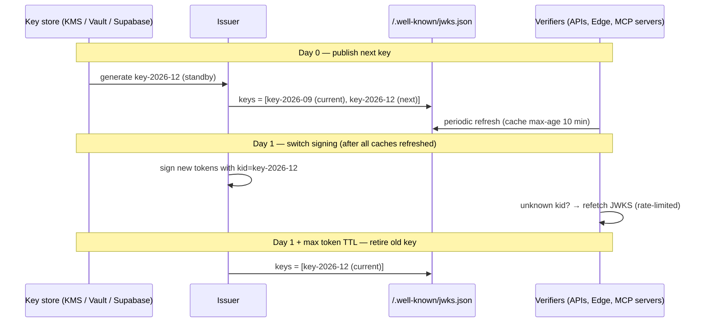

# JWT - Signing Algorithms, Keys & Rotation

> [!info] Deep dive of [[JWT]]

> [!abstract] TL;DR
> - **Algorithm**: sign with **ES256** (or Ed25519) using a private key that **only the issuer holds**, and publish public keys via **JWKS** with a `kid` per key.
> - **Verifiers**: pin the algorithm, cache the JWKS, and refetch on an unknown `kid`.
> - **Rotation** has four phases: **publish next key → wait for caches → switch signing → retire old key after max token lifetime**.
> - **HS256**: a shared secret copied into every service is a key-management liability. Supabase projects should migrate to **asymmetric signing keys**.

## Concept

### Algorithm choice
| `alg` | Sig size | Sign / verify speed | Key distribution | Pick it when… |
|---|---|---|---|---|
| `HS256` | 32 B | Fastest | **Same secret** for signing and verifying | Issuer and the one verifier are the same service, and the secret never leaves it |
| `RS256` | 256 B (2048-bit) | Slow sign, fast verify | Public key via JWKS | Legacy/enterprise compatibility (older Java/.NET, SAML-era IdPs) |
| `PS256` | 256 B | Like RS256 | JWKS | RSA required, but you want modern padding |
| **`ES256`** | 64 B | Fast sign, fast verify | JWKS | **Default**: small tokens, universal library support, Supabase/Apple/Google use it |
| `Ed25519` (`EdDSA`) | 64 B | Fastest asymmetric, deterministic | JWKS | Your whole verifier fleet supports it (check older libs, AWS/GCP KMS support) |

- **The key point is the trust boundary, not the cipher**: with HS256 every verifier can **mint** tokens, while with asymmetric keys a compromised verifier can't.
- **Post-quantum**: ML-DSA in JOSE/COSE is in IETF drafts, so plan for algorithm agility (`kid` + JWKS) rather than rewriting later.

### Key lifecycle states
| State | In JWKS? | Used to sign? | Duration |
|---|---|---|---|
| **Next / standby** | ✅ | ❌ | ≥ max JWKS cache TTL across all verifiers |
| **Current** | ✅ | ✅ | Rotation interval (e.g. 90 days) |
| **Previous** | ✅ | ❌ | ≥ max access-token lifetime (+ leeway) |
| **Retired / revoked** | ❌ | ❌ | Keep private key destroyed. Keep public metadata for audit |

## How It Works

- **Verifier rule**: select a key by `kid` **only from the trusted JWKS**. Accept only `alg` values from the allow-list, and ensure `kty`/`crv` match that algorithm.
- **Unknown `kid`**: refetch once (with a cooldown, e.g. 30 s), then reject. Never fall back to "try every key" or to keys from token headers.
- **`kid` format**: opaque and stable, e.g. a date label (`2026-12-a`) or the RFC 7638 JWK thumbprint. Never a file path or DB key used unsafely ([[JWT]] Critical Issues: `kid` injection).

## Practical Usage

### Generate and publish keys (Node `jose`)
```ts
import { generateKeyPair, exportJWK, calculateJwkThumbprint, SignJWT } from "jose";

const { publicKey, privateKey } = await generateKeyPair("ES256", { extractable: true });
const pub = await exportJWK(publicKey);
const kid = await calculateJwkThumbprint(pub);              // RFC 7638 thumbprint as kid
// Store privateKey in KMS/Vault/Coolify secret (PKCS8 PEM); publish only { ...pub, kid, alg: "ES256", use: "sig" }

export async function issueAccessToken(sub: string, tenant: string) {
  return new SignJWT({ tenant_id: tenant, scope: "orders:read" })
    .setProtectedHeader({ alg: "ES256", kid: CURRENT_KID, typ: "at+jwt" })
    .setIssuer("https://auth.example.my").setAudience("https://api.example.my")
    .setSubject(sub).setIssuedAt().setExpirationTime("10m").setJti(crypto.randomUUID())
    .sign(CURRENT_PRIVATE_KEY);
}
```
```ts
// JWKS endpoint: publish current + next + previous; allow caching but not forever
app.get("/.well-known/jwks.json", (_req, res) => {
  res.set("Cache-Control", "public, max-age=600, stale-while-revalidate=60");
  res.json({ keys: [NEXT_JWK, CURRENT_JWK, PREVIOUS_JWK].filter(Boolean) });
});
```

### Verify (pinned, cached, rotation-aware)
```ts
import { createRemoteJWKSet, jwtVerify } from "jose";

const JWKS = createRemoteJWKSet(new URL("https://auth.example.my/.well-known/jwks.json"), {
  cacheMaxAge: 10 * 60_000,     // refresh known keys every 10 min
  cooldownDuration: 30_000,     // min gap between refetches on unknown kid
});

export const verify = (token: string) =>
  jwtVerify(token, JWKS, {
    algorithms: ["ES256"], issuer: "https://auth.example.my",
    audience: "https://api.example.my", typ: "at+jwt", clockTolerance: 30,
  });
```

### Rotation runbook (scheduled, every 90 days)
1. Generate `next` key in the key store. Add it to JWKS **without** signing with it.
2. Wait ≥ the largest JWKS cache TTL among verifiers (CDN, `cacheMaxAge`, mobile apps). That's typically 1 h, or 24 h to be safe.
3. Switch the issuer's `CURRENT_KID` to `next`. Monitor 401 rates and "unknown kid" logs.
4. After the max access-token lifetime (+ refresh-token re-issue window if refresh tokens are JWTs), remove the previous public key, and destroy the previous private key.
5. Record the date, `kid`s and operator in the change log.

### Emergency rotation (private key leaked)
- Generate a new key, publish it and switch signing **immediately**, removing the compromised key from JWKS at once (accepting mass logouts).
- Revoke refresh tokens or sessions server-side (bump a `token_version` per user/tenant), and audit tokens issued since the suspected leak.

### Supabase: move from the legacy HS256 secret to signing keys
```ts
// Verify Supabase access tokens locally (Edge Function, Next.js middleware, MCP server)
const SUPABASE_JWKS = createRemoteJWKSet(new URL(`https://${PROJECT_REF}.supabase.co/auth/v1/jwks`));
const { payload } = await jwtVerify(token, SUPABASE_JWKS, {
  issuer: `https://${PROJECT_REF}.supabase.co/auth/v1`, audience: "authenticated", algorithms: ["ES256"],
});
```
- **Migration steps** (dashboard): migrate the legacy JWT secret → a standby asymmetric key is created → **rotate** (Auth signs with ES256, while old HS256 tokens and `anon`/`service_role` keys keep working) → update all custom verifiers to JWKS → **revoke the legacy secret**.
- **Code changes**: replace any code that verifies with `SUPABASE_JWT_SECRET` (HS256) before revoking, and move from legacy `anon`/`service_role` JWT keys to the new publishable/secret API keys.
- **Self-hosted Supabase**: configure `JWT_JWKS` containing both the EC public key and the legacy secret during the transition, so PostgREST, Realtime and Storage accept both.

## Patterns & Anti-patterns
| Pattern | When | Anti-pattern to avoid |
|---|---|---|
| Asymmetric keys, private key only at issuer | Multiple verifiers/services | HS256 secret pasted into 6 services, n8n and a partner's server |
| JWKS with current + next + previous | Always | Single key in JWKS → rotation = outage |
| Private key in KMS/Vault (sign via API) or a secret store | Production | PEM committed to repo or baked into Docker images |
| Short access-token TTL (5–15 min) + server-side refresh | APIs | 30-day access tokens that outlive any rotation plan |
| Scheduled rotation + emergency runbook | Always | "We'll rotate if something happens" (no tested procedure) |
| `typ` + `aud` per token type | Multiple token kinds | One key and audience for access, ID, email-verify and invite tokens |
| Separate keys per environment | Dev/staging/prod | Staging tokens valid in production |

## Performance & Trade-offs
- **Verification cost**: ES256 verification is ~50–100 µs per token in Node. With a cached JWKS that's negligible. Without caching, each request does a network fetch to the IdP (self-DoS).
- **KMS signing**: adds ~5–30 ms per token mint and per-call costs, but the key never leaves the HSM. Fine for login and refresh, which are low volume. Avoid it for high-volume service-to-service minting (cache short-lived tokens instead).
- **Rotation interval**: frequent rotation limits exposure but multiplies coordination. 90 days scheduled plus emergency capability is a good SME default. Rotate on staff/contractor offboarding if they had key access.
- **Token size**: RS256 signatures add ~250 bytes per request versus ES256. That matters in cookies (4 KB limit) and headers behind proxies.

## Tips & Reminders
> [!tip]
> - **Monitor** "unknown kid" and signature-failure rates per verifier. A spike after rotation means a verifier with a stale or hard-coded key.
> - **Mobile apps** that verify tokens locally (rare; usually avoid it) must fetch JWKS, never bundle a key.
> - **Document** the issuer URL, JWKS URL, algorithms, TTLs and rotation dates per project in `OPERATIONS.md`.
> - **Tokens to third parties** (MCP clients, partner APIs): give them their own audience and, ideally, their own issuer key, so you can rotate or revoke one partner without touching the others ([[Model Context Protocol - Building MCP Servers]]).
> - **In ZP's stack**:
>   - **Supabase projects**: migrate to signing keys and verify via `/auth/v1/jwks` in Next.js middleware, Edge Functions and MCP servers.
>   - **Your own issuers** (custom APIs): ES256 keys stored as Coolify secrets with a 90-day rotation reminder, and a JWKS served from the auth service.

## Version Notes
| Item | Change |
|---|---|
| RFC 7517/7518 (2015) | JWK/JWKS, JWA algorithm registry |
| RFC 7638 (2015) | JWK thumbprint (good `kid` source) |
| RFC 8037 (2017) | EdDSA in JOSE. Newer fully-specified `Ed25519` naming |
| `jose` v5–v6 | `createRemoteJWKSet` cache/cooldown options, WebCrypto-based (Node, Deno, Edge, Bun) |
| Supabase (2025) | JWT signing keys (asymmetric ES256/RS256, JWKS endpoint, rotation and revocation), new publishable/secret API keys replacing `anon`/`service_role` JWTs |

> [!warning] Unverified — check before relying on this
> Whether Supabase has set a deadline for retiring legacy HS256 secrets and legacy API keys wasn't verified. Check the Supabase changelog before planning client migrations.

## Critical Issues & Gotchas
> [!danger] A shared HMAC secret is a skeleton key
> With HS256, every service, script, n8n workflow and contractor laptop that can *verify* tokens can also **forge** them for any user, including `role: service_role`. A leaked legacy Supabase JWT secret has exactly that blast radius. Move to asymmetric keys, then **revoke** the old secret. Migrating without revoking leaves the hole open.

> [!danger] Rotation outages
> Switching the signing key before verifiers have the new public key causes instant mass 401s. Removing the old key while tokens signed with it are still valid logs everyone out. Hard-coded public keys in a service make it fail at the next rotation. Always use the publish → wait → switch → retire sequence, and test it in staging.

> [!warning] Gotchas
> - CDN-cached JWKS with `max-age=86400` delays new-key pickup by a day. Align with rotation wait times.
> - `createRemoteJWKSet` cooldown blocks immediate refetch. Tokens with a brand-new `kid` may fail for up to the cooldown if you skip the "publish first" phase.
> - Keys generated non-extractable (WebCrypto) can't be exported for backup. Decide your backup/HSM strategy first.
> - Mixing ECDSA DER and JOSE raw (r‖s) signature encodings when signing via KMS breaks verification. Convert KMS DER signatures to raw 64-byte format.
> - Clock skew > leeway during rotation windows looks like a key problem. Check NTP first.

## Related
- [[JWT]]
- [[OAuth 2.0 & OIDC]] — issuers, discovery metadata (`jwks_uri`)
- [[Supabase]] — Auth signing keys, JWKS endpoint, API keys
- [[Authentication & Authorization]] — sessions vs tokens, revocation
- [[Model Context Protocol - Building MCP Servers]] — validating tokens at resource servers
- [[Network Security]] — secret storage and access control

## References
- RFC 7517 (JWK): https://www.rfc-editor.org/rfc/rfc7517
- RFC 7638 (JWK thumbprint): https://www.rfc-editor.org/rfc/rfc7638
- RFC 8725 (JWT BCP): https://www.rfc-editor.org/rfc/rfc8725
- jose (panva) docs: https://github.com/panva/jose
- Supabase JWT signing keys: https://supabase.com/docs/guides/auth/signing-keys
- Supabase blog, introducing JWT signing keys: https://supabase.com/blog/jwt-signing-keys
