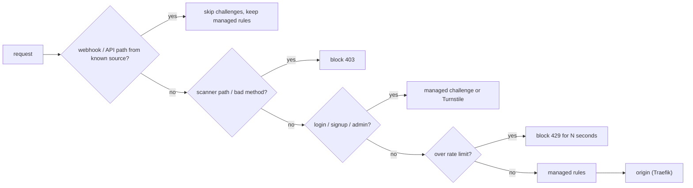

# Network Security - Cloudflare WAF & Rate Limiting Rules

> [!info] Deep dive of [[Network Security]]

> [!abstract] TL;DR
> A small SaaS edge policy is about six custom rules, one or more rate limits and the managed ruleset:
> - **skip** for webhook and API paths, so challenges never break machine clients;
> - **block** scanner noise (`/.env`, `/wp-login.php` on non-WordPress apps);
> - **managed challenge** on human-only surfaces (login, signup, admin);
> - **rate limit** OTP/login.
>
> Run new rules in log/simulate mode first, keep them as code via the Rulesets API, and keep **app-level** rate limits too. The edge only sees IPs, and Malaysian mobile carriers put many users behind one NAT IP.

## Concept
**Request phases** (simplified order):

| Phase | Rule type | Typical use |
|---|---|---|
| `http_request_firewall_custom` | **Custom rules** (expression → action) | Block paths, challenge humans, skip webhooks |
| `http_ratelimit` | **Rate limiting rules** | Login/OTP/API floods |
| `http_request_firewall_managed` | **Managed rules** (Cloudflare/OWASP rulesets) | SQLi/XSS/RCE signatures, CVE virtual patches |
| Bot features | Bot Fight Mode / Super Bot Fight Mode / Bot Management | Automated traffic (scope depends on plan) |
| Turnstile | Widget + server-side verify | Forms: signup, OTP request, contact |

**Plan limits** (official WAF table, 2026-10): **Free** gets the *Free Managed Ruleset* (a subset) and **1 rate-limiting rule**. **Pro and above** get the full WAF Managed Rules and more rate-limiting rules. Custom-rule counts per plan come from third-party summaries (e.g. 5 on Free, 20 on Pro).

**Actions**:

| Action | Effect | Safe for APIs/webhooks? |
|---|---|---|
| `block` | 403 | Yes |
| `managed_challenge` | Cloudflare decides: invisible check, JS or interactive | **No**: mobile apps, server clients and webhooks can't solve it |
| `js_challenge` | JS check | No |
| `skip` | Skip later rules/phases for matching traffic | Yes (use narrowly) |
| `log` | Record only (availability depends on plan) | Yes |

## How It Works


## Practical Usage
**Custom rules as code** (Rulesets API: replace the zone's custom phase entrypoint):
```bash
curl -sS -X PUT "https://api.cloudflare.com/client/v4/zones/$ZONE_ID/rulesets/phases/http_request_firewall_custom/entrypoint" \
  -H "Authorization: Bearer $CF_API_TOKEN" -H "Content-Type: application/json" --data @waf-custom.json
```
```json
{
  "rules": [
    { "description": "skip: webhooks (Meta, payment gateway)",
      "expression": "(http.request.uri.path wildcard r\"/api/webhooks/*\") and http.request.method eq \"POST\"",
      "action": "skip", "action_parameters": { "ruleset": "current", "phases": ["http_ratelimit"] } },
    { "description": "block: scanner paths",
      "expression": "(http.request.uri.path contains \"/.env\") or (http.request.uri.path contains \"/.git\") or (http.request.uri.path wildcard r\"/wp-*\")",
      "action": "block" },
    { "description": "block: unused methods",
      "expression": "not http.request.method in {\"GET\" \"HEAD\" \"POST\" \"PUT\" \"PATCH\" \"DELETE\" \"OPTIONS\"}",
      "action": "block" },
    { "description": "challenge: human-only pages",
      "expression": "(http.request.uri.path in {\"/login\" \"/signup\"}) or starts_with(http.request.uri.path, \"/admin\")",
      "action": "managed_challenge" }
  ]
}
```
**Rate limiting rule** (the one Free rule goes to OTP/login):
```json
{
  "description": "rl: OTP + login",
  "expression": "http.request.uri.path in {\"/api/auth/otp\" \"/api/auth/login\"} and http.request.method eq \"POST\"",
  "action": "block",
  "ratelimit": { "characteristics": ["ip.src", "cf.colo.id"], "period": 10, "requests_per_period": 5, "mitigation_timeout": 10 }
}
```
Free-plan rules are restricted in period and timeout (around 10 s). Longer windows and other counting keys need higher plans, so keep longer-window business limits in the app.

**App-level limits** behind the edge (user, phone or tenant aware), e.g. Redis or Postgres counters:
```ts
await limit(`otp:phone:${phone}`, { max: 3, windowSec: 3600 });   // the edge can't see phone numbers
```
**Verify Turnstile server-side** on signup/OTP request:
```ts
const r = await fetch('https://challenges.cloudflare.com/turnstile/v0/siteverify', {
  method: 'POST', body: new URLSearchParams({ secret: env.TURNSTILE_SECRET, response: token, remoteip: ip }) });
if (!(await r.json()).success) return problem(403, 'bot_check_failed', 'Please retry the verification');
```
**Wrong way**:
```text
❌ "Under Attack" mode / managed challenge on the whole zone → Flutter app API calls and Meta webhooks fail
❌ Block by country for everyone                              → locks out customers travelling and some payment callbacks
❌ Only edge rate limits                                      → CGNAT users throttled together, while one phone number is still OTP-pumped
```

## Patterns & Anti-patterns
| Pattern | When | Anti-pattern to avoid |
|---|---|---|
| Separate hostnames for humans (`app.`) and machines (`api.`, `hooks.`) | Products with mobile apps/webhooks | One hostname where challenge rules must carve exceptions |
| Narrow `skip` (path + method, ideally source ASN/IP) | Webhooks | Broad skips that disable managed rules |
| Log/simulate new rules for 24–72 h | Every new rule | Deploying blocks directly on Friday night |
| Rules in git, applied via API/Terraform | More than one zone/client | Click-ops drift across client zones |
| Turnstile on forms + app-level per-identity limits | Signup, OTP, contact | CAPTCHA everywhere (UX tax) |
| Origin locked to Cloudflare (Tunnel / AOP / IP allowlist) | Always behind CF | WAF bypass via direct origin IP ([[Nginx - Security Hardening]]) |

## Performance & Trade-offs
- **Edge vs app limits**: the edge stops floods before they cost VPS CPU, but it only keys on network attributes. The app knows user, tenant and phone. Use both layers.
- **Managed rules false positives** hit JSON APIs (rich text, code snippets, SQL-looking search terms). Exclude specific rules for specific paths rather than turning the ruleset off.
- **Challenges add friction**: managed challenge is usually invisible for real browsers, but adds latency and blocks non-browser clients. Scope it to HTML pages.
- **Plan economics**: Pro (~USD 20–25/month per zone) adds full managed rules and better rate limiting. That's worth it for revenue-generating client sites; Free is fine for internal tools behind Access.

## Tips & Reminders
> [!tip] In ZP's stack
> - **Per client zone**: the rule set above, applied from a git-tracked JSON via the Rulesets API.
> - **Hostnames**: `app.client.my` (challenge-able), `api.client.my` (Flutter + Next.js API: blocks + rate limits only), `hooks.client.my` (Meta, payment gateways: skip challenges, verify signatures in code).
> - **Admin tools** (Coolify, n8n editor, Langfuse) sit behind Cloudflare Access, not WAF rules ([[Cloudflare - Zero Trust Tunnel & Access]]).

- Use Security Events (Security → Analytics) to tune. Check what each rule matched for a week before tightening.
- Malaysian mobile CGNAT: set per-IP thresholds generously for general traffic. Strict per-IP limits only on auth endpoints.
- Keep Meta and payment-gateway source IP ranges or ASNs in a list if the provider publishes them, but **still** verify webhook signatures ([[REST API - Webhooks & Idempotency]]).
- Pass the real client IP to the origin (`CF-Connecting-IP`) and configure Traefik trusted IPs, so app limits see users, not Cloudflare ([[Traefik - Observability & Troubleshooting]]).

## Version Notes
| Date | Change |
|---|---|
| 2022–23 | Firewall Rules migrated to WAF **custom rules** (Rulesets engine). Legacy rate limiting migrated to new rate limiting rules |
| 2024–25 | Free Managed Ruleset for all plans. Turnstile free for all. Rulesets API/Terraform as the management path |
| 2026-10 | Official table: Free = 1 rate-limiting rule + Free Managed Ruleset. Advanced rate limiting = Enterprise add-on |

> [!warning] Unverified — check before relying on this
> Custom-rule counts per plan, Free rate-limit period/timeout caps, and Pro pricing come from third-party sources. Check https://developers.cloudflare.com/waf/ and the plan comparison page.

## Critical Issues & Gotchas
> [!danger] Challenges break machine clients
> Mobile apps, server-to-server calls, payment callbacks and WhatsApp webhooks can't solve challenges. They get HTML instead of JSON and fail in confusing ways (JSON parse errors in Flutter, silent webhook retries). Never challenge API or webhook paths. Use block and rate limits there.

> [!danger] The edge is not the only door
> If the origin IP is reachable (old DNS records, `mail.` hostnames, outbound connections revealing the IP), attackers skip every WAF rule. Lock the origin to Cloudflare, or use Tunnel only.

- **Rule ordering**: a broad `skip` placed first can disable later blocks. Review order whenever you add rules.
- **Cloudflare outages** (2025 global incidents) take WAF, DNS and proxy down together. Know your emergency path: DNS-only (grey cloud) with origin firewall rules ready ([[Cloudflare]]).
- **IPv6**: per-IP limits on IPv6 can be evaded by rotating within a /64. Prefer per-identity limits at the app.
- **Logs and PDPA**: Security Events contain IPs and paths, which may include personal data in query strings. Keep secrets and identifiers out of URLs.

## Related
- [[Network Security]]
- [[Cloudflare]] — edge platform, plans, outages
- [[Cloudflare - Zero Trust Tunnel & Access]] — admin tools behind Access
- [[OWASP Top 10 - API Security Top 10 in Practice]] — API4/API6 controls behind the edge
- [[Nginx - Security Hardening]] — origin lock and origin-side limits
- [[REST API - Webhooks & Idempotency]] — webhook verification

## References
- https://developers.cloudflare.com/waf/
- https://developers.cloudflare.com/waf/rate-limiting-rules/
- https://developers.cloudflare.com/ruleset-engine/rulesets-api/
- https://developers.cloudflare.com/turnstile/get-started/server-side-validation/
- https://eastondev.com/blog/en/posts/dev/20251201-cloudflare-pricing-compare/
