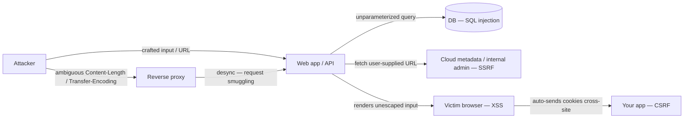

# Network Security - Common Web Attacks

> [!info] Deep dive of [[Network Security]]

> [!abstract] TL;DR
> Most real-world web compromises fall into about a dozen attack classes:
> - Broken access control (IDOR/BOLA) and SSRF.
> - Injection (SQL/NoSQL/command/template) and XSS.
> - CSRF, clickjacking, open redirects.
> - Request smuggling and cache poisoning.
> - Path traversal and file-upload abuse.
> - Unsafe deserialization and prototype pollution.
> - Credential stuffing and session theft.
>
> Each has a **standard, boring defence**: parameterized queries, output encoding + CSP, SameSite cookies + CSRF tokens, server-side authorization on every object, egress allow-lists, strict parsing, and patched proxies. Apply these by default in frameworks and templates, not case by case.

## Concept

### Attack map (with OWASP Top 10:2025 category)
| Attack | What happens | OWASP | Primary defence |
|---|---|---|---|
| **IDOR / BOLA** | Changing `/orders/123` → `/orders/124` returns someone else's data | A01 | Server-side ownership/tenant checks, RLS, 404 for others' resources |
| **SSRF** | Server fetches attacker-chosen URL → internal services, cloud metadata (`169.254.169.254`) | A01 | Egress allow-lists, block private ranges after DNS resolution, IMDSv2 |
| **SQL / NoSQL injection** | Input becomes query syntax | A05 | Parameterized queries / ORM, never string concatenation. Strict schemas |
| **Command / template injection** | Input reaches `exec`/shell or template engine | A05 | Avoid shells (`execFile` with args array), sandboxed templates, allow-lists |
| **XSS** (stored, reflected, DOM) | Attacker JS runs in victims' browsers (session theft, actions) | A05 | Context-aware output encoding (framework defaults), CSP with nonces, sanitize HTML (DOMPurify), HttpOnly cookies |
| **CSRF** | Victim's browser sends authenticated request from another site | A01/A07 | `SameSite=Lax/Strict` cookies, CSRF tokens / origin checks, no state changes on GET |
| **Clickjacking** | Your page framed invisibly to trick clicks | A02 | `Content-Security-Policy: frame-ancestors 'none'` |
| **Open redirect** | `?next=https://evil` used for phishing/OAuth token theft | A01 | Allow-list redirect targets / relative paths only |
| **Path traversal** | `../../etc/passwd` in file paths | A01 | Resolve and verify paths stay under a base dir. Never use user input as paths |
| **Unrestricted file upload** | Uploading executable/HTML/SVG with scripts | A06 | Validate type by content, store outside web root/in R2, random names, `Content-Disposition: attachment` |
| **Request smuggling / desync** | Proxy and backend disagree on request boundaries (CL/TE) | A02 | Patched, consistent HTTP parsers, HTTP/2 end-to-end, reject ambiguous requests |
| **Web cache poisoning / deception** | Unkeyed headers poison cached responses, or private pages cached publicly | A02 | Cache only explicit public routes, normalize keys, `Cache-Control: private/no-store` on user pages |
| **Insecure deserialization** | Object graphs from untrusted input execute code | A08 | JSON with schema validation. No native serialization of untrusted data |
| **Prototype pollution** (JS) | `__proto__`/`constructor` keys modify object prototypes | A05/A08 | Validate with schemas, use `Object.create(null)`/`Map`, patched merge libs |
| **Credential stuffing / brute force** | Reused passwords from breaches tried at scale | A07 | Rate limiting, breached-password checks, MFA/passkeys, bot detection |
| **Session hijacking** | Stolen cookies/tokens (XSS, infostealers, AitM phishing) | A07 | HttpOnly/Secure cookies, short sessions, re-auth for sensitive actions, passkeys |
| **Subdomain takeover** | Dangling CNAME to a deprovisioned service gets claimed | A02 | DNS hygiene, remove records when deleting services |
| **Supply-chain script injection** (Magecart) | Compromised third-party JS skims payment forms | A03 | SRI, CSP allow-lists, self-host critical scripts, monitor scripts on checkout pages |

## How It Works

- **Trust boundaries**: every byte from the browser, webhooks, files, third-party APIs and LLM outputs is attacker-controlled. Attacks happen where that data crosses into an **interpreter** (SQL, shell, HTML/JS, URL fetchers, deserializers, templates).
- **Browsers enforce origin rules, servers don't**: CORS/SameSite protect users' browsers. They don't stop direct requests from scripts (`curl`), so server-side authorization is mandatory.
- **SSRF via DNS rebinding**: checking a hostname, then fetching it, lets DNS change in between. Resolve once, validate the IP, then connect to that IP.

## Practical Usage

### Parameterized queries (Node + pg)
```ts
// Wrong: `select * from orders where id = '${req.params.id}'`  → SQLi
const { rows } = await pool.query(
  "select * from orders where id = $1 and tenant_id = $2",   // parameters + tenant scoping (also prevents IDOR)
  [req.params.id, user.tenantId],
);
if (rows.length === 0) return res.status(404).end();
```

### SSRF-safe fetch for user-provided URLs (link previews, webhooks)
```ts
import { lookup } from "node:dns/promises";
import ipaddr from "ipaddr.js";

async function safeFetch(raw: string) {
  const url = new URL(raw);
  if (!["https:"].includes(url.protocol)) throw new Error("scheme not allowed");
  const { address } = await lookup(url.hostname);                 // resolve once
  const range = ipaddr.parse(address).range();
  if (range !== "unicast") throw new Error(`blocked ${range}`);   // private, loopback, linkLocal (169.254.x), etc.
  // connect to the resolved IP with the Host/SNI header set (undici Agent with custom lookup), timeout + size limit
  return fetch(url, { redirect: "error", signal: AbortSignal.timeout(5000) });
}
```

### XSS: let the framework escape, sanitize when rendering HTML
```tsx
<p>{comment.text}</p>                                                     // React escapes by default
<div dangerouslySetInnerHTML={{ __html: DOMPurify.sanitize(cmsHtml) }} /> // only for trusted/sanitized HTML
// Never: href={userUrl} without checking scheme (javascript: URLs) → allow http(s) only
```

### Security headers (Next.js middleware or reverse proxy)
```http
Content-Security-Policy: default-src 'self'; script-src 'self' 'nonce-{random}' 'strict-dynamic'; object-src 'none'; base-uri 'self'; frame-ancestors 'none'; form-action 'self'
Strict-Transport-Security: max-age=31536000; includeSubDomains
X-Content-Type-Options: nosniff
Referrer-Policy: strict-origin-when-cross-origin
Set-Cookie: __Host-session=...; Path=/; Secure; HttpOnly; SameSite=Lax
```

## Patterns & Anti-patterns
| Pattern | When | Anti-pattern to avoid |
|---|---|---|
| Schema validation at every boundary (Zod/pydantic) | All inputs incl. webhooks | Trusting `req.body` types from TypeScript |
| Authorization check per object + tenant | Every read/write | Hiding IDs/UI buttons as "security" |
| Framework auto-escaping + CSP nonces | HTML rendering | Building HTML with string concatenation |
| `execFile(cmd, [args])` with fixed binaries | Shelling out (ffmpeg, ImageMagick) | `exec(\`convert ${userFile}\`)` |
| Egress proxy / allow-list for outbound HTTP | Webhooks, URL fetchers, n8n HTTP nodes | Fetching any user URL from inside the VPC/VPS |
| Rate limits on login/OTP/reset per IP + account | Auth endpoints | Unlimited OTP attempts (6-digit codes brute-forced in minutes) |

## Performance & Trade-offs
- Defences are cheap compared to incident costs. Parameterized queries are often *faster* (plan caching).
- Strict CSP takes effort with third-party scripts (analytics, chat widgets). Start with `Content-Security-Policy-Report-Only` and tighten.
- WAFs ([[Cloudflare]]) catch noisy automated attacks but are bypassable. They complement, never replace, secure code.
- Rate limiting needs shared state ([[Redis]]) across instances, and real client IPs behind proxies (trusted `X-Forwarded-For` handling).

## Tips & Reminders
> [!tip]
> - Test with real tools: OWASP ZAP baseline scans in CI, Burp Suite for manual testing, `sqlmap` only against your own staging.
> - Write negative tests: other tenant's IDs, `../` paths, `javascript:` URLs, `__proto__` keys, oversized payloads.
> - Log and alert on security signals: authorization failures, 4xx spikes, unusual export volumes ([[OWASP Top 10]] A09).
> - **In ZP's stack**:
>   - **Data**: [[Supabase]] RLS + parameterized SQL.
>   - **Browser**: Next.js default escaping + CSP middleware, and HttpOnly cookies via Supabase SSR helpers.
>   - **n8n**: HTTP Request nodes never take raw user URLs without an allow-list, and Code nodes never `eval` input.
>   - **Edge**: Cloudflare WAF + rate limiting on login/OTP endpoints.
>   - **Webhooks**: verify signatures (Meta, Stripe, Billplz) before processing.

## Version Notes
| Date | Change / incident | Lesson |
|---|---|---|
| 2019 | Capital One: SSRF → cloud metadata credentials → 100M+ records | IMDSv2, egress controls |
| 2019–2023 | HTTP request smuggling research (PortSwigger, Kettle) mainstreams desync attacks | Patch proxies, normalize parsing |
| 2023 | MOVEit Transfer SQLi mass exploitation (Cl0p) | Parameterize, and patch internet-facing apps immediately |
| 2024 | polyfill.io domain takeover injects malicious JS into 100k+ sites | SRI/CSP, self-host scripts |
| 2025-12 | React Server Components RCE ("React2Shell", CVE-2025-55182) via unsafe deserialization | Patch frameworks quickly, WAF virtual patching |
| 2025-11 | OWASP Top 10:2025 merges SSRF into Broken Access Control | Treat SSRF as an authorization problem |

## Critical Issues & Gotchas
> [!danger] Webhook endpoints are unauthenticated attack surface
> WhatsApp/Meta, payment gateway and n8n webhooks are public URLs. Without **signature verification** (HMAC with the provider secret, raw body, constant-time compare) and replay protection (timestamp window, idempotency on event IDs), attackers can forge "payment succeeded" events or trigger workflows. Verify before parsing, and never trust payload amounts without re-fetching from the provider API.

> [!danger] LLM features add new injection paths
> Prompt injection in user messages or retrieved documents can make AI agents call tools (send messages, query data) with the agent's privileges, and LLM output rendered as HTML/Markdown can carry XSS or data-exfiltration links. Treat LLM output as untrusted input: escape it, restrict tool permissions per user, and avoid auto-following links/images ([[AI Agents]] "lethal trifecta").

> [!warning] Gotchas
> - `SameSite=Lax` still allows top-level GET navigations with cookies. Never mutate state on GET.
> - CORS `Access-Control-Allow-Origin` reflecting the request `Origin` with credentials is as bad as `*` with credentials.
> - SVG uploads can contain scripts. Serve user uploads from a separate domain (e.g. R2 public bucket domain) with `Content-Disposition: attachment` when possible.
> - URL validation with regex or `startsWith` is bypassable (`https://example.my.evil.com`, `@` tricks). Parse with `new URL()` and compare hostnames exactly.
> - Rate limits keyed only by IP fail behind CGNAT (common for Malaysian mobile carriers). Combine IP + account + device signals.

## Related
- [[Network Security]]
- [[OWASP Top 10]] — risk categories these attacks map to
- [[Authentication & Authorization]] — IDOR, session, credential attacks
- [[Browser & Web Fundamentals]] — SOP, CORS, CSP, cookies
- [[HTTP & HTTPS]] — request smuggling, caching semantics
- [[GraphQL]] — GraphQL-specific DoS/IDOR issues
- [[Next.js]] — framework defaults and CVEs

## References
- OWASP Cheat Sheet Series: https://cheatsheetseries.owasp.org/
- PortSwigger Web Security Academy: https://portswigger.net/web-security
- OWASP SSRF Prevention Cheat Sheet: https://cheatsheetseries.owasp.org/cheatsheets/Server_Side_Request_Forgery_Prevention_Cheat_Sheet.html
- MDN Content Security Policy: https://developer.mozilla.org/en-US/docs/Web/HTTP/CSP
- HTTP request smuggling (PortSwigger): https://portswigger.net/web-security/request-smuggling
