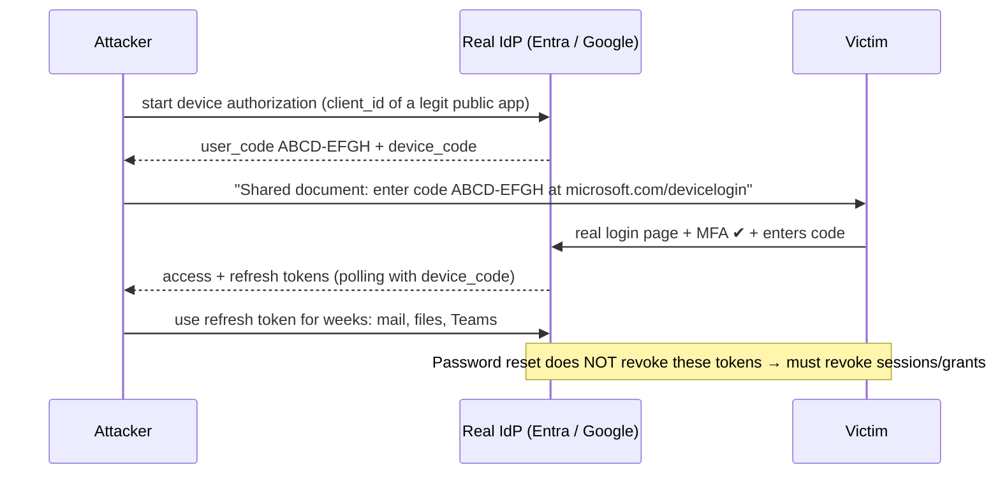

# OAuth 2.0 & OIDC - Attacks & Hardening

> [!info] Deep dive of [[OAuth 2.0 & OIDC]]

> [!abstract] TL;DR
> There are two attack families:
> - **Protocol/implementation bugs**: loose redirect URIs, missing `state`/PKCE/`iss`/`nonce` checks, unvalidated tokens, account linking by email.
> - **Abuse of legitimate flows**: consent phishing, device-code phishing, stolen refresh tokens.
>
> **RFC 9700** is the checklist for the first. For the second, you need tenant policy:
> - block device-code flow where unused
> - restrict which apps users can consent to
> - audit granted apps
> - revoke refresh tokens on incident (a password reset alone does **not** kill OAuth grants)

## Concept

### Attack catalogue
| Attack | Mechanism | Primary defence |
|---|---|---|
| **Redirect URI manipulation** | Prefix/wildcard matching or open redirector on client domain sends `code` to attacker | **Exact string match** of registered redirect URIs. No open redirects |
| **Authorization code interception/injection** | Stolen code (logs, malicious app with same custom scheme) redeemed or injected into victim session | **PKCE S256** enforced by AS. Bind `state` + verifier to session |
| **CSRF on callback** | Attacker logs victim into attacker's account (login CSRF) | `state` (or PKCE) tied to the user agent |
| **Mix-up attack** | Client talks to multiple AS. Attacker AS tricks client into sending code to it | `iss` response parameter (RFC 9207), per-AS redirect URIs |
| **ID token substitution / replay** | Token for another client/audience or old token reused | Validate `iss`, `aud`, `exp`, `nonce`, signature (pinned alg) |
| **Implicit-flow token leakage** | Tokens in URL fragment → history, Referer, logs | Don't use implicit. Code + PKCE only |
| **Account takeover via linking** | Link accounts by unverified/mutable `email` claim ("nOAuth") | Key users by `iss` + `sub`. Link only with verified email from trusted IdP |
| **Consent phishing / illicit consent grant** | Malicious app requests `Mail.Read`, `offline_access`, `Files.ReadWrite`. User clicks Accept | Admin consent workflow, verified publishers only, consent auditing |
| **Device code phishing** | Attacker starts device flow, sends victim the code. Victim signs in + MFA on the real IdP | Block device-code flow except for named apps/devices (Conditional Access) |
| **Refresh token theft** | Infostealer/log/vendor breach exfiltrates long-lived tokens | Rotation + reuse detection, sender-constrained tokens (DPoP/mTLS), short lifetimes |
| **Token passthrough / confused deputy** | Resource server forwards the user's token downstream | Audience-bound tokens, token exchange (RFC 8693) |
| **SSRF via OAuth metadata** | AS/client fetches attacker-supplied `jwks_uri`, `request_uri`, logo/redirect URLs during dynamic registration | Allow-list fetchers, block private IP ranges, no dynamic registration unless required |
| **Clickjacking the consent screen** | Consent page framed by attacker | `frame-ancestors 'none'` / `X-Frame-Options` on AS pages |

### Who must check what
| Party | Must do |
|---|---|
| **Client (your app)** | Code + PKCE, exact redirects, verify `state`, `iss`, `nonce`. Validate ID tokens with a certified library. Store tokens server-side (BFF). Key users by `iss`+`sub` |
| **Authorization server** (Supabase Auth, Keycloak, Entra, Google) | Enforce PKCE, exact redirect match, one-time short-lived codes, refresh rotation, consent controls, logging |
| **Resource server (your API, MCP server)** | Verify signature/alg/`iss`/`aud`/`exp`/scopes per request. No passthrough. Rate limit |
| **Tenant admin (client's Google Workspace / M365)** | Restrict user consent, block device code flow, review app grants, alert on new high-privilege grants |

## How It Works

- **Why MFA doesn't stop it**: the victim performs MFA on the genuine IdP, so phishing-resistant MFA (passkeys) only helps if policies also restrict *which flows and apps* can obtain tokens.

## Practical Usage

### Client-side callback validation (Next.js BFF, openid-client)
```ts
// All checks the library performs when you pass the expectations explicitly
const tokens = await client.authorizationCodeGrant(config, new URL(req.url), {
  pkceCodeVerifier: session.verifier,      // PKCE
  expectedState: session.state,            // CSRF / session binding
  expectedNonce: session.nonce,            // ID token replay
  idTokenExpected: true,
});
// openid-client also validates iss (RFC 9207 when supported), aud, exp, signature via JWKS
const claims = tokens.claims()!;
const user = await upsertUser({ issuer: claims.iss, subject: claims.sub,          // identity key
  email: claims.email_verified ? claims.email : null });                         // never link on unverified email
session.regenerate();                                                             // prevent session fixation
```

### Redirect URI registration rules
- Use exact URIs only: `https://app.example.my/auth/callback`, with no wildcards, no `localhost` in production clients, and no user-controlled query parameters.
- Mobile: use claimed HTTPS (App Links/Universal Links), not custom schemes. Desktop/CLI: loopback with a random port (RFC 8252).
- Remove unused redirect URIs and stale clients during quarterly reviews.

### Tenant hardening (client's Microsoft 365 / Google Workspace)
| Control | Microsoft Entra | Google Workspace |
|---|---|---|
| Block device code flow | Conditional Access → Authentication flows → block device code (exclude named devices/apps) | Limit API access and device flows via app access control |
| Restrict user consent | Allow consent only for verified publishers + low-risk permissions. Admin consent workflow for the rest | API controls: restrict third-party app access, trust only reviewed apps |
| Audit granted apps | Enterprise applications → permissions, sign-in logs for service principals | Security → API controls → app access, token audit log |
| Incident response | Revoke sessions (`revokeSignInSessions`), remove app grants, reset credentials | Revoke OAuth tokens per user/app, sign out user |

### Resource-server checks (APIs, MCP servers)
```ts
const { payload } = await jwtVerify(token, JWKS, {
  algorithms: ["ES256"], issuer: ISS, audience: "https://api.example.my", typ: "at+jwt", clockTolerance: 30,
});
if (!String(payload.scope).split(" ").includes("orders:read")) throw forbidden();
// never forward `token` downstream; exchange it (RFC 8693) for a token with the downstream audience
```

## Patterns & Anti-patterns
| Pattern | When | Anti-pattern to avoid |
|---|---|---|
| Certified OIDC library + explicit expectations | Every client | Hand-parsing JWTs from the callback |
| Users keyed by `iss`+`sub` | Social/enterprise login | Keying by email across IdPs |
| Admin-approved app consent | Client tenants (M365/Google) | Users granting `Mail.ReadWrite` + `offline_access` to any app |
| Block device code flow by default | Tenants without TV/IoT/CLI needs | Leaving it open "because Microsoft enables it" |
| Revoke grants/sessions on incident | Compromise response | Password reset only (OAuth refresh tokens survive) |
| Least-privilege scopes in your own integrations | n8n/Make/Zapier connections | Requesting full mailbox/drive scopes for a single sheet |

## Performance & Trade-offs
- **Stricter consent policies** add admin overhead (approving apps). Mitigate with a pre-approved app catalogue per client tenant.
- **Short refresh-token lifetimes** improve containment but cause more re-logins. Balance per risk (admin vs regular users).
- **DPoP** makes stolen tokens useless elsewhere but needs client key management and AS/RS support. Prioritise it for mobile apps and high-value APIs.
- **Blocking device code flow** can break CLI tools (Azure CLI, some IoT). Inventory usage from sign-in logs before enforcing, then allow-list.

## Tips & Reminders
> [!tip]
> - **Add an OAuth review to client security baselines**: list third-party apps with access to Google Workspace/M365, their scopes and owners. Remove unknown ones. It's a cheap, high-impact SME audit item.
> - **Your own integrations**: request minimal scopes, store refresh tokens encrypted, rotate on staff exit, and document which n8n credentials hold which grants.
> - **Train users**: never enter a device code someone sent you. Legitimate device codes appear on *your own* device's screen.
> - **In ZP's stack**:
>   - **Your apps**: Next.js BFF with openid-client, `iss`+`sub` identities and Supabase Auth.
>   - **Client M365 tenants**: block device code, restrict consent, and sign-in log alerts for new OAuth apps. Offer this as part of the security retainer.

## Version Notes
| Spec / event | Relevance |
|---|---|
| RFC 6819 (2013) | Original OAuth threat model |
| RFC 8252 (2017) | Native apps: system browser, no embedded WebViews |
| RFC 9207 (2022) | `iss` in authorization response (mix-up defence) |
| RFC 9449 (2023) | DPoP sender-constrained tokens |
| **RFC 9700** (2025-01) | Security BCP: deprecates implicit/password, PKCE for all, exact redirects, refresh rotation |
| RFC 10017 (2026-08) | Browser-based apps BCP (BFF preferred) |
| 2024–26 campaigns | Device-code phishing grows from state actors (2024–25) to PhaaS kits (2026, e.g. EvilTokens). Consent-phishing automation (ConsentFix) |

> [!warning] Unverified — check before relying on this
> Campaign statistics (organisations hit, kit counts) come from vendor/aggregator research notes. Exact admin-console menu names for Entra/Google change often, so follow current vendor docs when configuring.

## Critical Issues & Gotchas
> [!danger] Device-code phishing at scale (2026)
> Starting February 2026, a device-code phishing campaign hit **340+ Microsoft 365 organisations**. It used DocuSign/voicemail lures routed through trusted services, with victims completing MFA themselves. PhaaS kits (EvilTokens and 25+ others) then commoditised the technique, and refresh tokens persisted after password resets. For SME clients on M365, blocking device code flow via Conditional Access and revoking sessions on suspicion are the two highest-value controls.

> [!danger] Consent phishing bypasses passwords and MFA entirely
> A user approving a malicious multi-tenant app grants it API access with long-lived refresh tokens. No credential theft is needed, and MFA isn't challenged again. Restrict user consent, require admin approval for sensitive scopes, and alert on new grants with mail/files scopes.

> [!warning] Gotchas
> - Open redirects anywhere on the client domain (`/logout?next=`) combine with loose redirect matching into code theft. Audit `next`/`returnTo` params.
> - Error pages that echo the full callback URL (with `code`) into logs or analytics leak codes. Strip query params from logs on callback routes.
> - Multiple IdPs without `iss` validation are vulnerable to mix-up. Use per-IdP callback paths.
> - Dynamic client registration (needed for MCP) is an SSRF and spam surface. Validate metadata URLs and rate-limit registrations ([[Model Context Protocol - Building MCP Servers]]).

## Related
- [[OAuth 2.0 & OIDC]]
- [[OAuth 2.0 & OIDC - Flows, PKCE & Token Lifecycle]] — the correct flows these attacks target
- [[JWT - Refresh Tokens, Revocation & Storage]] — revocation and storage
- [[Authentication & Authorization - Passkeys & WebAuthn]] — phishing-resistant MFA and its limits
- [[Network Security - Common Web Attacks]] — CSRF, open redirects, SSRF
- [[Model Context Protocol - Building MCP Servers]] — resource-server validation, dynamic registration

## References
- RFC 9700 OAuth 2.0 Security BCP: https://www.rfc-editor.org/rfc/rfc9700
- RFC 9207 (iss parameter): https://www.rfc-editor.org/rfc/rfc9207
- CSA research note, device code phishing (2026-03): https://labs.cloudsecurityalliance.org/research/csa-research-note-oauth-device-code-phishing-m365-20260325-c/
- The Hacker News, device code phishing hits 340+ M365 orgs: https://thehackernews.com/2026/03/device-code-phishing-hits-340-microsoft.html
- Microsoft, block device code flow with Conditional Access: https://learn.microsoft.com/en-us/entra/identity/conditional-access/concept-authentication-flows
- OWASP OAuth 2.0 Cheat Sheet: https://cheatsheetseries.owasp.org/cheatsheets/OAuth2_Cheat_Sheet.html
