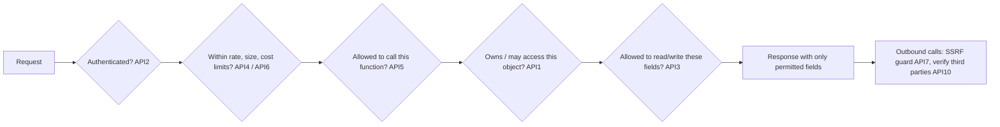

# OWASP Top 10 - API Security Top 10 in Practice

> [!info] Deep dive of [[OWASP Top 10]]

> [!abstract] TL;DR
> The **2023 API Security Top 10** is mostly about **authorization**, not injection. Its top three are object-level authorization (BOLA), authentication, and property-level authorization (BOPLA). Then come resource consumption and business-flow abuse.
> - In a Supabase + Next.js stack, RLS covers BOLA if every table has correct policies.
> - BOPLA (columns), function-level checks on RPCs and service-role code, rate and cost limits, and SSRF on URL-fetching features are where real gaps stay.
> - Test with an **authz matrix** and a second-tenant account, not only a scanner.

## Concept
| # | Risk | What it looks like in ZP's stack | Primary control |
|---|---|---|---|
| API1 | **Broken Object Level Authorization (BOLA)** | `GET /api/orders/123` returns another tenant's order; table without RLS reachable with the publishable key | Tenant/owner check **in the query** (RLS), 404 on miss |
| API2 | Broken Authentication | Long-lived JWTs, no refresh-token rotation, OTP without attempt limits, `user_metadata` used for roles | Supabase Auth defaults + short tokens + rate-limited OTP ([[JWT - Refresh Tokens, Revocation & Storage]]) |
| API3 | **Broken Object Property Level Authorization (BOPLA)** | `select *` exposes `cost_price`, `internal_notes`; `update(req.body)` lets users set `role` or `credit_balance` | Explicit column lists/views, column grants, `z.strictObject` |
| API4 | Unrestricted Resource Consumption | No page-size cap, 100 MB uploads, unbounded LLM calls per tenant, regex DoS | Limits on size, rate, page, time and **cost** |
| API5 | Broken Function Level Authorization | `/api/admin/*` checks login but not role; `security definer` RPC callable by any user | Role/permission check per function, deny by default |
| API6 | Unrestricted Access to Sensitive Business Flows | Bots mass-creating accounts, voucher farming, **WhatsApp/SMS OTP pumping** | Business-rate limits, CAPTCHA/Turnstile, per-number/day caps, anomaly alerts |
| API7 | Server-Side Request Forgery | "Import from URL", webhook URL fields, link previews fetching `http://169.254.169.254` or `localhost:8080` | Allowlist schemes/hosts, block private ranges after DNS resolution, egress proxy |
| API8 | Security Misconfiguration | CORS `*` with credentials, stack traces, debug routes, exposed Traefik dashboard, extra Supabase schemas in the Data API | Hardened defaults, config review, headers |
| API9 | Improper Inventory Management | Forgotten `/v1`, Coolify preview envs with prod data, old n8n test webhook URLs, undocumented endpoints | API inventory (OpenAPI), retire old versions, no prod data in previews |
| API10 | Unsafe Consumption of APIs | Trusting payment-gateway callbacks or Meta webhooks without verification; rendering third-party HTML | Verify signatures, re-query the source of truth, validate responses |

## How It Works

Every layer must fail closed. Most real breaches are one missing layer on one endpoint, which is why inventory (API9) matters.

## Practical Usage
**API1 BOLA**: authorize in the query, not after the fetch.
```ts
// ❌ fetch by id, then compare (easy to forget; leaks existence through timing and 403s)
const order = await db.from('orders').select('*').eq('id', id).single();
if (order.tenant_id !== user.tenantId) return forbidden();
// ✅ tenant in the WHERE clause (and RLS underneath as the safety net)
const { data } = await db.from('orders').select('id,status,total_sen').eq('id', id).eq('tenant_id', user.tenantId).maybeSingle();
if (!data) return problem(404, 'not_found', 'Order not found');
```
**API3 BOPLA**: column-level control in Postgres for PostgREST exposure.
```sql
-- clients can read only safe columns of products
revoke select on public.products from anon, authenticated;
grant select (id, name, price_sen, image_url, tenant_id) on public.products to anon, authenticated;
-- and can only update these
grant update (name, price_sen, image_url) on public.products to authenticated;   -- not cost_sen, not tenant_id
```
```ts
// writes: strict schema = mass-assignment guard
const UpdateProfile = z.strictObject({ display_name: z.string().max(80), avatar_url: z.url().optional() });
```
**API4 / API6**: business-level limits (OTP pumping guard).
```ts
// per phone number and per IP, before calling the WhatsApp authentication template (each send costs money)
await limit(`otp:phone:${phone}`, { max: 3, windowSec: 3600 });
await limit(`otp:ip:${ip}`, { max: 10, windowSec: 3600 });
if (!isMalaysianMobile(phone) && !tenant.allowsInternational) throw problem(422, 'unsupported_country', '…');
await verifyTurnstile(req);              // Cloudflare Turnstile on public signup/OTP forms
```
**API7 SSRF**: resolve, check, then connect (blocks DNS tricks to private ranges).
```ts
import { lookup } from 'node:dns/promises';
import ipaddr from 'ipaddr.js';

export async function assertPublicUrl(raw: string) {
  const u = new URL(raw);
  if (!['https:'].includes(u.protocol)) throw new Error('https only');
  const addrs = await lookup(u.hostname, { all: true });
  for (const { address } of addrs) {
    const range = ipaddr.parse(address).range();
    if (range !== 'unicast') throw new Error(`blocked address range: ${range}`);   // private, loopback, linkLocal…
  }
  return { url: u, pinnedIp: addrs[0].address };   // connect to the pinned IP to avoid DNS rebinding
}
```
**API10**: verify, then re-query the source of truth.
```ts
// payment callback: signature check AND fetch the bill status from the gateway API before marking paid
if (!verifyBillplzSignature(params, env.BILLPLZ_XSIGN)) return new Response('bad signature', { status: 401 });
const bill = await billplz.getBill(params.id);           // never trust "paid=true" from the redirect/callback alone
if (bill.paid && bill.amount === order.total_sen) await markPaid(order.id, bill.id);
```
**Authz matrix test** (integration, two tenants):
```ts
test.each(endpoints)('%s denies cross-tenant access', async (ep) => {
  const res = await ep.call(asUser(tenantB.staff), { id: tenantA.orderId });
  expect([403, 404]).toContain(res.status);
});
```

## Patterns & Anti-patterns
| Pattern | When | Anti-pattern to avoid |
|---|---|---|
| RLS on every exposed table + explicit column grants | Supabase Data API | "The UI doesn't show that field" as protection |
| Deny-by-default middleware; routes opt into roles | Next.js route handlers, API servers | Per-route `if (isAdmin)` sprinkled by hand |
| Cost budgets per tenant (LLM tokens, WhatsApp messages, SMS) | Metered third-party calls | Unlimited free-tier usage funded by you |
| OpenAPI inventory + CI diff on routes | Every API | Shadow endpoints from experiments |
| Second-tenant test account in every environment | Testing | Testing only with the owner account |
| Signature verification + replay window on webhooks | Inbound third-party calls | Accepting any POST to `/webhook/payment` |

## Performance & Trade-offs
- **RLS cost**: policies add predicate evaluation per row, which is cheap with indexed `tenant_id` and `(select …)`-wrapped helpers ([[Authentication & Authorization - Multi-Tenant Authorization with RLS]]). The alternative (app-only checks) is faster to write and much easier to get wrong.
- **Rate limiting placement**: Cloudflare rules stop floods before they hit the VPS but don't know business identity. App-level limits keyed by user, phone or tenant catch API6 abuse. Use both.
- **Scanners vs manual testing**: ZAP and Schemathesis find misconfigurations, crashes and some injection. BOLA, BOPLA and business-flow abuse need tests that understand ownership. Budget a manual or authz-matrix pass per release.
- **Strictness vs compatibility**: `strictObject` on writes breaks sloppy clients. Roll it out with logging first if mobile versions in the wild send extra fields.

## Tips & Reminders
> [!tip] In ZP's stack
> - **Supabase**: run the Security Advisor (missing RLS, exposed `security definer` functions), and keep non-API schemas out of `exposed schemas`. Never ship the secret/service key in Flutter or `NEXT_PUBLIC_*`.
> - **n8n**: production webhook URLs are public endpoints. Add header auth or HMAC verification, rate-limit at Cloudflare, and disable test URLs in prod.
> - **WhatsApp**: authentication-template sends and marketing broadcasts cost money per message. Cap per number, per tenant and per day, and alert on spikes (API6 / API4).

- Return **404** for objects outside the caller's tenant. 403 confirms existence (enumeration).
- Log authorization denials with user, tenant, route and object ID. Spikes are attack signals.
- Keep IDs unguessable (UUIDv7/v4), but never rely on that alone for authorization.
- Review every `security definer` function and every `service_role` code path as if it were a public endpoint.

## Version Notes
| Edition | Change |
|---|---|
| 2019 | First API Security Top 10. Excessive Data Exposure and Mass Assignment separate. Injection included |
| **2023** (current) | BOPLA merges Excessive Data Exposure + Mass Assignment. New: Unrestricted Access to Sensitive Business Flows, SSRF, Unsafe Consumption of APIs. Injection dropped as a separate item |
| 2026-10 | No newer edition found at re-check. OWASP LLM Top 10 (2025) and Agentic guidance cover AI-specific APIs ([[OWASP Top 10 - LLM & Agent Security]]) |

## Critical Issues & Gotchas
> [!danger] PostgREST exposes what the database allows
> With the Supabase Data API, any table in an exposed schema is an API endpoint. A missing RLS policy (or RLS enabled with a permissive `using (true)`) is a full BOLA, reachable with the publishable key that ships in every client. Enforce RLS on every table, and check it in CI.

> [!danger] OTP and messaging pumping
> Attackers trigger OTP or verification messages to premium or international numbers they profit from, and you pay per message. One unprotected "send code" endpoint can cost thousands of ringgit overnight. Rate-limit by number, IP and country, add Turnstile, and set provider spend caps.

- **CORS is not access control**: `Access-Control-Allow-Origin` restricts browsers only. curl and bots ignore it. And `*` combined with credentials is a misconfiguration.
- **GraphQL amplifies API1/API3/API4**: introspection, deep queries and batching. See [[GraphQL - Security Hardening]].
- **Preview environments with production data** violate PDPA expectations and widen API9. Seed with synthetic data.
- **Third-party SDK responses are input** (API10). Validate shapes and sizes before using or rendering them ([[TypeScript - Runtime Validation with Zod & Type-Safe APIs]]).

## Related
- [[OWASP Top 10]]
- [[OWASP Top 10 - LLM & Agent Security]] — AI-specific API risks
- [[Authentication & Authorization - Multi-Tenant Authorization with RLS]] — BOLA/BOPLA controls in Postgres
- [[Supabase - Row Level Security]] — policy mechanics
- [[REST API - Webhooks & Idempotency]] — webhook verification (API10)
- [[GraphQL - Security Hardening]] — GraphQL-specific abuse

## References
- https://owasp.org/API-Security/editions/2023/en/0x11-t10/
- https://akamai.com/blog/security/owasp-top-10-api-security-risks-2023-edition
- https://akamai.com/glossary/what-is-bopla
- https://cheatsheetseries.owasp.org/cheatsheets/Server_Side_Request_Forgery_Prevention_Cheat_Sheet.html
- https://supabase.com/docs/guides/database/postgres/column-level-security
