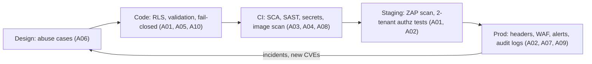

# OWASP Top 10 - Web Application Top 10 2025 in Practice

> [!info] Deep dive of [[OWASP Top 10]]

> [!abstract] TL;DR
> The overview lists the 2025 categories. This note turns them into **concrete controls, code and checks** for a Next.js + Supabase + n8n client project.
> - **A01 Broken Access Control** (incl. SSRF) and **A02 Misconfiguration** cause most real SME breaches: missing RLS, service-role keys in the browser, public dashboards, open buckets.
> - **A03 Supply Chain** is now #3. Lockfiles, pinned CI actions and image scanning are baseline, not extras.
> - **A10 Exceptional Conditions** (new) catches fail-open error paths: a payment webhook that grants access when verification throws.
>
> Run a **one-page pre-launch review** (table below) on every delivery, and keep the evidence as a liability shield.

## Concept
**Category → where it bites in ZP's stack → control → how to verify**:

| # | Typical bug in Next.js/Supabase/n8n | Control | Verify |
|---|---|---|---|
| A01 Access Control | Table without RLS. Server Action trusting `tenantId` from the client. n8n webhook with no auth. SSRF via "fetch this URL" | RLS on every table, derive tenant from session, webhook signatures, egress allow-list | Second test account tries other tenant's IDs. `select … where rowsecurity = false` |
| A02 Misconfiguration | Service-role key in `NEXT_PUBLIC_*`. n8n/Coolify/Supabase Studio public. Permissive CORS. Debug errors | Env separation, Access/Tunnel on admin UIs, strict headers | Grep bundles for keys. External port scan. securityheaders check |
| A03 Supply Chain | Unpinned GitHub Actions, typosquat npm package, compromised scanner image | Lockfiles + `npm ci`, pin actions by SHA, SCA + SBOM, minimal deps | Dependabot/Renovate PRs, `npm audit signatures`, Trivy/Grype in CI |
| A04 Crypto | Tokens in localStorage over HTTP, weak password hashing in a custom auth, secrets in git | TLS everywhere (HSTS), use Supabase Auth/Argon2id, secret manager | gitleaks in CI. SSL Labs A+ |
| A05 Injection | Raw SQL string in RPC, `dangerouslySetInnerHTML`, n8n Code node running `exec`, prompt injection into tools | Parameterized queries, output encoding, CSP, no shell in workflows | Semgrep rules. ZAP active scan on staging |
| A06 Insecure Design | No rate limit on OTP/SMS, coupons reusable, price from client | Abuse cases in design, server-side pricing, rate limits | Threat-model checklist per feature |
| A07 Authentication | No MFA for admins, unlimited login attempts, long-lived sessions | Supabase MFA/passkeys for staff, Turnstile + rate limits, session expiry | Brute-force test on staging |
| A08 Integrity | Unverified webhooks, unsigned images, deserializing untrusted data (React2Shell class) | HMAC verification, image signing/digest pinning, patched frameworks | Replay a modified webhook → must fail |
| A09 Logging & Alerting | No audit trail of admin actions, no alert on brute force, PII in logs | Audit table, alerting on auth anomalies, redaction | Trigger a failed-login burst → alert arrives |
| A10 Exceptional Conditions | `catch {}` returning success, partial writes without transactions, timeouts treated as "ok" | Fail closed, transactions, idempotency keys, explicit timeouts | Fault-injection tests (kill dependency mid-request) |

## How It Works


## Practical Usage
**A01: find tables without RLS, and never trust client tenant IDs**:
```sql
select schemaname, tablename from pg_tables
where schemaname = 'public' and rowsecurity = false;      -- must return 0 rows
```
```ts
// Server Action: derive tenant from the session, not from formData
"use server";
export async function updateLead(input: unknown) {
  const { id, status } = LeadUpdate.parse(input);           // Zod
  const supabase = await createClient();                    // user-scoped client → RLS applies
  const { error } = await supabase.from("leads").update({ status }).eq("id", id);
  if (error) throw new Error("update_failed");              // fail closed (A10)
}
```
**A01 (SSRF): guard server-side fetches of user-supplied URLs**:
```ts
const url = new URL(input);
if (url.protocol !== "https:" || !ALLOWED_HOSTS.has(url.hostname)) throw new Error("blocked_host");
// also resolve DNS and reject private ranges (10/8, 172.16/12, 192.168/16, 169.254/16, ::1) before fetching
```
**A02: security headers in Next.js** (`next.config.ts`):
```ts
const headers = [
  { key: "Strict-Transport-Security", value: "max-age=63072000; includeSubDomains; preload" },
  { key: "X-Content-Type-Options", value: "nosniff" },
  { key: "Referrer-Policy", value: "strict-origin-when-cross-origin" },
  { key: "Permissions-Policy", value: "camera=(), microphone=(), geolocation=()" },
  { key: "Content-Security-Policy", value: "default-src 'self'; frame-ancestors 'none'; object-src 'none'" },
];
export default { async headers() { return [{ source: "/(.*)", headers }]; } };
```
**A02/A04: catch leaked secrets in the client bundle**:
```bash
npx next build && grep -rE "service_role|sk_live_|eyJhbGciOi[^\"]{100,}" .next/static && echo "LEAK" && exit 1
```
**A03: CI supply-chain baseline**:
```yaml
- uses: actions/checkout@<full-commit-sha>          # pin by SHA, not tag
- run: npm ci --ignore-scripts && npm audit --audit-level=high && npm audit signatures
- uses: gitleaks/gitleaks-action@<sha>
- run: semgrep scan --config p/owasp-top-ten --error
```
**A08: verify webhooks before doing anything**:
```ts
const sig = req.headers.get("x-hub-signature-256") ?? "";
const expected = "sha256=" + createHmac("sha256", APP_SECRET).update(rawBody).digest("hex");
if (sig.length !== expected.length || !timingSafeEqual(Buffer.from(sig), Buffer.from(expected)))
  return new Response("invalid signature", { status: 401 });
```
**A10: fail closed in payment callbacks**:
```ts
try {
  const ok = await gateway.verify(payload);                // throws on network error
  if (!ok) return new Response("rejected", { status: 400 });
  await markPaidIdempotent(payload.orderId, payload.txnId); // unique(txn_id) → no double credit
} catch (e) {
  log.error({ err: e, orderId: payload.orderId }, "payment_verify_failed");
  return new Response("retry later", { status: 503 });    // ❌ never fall through to "paid"
}
```
**Wrong way**:
```text
❌ NEXT_PUBLIC_SUPABASE_SERVICE_ROLE_KEY               → full database bypass from any browser (A01/A02)
❌ n8n editor on n8n.client.my with only basic auth     → workflow + credential takeover (A02/A07)
❌ catch (e) { return { success: true } }              → fail-open (A10)
❌ uses: some/action@v1 with secrets in the job         → supply-chain token theft (A03)
```

## Patterns & Anti-patterns
| Pattern | When | Anti-pattern to avoid |
|---|---|---|
| RLS + user-scoped client by default, service role only server-side | Every Supabase project | Service role for convenience in Server Actions |
| Admin UIs behind Cloudflare Access/Tunnel | n8n, Coolify, Studio, Grafana | Public login pages on default paths |
| Signed webhooks + idempotency keys | Payments, WhatsApp, Stripe | Trusting the payload's `status` field |
| Two-tenant authz tests in CI | Multi-tenant SaaS | Testing only with an admin account |
| Renovate with grouped, reviewed updates | Dependencies | Never updating, or auto-merging everything |
| Pre-launch review signed off in the handover doc | Client deliveries | "We'll pentest later" |
| Error envelope without stack traces + correlation ID | APIs | Raw exception messages to clients |

## Performance & Trade-offs
- **CSP**: strict CSP with nonces works with Next.js App Router but forces dynamic rendering for nonce injection. Start with `frame-ancestors`/`object-src` and tighten iteratively.
- **SAST/SCA in CI** adds ~1–3 minutes. Run full ZAP active scans nightly on staging, not per PR.
- **RLS cost**: policy functions run per row, so index policy columns and wrap `auth.uid()` in `(select auth.uid())` ([[Supabase - Row Level Security]]).
- **Strictness vs delivery**: for small fixed-price projects, the table above plus headers, RLS check, secret scan and admin-UI lockdown covers most real risk in about half a day.

## Tips & Reminders
> [!tip] In ZP's stack
> - **Put the pre-launch review in every SOW** as a deliverable ("OWASP Top 10:2025 baseline review"). It's billable, differentiates you from cheaper freelancers, and documents due diligence if something goes wrong later.
> - **Biggest real risks for SME projects**: service-role key exposure, missing RLS, public n8n/Coolify dashboards, unverified payment/WhatsApp webhooks. Check these four first.
> - **PDPA 2024 amendments** (breach notification, DPO): A09 logging and alerting is what lets you notify within the required window.

- Use a second test account in a second tenant for every authz-sensitive feature.
- Map findings to ASVS 5.0 levels when a client asks for a "security standard".
- Re-run the review after major framework upgrades (Next.js, Supabase, n8n majors).
- Also check API-specific risks ([[OWASP Top 10 - API Security Top 10 in Practice]]) and AI features ([[OWASP Top 10 - LLM & Agent Security]]).

## Version Notes
| Version | Change relevant here |
|---|---|
| Top 10:2021 | SSRF as its own category. Insecure Design introduced |
| Top 10:2025 (2025-11) | Supply Chain (A03) and Exceptional Conditions (A10) new. SSRF folded into A01. Misconfiguration to #2 |
| ASVS 5.0 (2025-05) | Restructured requirements. Use for detailed checklists |
| Next.js 15.x/16.x (2025) | React2Shell (CVE-2025-55182) and middleware auth-bypass (CVE-2025-29927) patches, a reminder to keep frameworks current ([[Next.js]]) |

> [!warning] Unverified — check before relying on this
> Exact patched version numbers for the Next.js CVEs and the current ZAP release weren't re-verified this run. See the overview's references and vendor advisories.

## Critical Issues & Gotchas
> [!danger] Middleware-only authorization (CVE-2025-29927 class)
> Next.js middleware auth was bypassable via a crafted `x-middleware-subrequest` header in unpatched versions. Any app that checked auth **only** in middleware was fully exposed. Always re-check authorization in Server Components/Actions/route handlers and in the database (RLS). Middleware is a convenience layer, not a security boundary ([[Next.js - Middleware, Auth & Multi-Tenant Routing]]).

> [!danger] Fail-open error handling (A10)
> Payment, license and permission checks that "allow on error" turn every outage or timeout into a bypass. Attackers can trigger these deliberately (slow responses, malformed payloads). Default to deny, return 5xx for retryable failures, and make side effects idempotent.

- **Supabase Storage buckets** created "public" for convenience expose ICs, invoices and receipts. Use private buckets plus signed URLs.
- **CORS `*` with credentials** is rejected by browsers, but `origin` reflection with credentials is an A02 hole.
- **Verbose errors** from Postgres (`duplicate key … (email)=(x@y.com)`) leak data and enable user enumeration.
- **n8n Code nodes** with `NODE_FUNCTION_ALLOW_BUILTIN=*` allow `child_process`. Restrict builtins in production.

## Related
- [[OWASP Top 10]]
- [[OWASP Top 10 - API Security Top 10 in Practice]] — API1–API10 equivalents
- [[Supabase - Row Level Security]] — A01 control in depth
- [[Next.js - Server Actions, Mutations & Security]] — validation and authz in actions
- [[CI-CD - GitHub Actions Security Hardening]] — A03 pipeline controls
- [[Network Security - Common Web Attacks]] — attack mechanics (XSS, CSRF, SSRF)

## References
- https://owasp.org/Top10/
- https://owasp.org/www-project-application-security-verification-standard/
- https://cheatsheetseries.owasp.org/
- https://nextjs.org/blog/cve-2025-29927
- https://www.zaproxy.org/docs/
