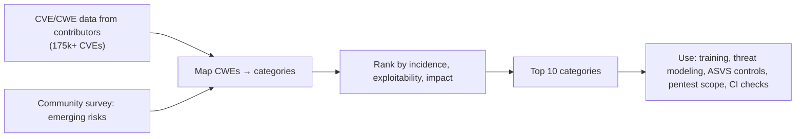

# OWASP Top 10

> [!abstract] TL;DR
> The OWASP Top 10 is the industry's consensus list of the most critical web application security risk **categories**, built from CVE/CWE data (175k+ CVEs for 2025) plus a practitioner survey.
> - **2025 edition** (8th, released November 2025):
>   1. **A01 Broken Access Control** (now includes SSRF) stays #1.
>   2. **Security Misconfiguration** jumps to #2.
>   3. **Software Supply Chain Failures** is new at #3.
>   4. Cryptographic Failures.
>   5. Injection.
>   6. Insecure Design.
>   7. Authentication Failures.
>   8. Software or Data Integrity Failures.
>   9. Logging & Alerting Failures.
>   10. **Mishandling of Exceptional Conditions** is new.
> - **How to use it**: as an awareness and checklist baseline, not a standard. For verifiable requirements, use **ASVS**.

## Introduction
- **What**: an Open Worldwide Application Security Project (OWASP Foundation, non-profit) document. Editions: 2003, 2004, 2007, 2010, 2013, 2017, 2021, **2025**.
- **Why it matters**: referenced by PCI DSS, procurement checklists, pentest scopes and client security questionnaires. Malaysian banks/fintech and government RFPs often require "OWASP Top 10 compliance" evidence.
- **Siblings**: OWASP **API Security Top 10** (2023), **Top 10 for LLM Applications** (2025), **Mobile Top 10** (2024), **ASVS 5.0** (verification standard, 2025), Cheat Sheet Series, ZAP (scanner, now under Checkmarx sponsorship as "ZAP by Checkmarx").

## Core Concepts

### The 2025 list
| # | Category | Typical bugs | Key mitigations |
|---|---|---|---|
| **A01** | Broken Access Control (incl. **SSRF**) | IDOR, missing tenant checks, privilege escalation, forced browsing, CORS misconfig, SSRF to cloud metadata | Deny by default, server-side checks + RLS, ownership tests, egress allow-lists for server-side fetches |
| **A02** | Security Misconfiguration | Default creds, exposed admin/actuator/dashboards, verbose errors, open storage buckets, permissive CORS, missing headers | Hardened baselines, IaC + review, config scanning, minimal exposed surface |
| **A03** | Software Supply Chain Failures (new, broader than "vulnerable components") | Vulnerable/malicious dependencies, compromised build tools/actions, typosquats, unsigned artifacts | Lockfiles, SBOM, SCA, pinned CI actions, provenance (SLSA), minimal deps |
| **A04** | Cryptographic Failures | Plain HTTP, weak hashing (MD5/SHA1 passwords), hard-coded keys, weak randomness | TLS everywhere, Argon2id/bcrypt, KMS/secret managers, vetted libraries |
| **A05** | Injection (incl. XSS) | SQLi, NoSQLi, OS command, LDAP, template injection, XSS | Parameterized queries, output encoding, CSP, input validation (Zod) |
| **A06** | Insecure Design | No rate limits on OTP, business-logic flaws, trust boundaries missing | Threat modeling, abuse cases, secure design patterns |
| **A07** | Authentication Failures | Credential stuffing, weak reset flows, session fixation, missing MFA | Passkeys/MFA, breach checks, session hygiene (see [[Authentication & Authorization]]) |
| **A08** | Software or Data Integrity Failures | Insecure deserialization, unsigned updates, CI/CD trusting unverified artifacts | Signed artifacts, safe serializers, integrity checks |
| **A09** | Security Logging & Alerting Failures | No audit trail, no alerting on brute force, logs with secrets | Centralized logs, alerts on auth anomalies, retention, redaction |
| **A10** | Mishandling of Exceptional Conditions (new) | Fail-open error paths, unhandled exceptions leaking state, inconsistent rollback, race conditions | Fail closed, consistent error handling, transactions, timeouts |

### 2021 → 2025 changes
| 2021 | 2025 | Change |
|---|---|---|
| A01 Broken Access Control | A01 | Absorbs **A10:2021 SSRF** |
| A05 Security Misconfiguration | **A02** | Up 3 (cloud/config sprawl) |
| A06 Vulnerable & Outdated Components | **A03 Software Supply Chain Failures** | Broadened to the whole build/distribution chain |
| A02 Cryptographic Failures | A04 | Down 2 |
| A03 Injection | A05 | Down 2 |
| A04 Insecure Design | A06 | Down 2 |
| A07 Identification & Authentication Failures | A07 Authentication Failures | Renamed |
| A08 Software & Data Integrity Failures | A08 | Same |
| A09 Logging & Monitoring Failures | A09 Logging & **Alerting** Failures | Emphasis on alerting |
| A10 SSRF | **A10 Mishandling of Exceptional Conditions** | New category |

## Architecture / How It Works

- Categories are **groups of CWEs** (e.g. A01 maps 40+ CWEs), not individual bugs. Two categories in each edition come from the survey to capture risks the data underrepresents.
- Data-driven but lagging: it reflects what tools find and report. Logic/design flaws are underrepresented in CVE data.
- **Mapping to your SDLC**: requirements (ASVS level 1–3) → design review (A06) → code review + SAST (A05, A04) → dependency/SCA + CI hardening (A03, A08) → DAST/pentest (A01, A02, A07) → monitoring (A09).

## Project Structure
N/A — a risk taxonomy, not a codebase. A practical per-project security checklist mapping:
```text
SECURITY.md (per client project)
├── A01  Authz matrix (role × endpoint × tenant) + RLS tests + SSRF egress policy
├── A02  Hardening: headers, CORS, admin surfaces behind Access, no default creds
├── A03  Lockfile, Renovate, npm ci --ignore-scripts, SHA-pinned Actions, SBOM
├── A04  TLS everywhere, secrets in env/secret manager, Argon2id, rotation plan
├── A05  Parameterized queries/ORM, Zod validation, CSP, output encoding
├── A06  Threat model notes, rate limits on OTP/login/reset, business rules
├── A07  Passkeys/MFA, session config, reset flow review
├── A08  Signed images/provenance, no unsafe deserialization
├── A09  Audit logs (auth, admin, payments), alerts → n8n/Telegram
└── A10  Fail-closed defaults, global error handlers, transactional consistency
```
```http
# Baseline security headers (Next.js middleware / Nginx / Traefik)
Content-Security-Policy: default-src 'self'; script-src 'self' 'nonce-{random}'; object-src 'none'; frame-ancestors 'none'; base-uri 'self'
Strict-Transport-Security: max-age=31536000; includeSubDomains
X-Content-Type-Options: nosniff
Referrer-Policy: strict-origin-when-cross-origin
Permissions-Policy: camera=(), microphone=(), geolocation=()
```

## Use Cases
| Use case | Why it fits |
|---|---|
| Developer security training | Shared vocabulary for common risks |
| Secure code review checklists | Category-by-category review prompts |
| Pentest/DAST scoping and reporting | Findings mapped to A01–A10 |
| Client security questionnaires / RFPs (banks, GLCs, government) | Expected baseline reference |
| CI security gates | SAST/SCA/secret scanning tied to categories |
| Formal compliance certification | **Not designed for it**. Use ASVS, ISO 27001, PCI DSS |

## Pros & Cons
| Pros | Cons |
|---|---|
| Free, widely recognized, data-backed | Awareness document, not a testable standard |
| Simple shared language for devs, managers, clients | Categories are broad. "Compliant with Top 10" is ill-defined |
| Updated with real-world trends (supply chain, SSRF) | Updates every ~4 years lag fast-moving threats |
| Links to cheat sheets, ASVS, testing guides | Web-centric. APIs/LLMs/mobile need sibling lists |

## Alternatives & Peers
| Resource | Strength | Pick it when… |
|---|---|---|
| **OWASP ASVS 5.0** | Testable requirements at 3 assurance levels | Defining security requirements/acceptance criteria |
| OWASP API Security Top 10 (2023) | BOLA, BOPLA, resource consumption for APIs | [[REST API]]/[[GraphQL]] backends |
| OWASP Top 10 for LLM Apps (2025) | Prompt injection, excessive agency, data leakage | AI features / n8n AI agents |
| OWASP MASVS / Mobile Top 10 (2024) | Mobile-specific controls | Flutter/native apps |
| CWE Top 25 (MITRE) | Specific weakness ranking | SAST tuning, developer focus |
| NIST SSDF (SP 800-218) | Secure development process | Process maturity / government clients |

## Tips & Reminders
> [!tip]
> - Treat A01 as the default threat: write negative authorization tests (other tenant, lower role) for every endpoint. Use RLS in [[Supabase]].
> - Automate the cheap wins in [[CI-CD]]: secret scanning (gitleaks), SCA (npm audit/Renovate/Dependabot), SAST (Semgrep/CodeQL), container scan (Trivy).
> - Run OWASP ZAP baseline scans against staging, and do a manual pentest before launching anything handling money or PII.
> - Write down a lightweight threat model per project (assets, actors, trust boundaries, abuse cases). Half a page is fine.
> - **In ZP's stack**: include an OWASP-mapped security section in proposals/SOWs (what is and isn't in scope), which protects you contractually. Map n8n AI agents to the **LLM Top 10** (prompt injection, excessive agency) and Supabase APIs to the **API Top 10** (BOLA).

## Versions & Breaking Changes
| Edition | Released | Key changes | Notes |
|---|---|---|---|
| 2003–2010 | — | Early editions: XSS and injection dominate | Historical |
| 2013 | 2013-06 | "Using components with known vulnerabilities" added | — |
| 2017 | 2017-11 | XXE, insecure deserialization, insufficient logging added | — |
| 2021 | 2021-09 | Broken Access Control to #1. Insecure Design, Integrity Failures, SSRF added | Previous baseline |
| **2025** | 2025-11 | **Software Supply Chain Failures** (A03) and **Mishandling of Exceptional Conditions** (A10) new. SSRF merged into A01. Misconfiguration to #2 | Current. Update checklists and reports |
| ASVS 5.0 | 2025-05 | Restructured verification standard | Pair with the Top 10 |

> [!warning] Unverified — check before relying on this
> Exact final wording/order should be confirmed at https://owasp.org/Top10/ (some early coverage described a release candidate).

## Critical Issues & Gotchas
> [!danger] Real breaches map straight onto the list
> - **MOVEit Transfer SQL injection** (2023, Cl0p) → A05, with data theft from 2,000+ organizations.
> - **Log4Shell** (2021) and the **tj-actions** CI compromise (2025) → A03.
> - **React2Shell** (CVE-2025-55182, Dec 2025): unsafe deserialization in React Server Components allowed unauthenticated RCE in Next.js apps → A08/A05.
> - **Optus** (2022): an unauthenticated API exposed millions of customer records → A01.
> - **Capital One** (2019): SSRF to cloud metadata credentials → A01 (SSRF).

> [!danger] "We're OWASP compliant" is not a security guarantee
> A Top-10 checkbox exercise misses business-logic flaws, authorization gaps specific to your domain, and operational security (backups, access control to infra). Use it as a floor, back claims with ASVS-level requirements and testing evidence, and avoid promising "fully secure" in client contracts.

> [!warning] Gotchas
> - Scanners (ZAP, SAST) find A05/A02 well but rarely find A01/A06. Those need manual testing and tests.
> - SSRF in server-side features (URL previews, webhooks, PDF/image fetchers, n8n HTTP nodes with user-supplied URLs) can reach `169.254.169.254` or internal services. Block private ranges.
> - Error handling (A10): catch-all handlers that return `200 OK` or skip authorization on exceptions create fail-open paths.
> - Logging (A09): logging tokens, passwords or full card data creates a new breach vector. Redact.

## Deep Dives
- [[OWASP Top 10 - LLM & Agent Security]]
- [[OWASP Top 10 - API Security Top 10 in Practice]] — API1–API10 mapped to Supabase/Next.js/n8n, column grants, SSRF guard, OTP pumping, authz matrix

## Related
- [[Authentication & Authorization]] — A01 and A07 in depth
- [[Network Security]] — infrastructure-layer counterpart, and [[Network Security - Common Web Attacks]]
- [[JWT]] — token pitfalls (A04/A07)
- [[GraphQL]] · [[REST API]] — API-specific risks
- [[CI-CD]] — supply-chain controls (A03/A08)
- [[Supabase]] — RLS as an A01 control

## References
- OWASP Top 10 (2025): https://owasp.org/Top10/
- What changed in 2025 (Qualys): https://blog.qualys.com/qualys-insights/2026/06/15/what-changed-in-owasp-top-10-2025-and-recommendations-for-each-category
- OWASP ASVS: https://owasp.org/www-project-application-security-verification-standard/
- OWASP API Security Top 10: https://owasp.org/API-Security/
- OWASP Top 10 for LLM Applications: https://genai.owasp.org/llm-top-10/
- OWASP Cheat Sheet Series: https://cheatsheetseries.owasp.org/
