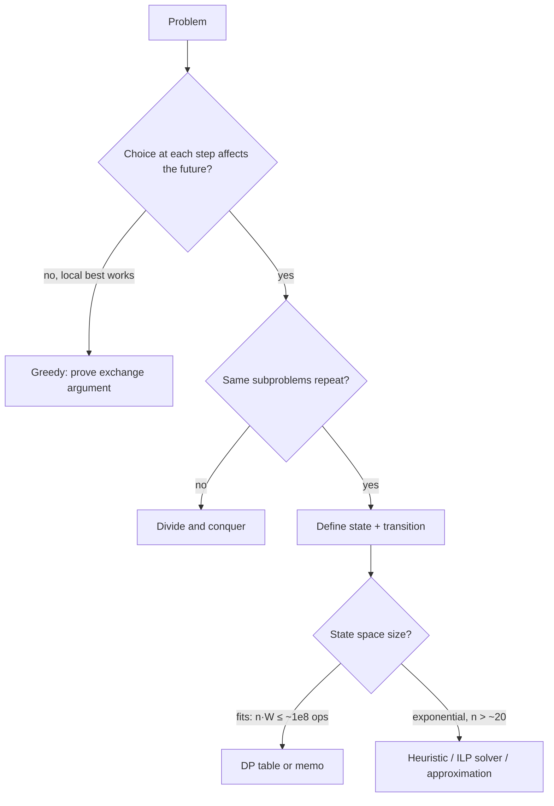

# Algorithms - Dynamic Programming Patterns

> [!info] Deep dive of [[Algorithms]]

> [!abstract] TL;DR
> DP applies when a problem has **optimal substructure** (the best answer is built from best sub-answers) and **overlapping subproblems** (the same sub-answer is needed many times).
> Recipe:
> 1. Define the **state** (what you must know to decide the rest).
> 2. Write the **transition**.
> 3. Set base cases.
> 4. Choose the order: memoized recursion (top-down) or a table (bottom-up).
> 5. Compress space if only the previous row matters.
>
> Most real-world DP in business apps is one of five shapes: knapsack/coin change, edit distance, LIS/sequence alignment, weighted interval scheduling, or small-n bitmask (routing).

## Concept
**Pattern catalog**:

| Pattern | State | Transition (sketch) | Complexity | Business use |
|---|---|---|---|---|
| 1-D linear | `dp[i]` = best up to i | `dp[i] = max(dp[i-1], dp[i-2] + v[i])` | O(n) | Non-adjacent selection, step counting |
| 0/1 knapsack | `dp[w]` = best value with capacity w | iterate items, `w` **descending** | O(n·W) | Pick promo items under a budget/weight |
| Unbounded knapsack / coin change | `dp[a]` = min coins for amount a | iterate `a` **ascending** | O(n·A) | Bundle packing, change-making with odd denominations |
| Edit distance / LCS | `dp[i][j]` over two prefixes | min of insert/delete/replace | O(n·m), space O(min) | Fuzzy name/product matching, diffing |
| LIS | `tails[k]` = smallest tail of length k+1 | binary search replace | O(n log n) | Trend runs, ordering constraints |
| Weighted interval scheduling | `dp[i]` over jobs sorted by end | `max(dp[i-1], w[i] + dp[p(i)])` | O(n log n) | Maximize booked revenue with non-overlapping slots |
| Interval DP | `dp[l][r]` | split point k | O(n³) | Optimal merges, parenthesization |
| Bitmask DP (TSP) | `dp[mask][last]` | add an unvisited node | O(2ⁿ·n²) | Exact delivery route for ≤ ~15 stops |
| Tree DP | `dp[node][state]` | combine children | O(n) | Org/category hierarchies, pick/no-pick on trees |

- **Top-down** (recursion + memo) is easy to write and computes only reachable states, but risks stack depth limits (JS ≈ 10k frames).
- **Bottom-up** (a table in dependency order) has no recursion, is easy to space-optimize, and is usually faster.

## How It Works


## Practical Usage
**Coin change / bundle packing** with reconstruction (amounts in **sen**, integers only):
```ts
export function minPacks(amount: number, packs: number[]): number[] | null {
  const INF = Number.MAX_SAFE_INTEGER;
  const dp = new Array<number>(amount + 1).fill(INF);
  const from = new Array<number>(amount + 1).fill(-1);
  dp[0] = 0;
  for (let a = 1; a <= amount; a++) {
    for (const p of packs) {
      if (p <= a && dp[a - p] + 1 < dp[a]) { dp[a] = dp[a - p] + 1; from[a] = p; }
    }
  }
  if (dp[amount] === INF) return null;
  const out: number[] = [];
  for (let a = amount; a > 0; a -= from[a]) out.push(from[a]);
  return out;                                  // e.g. packs [6, 10, 15]: 7 → null; 31 → 3 packs (15 + 10 + 6); greedy would fail on 34 (15+15+? → 6+6+6+6+10)
}
```
**Edit distance in O(min(n, m)) space** (fuzzy matching "Mohd" vs "Mohamad", Manglish typos):
```ts
export function editDistance(a: string, b: string): number {
  if (a.length < b.length) [a, b] = [b, a];
  let prev = Array.from({ length: b.length + 1 }, (_, j) => j);
  for (let i = 1; i <= a.length; i++) {
    const cur = [i];
    for (let j = 1; j <= b.length; j++) {
      cur[j] = Math.min(prev[j] + 1, cur[j - 1] + 1, prev[j - 1] + (a[i - 1] === b[j - 1] ? 0 : 1));
    }
    prev = cur;
  }
  return prev[b.length];
}
```
In Postgres, use `fuzzystrmatch.levenshtein()` for small sets, or `pg_trgm` similarity with a GIN index for search at scale.

**Weighted interval scheduling** (maximize revenue from non-overlapping bookings):
```ts
type Job = { start: number; end: number; value: number };
export function maxRevenue(jobs: Job[]): number {
  const js = [...jobs].sort((x, y) => x.end - y.end);
  const ends = js.map((j) => j.end);
  const lastCompatible = (i: number) => {          // binary search: last job ending ≤ js[i].start
    let lo = 0, hi = i - 1, ans = -1;
    while (lo <= hi) { const mid = (lo + hi) >> 1; if (ends[mid] <= js[i].start) { ans = mid; lo = mid + 1; } else hi = mid - 1; }
    return ans;
  };
  const dp = new Array<number>(js.length + 1).fill(0);
  for (let i = 0; i < js.length; i++) {
    const p = lastCompatible(i);
    dp[i + 1] = Math.max(dp[i], js[i].value + dp[p + 1]);
  }
  return dp[js.length];
}
```
**Bitmask TSP** for small delivery runs (exact up to ~15 stops; beyond that use heuristics or OR-Tools):
```python
from functools import lru_cache
def tsp(dist):                       # dist[i][j] in minutes; start at depot 0
    n = len(dist)
    @lru_cache(None)
    def go(mask, last):
        if mask == (1 << n) - 1: return dist[last][0]
        return min(dist[last][j] + go(mask | 1 << j, j) for j in range(n) if not mask & 1 << j)
    return go(1, 0)
```
**Wrong way**:
```ts
const fib = (n: number): number => (n < 2 ? n : fib(n - 1) + fib(n - 2));   // ❌ O(2ⁿ): no memo
const total = prices.reduce((s, p) => s + p * 1.06, 0);                    // ❌ float money in DP states → off-by-one-sen bugs
```

## Patterns & Anti-patterns
| Pattern | When | Anti-pattern to avoid |
|---|---|---|
| Write the state in words first ("min cost to reach amount a") | Every DP | Coding transitions before the state is clear |
| Integer units (sen, minutes) for state indices | Money, time | Floats as DP indices or keys |
| Iterate knapsack capacity **descending** for 0/1 | Each item used once | Ascending loop that silently reuses items |
| Rolling arrays for 2-D DPs that only need the previous row | Large n·m | O(n·m) memory for edit distance on long texts |
| Check whether greedy is provably optimal first | Canonical coin systems (RM notes/coins), interval scheduling unweighted | DP where greedy suffices, or greedy where it doesn't |
| Solvers (ILP, OR-Tools) for big combinatorial problems | Routing/scheduling at scale | Hand-rolled exponential DP for n = 40 |

## Performance & Trade-offs
- **State space is the cost**: n·W for knapsack. With W in sen (RM 10,000 = 1,000,000 sen) × 200 items = 2×10⁸ operations, which is borderline in JS. Scale units (round to RM) or bound W.
- **Memo key cost**: string keys like `${i},${j}` in a `Map` are slow and memory-heavy. Prefer typed arrays indexed `i * cols + j`.
- **Top-down on sparse reachable states** can beat bottom-up when only a fraction of the table is needed (e.g. bitmask DPs with pruning).
- **Approximation vs exact**: for routing or scheduling with business constraints (time windows, vehicle capacity), an exact DP explodes. A good heuristic or solver gets within a few % in milliseconds.

## Tips & Reminders
> [!tip] In ZP's stack
> - **Where DP actually shows up in SME products**:
>   - promo/bundle optimizers ("cheapest combination of packs");
>   - booking slot maximization;
>   - fuzzy matching of customer and product names across POS exports;
>   - small delivery route ordering for a single rider.
> - **Placement**: run the heavy ones in a worker (Node/Python), not in request handlers.

- Unit-test DP functions with brute force on small inputs (property-based tests). A brute force O(2ⁿ) checker catches transition bugs immediately.
- Reconstruct the actual choice (keep `from[]`/parent pointers), not just the optimal value. Users need "which packs", not "3 packs".
- In Python, `functools.lru_cache` + `sys.setrecursionlimit` is fine for prototypes; port to bottom-up for production sizes.
- For interview prep, recognize the five shapes above and practice the state definition, not memorized solutions.

## Version Notes
N/A — algorithmic concepts. Runtime notes: JS recursion depth is engine-dependent (~10k frames in V8 by default); CPython's default recursion limit is 1000 frames.

## Critical Issues & Gotchas
> [!danger] Exponential blow-up hiding in "small" inputs
> Bitmask DP at n = 25 is 2²⁵ × 25² ≈ 2×10¹⁰ operations, which will hang a request handler. Guard input sizes, set timeouts, and switch to heuristics above a threshold.

> [!danger] Floating-point money in optimization
> Using `RM 12.30` as 12.3 in DP states leads to unreachable targets (12.299999…) and wrong "optimal" bundles. Always convert to integer sen at the boundary.

- **Greedy traps**: non-canonical denominations (packs of 6, 10, 15) break greedy change-making. Verify with a DP before shipping a greedy shortcut.
- **Tie-breaking**: multiple optimal solutions exist. Make tie-breaks deterministic (prefer fewer items, then lower ID) so results are stable across runs.
- **Off-by-one in table sizes** (`n` vs `n + 1` rows) is the most common DP bug. Base cases live in index 0.

## Related
- [[Algorithms]]
- [[Algorithms - Graph Algorithms in Practice]] — shortest paths (DP on DAGs), routing heuristics
- [[Big O Notation - Amortized Analysis & Practical Complexity]] — estimating state-space cost
- [[Data Structures]] — memo tables, typed arrays, heaps
- [[PostgreSQL]] — `fuzzystrmatch`, `pg_trgm` for fuzzy matching in SQL
- [[Python]] — `lru_cache` prototypes, OR-Tools

## References
- Cormen et al., *Introduction to Algorithms* (4th ed.), ch. 14 "Dynamic Programming"
- Kleinberg & Tardos, *Algorithm Design*, ch. 6 (weighted interval scheduling, knapsack, sequence alignment)
- https://www.postgresql.org/docs/current/fuzzystrmatch.html
- https://developers.google.com/optimization/routing
