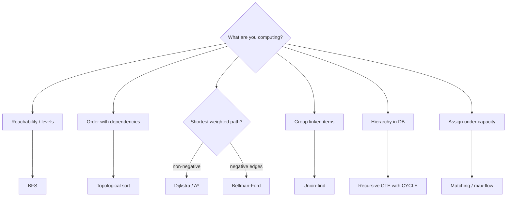

# Algorithms - Graph Algorithms in Practice

> [!info] Deep dive of [[Algorithms]]

> [!abstract] TL;DR
> Most "graph problems" in business software reduce to a handful of algorithms:
>
> | Problem | Algorithm |
> |---|---|
> | Reachability / degrees of separation | **BFS/DFS** |
> | Dependency order and parallel stages | **topological sort** |
> | Cheapest route / ETA | **Dijkstra / A\*** |
> | Grouping duplicates or linked accounts | **union-find** |
> | Org charts, referral trees, bill of materials | **recursive CTEs** in Postgres |
> | Rider ↔ order assignment | **matching / flow** |
>
> Model the graph explicitly (nodes, edges, weights), pick by edge weights and size, and keep it in **Postgres** until traversal depth or volume clearly needs a graph DB.

## Concept

### Algorithm chooser
| Need | Algorithm | Complexity | Notes |
|---|---|---|---|
| Fewest hops (unweighted) | BFS | O(V + E) | Levels = distance. Social "within 2 degrees" |
| Explore/visit all, detect cycles | DFS | O(V + E) | Recursion depth limits. Use an explicit stack for big graphs |
| Order with dependencies, detect cycles | Topological sort (Kahn/DFS) | O(V + E) | Only for DAGs. Layers give parallel stages |
| Shortest path, non-negative weights | **Dijkstra** (binary heap) | O((V + E) log V) | Travel time, cost |
| Shortest path with a good heuristic | **A\*** | ≤ Dijkstra in practice | Admissible heuristic (straight-line distance) |
| Negative weights | Bellman-Ford | O(V · E) | Detects negative cycles (arbitrage) |
| All-pairs, small V | Floyd-Warshall | O(V³) | V ≤ ~500 |
| Connected groups / dedupe | **Union-find (DSU)** | ~O(α(n)) per op | Merge customers sharing phone/email |
| Strongly connected components | Tarjan / Kosaraju | O(V + E) | Circular dependencies, fraud rings |
| Minimum spanning tree | Kruskal (DSU) / Prim | O(E log E) | Cheapest network/cabling |
| Assignment / capacity | Max-flow (Dinic), Hungarian, bipartite matching | Polynomial | Riders ↔ deliveries, staff ↔ shifts |
| Importance / ranking | PageRank / centrality | Iterative | Influencers, key accounts |

### Representations
| Representation | Memory | Good for |
|---|---|---|
| Adjacency list (`Map<node, Edge[]>`) | O(V + E) | Sparse graphs (almost all business graphs) |
| Adjacency matrix | O(V²) | Dense small graphs, Floyd-Warshall |
| Edge table in SQL (`edges(src, dst, weight)`) | Rows | Persistent graphs, recursive CTEs |
| CSR (compressed sparse row) | Compact arrays | Large static graphs, analytics |

## How It Works

- **Dijkstra** settles nodes in increasing distance using a min-heap. Once settled, a node's distance is final, which is why negative edges break it.
- **Union-find** keeps a parent pointer per element. **Path compression** plus **union by rank** make operations near-constant.
- **Recursive CTE**: anchor rows, then repeatedly join the previous level to the edge table until no new rows. It's BFS-like, executed by the database.

## Practical Usage

### Dijkstra with a binary heap (TypeScript)
```ts
type Edge = { to: string; w: number };
export function dijkstra(g: Map<string, Edge[]>, src: string) {
  const dist = new Map<string, number>([[src, 0]]);
  const prev = new Map<string, string>();
  const heap: [number, string][] = [[0, src]];                 // [distance, node]
  const push = (x: [number, string]) => { heap.push(x); let i = heap.length - 1;
    while (i > 0) { const p = (i - 1) >> 1; if (heap[p][0] <= heap[i][0]) break; [heap[p], heap[i]] = [heap[i], heap[p]]; i = p; } };
  const pop = () => { const top = heap[0], last = heap.pop()!; if (heap.length) { heap[0] = last; let i = 0;
    for (;;) { const l = 2 * i + 1, r = l + 1; let m = i;
      if (l < heap.length && heap[l][0] < heap[m][0]) m = l;
      if (r < heap.length && heap[r][0] < heap[m][0]) m = r;
      if (m === i) break; [heap[m], heap[i]] = [heap[i], heap[m]]; i = m; } } return top; };

  while (heap.length) {
    const [d, u] = pop();
    if (d > (dist.get(u) ?? Infinity)) continue;               // stale heap entry
    for (const { to, w } of g.get(u) ?? []) {
      const nd = d + w;
      if (nd < (dist.get(to) ?? Infinity)) { dist.set(to, nd); prev.set(to, u); push([nd, to]); }
    }
  }
  return { dist, prev };                                       // walk prev back from target for the path
}
```

### Union-find: merge customers sharing identifiers
```ts
class DSU {
  private p = new Map<string, string>(); private r = new Map<string, number>();
  find(x: string): string { if (!this.p.has(x)) { this.p.set(x, x); this.r.set(x, 0); }
    const px = this.p.get(x)!; if (px !== x) this.p.set(x, this.find(px)); return this.p.get(x)!; }
  union(a: string, b: string) { let x = this.find(a), y = this.find(b); if (x === y) return;
    if (this.r.get(x)! < this.r.get(y)!) [x, y] = [y, x]; this.p.set(y, x);
    if (this.r.get(x) === this.r.get(y)) this.r.set(x, this.r.get(x)! + 1); }
}
// For each contact record: union(recordId, "phone:"+phone), union(recordId, "email:"+email)
// find(recordId) → cluster id = one real customer across WhatsApp, web orders, POS
```

### Topological layers (parallel stages for a DAG runner)
```ts
export function layers(deps: Map<string, string[]>): string[][] {     // deps: node → prerequisites
  const indeg = new Map<string, number>(), out = new Map<string, string[]>();
  for (const [n, pre] of deps) { indeg.set(n, (indeg.get(n) ?? 0) + pre.length);
    for (const p of pre) { if (!indeg.has(p)) indeg.set(p, 0); out.set(p, [...(out.get(p) ?? []), n]); } }
  let frontier = [...indeg].filter(([, d]) => d === 0).map(([n]) => n);
  const result: string[][] = []; let seen = 0;
  while (frontier.length) {
    result.push(frontier); seen += frontier.length;
    const next: string[] = [];
    for (const n of frontier) for (const m of out.get(n) ?? []) { indeg.set(m, indeg.get(m)! - 1); if (indeg.get(m) === 0) next.push(m); }
    frontier = next;
  }
  if (seen !== indeg.size) throw new Error("cycle detected");           // reject invalid workflow definitions
  return result;                                                        // each inner array can run in parallel
}
```

### Hierarchies in Postgres (recursive CTE + cycle protection)
```sql
-- Referral tree / org chart / bill of materials
with recursive tree as (
  select id, referred_by, name, 0 as depth
  from customers where id = $1
  union all
  select c.id, c.referred_by, c.name, t.depth + 1
  from customers c join tree t on c.referred_by = t.id
  where t.depth < 10                                      -- hard depth cap
) cycle id set is_cycle using path                        -- PG14+: stops on loops in bad data
select * from tree where not is_cycle order by depth;
```
- For road-network shortest paths in SQL, **pgRouting** (`pgr_dijkstra`) runs on PostGIS data. For delivery route optimisation (multi-stop TSP/VRP), use OR-Tools or a routing API, not hand-rolled algorithms.

## Patterns & Anti-patterns
| Pattern | When | Anti-pattern to avoid |
|---|---|---|
| Adjacency lists + Map/Set visited | In-memory graphs | Arrays with `includes()` for visited (O(n²)) |
| Recursive CTE with depth cap + CYCLE | Trees in Postgres | Unbounded recursion on data that may contain loops |
| Union-find for identity clustering | Customer dedupe, linked accounts | Pairwise comparisons of all records (O(n²)) |
| Topological sort with cycle detection | Workflow/migration runners | Executing steps in insertion order and hoping |
| Dijkstra/A* for weights, BFS for hops | Routing, recommendations | Dijkstra on unweighted graphs (BFS is simpler and faster) |
| Graph DB only after measuring | Deep, ad hoc traversals at scale | Adding Neo4j for a 3-level referral tree |

## Performance & Trade-offs
- **Graph size reality**: millions of edges fit in memory on one Node process (adjacency maps ~100–200 bytes/edge). Beyond that, use CSR arrays, a graph DB, or batch processing.
- **Postgres vs graph DB**:
  - **Postgres** recursive CTEs handle depth ≤ ~5–10 on indexed edge tables well.
  - **Graph DBs** (Neo4j, Memgraph, Apache AGE extension) shine for deep, variable-length traversals and graph analytics. The cost is another system to run and sync.
- **Heap implementation**: JavaScript has no built-in priority queue. A binary heap is fine, and a pairing/Fibonacci heap is rarely worth it.
- **Recursion limits**: recursive DFS overflows the stack on deep graphs (~10k frames in JS). Use explicit stacks.

## Tips & Reminders
> [!tip]
> - **Store edges with tenant IDs** and index `(tenant_id, src)` and `(tenant_id, dst)` for bidirectional traversal ([[PostgreSQL]]).
> - **Cache derived results** (cluster IDs, shortest-path tables) and recompute incrementally when edges change, rather than per request.
> - **Visualise** with Mermaid or Graphviz to debug workflow DAGs and dependency cycles.
> - **In ZP's stack**:
>   - **Workflows and referrals**: topological layers for custom workflow runners (n8n-like DAGs), recursive CTEs for referral/loyalty trees in Supabase.
>   - **Identity**: union-find to merge WhatsApp/web/POS customer identities.
>   - **Delivery**: PostGIS KNN plus a routing API for "nearest outlet" and delivery ETAs.

## Version Notes
N/A: classical algorithms. Tooling notes:
- **PostgreSQL 14+** adds the `SEARCH` and `CYCLE` clauses for recursive CTEs.
- **pgRouting 3.x** provides `pgr_dijkstra`/`pgr_aStar` on PostGIS.
- **Apache AGE** adds openCypher to Postgres (check managed-provider availability).

## Critical Issues & Gotchas
> [!danger] Cycles in "trees"
> Real data contains loops: a customer referring themselves via a second account, a manager loop after a data import, circular task dependencies. Unprotected recursive queries or DFS then run until timeout or stack overflow, taking the database or worker down. Always use cycle detection (`CYCLE`, visited sets) and depth caps.

> [!danger] Dijkstra with negative or changing weights
> Using Dijkstra with negative edges (discounts modelled as negative costs, arbitrage) silently returns wrong answers. Weights changing during computation (live traffic) give inconsistent paths. Use Bellman-Ford for negatives and snapshot weights per computation.

> [!warning] Gotchas
> - BFS from a high-degree "celebrity" node explodes the frontier. Cap depth/fan-out, or sample.
> - Union-find merges are transitive: one bad shared identifier (a shop's landline used by many customers) merges thousands of people. Exclude generic identifiers.
> - Floating-point weights accumulate rounding error, so compare with tolerance, or use integer units (seconds, sen).
> - Directed vs undirected mistakes: insert both directions for undirected graphs, or traversals miss nodes.

## Related
- [[Algorithms]]
- [[Data Structures]] — heaps, hash maps, adjacency structures
- [[Big O Notation]] — complexity analysis
- [[PostgreSQL]] — recursive CTEs, PostGIS, pgRouting
- [[System Design]] — when to add a graph store
- [[Data Structures - Probabilistic Data Structures]] — sketches for large-graph analytics

## References
- CLRS, Introduction to Algorithms (graph chapters): https://mitpress.mit.edu/9780262046305/introduction-to-algorithms/
- PostgreSQL WITH queries (SEARCH/CYCLE): https://www.postgresql.org/docs/current/queries-with.html
- pgRouting docs: https://docs.pgrouting.org/
- Red Blob Games, A* introduction: https://www.redblobgames.com/pathfinding/a-star/introduction.html
- Google OR-Tools routing: https://developers.google.com/optimization/routing
